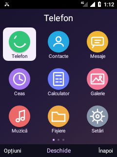
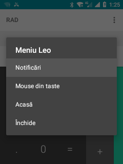
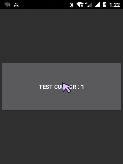
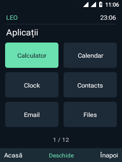
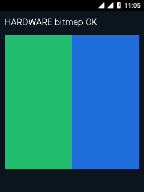
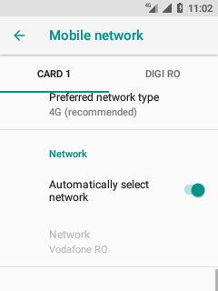
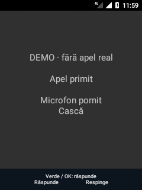
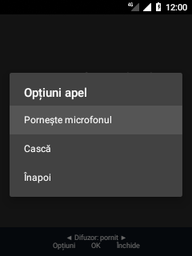

# Nokia 6300 4G TA-1286 — Android 8.1 / Leo

Port experimental **AOSP Android 8.1** pentru Nokia 6300 4G, cu interfață nativă pentru tastatura fizică, accelerare Adreno și adaptarea componentelor Qualcomm din sistemul original KaiOS.

**Actualizat: 19 octombrie 2026.** Android rulează din memoria internă. Meniul Leo, datele LTE și redarea audio funcționează în probele efectuate. Un apel primit real a fost confirmat pe telefon: ecran complet, răspuns și închidere din taste, conversație audibilă în ambele sensuri.

Proiectul rămâne un prototip de dezvoltare: există un ANR cunoscut la pornire, componente hardware neintegrate și aplicații instabile. Repository-ul conține surse, patch-uri și documentație; **nu oferă un ROM complet instalabil**.

## Platformă și abordare

| Componentă | Configurație utilizată |
| --- | --- |
| Telefon țintă | Nokia 6300 4G **TA-1286**, produs `leo` |
| Sistem | AOSP `android-8.1.0_r81`, produs `aosp_leo_go-eng` |
| Arhitectură | ARMv7, userspace și Binder pe 32 de biți |
| Kernel | Kernel stock `4.9.240-perf-g4f9e270fd77f` |
| Ecran | 240 × 320, panou SPI, ieșire RGB565 |
| GPU | Qualcomm Adreno 304, GLES 3.0 |
| Profil de memorie | `ro.config.low_ram=true`, zRAM de aproximativ 256 MiB |
| Stocare sistem | Memorie internă: `/system` aproximativ 800 MiB, `/data` aproximativ 2,3 GiB |
| Interfață principală | Leo Shell nativ, D-pad și taste soft |
| Servicii Google | Nu sunt incluse; configurația Go nu reprezintă certificare Android Go |

Portul păstrează kernelul și componentele hardware necesare din sistemul original, adaptându-le la frameworkul Oreo. Launcherul nu folosește WebView. Grafica folosește Adreno, gralloc ION adaptat și un bridge HWC1 pentru panoul SPI. Telefonia folosește două instanțe RIL și serviciile Qualcomm integrate în init.

## Tabelul funcțiilor

Starea descrie **probele efectuate**, nu toate scenariile posibile de utilizare.

- **Funcțional** — operația descrisă a trecut pe telefon, în limitele menționate.
- **Parțial** — doar o parte este verificată sau există o problemă cunoscută.
- **Nefuncțional** — proba documentată a eșuat ori componenta nu este integrată.
- **Netestat** — nu avem încă o probă suficientă pentru un verdict.
- **Experimental** — rezultat obținut într-o probă temporară, neactivat permanent.

### Sistem, interfață și stocare

| Funcție | Stare | Ce am verificat / limită |
| --- | --- | --- |
| Android pe memoria internă | **Funcțional** | `/system` read-only, `/data` read-write; sistemul nu mai depinde de cardul SD. |
| Pornire și repornire | **Parțial** | Android și serviciile revin după reboot; ANR-ul NetworkPolicy poate necesita „Așteaptă”. |
| USB / ADB / root | **Funcțional** | Diagnostic, instalare și control din PC; s-au observat și întreruperi USB temporare. |
| Leo Shell | **Funcțional** | Meniu nativ, listă de aplicații, navigare și etichete pentru tastele soft. |
| Tastatură fizică / D-pad | **Funcțional** | Mapare adaptată și confirmări pe telefon; aplicațiile Android nu sunt toate adaptate la taste. |
| Introducere text T9 / multi-tap completă | **Nefuncțional** | Nu există încă o implementare completă pentru utilizare generală. |
| Bară de stare Android | **Funcțional** | Vizibilă împreună cu Leo Shell; nu confirmă singură funcționarea fiecărui serviciu afișat. |
| Accelerare Adreno | **Funcțional** | Renderer Qualcomm și test Android HARDWARE bitmap verificate, inclusiv după reboot. |
| Fluiditate generală | **Parțial** | Sincronizarea HWC1 a fost corectată; limitele panoului SPI și întârzierile unor aplicații rămân. |
| Profil pentru memorie redusă | **Funcțional** | `low_ram` și zRAM verificate software; nu înseamnă că orice aplicație rulează fluent. |
| Baterie / alimentare USB | **Parțial** | Nivel, tensiune, temperatură și alimentare citite; autonomia și ciclul complet de încărcare sunt netestate. |
| Card microSD / MTP | **Netestat** | Nu avem o probă completă de utilizare și transfer pentru aceste funcții. |

### Telefonie, sunet și conectivitate

| Funcție | Stare | Ce am verificat / limită |
| --- | --- | --- |
| Modem și două SIM-uri | **Funcțional** | Ambele SIM-uri READY și ambele sloturi înregistrate pentru voce, inclusiv după reboot. |
| Date mobile LTE / 4G | **Funcțional** | SIM 1: conexiune Android validată și două răspunsuri ping externe după reboot. Nu confirmă datele pe SIM 2 sau toate rețelele/APN-urile. |
| Setări rețea mobilă / opțiune 4G | **Funcțional** | Pagina și taburile SIM verificate; opțiunea LTE este expusă. Statisticile de trafic indisponibile sunt dezactivate. |
| Ecran de apel pentru taste | **Funcțional** | Apelul primit deschide interfața completă; răspunsul și închiderea din taste au fost confirmate pe apel real. |
| Apel primit și audio în ambele sensuri | **Funcțional** | Un apel real a trecut: ringing → off-hook → idle; utilizatorul confirmă conversația în ambele sensuri. Nu validează toate SIM-urile sau rutele audio. |
| Apel inițiat de pe Nokia | **Netestat** | Deschiderea Dialer nu confirmă efectuarea unui apel către rețea. |
| Respingere apel real / apel în așteptare / conferință | **Netestat** | Respingerea a trecut în simulare; scenariile reale necesită probe separate. |
| Tasta roșie | **Parțial** | Mapată ENDCALL; revenirea Acasă în repaus a fost verificată prin codul fizic. Apelul real a fost închis cu soft dreapta. |
| DTMF, microfon mut, difuzor și volum în apel | **Parțial** | Comenzi implementate; DTMF și comutările microfon/difuzor au trecut în simulare. Transportul DTMF și toate efectele audio în apel real sunt netestate. |
| SMS / MMS | **Netestat** | Nu avem mesaje reale trimise/primite confirmate; auditul inițial nu avea o aplicație SMS dedicată. |
| Difuzor / AudioTrack | **Funcțional** | Bipuri prin HAL-ul Qualcomm, confirmate auditiv înainte și după reboot. |
| MediaPlayer / fișiere OGG | **Funcțional** | Decodorul Vorbis și configurația codec corectate; redare OGG confirmată auditiv. Nu validează toate formatele sau aplicațiile media. |
| Microfon în convorbire | **Funcțional** | Confirmat prin conversația în ambele sensuri; înregistrarea audio separată nu este testată. |
| Căști / alte rute audio | **Netestat** | Fără validare completă pentru accesorii și schimbarea rutelor. |
| Client IMS | **Experimental** | Port compilat, cu înregistrare IMS voce pe SIM 1 într-o probă controlată. Activarea a fost retrasă; nu pornește automat. |
| VoLTE | **Netestat** | Înregistrarea IMS nu dovedește un apel VoLTE; apelul primit reușit nu a fost identificat ca VoLTE. |
| VoWiFi | **Nefuncțional** | Neintegrat; Wi-Fi nu este încă operațional. |
| Wi-Fi | **Nefuncțional** | Fără scanare/conectare confirmată; auditul a găsit stare hardware unknown și lipsa interfeței WLAN. |
| Bluetooth | **Nefuncțional** | Activarea eșuează din cauza serviciului HCI lipsă; procesul se închide. |
| Hotspot | **Netestat** | Nu există o probă de partajare a conexiunii. |

### Aplicații și alte componente hardware

| Funcție | Stare | Ce am verificat / limită |
| --- | --- | --- |
| Setări Android | **Parțial** | Se deschide după corecții; unele categorii nu au suport hardware funcțional. |
| Calculator | **Funcțional** | Pornire și `2 + 2 = 4` verificate; introducerea din proba inițială a fost prin ADB. |
| Ceas / Calendar / Contacte / Fișiere | **Parțial** | Interfețele se deschid; alarmele, salvarea evenimentelor/contactelor și operațiile complete nu sunt validate. |
| Galerie / Muzică | **Parțial** | Pornire verificată; proba MediaPlayer separată nu confirmă toate funcțiile acestor aplicații. |
| Browser / WebView | **Parțial** | HTML local afișat, dar ulterior crash GPU în audit. Fără navigare stabilă pe internet validată. |
| Email | **Nefuncțional** | Se închide la pornire din cauza unei erori de resurse. |
| Cameră | **Nefuncțional** | Serviciul Android raportează zero dispozitive. |
| GPS / localizare reală | **Nefuncțional** | Fără provider GPS funcțional sau fix real confirmat. |
| Senzori Android | **Nefuncțional** | SensorService nu detectează senzori; descrie integrarea software, nu inventarul fizic. |

**Detalii despre probe:** [apeluri și taste](android81/CALL-KEYPAD.md), [LTE](android81/LTE-BRINGUP.md), [audio](android81/AUDIO-BRINGUP.md), [codec OGG și setări mobile](android81/PHONE-AUDIO-FOLLOWUP.md), [IMS](android81/IMS-PORT.md), [auditul inițial](android81/FUNCTION-AUDIT-2026-10-18.md).

## Capturi de pe telefon

### Leo Visual — interfața actuală

| Home și ambele SIM-uri | Grila de aplicații |
| --- | --- |
|  |  |

| Meniul global din tasta Meniu | Cursor controlat din taste |
| --- | --- |
|  |  |

Meniul global oferă Notificări, Mouse din taste și Acasă. Captura cursorului
arată un **ecran local de test**, unde apăsarea OK a activat butonul o dată.
Grila deschide aplicații Android existente; prezența unei iconițe nu confirmă
instalarea sau funcționarea completă a aplicației respective.

### Capturi din etapele anterioare

| Leo Shell | Setări | Înregistrare în rețea |
| --- | --- | --- |
|  |  |  |

| Meniu cu Adreno | Test HARDWARE bitmap | Setări LTE |
| --- | --- | --- |
|  |  |  |

| Demonstrație apel primit | Opțiuni controlabile din taste |
| --- | --- |
|  |  |

Capturi reale ale ecranului de 240 × 320. Cele două capturi de apel provin din **simularea locală**, nu din conversația reală; validarea apelului real este documentată separat. Capturile inițiale pot avea ceasul nesincronizat.

## Investigație: interfață alternativă inspirată de KaiOS

Dump-ul KaiOS 2.5.4 conține 64 de intrări de aplicații și 63 de pachete locale.
Am inventariat shell-ul, permisiunile, API-urile specifice și declarațiile de
servicii. Acestea nu sunt încă portate ca ansamblu în Android.

Vezi [inventarul complet](android81/KAIOS-UI-INVENTORY.md) și
[planul pentru interfață și aplicații](android81/KAIOS-ALTERNATIVE.md).
Analiza nu a modificat sistemul de pe telefon.

Primul [prototip Leo Visual](android81/VISUAL-SHELL.md) este acum instalat separat:
home, stare pentru ambele SIM-uri și grilă 3×3 controlată din taste. Deschide
aplicațiile Android existente; nu reprezintă încă portarea aplicațiilor KaiOS.
Leo Visual este acum HOME implicit, cu acces la notificări din prima pagină și
mouse opțional din taste. Tasta dedicată Meniu deschide comenzile globale și
din alte aplicații. Leo clasic a fost dezinstalat pentru utilizatorul activ.

## Ce am adaptat

- **Pornire și stocare:** trecerea de la probele inițiale la rularea din memoria internă.
- **Grafică:** integrarea Adreno/ION/HWC1, păstrând afișarea SPI RGB565.
- **Interfață:** Leo Shell nativ, mapare de taste și bară pentru acțiunile softkeys.
- **Telefonie:** servicii Qualcomm, sincronizarea celor două RIL-uri și date LTE.
- **Audio:** HAL Qualcomm, module/calibrări necesare și configurația codec pentru OGG.
- **Apeluri:** comenzi fizice și deschiderea directă a ecranului complet la apel primit.
- **Compatibilitate Oreo:** corecții pentru Setări, statistici de trafic absente și portul experimental IMS.

Corecția DispSync/HWC1 a redus mediana **tastă → începutul desenării** de la aproximativ **1005 ms la 18 ms**, în două probe de câte 16 apăsări. Nu este latența optică până la afișarea pe panou și nu reprezintă un test FPS. [Metodă și limite](android81/UI-LATENCY.md).

## Structura repository-ului

```text
android81/
  device/nokia/leo/    Configurație AOSP, init, keylayout și componente native
  shell/               Sursele launcherului Leo
  call-ui/             Comenzi pentru apeluri și demonstrația fără apel real
  audio-runtime/       Inițializare și integrare audio
  radio-runtime/       Inițializare și integrare radio
  screenshots/         Capturi selectate pentru documentație
  *.py, *.sh, *.ps1    Patch-uri, compilare, instalare și verificare
analysis/              Unelte pentru analiza dump-ului
kaios31/               Investigația unui sistem KaiOS donator
```

## Compilare și reproducere

Mediul existent folosește Windows + WSL, distribuția `kaios`, Java 8 și arborele AOSP separat din `/root/android81-leo/src`. Arborele AOSP nu este copiat în acest repository. Patch-urile și configurațiile portului sunt păstrate aici.

Fluxul de lucru este: pregătirea surselor și intrărilor locale, aplicarea patch-urilor, compilarea componentei, verificarea rezultatului, apoi instalarea controlată pe telefonul țintă. Scripturile conțin căi și verificări specifice mediului de dezvoltare și aparatului testat; clonarea repository-ului singură nu reproduce toate intrările necesare.

| Subiect | Documentație |
| --- | --- |
| Pregătire inițială / istoric | [android81/README.md](android81/README.md) |
| Rezultate și evoluție | [STATUS.md](android81/STATUS.md), cu cele mai noi rezultate la început |
| Grafică Adreno și revenire la rendererul anterior | [ADRENO-INTEGRATION.md](android81/ADRENO-INTEGRATION.md) |
| Măsurarea întârzierii interfeței | [UI-LATENCY.md](android81/UI-LATENCY.md) |
| Radio și date LTE | [RADIO-BRINGUP.md](android81/RADIO-BRINGUP.md), [LTE-BRINGUP.md](android81/LTE-BRINGUP.md) |
| Sunet și codec-uri | [AUDIO-BRINGUP.md](android81/AUDIO-BRINGUP.md), [PHONE-AUDIO-FOLLOWUP.md](android81/PHONE-AUDIO-FOLLOWUP.md) |
| Interfață de apel, compilare și probe | [CALL-KEYPAD.md](android81/CALL-KEYPAD.md) |
| Port IMS și limitele probei | [IMS-PORT.md](android81/IMS-PORT.md) |

Nu sunt incluse dump-uri complete, kernelul precompilat, binare proprietare, imagini generate, APK-uri compilate, chei ADB sau date private. Acestea rămân locale; jurnalele brute nu sunt publicate. Nu există aici un pachet universal de flash, o instalare OTA sau o procedură validată pentru alte variante Nokia.

## Următoarele verificări și lucrări

1. Apeluri inițiate de pe Nokia, respingere reală, ambele SIM-uri și repetarea probelor audio.
2. DTMF către rețea, microfon mut, difuzor și accesorii în convorbire reală.
3. SMS și introducere text T9 / multi-tap potrivită tastaturii fizice.
4. Rezolvarea ANR-ului de pornire și stabilizarea aplicațiilor/WebView.
5. Integrarea Wi-Fi, Bluetooth, camerei și localizării.
6. Continuarea IMS, cu probe separate pentru VoLTE și VoWiFi după îndeplinirea dependențelor.

Tabelul de mai sus este rezumatul curent. Documentele mai vechi păstrează rezultatele etapelor respective și pot descrie blocaje rezolvate ulterior. Istoricul Git începe de la inițializarea repository-ului; experimentele anterioare nu au commit-uri retroactive.
