# [DEV] Android 8.1 port + KeyShell

<p align="center">
  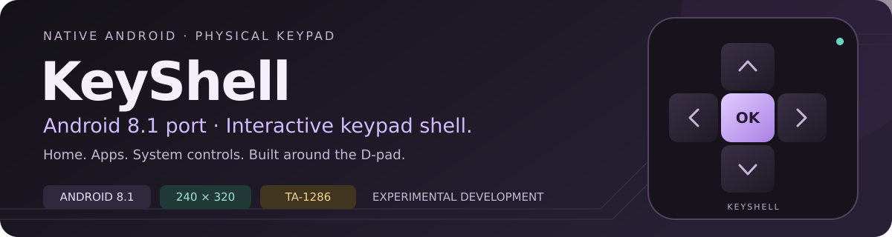
</p>

<p align="center">
  <b>Nokia 6300 4G · TA-1286</b><br>
  <code>AOSP 8.1 / API 27</code> · <code>240 × 320</code> · <code>ARMv7</code> · <code>0.14.0-dev</code><br>
  <sub>Development snapshot · 27 November 2026</sub>
</p>

<p align="center">
  <a href="#screenshots">Screenshots</a> ·
  <a href="#what-works">Working features</a> ·
  <a href="#known-issues">Known issues</a> ·
  <a href="#installation-and-recovery">Install / downloads</a> ·
  <a href="#changelog">Changelog</a> ·
  <a href="#roadmap">Roadmap</a> ·
  <a href="#building-keyshell">Build</a>
</p>

**An experimental Android 8.1 port for a physical-key phone, with an interactive
native shell: KeyShell.** Android supplies the device services and application
runtime. KeyShell brings the dashboard, launcher, Settings, everyday apps and
system controls together around the D-pad, OK, number keys and two softkeys.
**N0d3** is the wider project; **KeyShell** names its interactive Android shell.

The reference handset boots Android and runs this interface on its real
**240 × 320 non-touch display**. The project includes device integration,
framework/SystemUI adaptations, a physical-keyboard IME, recovery/build tooling
and the shell itself. Selected Mozilla Gaia artwork gives the UI its colorful
feature-phone character; the apps use native Android views and Canvas.

> **Development status:** installed and tested on the project's Nokia 6300 4G
> TA-1286. Individual ROM packages have their own validation dates. Nokia 8000
> compatibility and a general release for other variants remain unverified.

<a id="leo-în-imagini"></a>
<a id="screenshots"></a>

## On the actual phone

**The original 24-screen showcase was captured on the TA-1286 on 23 November;
Messages was refreshed on 24 November and launcher folders on 25 November.** Select an image for its
original 240 × 320 version. The following are rendered by the installed app on
the phone, with Romanian UI selected. English UI is also available.
Weather, unread counts, SMS/call examples and the music player use
local demonstrations. Radio is shown idle; Terminal executes a real local
`uname -m`; the graphical browser loads an app-owned loopback page.

| Home dashboard | App launcher | Settings |
| :---: | :---: | :---: |
| <a href="android81/screenshots/showcase-2026-11-23/home.png">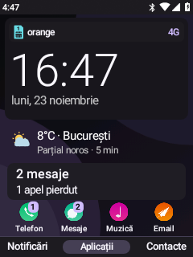</a> | <a href="android81/screenshots/launcher-folders-2026-11-25/menu-tools.png"></a> | <a href="android81/screenshots/showcase-2026-11-23/settings.png">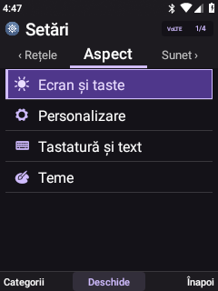</a> |

| Digital standby | Audio player · demo | Internet radio · idle |
| :---: | :---: | :---: |
| <a href="android81/screenshots/showcase-2026-11-23/standby.png">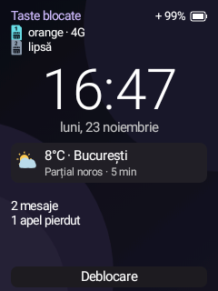</a> | <a href="android81/screenshots/showcase-2026-11-23/music-demo.png">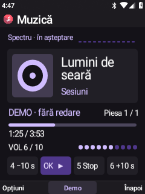</a> | <a href="android81/screenshots/showcase-2026-11-23/internet-radio-idle.png">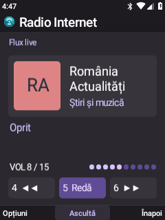</a> |

<details>
<summary><b>Open the full gallery — communication, web, tools and appearance</b></summary>

### Communication and system access

| SMS · local demo | Call screen · local demo | Dedicated global Menu |
| :---: | :---: | :---: |
| <a href="android81/screenshots/messages-ui-2026-11-24/conversations.png"></a> | <a href="android81/screenshots/showcase-2026-11-23/call-demo.png">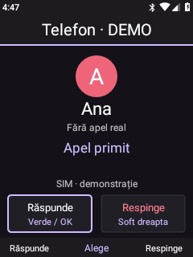</a> | <a href="android81/screenshots/showcase-2026-11-23/global-menu.png">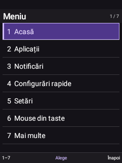</a> |

### Web and daily tools

| Browser hub | Graphical page · local | Terminal · real command |
| :---: | :---: | :---: |
| <a href="android81/screenshots/showcase-2026-11-23/browser-hub.png">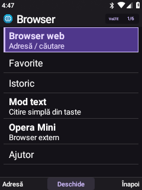</a> | <a href="android81/screenshots/showcase-2026-11-23/browser-local.png">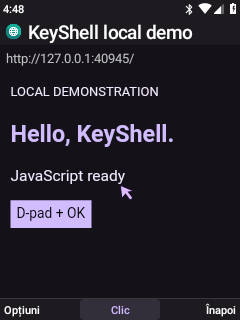</a> | <a href="android81/screenshots/showcase-2026-11-23/terminal.png">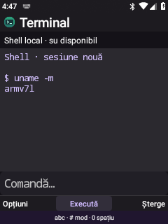</a> |

| Files · owned fixture | Gallery · Gaia samples | Recorder · idle |
| :---: | :---: | :---: |
| <a href="android81/screenshots/showcase-2026-11-23/files-fixture.png">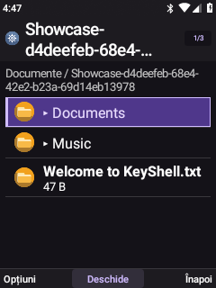</a> | <a href="android81/screenshots/showcase-2026-11-23/gallery-fixture.png">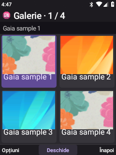</a> | <a href="android81/screenshots/showcase-2026-11-23/recorder-idle.png">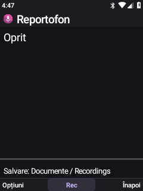</a> |

| Clock | Calculator | Seven-day weather · fixture |
| :---: | :---: | :---: |
| <a href="android81/screenshots/showcase-2026-11-23/clock.png">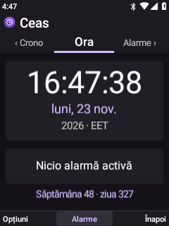</a> | <a href="android81/screenshots/showcase-2026-11-23/calculator.png">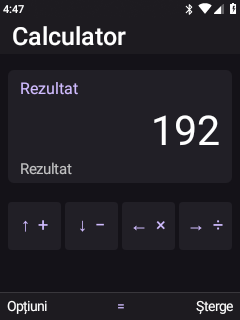</a> | <a href="android81/screenshots/showcase-2026-11-23/weather-week.png">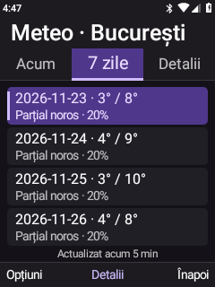</a> |

### One style choice for Home and standby

| Minimal Home | High-contrast Home | Home configuration |
| :---: | :---: | :---: |
| <a href="android81/screenshots/showcase-2026-11-23/home-minimal.png">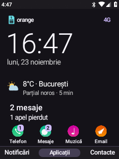</a> | <a href="android81/screenshots/showcase-2026-11-23/home-contrast.png">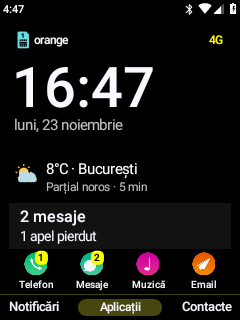</a> | <a href="android81/screenshots/showcase-2026-11-23/home-settings.png">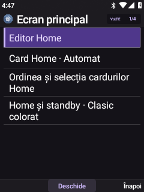</a> |

| Minimal standby | High-contrast standby | Current weather · fixture |
| :---: | :---: | :---: |
| <a href="android81/screenshots/showcase-2026-11-23/standby-minimal.png">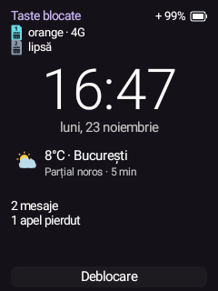</a> | <a href="android81/screenshots/showcase-2026-11-23/standby-contrast.png">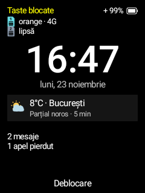</a> | <a href="android81/screenshots/showcase-2026-11-23/weather-current.png">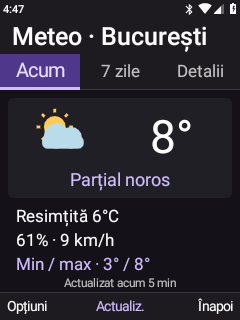</a> |

</details>

[Capture method and evidence](android81/SHOWCASE-2026-11-23.md) ·
[Home/standby details](android81/HOME-STANDBY-UI.md) ·
[Earlier device atlas](archive/screenshots/atlas-2026-11-13/README.md)

## At a glance

| Project layer | What is here |
| --- | --- |
| **Android port** | AOSP `android-8.1.0_r81`, low-RAM product, stock-derived Linux 4.9, Qualcomm msm8909 / Adreno 304 and adapted device services |
| **Interactive shell** | Home, app grid/list, contextual cards, Settings, global menu, notifications, pointer and native daily apps |
| **Physical input** | D-pad/softkeys, multi-tap, Romanian T9, personal dictionary and keypad adaptations for Android screens |
| **Current catalog** | **50 stable destinations**: 36 available in the full launcher and 14 contextual or Settings entries; some share an app implementation |
| **Appearance** | 18 palettes, per-app themes, Gaia icons/wallpapers, adjustable text and three shared Home/standby presets |
| **Delivery** | Source, signed app builders, versioned app bundles, recovery/ROM packaging and dated hardware reports |

The 23 November screenshot snapshot is based on [`3425f78`](https://github.com/smp971/nokia-6300-android81/commit/3425f7871c5d9295bcf616b854372bdce8abd750).
The [capture report](android81/SHOWCASE-2026-11-23.md) identifies the exact APK and
which scenes use demonstration data.

<a id="ce-poți-face-deja"></a>
<a id="tabelul-funcțiilor"></a>

## What works

**Evidence matters:** **Device** refers to a recorded handset check; **Local**
uses an owned fixture or demonstration; **Partial** identifies an incomplete
hardware or compatibility area. The capture session is a UI record, not a new
carrier, audio or endurance test. Linked reports preserve dates and limits.

The [24 November integration update](android81/KEYSHELL-NETWORK-SIP.md) adds real-state
VoLTE/Internet badges, a separate keypad-operated Android KaiSIP port, and
OK → star as an alternative unlock sequence. KaiSIP now registers with a PBX
and establishes an outgoing test call; voice audibility and incoming calls
still need confirmation. A legacy WebRTC compatibility fix is included. An intermittent
duplicate-key report remains under diagnosis.

| SIM badges · device canvas fixture | KaiSIP · unconfigured on device |
| :---: | :---: |
| <a href="android81/KEYSHELL-NETWORK-SIP.md">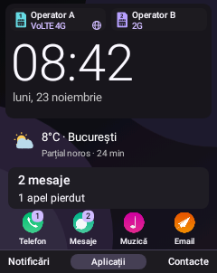</a> | <a href="android81/KEYSHELL-NETWORK-SIP.md"></a> |

The [Messages UI refresh](android81/MESSAGES-UI.md) adds Conversations / Drafts /
Archive tabs, recycled contact cards, clearer message bubbles and a themed editor.
It retains SMS/draft data and the existing send/confirmation workflow.

The [launcher folders update](android81/LAUNCHER-FOLDERS.md) reduces the default
main menu from 35 to 18 entries. Tools, Organizer, Media, Internet and Advanced
collect secondary apps; Phone, Messages and the other core apps stay direct.
Use **Options → Move to folder** to change an app’s location. Flat-menu mode and
all existing shortcuts remain available.

| Tools | Organizer | Internet |
| :---: | :---: | :---: |
| <a href="android81/screenshots/launcher-folders-2026-11-25/tools.png"></a> | <a href="android81/screenshots/launcher-folders-2026-11-25/organizer.png"></a> | <a href="android81/screenshots/launcher-folders-2026-11-25/internet.png">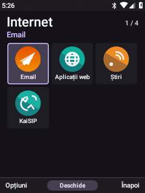</a> |

### KeyShell, controlled from your browser

The [WebUI](android81/WEBUI.md) shows the **real Nokia screen inside a keypad
handset**. Its D-pad, softkeys, digits, Call/End, Menu and Back operate the phone.
You can paste Unicode text, launch apps, manage files/themes/folders, consult
contacts/messages/history and prepare calls or SMS with explicit confirmation.
Call audio stays on Nokia.

**27 November · faster remote control:** ordered input, a reusable local helper,
adaptive frames and unchanged-image responses replace per-key process startup
and fixed display delays. The interface contains real device data after sign-in;
the offline simulator and sample catalog have been removed.
[Measurements and current build](android81/WEBUI-REMOTE-FAST.md).

<a href="android81/WEBUI.md"></a>

Enable it on Nokia from **Applications → Advanced → WebUI**. Its first row shows
its current Wi-Fi HTTPS address. The service can stay in the background and start
automatically. Native controls and browser **Administrare** provide passwords,
users, theme and feature switches. Remote input and dedicated communications
require an administrator; read-only accounts cannot access those private controls.

Device/browser checks exercise actual input, image capture, UI routes and private
API boundaries. Call/SMS dispatch uses a fake test transport; cellular establishment
and delivery from these browser pages remain live trials. The separate **keySIP**
[extension-200 trial](android81/KEYSHELL-NETWORK-SIP.md#keysip-follow-up--25-november-2026)
confirms SIP signaling, bidirectional RTP and route switches; voice audibility
still needs a listening result.

### The interactive shell and its apps

| Area | Current functionality | Evidence / boundary |
| --- | --- | --- |
| **Home and launcher** | Clock/date, real per-SIM operator and RAT, compact cached weather, automatic/manual cards, unread counts, four configurable shortcuts, five customizable launcher folders, grid/list and editable layout | **Device + Local:** current Home/standby and physical-key checks; fixture weather/counts in the gallery. [Home guide](android81/LEO-HOME.md) |
| **Standby and themes** | Digital clock, cached weather with age, alarms, unread counters, media/notification area; classic/minimal/high-contrast presets, text scaling and per-app colors | **Device + Local:** 18 palettes × three text sizes × three Home presets. Standby is an accidental-key guard. [UI refresh](android81/HOME-STANDBY-UI.md) |
| **Settings and notifications** | Six Settings tabs, native lists/forms/dialogs, app permissions, quick controls, Android notifications and a dedicated global menu | **Device:** keypad routes and selected Android screens/dialogs. Individual third-party app behavior varies. [Android integration](android81/ANDROID-KEYPAD-NAVIGATION.md) |
| **Physical text input** | Multi-tap, Romanian diacritics, Romanian T9, candidate selection, private personal dictionary and optional learned ranking | **Device + host:** editor/word fixtures and physical typing history. English UI is available; English T9 remains open. [IME](android81/KEYPAD-IME.md) · [T9 follow-up](android81/LEO-DAILY-REFINEMENTS.md) |
| **Phone, contacts and SMS** | Native dial/in-call UI, physical answer/end, contact tools, favorites, SMS conversation/editor, drafts, search and SIM markers | **Earlier Device + current Local UI:** recorded real incoming-call/audio and SMS trials; no calls/SMS in the current showcase. MMS remains absent. [Calling](android81/CALL-KEYPAD.md) · [Function inventory](android81/LEO-SHELL-AUDIT.md) |
| **Music and Internet radio** | Media library, artwork, queue/playlists, Current Media, dedicated Internet radio player, presets/custom stations and shared playback service | **Earlier Device + Local UI:** MP3/AAC stream trials and media fixtures. Current music is a silent demo and radio is idle. [Player source](android81/visual-shell/StreamRadioActivity.java) · [Pocket apps](android81/POCKET-APPS.md) |
| **FM and recorder** | Keypad tuner, seek/presets/RDS, speaker/headset controls; recorder with saved clips and quality choices | **Earlier Device + current idle UI:** FM/audio and recording checks are separate from the screenshot session. [FM](android81/FM-INVESTIGATION.md) · [Daily apps](android81/DAILY-UI-POLISH.md) |
| **Web browser** | Software-rendered WebView, visible D-pad cursor, scrolling, native address/search, text-field focus, bookmarks/history and last-page continuation | **Device + Local:** HTTP/DOM/editor tests; current local HTML capture. Old WebView limits modern-site compatibility. [Browser](android81/KEYSHELL-WEB-BROWSER.md) · [Daily use](android81/BROWSER-DAILY-USE.md) |
| **Files, gallery and reader** | Internal/microSD browsing, file actions, ZIP tools, four-thumbnail gallery, viewer and TXT/Markdown/EPUB/PDF reading | **Device + Local:** owned file/image/archive fixtures; large/corrupt media and card-removal coverage still need expansion. [Pocket suite](android81/POCKET-APPS.md) · [Daily UI](android81/DAILY-UI-POLISH.md) |
| **Clock, calendar and notes** | Alarms, world time, timer/stopwatch, local calendar/events, notes/drafts, calculator, converter and task-oriented tools | **Local + earlier Device:** calculation, scheduling and persistence checks. Calendar account synchronization is outside the local-calendar implementation. [Daily tools](android81/DAILY-TOOLS.md) |
| **Terminal and SSH/SFTP** | Local command shell, opt-in root session, command history/symbols; SSH terminal and file transfer | **Local:** actual `uname -m` in this gallery and earlier loopback SSH/SFTP fixtures. The local shell has no PTY; full-screen terminal apps have separate limits. [Pocket apps](android81/POCKET-APPS.md) |
| **Java ME and games** | Native games, launcher/JAR handoff to **J2ME Loader**, physical left/right softkeys with separate Menu and Back | **Device checked:** owned MIDlet receives `-6` / `-7`; individual games still need testing. [Keys and evidence](android81/POWER-WAKE-J2ME.md#physical-keys-in-j2me-loader) |
| **Backup and app updates** | Selective settings/app-data archives, validated schemas, interrupted-restore recovery, signed update/rollback workflow and update-journal recovery | **Local:** isolated round trips and interruption fixtures; archive versions and firmware packages remain distinct. [App bundles](android81/RELEASE-APPS.md) · [Reliability work](android81/SHELL-SIX-OPTIMIZATIONS.md) |
| **More built-in tools** | News/podcasts, dictionary/study, expenses, metronome, QR codes and contextual help | **Mixed:** local parser/storage/QR fixtures and source wiring; external providers and long sessions require their own tests. [Pocket apps](android81/POCKET-APPS.md) |

### Android and hardware integration

| Component | Recorded state | Remaining boundary |
| --- | --- | --- |
| **Boot / display / graphics** | Android boots on the reference device; stock-derived kernel, SPI RGB565 display path and Adreno 304 integration | Engineering port; presentation timing and broad graphics compatibility need continued testing. [Graphics](android81/ADRENO-INTEGRATION.md) · [Latency](android81/UI-LATENCY.md) |
| **Speaker and phone audio** | Qualcomm audio integration, speaker playback and supervised call/audio trials recorded | Earpiece/headset/Bluetooth routes, interruptions and handover need a larger repeatable matrix. [Audio](android81/AUDIO-BRINGUP.md) · [Headset](android81/WIRED-HEADSET.md) |
| **Dual SIM / LTE / IMS** | Both SIMs in standby; LTE/data and selected-slot IMS voice registration verified in dated trials | Simultaneous dual LTE/dual VoLTE is unverified. The 17 November comparison observed one LTE stack + one GSM stack on both Android and KaiOS with the tested SIM pair. [Read the modem comparison](android81/IMS-DUAL-SLOT.md#live-comparison-with-stock-kaios-17-november) |
| **Wi-Fi / hotspot** | Wi-Fi association/Internet and tethering to another phone verified; initialization survived follow-up boots | Long-duration reconnect/suspend tests remain. Radios were not toggled for the new gallery. [Connectivity](android81/CONNECTIVITY-BRINGUP.md) |
| **Bluetooth** | Earlier HID input, A2DP audio and OPP file-transfer evidence | HFP/call audio and a wider accessory matrix remain open. [Hardware inventory](android81/LEO-SHELL-AUDIT.md#shared-functions-and-hardware) |
| **Camera** | One HAL1 camera, preview and JPEG capture, including a capture after reboot | Video capture and broader HAL stability are unfinished. [Camera runtime](android81/CAMERA-RUNTIME.md) |
| **USB / storage** | ADB, microSD and file-transfer paths work in recorded tests | Intermittent USB/ADB reconnection and MTP transition validation remain open. [16 November follow-up](android81/PROJECT-AUDIT-2026-11-13.md#16-november-follow-up) |
| **GPS** | GPS/provider UI and request lifecycle are implemented | A real satellite fix has not been verified. [Inventory](android81/LEO-SHELL-AUDIT.md) |
| **Recovery / internal install / SD boot** | Native keypad recovery; exact clean-install packages verified by partition readback; dated internal/SD boot evidence | Full KaiOS restoration, EDL/QFIL flashing and SD telephony/data need further hardware validation. [Install record](android81/FLASH-FROM-STOCK.md) · [Recovery](android81/LEO-RECOVERY.md) |

## Recent system UI fixes

Android's native **Mobile network** page and **PackageInstaller** received scoped
rendering corrections on the Nokia. The installer no longer repeats confirmation
text, and its app-name header remains readable. The manifest/header fix retains
the original package identity, signer and installation decisions.

| Corrected installer · 21 November | Native permission dialog · 21 November | N0d3 boot artwork · rendered preview |
| :---: | :---: | :---: |
| <a href="android81/screenshots/installer-rendering/after.png">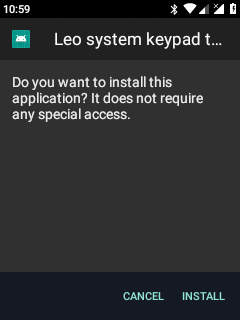</a> | <a href="android81/screenshots/installer-rendering/permission.png"></a> | <a href="android81/screenshots/keyshell-2026-11-17/boot.gif"></a> |

[Installer fix and checks](android81/PACKAGEINSTALLER-RENDERING.md) ·
[Android system UI integration](android81/ANDROID-KEYPAD-NAVIGATION.md) ·
[Boot animation](android81/BOOTANIMATION-SD.md)

<a id="known-issues"></a>

## Known issues / unfinished work

| Area | What still needs work |
| --- | --- |
| **Firmware freshness** | Package and validate a firmware kit containing the latest shell, IME and system UI fixes together. Existing firmware downloads are tied to earlier snapshots. |
| **Power / suspend** | First valid unplug trial: **4 h 22 min**, **94.9% suspended**, battery **99% → 98%**, with Opera stopped. Native screen wake: **0.34 s vs 1.64 s** on USB. Repeat longer discharge and keypad wake after prolonged unplugged suspend before claiming daily autonomy. [Recorded trial](android81/POWER-WAKE-J2ME.md#battery-trial-2026-11-23) · [Keypad wake/unlock follow-up](android81/KEYPAD-WAKE-UNLOCK.md) |
| **Modem / calling** | Broader carrier-call, DTMF, handover, Bluetooth HFP and VoWiFi checks; independent second-stack LTE/IMS evidence before any dual-VoLTE claim. |
| **USB** | Resolve the intermittent reconnect behavior and complete real MTP transition trials. |
| **Modern websites** | Assess a compatible newer WebView and repeat cursor/editor/media tests. The current selected provider is WebView 61.0.3163.98. Opera Mini is an optional external integration. |
| **Hardware completeness** | Verify a real GPS fix; finish camera video and test more camera/audio interruptions and removable-storage failures. |
| **Messaging / language** | MMS is absent. Add English T9 coverage and expand application/editor compatibility. |
| **Recovery / other devices** | Complete a verified stock-return run and recovery-only QFIL trial; validate SD radio services and investigate Nokia 8000 / other variants separately. |
| **Extended services** | WebUI HTTPS, concurrent-transfer protection and browser/device checks are implemented. Expand external email, SSH, feed, router and long-session validation. [WebUI evidence](android81/WEBUI.md). |

<a id="din-taste"></a>

## Keypad controls

| Screen | Keys | Action |
| --- | --- | --- |
| Home | **OK** with no focus | Open Applications |
| Home | **Left / Right** | Focus a shortcut, compact weather or a contextual card |
| Home | **Up / Down** | Quick Settings / notifications |
| Home | **0 / 1** | Current Media / local search |
| Home | **\* / #** | Switch / open the current card |
| Apps | **D-pad / OK** | Select / launch; left softkey opens Options |
| Apps | **\* / #** | Previous / next page |
| Shell or compatible Android screen | **Dedicated Menu** | Global menu, app switching, notifications, quick controls and optional pointer |
| Pointer | **D-pad / OK / #** | Move / click / leave pointer mode |
| Graphical browser | **D-pad / OK** | Move cursor / click; scroll at screen edges |
| Browser, outside an editor | **\* / #** | Scroll mode / cursor mode |
| Internet radio | **4 / 5 / 6** | Previous preset / play-stop / next preset |
| Standby | **Left softkey, then \*** | Complete both presses within three seconds to unlock |

The two softkey actions are visible at the bottom. Detailed instructions live
under each page's **Info / Help**. Presets are available from **Apps → Options →
Personalization → Home and standby**. [Full Home guide](android81/LEO-HOME.md)

<a id="changelog"></a>

## How the project reached this point

| Stage | Work completed | Record |
| --- | --- | --- |
| **October · Android bring-up** | Boot, display/Adreno and UI scheduling; Qualcomm audio, LTE data, Wi-Fi/BT/hotspot; physical calling/text input | [Development log](android81/STATUS.md), [graphics](android81/ADRENO-INTEGRATION.md), [connectivity](android81/CONNECTIVITY-BRINGUP.md) |
| **Late October · device services** | Camera HAL1/JPEG, selected-slot IMS integration, native recovery and a verified clean installation | [Camera](android81/CAMERA-RUNTIME.md), [IMS](android81/IMS-DUAL-SLOT.md), [flash record](android81/FLASH-FROM-STOCK.md) |
| **13–16 November · packaging and audit** | Feature atlas, signed app/ROM tooling, backup/restore follow-ups, internal installation and SD/recovery radio initialization | [Project audit](android81/PROJECT-AUDIT-2026-11-13.md), [packages](android81/GITHUB-PACKAGES.md) |
| **17 November · KeyShell identity** | N0d3 naming, Gaia artwork/wallpapers, square app tiles and subtitle, dedicated radio player, larger Settings, themes, lock screen, J2ME handoff and boot animation | [Modern UI](android81/LEO-MODERN-UI.md), [boot artwork](android81/BOOTANIMATION-SD.md) |
| **17 November · modem comparison** | Same-phone, same-SIM Android/KaiOS NAS/DMS comparison and selected-slot IMS follow-up | [Measured results](android81/IMS-DUAL-SLOT.md#live-comparison-with-stock-kaios-17-november) |
| **18–19 November · web and daily UI** | Native graphical browser, D-pad cursor, delayed web-editor focus, shared browser records, consistent files/gallery/player and keypad actions | [Browser](android81/KEYSHELL-WEB-BROWSER.md), [daily UI](android81/DAILY-UI-POLISH.md), [browser follow-up](android81/BROWSER-DAILY-USE.md) |
| **21 November · reliability** | Full text scaling on remaining pages, stable focus, incremental Quick Settings, idle work/cache handling, interrupted-update recovery and native installer artifact fix | [Six refinements](android81/SHELL-SIX-OPTIMIZATIONS.md), [installer](android81/PACKAGEINSTALLER-RENDERING.md) |
| **23 November · Home and standby** | Balanced dashboard, separate weather, explicit notification counters, shared standby styling, clearer softkeys and three presentation presets | [Implementation and validation](android81/HOME-STANDBY-UI.md) |

<a id="auditul-proiectului"></a>

## Validation snapshot

| Check | Result and scope |
| --- | --- |
| **Current shell APK** | `57e19fb585ce053c1430c858a4fb23342187fc9cfd7f20a1378110674cc6bf70` — installed data update on the reference Nokia |
| **Home / standby** | **700 checks passed** on that APK: themes/text sizes, layout separation, weather entry, hidden-element focus, preset selection, persistence and staged unlocking |
| **Existing daily UI** | **188 checks passed** on the same APK, including private Home entry, file/gallery/media/browser presentation, key release handling and screen ticker behavior |
| **Host suite** | **96 tests passed** for this documentation/tooling revision; includes seven new checks for the current catalog inventory parser |
| **Physical keys** | Five hardware navigation routes plus preset-picker open/cancel recorded for the installed shell; the new global-menu capture also uses the actual Menu scan code |
| **Fresh gallery** | **23 fixture-captured scenes + one physical-menu capture**; no calls, SMS, audio recording, stream playback or external webpage requests |
| **Build / APK audit** | 291 production Java sources compiled in the app validation; 431 external dependency classes retained, 2,252 total classes, unchanged manifest/signer and no duplicates |

Earlier USB-connected resource samples reported roughly **23.6 MiB combined
shell + IME PSS** at Home. That is a dated measurement of the preceding APK,
not a current whole-system RAM or battery-life figure. The project now stops
display-driven work while inactive, bounds image caches and handles memory trim.
[Measurement conditions and limits](android81/SHELL-SIX-OPTIMIZATIONS.md#resource-snapshots)

The current screenshot task changes documentation and capture tooling. The
installed Android port and shell APK remain the tested snapshot above.

<a id="installation-and-recovery"></a>

## Downloads, installation and recovery

| Starting point | Route | Status |
| --- | --- | --- |
| **Already on a compatible Android port** | Build signed KeyShell/Keypad APKs and use the app-update workflow | Current source and installed shell verified. [App bundles](android81/RELEASE-APPS.md) |
| **Rooted KaiOS on the exact TA-1286 reference device** | Follow the recovery-entry, backup, clean-install and post-install procedure | Exact dated packages have hardware evidence. Internal clean installation erases userdata. [Install / stock return](android81/FLASH-FROM-STOCK.md) |
| **Firmware/recovery artifacts** | Use the package index, checksums and the guide matching the specific archive | October release and later private November kits; access requirements are marked. [Package index](android81/GITHUB-PACKAGES.md) · [Releases](https://github.com/smp971/nokia-6300-android81/releases) |
| **microSD profiles** | Use the matching SD storage layout and Leo Recovery | Dated boot evidence; complete SD telephony/data validation remains open. [SD boot](android81/KAIOS-SD.md) · [Recovery](android81/LEO-RECOVERY.md) |
| **Locked stock / another phone variant** | Device-specific bring-up and recovery work first | No universal unlock, stock-signed OTA or Nokia 8000 installation is validated here |

Firmware artifacts are pinned to their own dates; update the current apps
separately. Proprietary runtime, modem/NV/persist data, private keys and personal
backups stay outside the source repository. The recovery guides explain the
exact-device prerequisites and tested post-install fixes.

<a id="architecture"></a>

## Architecture / source map

| Layer | Main sources | Responsibility |
| --- | --- | --- |
| **Android device port** | [Device tree](android81/device/nokia/leo), [reproducible source pins](android81/repro), runtime/bring-up reports | Kernel/platform configuration, display, graphics, audio, connectivity and telephony integration |
| **Interactive shell** | [visual-shell](android81/visual-shell) | `MainActivity`, `LeoHome`, app catalog, native pages, common lists/forms/tabs/dialogs and Home/standby presentation |
| **Keypad IME** | [keypad-ime](android81/keypad-ime) | Multi-tap, Romanian T9, candidate handling and text entry |
| **System input / Android UI** | [Framework keypad work](android81/framework-keypad), [system-dark](android81/system-dark), [integration guide](android81/ANDROID-KEYPAD-NAVIGATION.md) | Physical routes in Android Settings, SystemUI, notifications and system dialogs |
| **Recovery / release tooling** | [leo-recovery](android81/leo-recovery), [app releases](android81/RELEASE-APPS.md), [ROM bundles](android81/RECOVERY-BUNDLE.md) | Native recovery, device/package verification, install/update/rollback and offline artifact checks |

Common components own typography, focus, softkeys and lifecycle handling. App
destinations live in one stable registry. Android IDs `ro.leo.visual` and
`ro.leo.keypad` preserve compatible updates; the visible project identity is
**KeyShell**, part of the wider **N0d3** project. The separate SIP client is
**keySIP**; its existing package and origin preserve the owner's account.

<a id="building-leo"></a>
<a id="pentru-cei-care-vor-să-construiască"></a>
<a id="building-keyshell"></a>

## Building and checking the project

The app build uses **Java 8**, API 27, pinned dependencies and the local SDK/tool
setup described in [REBUILD](android81/REBUILD.md). The full Android port also
needs the documented device/vendor inputs. A clean full-ROM rebuild on a new PC
is a separate validation goal from the working app build.

```powershell
# Full-source Windows shell APK
python -X utf8 android81/build-pocket-apps-windows.py

# Source/manifest inventory and host checks
python -X utf8 android81/audit-leo-shell.py
python -m unittest discover -s android81/tests
```

```bash
# Shell + IME using the prepared AOSP environment
bash android81/repro/build-apps.sh
```

Device checks and the screenshot fixture are documented in the
[showcase report](android81/SHOWCASE-2026-11-23.md) and
[Home/standby report](android81/HOME-STANDBY-UI.md). They require the explicit
project handset, an idle phone and the appropriate prepared host environment.

<a id="ce-mai-avem-de-construit"></a>
<a id="roadmap"></a>

## Roadmap — next acceptance targets

### Release and everyday reliability

- [ ] Build one dated firmware kit containing the current shell/IME/system fixes;
  complete clean-install, first-boot, permissions and update/rollback checks.
- [x] Complete the first valid physical USB-unplug trial: **4 h 22 min**,
  **94.9% system suspension**, battery **99% → 98%**. [Evidence and conditions](android81/POWER-WAKE-J2ME.md#battery-trial-2026-11-23)
- [ ] Repeat longer discharge and physical keypad wake after prolonged unplugged
  suspend; extend startup, memory-pressure and longer audio/browser sessions.
- [ ] Diagnose the intermittent USB reconnect and verify real MTP transitions.
- [ ] Evaluate a newer compatible WebView and repeat cursor, editor, page-resume
  and media checks against the replacement provider.

### Hardware and compatibility

- [ ] Expand real calling/audio tests: carrier DTMF, handover, HFP and VoWiFi.
- [ ] Investigate dual LTE/IMS configurations with independent NAS/IMS evidence;
  retain the measured Android/KaiOS comparison as the baseline.
- [ ] Verify GPS acquisition; finish camera video and more interruption tests.
- [ ] Complete stock restoration and the scoped QFIL recovery trial; validate SD
  registration, voice, SMS and mobile data.
- [ ] Validate other Nokia variants, including the 8000, before advertising support.

### Apps and polish

- [ ] Extend English T9 and third-party editor/navigation coverage.
- [ ] Expand corrupt/large file, removable-card and interrupted import/restore tests.
- [x] Add authenticated phone WebUI, remote keypad/screen and concurrent-upload protection.
- [ ] Expand external-provider, PC Wi-Fi/router and long-session trials.

<a id="harta-proiectului"></a>

## Documentation and credits

[Documentation index](android81/README.md) ·
[Hardware/development log](android81/STATUS.md) ·
[Source and feature audit](android81/LEO-SHELL-AUDIT.md) ·
[Historical work and original READMEs](archive/README.md)

- **Android/AOSP and device-port references:** platform sources and the
  [Nokia Leo reference](https://github.com/ducmbuii/nokia-leo), plus the
  [kernel source reference](https://github.com/bmndc/nokia-leo); pinned projects and
  local adaptations are recorded in [repro](android81/repro) and the build guides.
- **Mozilla Gaia:** selected unmodified icons, SIM artwork and wallpapers, with
  the bundled notices and original source revision. [Icons](android81/visual-shell/assets/catalog-icons/gaia/README.md) · [Wallpapers](android81/visual-shell/assets/wallpapers/gaia/README.md)
- **Java ME:** [J2ME Loader](https://github.com/nikita36078/J2ME-Loader), installed
  separately from KeyShell.
- **Third-party components:** the per-component notices live in
  [Pocket licenses](android81/visual-shell/assets/licenses/POCKET-THIRD-PARTY.txt).

For a useful issue report, include the device variant, ROM/package date or APK
hash, exact key sequence, expected/observed behavior and whether it survives a
normal restart. Remove phone numbers, account data and identifiers from logs.
