# N0d3 KeyShell

N0d3 KeyShell is a native, keypad-first interface for Android 8.1 on phones
with physical keys and a small, non-touch display. It includes a Home dashboard,
an app launcher, Settings and everyday apps designed around the D-pad, OK and
the two softkeys. The **Nokia 6300 4G TA-1286** is the reference device.

`AOSP 8.1 · API 27` · `240 × 320` · `ARMv7` · `0.14.0-dev`

[Screenshots](#screenshots) · [Features](#what-works) · [Keypad controls](#keypad-controls) ·
[Architecture](#architecture) · [Installation](#installation-and-recovery) · [Build](#building-keyshell)

## Screenshots

On-device screenshots from the Nokia 6300 4G, captured during the November UI work.
The original gallery uses shell commit `e5b26ad`; the shared-page update below
is documented in [Leo Modern UI](android81/LEO-MODERN-UI.md).
The audio and SMS examples use the built-in demos.
The boot animation is a rendered preview. Select any thumbnail to open it at
240 × 320.

| Home dashboard | App launcher | Settings |
| :---: | :---: | :---: |
| <a href="android81/screenshots/keyshell-2026-11-17/home.png">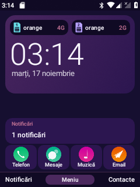</a> | <a href="android81/screenshots/keyshell-2026-11-17/apps.png">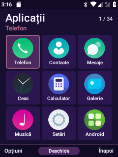</a> | <a href="android81/screenshots/keyshell-2026-11-17/settings.png">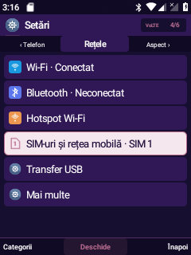</a> |

| Updated Clock | Shared keypad options | Android apps |
| :---: | :---: | :---: |
| <a href="android81/screenshots/keyshell-2026-11-17/ui-polish/clock.png">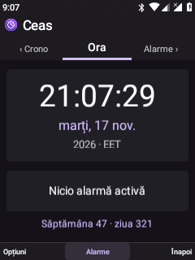</a> | <a href="android81/screenshots/keyshell-2026-11-17/ui-polish/dialogs.png">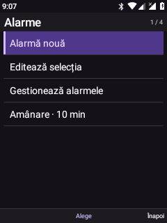</a> | <a href="android81/screenshots/keyshell-2026-11-17/ui-polish/android-apps.png">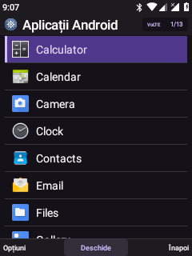</a> |

| Files · fixture | Gallery · Gaia samples | Updated player · demo |
| :---: | :---: | :---: |
|  |  | <a href="android81/screenshots/daily-ui/player.png">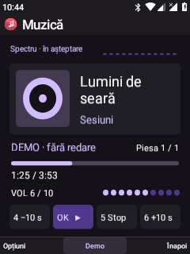</a> |

[Updated lock screen](android81/screenshots/daily-ui/lock.png) ·
[Daily UI tests and resource measurements](android81/DAILY-UI-POLISH.md)

| Audio player · demo | Internet radio | Terminal |
| :---: | :---: | :---: |
| <a href="android81/screenshots/keyshell-2026-11-17/audio-player.png">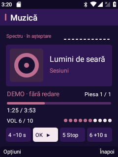</a> | <a href="android81/screenshots/keyshell-2026-11-17/radio.png">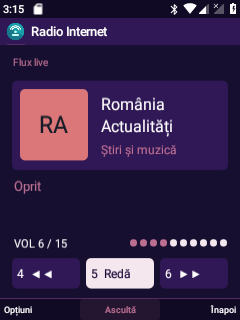</a> | <a href="android81/screenshots/keyshell-2026-11-17/terminal.png">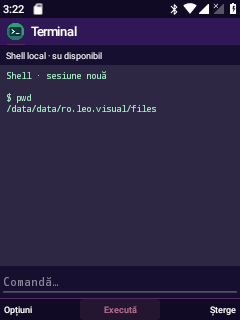</a> |

| Global Menu | SIM settings | Boot animation |
| :---: | :---: | :---: |
| <a href="android81/screenshots/keyshell-2026-11-17/global-menu.png">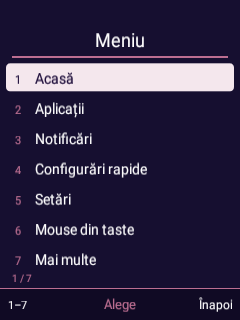</a> | <a href="android81/screenshots/keyshell-2026-11-17/sims.png">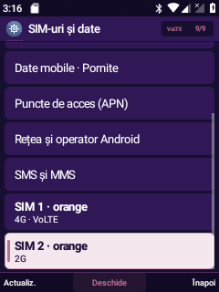</a> | <a href="android81/screenshots/keyshell-2026-11-17/boot.gif">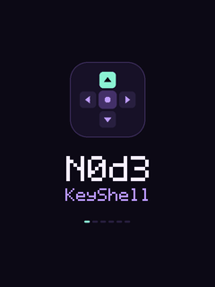</a> |

More on-device screenshots

| Phone | Messages · demo | New contact |
| :---: | :---: | :---: |
| <a href="android81/screenshots/keyshell-2026-11-17/phone.png">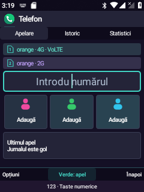</a> | <a href="android81/screenshots/keyshell-2026-11-17/messages.png">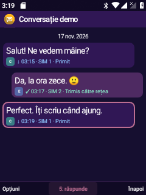</a> | <a href="android81/screenshots/keyshell-2026-11-17/contact.png">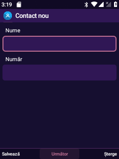</a> |

| Music library | Current Media · demo | FM tuner |
| :---: | :---: | :---: |
| <a href="android81/screenshots/keyshell-2026-11-17/music.png">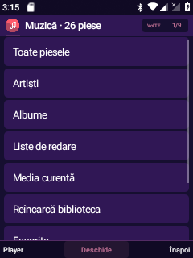</a> | <a href="android81/screenshots/keyshell-2026-11-17/current-media.png">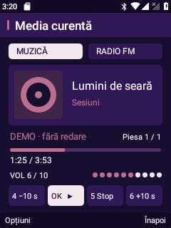</a> | <a href="android81/screenshots/keyshell-2026-11-17/fm.png">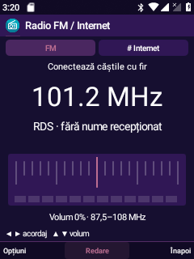</a> |

| Clock | Calendar | Calculator |
| :---: | :---: | :---: |
| <a href="android81/screenshots/keyshell-2026-11-17/clock.png">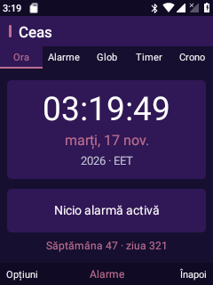</a> | <a href="android81/screenshots/keyshell-2026-11-17/calendar.png">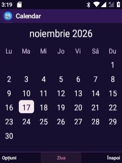</a> | <a href="android81/screenshots/keyshell-2026-11-17/calculator.png">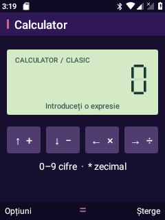</a> |

| Files | Quick Settings | Theme collections |
| :---: | :---: | :---: |
| <a href="android81/screenshots/keyshell-2026-11-17/files.png">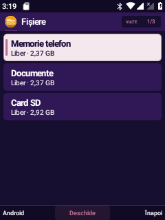</a> | <a href="android81/screenshots/keyshell-2026-11-17/quick.png">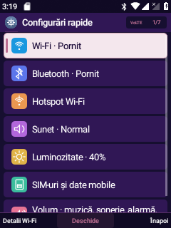</a> | <a href="android81/screenshots/keyshell-2026-11-17/themes.png">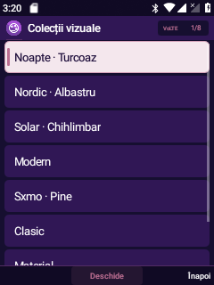</a> |

| Gallery | Camera controls | Voice recorder |
| :---: | :---: | :---: |
| <a href="android81/screenshots/keyshell-2026-11-17/gallery.png">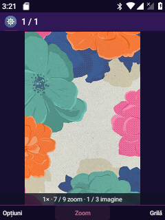</a> | <a href="android81/screenshots/keyshell-2026-11-17/camera.png">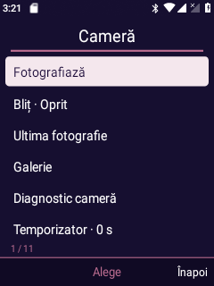</a> | <a href="android81/screenshots/keyshell-2026-11-17/recorder.png">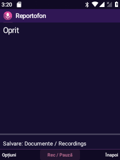</a> |

| Games | Unit converter | About |
| :---: | :---: | :---: |
| <a href="android81/screenshots/keyshell-2026-11-17/games.png">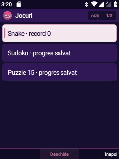</a> | <a href="android81/screenshots/keyshell-2026-11-17/converter.png">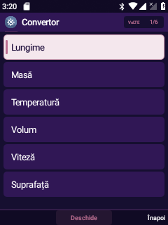</a> | <a href="android81/screenshots/keyshell-2026-11-17/about.png">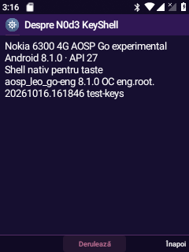</a> |

[Earlier on-device screen atlas](archive/screenshots/atlas-2026-11-13/README.md) ·
[Extended atlas](archive/screenshots/atlas-2026-11-13/extended/README.md) ·
[Boot animation build](android81/BOOTANIMATION-SD.md)

## What works

- **Home and apps.** Clock, per-SIM carrier and network technology, notification
  cards and editable shortcuts. The launcher uses one app catalog, with a
  three-column grid or a list. The focused app name appears below the heading.
  [Home and keypad guide](android81/LEO-HOME.md)
- **Settings and Android controls.** Larger text, six settings tabs, per-SIM
  details and page-specific help. The dedicated Menu key opens a global menu
  with app switching, notifications, quick settings and a D-pad pointer.
  [Android keypad integration](android81/ANDROID-KEYPAD-NAVIGATION.md)
- **Communication and text.** Dialer, in-call controls, contacts, SMS and a
  physical-keyboard IME with multi-tap, Romanian T9 and a personal dictionary.
  The shell has Romanian and English labels. [Localization](android81/LOCALIZATION.md)
- **Media and daily apps.** Music library, a dedicated Internet radio player,
  FM tuner, recorder, calendar, alarms, notes and internal or microSD file
  browsing. [Pocket apps](android81/POCKET-APPS.md)
- **Java ME games.** Open the separately installed J2ME Loader from **Games →
  Java games (J2ME)**. In **Files**, select a local JAR and choose **Open** to
  import it. [J2ME Loader 1.8.2](https://github.com/nikita36078/J2ME-Loader/releases/tag/1.8.2)
- **Appearance.** A KaiOS-inspired app grid with selected Mozilla Gaia icons
  and wallpapers, Material-inspired themes, adjustable accents and an
  editable Home layout. **Settings → Appearance → Themes** includes a preview
  of the digital lock screen. The lock screen uses the latest weather saved
  by the Weather app. [Gaia artwork credits](android81/visual-shell/assets/catalog-icons/gaia/README.md) ·
  [Wallpaper credits](android81/visual-shell/assets/wallpapers/gaia/README.md) ·
  [Material theme](android81/MATERIAL-SHELL.md)

On the development Nokia, the current build has been checked for Home, the app
grid, Settings navigation, per-SIM details and the Internet radio screen.
Telephony uses the existing AOSP/Qualcomm integration. The current modem
configuration allocates LTE to one SIM, with both SIMs available in standby.
[Index of hardware tests and limitations](android81/LEO-SHELL-AUDIT.md) ·
[Dual-slot modem investigation](android81/IMS-DUAL-SLOT.md)

## Keypad controls

| From | Keys | Action |
| --- | --- | --- |
| Home | OK with no selection | Open the app launcher |
| Home | Up / Down | Quick Settings / notifications |
| Home | `0` / `1` | Current Media / local search |
| Home | `*` / `#` | Switch / open the current card |
| Apps | D-pad / OK | Move focus / open the highlighted app |
| Apps | `*` / `#` | Previous / next page |
| Shell or compatible Android screen | Dedicated Menu | Open the global menu when accessibility is enabled |
| Pointer enabled | D-pad / OK / `#` | Move / click / exit pointer mode |
| Internet radio | `4` / `5` / `6` | Previous preset / play or stop / next preset |

The softkey actions are shown at the bottom of each screen.

## Architecture

The low-RAM AOSP port provides device services. KeyShell handles the user
interface with native Android views and Canvas drawing. Shared list and dialog
components handle focus, softkeys and keypad navigation.

| Layer | Source |
| --- | --- |
| Dashboard, app catalog, settings and native apps | [Visual shell](android81/visual-shell) |
| Multi-tap and Romanian T9 | [Keypad IME](android81/keypad-ime) |
| Android Settings, status bar and system dialogs | [Keypad integration](android81/ANDROID-KEYPAD-NAVIGATION.md) · [System overlays](android81/system-dark) |
| TA-1286 boot, display, audio and modem | [Device tree](android81/device/nokia/leo) · [Radio integration](android81/RADIO-RECOVERY.md) |
| Recovery and one-shot microSD boot | [Leo Recovery](android81/LEO-RECOVERY.md) · [SD boot design](android81/KAIOS-SD.md) |

## Build status

| Component | Status |
| --- | --- |
| N0d3 KeyShell app update | Signed build installed and checked on the TA-1286 development handset |
| N0d3 boot artwork | 240 × 320 package installed with hash verification. The gallery shows the rendered preview. |
| 16 November unified firmware kit | Earlier AOSP baseline. The internal image passed offline checks and the matching microSD profile reached first boot on the development handset. [Package history](android81/GITHUB-PACKAGES.md) |

## Installation and recovery

For an existing compatible AOSP installation, build the apps and use the
signed APK update workflow. The project retains the Android package IDs
`ro.leo.visual` and `ro.leo.keypad` for compatible updates.
[App builds and update workflow](android81/RELEASE-APPS.md)

For a ROM installation on TA-1286, the firmware and recovery guides cover the
internal and microSD profiles. **A clean internal installation erases
userdata.** Check the exact package, device variant and recovery prerequisites
in the guide. [Installation guide](android81/INSTALL-GUIDE.md) ·
[Firmware packages](android81/GITHUB-PACKAGES.md) ·
[KaiOS restore notes](android81/FLASH-FROM-STOCK.md)

## Building KeyShell

The handset uses the `aosp_leo_go-eng` product based on
`android-8.1.0_r81`, a stock-derived Linux 4.9 kernel, msm8909 and Adreno 304.
The app build uses Java 8, the API 27 platform and the pinned AOSP vCard
dependency. The full ROM build also needs the documented local firmware and
vendor inputs. [Build prerequisites](android81/REBUILD.md)

| Goal | Command or guide |
| --- | --- |
| Build the shell APK on Windows | `python -X utf8 android81/build-pocket-apps-windows.py` |
| Build the shell and the keypad IME from AOSP | `bash android81/repro/build-apps.sh` |
| Generate the boot animation | `python android81/make-bootanimation.py` |
| Run host tests | `python -m unittest discover -s android81/tests` |
| Rebuild ROM or recovery packages | [ROM and recovery bundle guide](android81/RECOVERY-BUNDLE.md) |

## Project audit

The earlier audit records device integration, release tooling and open tests.
For a bug report, include the phone variant, ROM or APK version, the sequence
of keys pressed and the behavior observed. [Technical audit](android81/PROJECT-AUDIT-2026-11-13.md)

## Roadmap

- Make keypad navigation and focus consistent across shell apps and Android dialogs.
- Measure memory, startup time and battery use on the reference handset.
- Compare LTE and IMS allocation across both SIM slots with the KaiOS baseline.
- Build and verify a firmware package with the current KeyShell version.

## Documentation

[Documentation index](android81/README.md) · [Hardware and lab notes](android81/STATUS.md) ·
[Project archive](archive/README.md)
