# Leo · Android 8.1 for Nokia 6300 4G

Leo boots AOSP from the internal eMMC of the **Nokia 6300 4G TA-1286**.
**Leo Visual** is the native Home, dialer and application shell. **Leo Keypad**
provides physical multi-tap and Romanian T9. The project also adapts Android
Settings, SystemUI and system dialogs for the 240 × 320 display and D-pad.

`0.14.0-dev` · `API 27` · `msm8909 / ARMv7` · `aosp_leo_go-eng` · `16 November 2026`

[Architecture](#architecture) · [Screenshots](#screenshots) · [Hardware status](#what-works) ·
[Installation](#installation-and-recovery) · [Build and verify](#building-leo) ·
[Audit](#project-audit) · [Documentation](#documentation)

## Build status

| Artifact | Scope | Evidence |
| --- | --- | --- |
| Current development handset | Adaptive single-SIM Home, FM/Internet radio, dark Android UI and native Settings search fix | APK hash and device checks are recorded in the [technical audit](android81/PROJECT-AUDIT-2026-11-13.md) |
| Unified kit | One System image for internal installation and one-shot boot from microSD. Recovery offers both boot choices. | SD first boot reached the Leo setup wizard with Leo Keypad selected and LTE on SIM 2. The matching internal ROM has offline validation. [Hardware results](android81/leo-recovery/leo-unified-hardware-validation.json) |
| 16 November internal candidate | Rebuilt Leo Visual and current MTP and radio startup scripts | APK and clean ROM checks passed offline. Installation uses the PC recovery installer. |
| 16 November Recovery and SD boot | One-shot Leo or KaiOS boot from microSD. Leo starts both Qualcomm RIL services against the original modem firmware. | Leo SD boot and automatic baseband detection verified on `695d`. Calls, SMS and mobile data in the SD profile remain unverified. |
| 13 November ROM prerelease | Boot, system and empty userdata. Includes dark Android UI and the Settings fix. Predates the radio and single-SIM Home changes. | Clean flash and partition readback verified on 16 November. See the [first-boot notes](android81/FLASH-FROM-STOCK.md#16-november-hardware-test). [Private download](https://github.com/smp971/nokia-6300-leo-releases/releases/tag/leo-0.14.0-dev-20261113) |
| 28 October ROM and Leo Recovery 0.2 | Hardware baseline for native clean installation | Recovery boot, key navigation, partition readback and first boot confirmed. The October ZIP requires its [post-install bootstrap fix](android81/FLASH-FROM-STOCK.md#post-install-fix-found-during-testing). |

## Architecture

| Layer | Entry points and responsibilities |
| --- | --- |
| Boot and device | Stock-derived Linux 4.9 kernel, Android init/bootstrap, device key layout, graphics/HWC integration and audio policy. [TA-1286 device tree](android81/device/nokia/leo) |
| Shell and keypad | `MainActivity` renders Home and the catalog. `LeoActivity`, `KeypadDialog` and `CircularNavigation` share focus and softkey behavior. Leo accessibility owns the universal Menu and pointer. The separate IME handles text entry. [Visual sources](android81/visual-shell) · [IME sources](android81/keypad-ime) |
| Native Android UI | Framework keypad patches and Android resource overlays cover SystemUI, framework themes, Settings and Package Installer. The Settings app has a separate compatibility fix for search indexing. [Keypad integration](android81/ANDROID-KEYPAD-NAVIGATION.md) · [Dark overlays](android81/system-dark) |
| Calls and messaging | Leo's dialer and in-call UI use Android Telecom. Android providers store call/SMS data. The Qualcomm RIL and IMS components handle radio registration and voice. [Radio integration](android81/RADIO-RECOVERY.md) · [IMS slot management](android81/IMS-DUAL-SLOT.md) |
| Audio and media | `PlaybackService` owns local and Internet playback. `FmService` controls the tuner and FM routing. The media library indexes Android media and removable storage. [Audio runtime](android81/audio-runtime) · [FM runtime](android81/fm-runtime) |
| Recovery | The standalone RGB565 recovery handles keys, SD staging and pinned packages outside Android. The early selector supports one-shot Leo and KaiOS boot from SD. [Recovery implementation](android81/leo-recovery) · [SD boot design](android81/KAIOS-SD.md) |

## Installation and recovery

[Download the private unified kit](https://github.com/smp971/nokia-6300-leo-releases/releases/tag/leo-unified-20261116)
· [Choose a package](android81/GITHUB-PACKAGES.md)
· [Complete installation guide](android81/INSTALL-GUIDE.md)

**The clean installer erases internal userdata.** The November ZIP requires the
project TA-1286 (`695d`), root ADB in Leo Recovery, a mounted external SD card
with at least 3.3 GiB of staging space, and the three verified stock backups
for the write step. The host needs equivalent temporary storage. The current
unified recovery menu accepts the rebuilt 16 November ROM. The previous internal
ZIP uses the older recovery or the PC installer.

From the repository root, verify the November download, then run the recovery
preflight after the handset has entered recovery. Neither command flashes an
image.

```powershell
$rom = '.\leo-fresh-0.14.0-dev-20261113-140016.zip'
Get-FileHash -Algorithm SHA256 $rom
python android81/install-recovery-bundle.py $rom
python android81/install-recovery-bundle.py $rom --preflight --serial 695d --adb adb
```

Expected ROM SHA-256

```text
465e80df8a02922d7f442e80fe520965a30f2adf1a39c0b0994c7be171e6fc68
```

The verified bundle stages all images before writing. It writes `system` →
blank `userdata` → `boot` and hashes each partition after writing. Recovery,
modem, calibration, GPT and the bootloader remain outside the write set.
See the [bundle guide](android81/RECOVERY-BUNDLE.md) for the explicit write
flags and the [stock return guide](android81/FLASH-FROM-STOCK.md) for backups
and restoration.

**Leo Recovery 0.2** is a standalone native recovery for D-pad, OK and softkeys,
with a dedicated RGB565 renderer for the 240 × 320 display. Direct boot, physical
keys, root ADB, SD backup and clean installation have passed on the phone.
Before the October test, the previous userdata was backed up and verified on
both SD and PC.

After a wipe, choose the data SIM and configure network/Wi-Fi preferences again.
SIM 2 IMS voice registration and validated LTE data passed on the fresh installation
on 29 October after a [capability-refresh fix](android81/IMS-DUAL-SLOT.md). Calls
were not repeated. USB/ADB still drops occasionally; disconnecting USB for ten
seconds and reconnecting restored it.

The development system now includes [Romanian/European APN defaults](android81/APN-CATALOG.md):
844 public profiles, including 18 for Romania, with Internet/MMS/IMS and MVNO
matching retained. Both SIMs report LTE-preferred mode, but simultaneous dual LTE
and dual VoLTE are not yet validated; the current IMS port manages one selected slot.
The first [VoWiFi trial](android81/VOWIFI-BRINGUP.md) accepted the modem's WFC
setting on SIM 2, but registration stayed on the mobile network. The setting was
restored; Wi-Fi calling is not functional yet.

| Package | Purpose and limits |
| --- | --- |
| November clean Leo ROM | Boot, system and blank userdata flashed and read back using ADB in Leo Recovery |
| October clean Leo ROM | Hardware-verified native recovery installation; apply the documented first-boot fix |
| Leo Recovery | Native SD installer, boot/system/recovery backup, diagnostics and experimental KaiOS SD boot |
| Root ADB recovery entry kit | Bootstrap from the known rooted KaiOS installation; not a signed stock OTA |
| KaiOS restore ZIP | Verified original boot/system payloads; full restoration untested, data reset separate |
| QPST/QFIL candidate | Recovery partition only; offline checks passed, EDL programmer/flash untested |

These are not full-device images. They do not restore personal data, GPT,
bootloader, modem/NV or calibration partitions. QFIL needs an intact partition
layout. See [Leo Recovery](android81/LEO-RECOVERY.md) and
[QFIL recovery](android81/QFIL-RECOVERY.md) before choosing a procedure.

**KaiOS from SD:** the one-shot selector booted the KaiOS menu while retaining
internal Leo. Root ADB confirmed SD loop images for system/data/cache and
read-only internal OS partitions. A normal reboot returned to Leo. USB remains
intermittent; KaiOS radio/media services need separate tests.
[Architecture and evidence](android81/KAIOS-SD.md).

<a id="leo-în-imagini"></a>

## Screenshots

The [screen atlas](android81/screenshots/atlas-2026-11-13/README.md) has
**159 on-device captures** across the seven launcher categories,
six Leo Settings tabs, system controls, and application menus.
The [detailed atlas](android81/screenshots/atlas-2026-11-13/extended/README.md) adds
48 screens, including Home cards, call history filters, message and email composers,
radio options, clock presets and system tools. The Nokia captures are 240 × 320.
Select any thumbnail to open the full image.

| Home · single SIM | Apps · primary category | Universal Menu |
| :---: | :---: | :---: |
| <a href="android81/screenshots/readme-2026-11-13/home.png">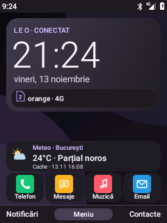</a> | <a href="android81/screenshots/atlas-2026-11-13/apps-cycle-1.png">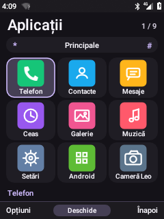</a> | <a href="android81/screenshots/atlas-2026-11-13/global-menu.png">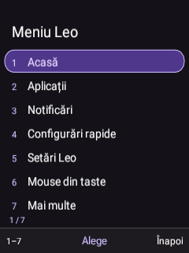</a> |

| Leo Settings | App ordering | Home card editor |
| :---: | :---: | :---: |
| <a href="android81/screenshots/atlas-2026-11-13/settings-networks.png">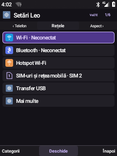</a> | <a href="android81/screenshots/readme-2026-11-13/reorder.png">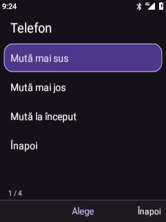</a> | <a href="android81/screenshots/atlas-2026-11-13/extended/home-card-list.png">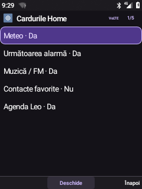</a> |

| Phone keypad | Call history filters | New SMS |
| :---: | :---: | :---: |
| <a href="android81/screenshots/atlas-2026-11-13/phone.png">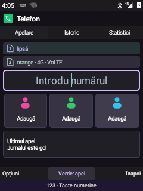</a> | <a href="android81/screenshots/atlas-2026-11-13/extended/phone-history-options.png">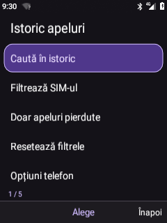</a> | <a href="android81/screenshots/atlas-2026-11-13/extended/sms-compose.png">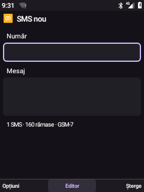</a> |

| Music player | Current Media · demo | FM tuner options |
| :---: | :---: | :---: |
| <a href="android81/screenshots/atlas-2026-11-13/player.png">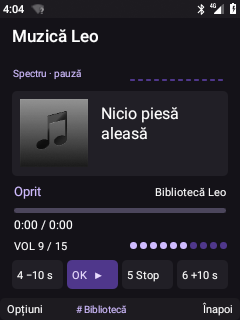</a> | <a href="android81/screenshots/atlas-2026-11-13/now-playing.png">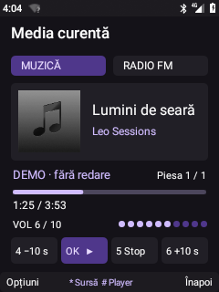</a> | <a href="android81/screenshots/atlas-2026-11-13/extended/fm-options.png">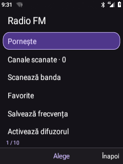</a> |

| Internet station directory | Clock · timer presets | Calendar tools |
| :---: | :---: | :---: |
| <a href="android81/screenshots/readme-2026-11-13/internet-radio.png">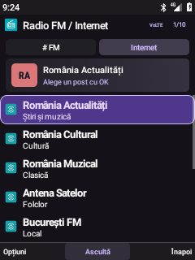</a> | <a href="android81/screenshots/atlas-2026-11-13/extended/timer-options.png">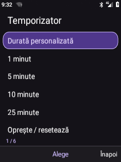</a> | <a href="android81/screenshots/atlas-2026-11-13/extended/calendar-tools.png">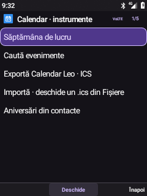</a> |

| Quick Settings | Leo notifications · redacted | Keypad and T9 settings |
| :---: | :---: | :---: |
| <a href="android81/screenshots/atlas-2026-11-13/quick-settings.png">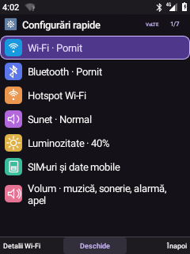</a> | <a href="android81/screenshots/atlas-2026-11-13/notifications.png">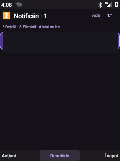</a> | <a href="android81/screenshots/readme-2026-11-13/input.png">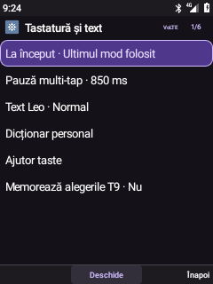</a> |

| Leo Studio | Theme preview · Home | Recovery center in Leo |
| :---: | :---: | :---: |
| <a href="android81/screenshots/atlas-2026-11-13/studio.png">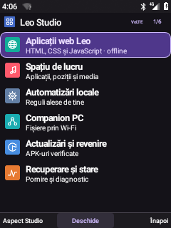</a> | <a href="android81/screenshots/atlas-2026-11-13/extended/theme-home.png">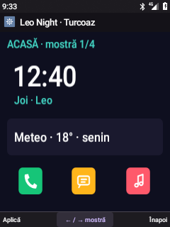</a> | <a href="android81/screenshots/atlas-2026-11-13/extended/recovery-center.png">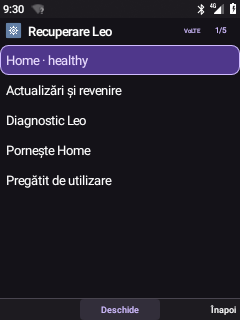</a> |

| Android Settings search | Android permission dialog · demo | Leo controls in Android |
| :---: | :---: | :---: |
| <a href="android81/screenshots/readme-2026-11-13/settings-search.png">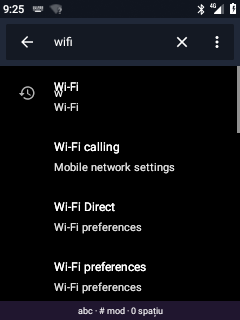</a> | <a href="android81/screenshots/readme-2026-11-13/permission.png">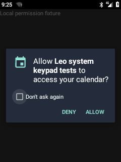</a> | <a href="android81/screenshots/atlas-2026-11-13/extended/global-in-android.png">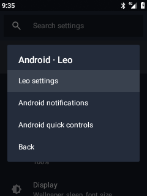</a> |

[FM tuner](android81/screenshots/atlas-2026-11-13/radio-fm.png) ·
[Earlier live radio capture](android81/screenshots/leo-20261113-radio-live.png) ·
[Archived gallery](android81/screenshots/archive/2026-11-06/README.md)

## Radio · FM and Internet

Open **FM / Internet Radio** in Media and press **#** to switch sources.
FM keeps left/right tuning and up/down volume. In Internet, choose a station
with up/down and start or stop it with OK. The left softkey opens favorites,
custom MP3/AAC streams and the on-demand ICY track title.

The ten presets are România Actualități, România Cultural, România Muzical,
Antena Satelor, București FM, Radio Cluj, Radio Brașov FM, Kiss FM, Magic FM
and Rock FM. Streams use Wi-Fi or mobile data. Leo opens a connection when
you select a station.

[Radio România stream directory](https://api.srr.ro/stream/playlist.htm) ·
[Kiss FM](https://www.kissfm.ro/live) · [Magic FM](https://www.magicfm.ro/live) ·
[Rock FM](https://www.rockfm.ro/live)

The radio update is part of the Leo Visual development build. The 13 November
ROM ZIP was assembled before this radio update. All ten endpoints returned
audio in a host check. The Nokia reached the playing state over LTE with
România Actualități (MP3) and Kiss FM (AAC); these checks ran at zero volume.

<a id="tabelul-funcțiilor"></a>
<a id="ce-poți-face-deja"></a>

## What works

See the [November 2026 Leo Shell audit](android81/LEO-SHELL-AUDIT.md) for
catalog-wide coverage, current regression results and refactoring priorities.
See the [Leo Home guide](android81/LEO-HOME.md) for the app menu, keypad
navigation and on-device personalization.

This table combines documented development tests. **Not every feature was
retested after the latest wipe.** A confirmation covers the specific TA-1286
test, not every accessory, carrier or scenario.

| Feature | Demonstrated behavior and remaining limits |
| --- | --- |
| 🏠 **Home and navigation** | Default Leo Home; native grid/list, grouped notifications, keypad lock, weather/alarm/media cards, app order and shortcuts. Leo lists wrap between first and last item. |
| 🖱️ **Global menu and pointer** | Menu over external Android apps through Leo accessibility. Pointer movement, click and edge scrolling tested. Accessibility was repaired after the wipe; menu captured over Android Settings. |
| 🗂️ **Tasks and recents** | Leo recents and Android tasks, switching and confirmed closing through the root service. Active calls and telephony windows protected. |
| ⌨️ **Text input** | Multi-tap, extended Romanian T9, personal dictionary, optional learned choices, capitals, diacritics and symbols. English UI does not add English T9. |
| 📞 **SIM 1 calls** | Incoming/outgoing calls with two-way audio and keypad answer/end. USB disconnected during outgoing-call tests. |
| 📶 **SIM 2 / IMS** | Earlier incoming/outgoing VoLTE with two-way audio and concurrent LTE data, plus SMS send, delivery and reception. Registration and LTE data were verified again on the October clean install after capability refresh. Calls on that clean install, DTMF, handover and VoWiFi remain open. |
| 👥 **Contacts / SMS** | Multiple numbers, photos, favorites, VCF preview, T9 lookup, bubble conversations, drafts, folder tabs, unread markers, SIM colors, GSM-7/Unicode counters, templates, search and pin/archive. Carrier tests are separate from UI fixtures. MMS unimplemented. |
| 🌐 **Connectivity** | Earlier LTE data tests; Wi-Fi and hotspot Internet confirmed using another phone. Both SIMs voice-registered after clean installation; default data SIM initially unset. |
| 🔊 **Audio / vibration** | Speaker, earpiece, wired stereo headphones, Bluetooth A2DP speaker and physical vibration confirmed. Bluetooth microphone/HFP, variable vibration amplitude and concurrent call/media cases need tests. Audio card/server present after wipe; listening tests not repeated. |
| 🎵 **Music** | Artwork, progress, keypad transport, real visualizer, artists/albums, favorites, search, playlists, editable queue, shuffle/repeat, LRC lyrics and sleep timer. MP3/FLAC/AAC/OGG/WMA v2 samples played; not universal profile support. |
| 📻 **FM / Internet radio** | FM tuning, seek, scanning, favorites, RDS and wired/speaker routes. Wired headphones are the FM antenna. Internet adds ten Romanian presets, custom streams and favorites. |
| 🎙️ **Recorder** | AAC/M4A, pause, internal/SD save, voice-reactive meter and renaming confirmed earlier. New quality profiles need separate recording tests. |
| 📷 **Camera** | BF20A1/HAL1, preview and OK-key JPEG at 480 × 640, including earlier post-reboot capture. Flashlight and capture LED pulse confirmed. Video unimplemented; Auto flash, exposure quality and long sessions unvalidated. |
| 📂 **Files / transfer** | Internal/SD browsing, multi-selection, search/sort, images, storage analysis and export location. Copy/move hashes and USB MTP confirmed. Bluetooth text-file transfer worked both ways with Samsung. |
| 🧰 **Daily tools** | Calculator, pinned notes/checklists, TXT export, T9 search, local Calendar with recurrence/notifications. Clock: Time, Alarms, World, Timer and Stopwatch; weekday alarms, snooze, pause/resume and laps. Snooze scheduling checked; eventual sound needs confirmation. |
| 🧩 **Pocket apps** | [Ten new native keypad apps](android81/POCKET-APPS.md): RSS/Atom, podcasts with verified SD saving, Internet radio, SSH/SFTP, starter RO–EN dictionary, study cards, ZIP, expenses, metronome and QR generation. First versions; 72 synthetic on-device checks. |
| 🌤️ **Weather** | Configurable city, Bucharest default, Open-Meteo model forecast, seven days, sunrise/sunset and timestamped cache. Live forecast displayed on phone. |
| 🎨 **Personalization** | [Leo Material](android81/MATERIAL-SHELL.md), [Leo Classic](android81/CLASSIC-COMPACT-SHELL.md), Material Night, Leo Night/Nordic/Solar and [Sxmo · Pine](android81/SXMO-THEME.md) collections, accents/app themes, lock wallpaper, app reordering, shortcuts, dialer favorites and quick-settings volume. |
| 💾 **Leo backups** | Supported preferences, themes, app order, notes, dictionary, favorites, Calendar and templates. Selective restore with validation/rollback copy; separate contact/SMS archive with duplicate skipping. Accounts excluded; not a full userdata backup. |
| 📚 **Reader / games** | TXT/EPUB, Markdown/PDF, resume/bookmarks, adjustable text, PDF keypad zoom, Snake, Sudoku and 15 Puzzle. Local parser/UI tests passed; long sessions/all game flows not exhaustively validated. |
| ✉️ **Email / web** | Configurable IMAP/SMTP and keypad text browser. IMAP reception confirmed; SMTP unvalidated. Text browser does not execute JavaScript. Existing WebView ran local HTML/JS apps with GPU limitations. |
| 🖥️ **Terminal / apps** | Physical-keyboard terminal; typing/executing `pwd` confirmed. Root broker authorized against the new Leo UID. Android app list, converter, downloads and diagnostics; external app keypad compatibility varies. [Android keypad navigation](android81/ANDROID-KEYPAD-NAVIGATION.md) extends native Settings/SystemUI/permission controls (67 checks). |
| 📦 **Local updates** | Metadata/integrity checks, Android sessions and previous-APK backup. Validation/rejection tested locally; complete phone-UI update/rollback unproven. |
| 🛰️ **GPS / NFC** | Experimental GNSS HAL/provider/request lifecycle checked; 30-second test saw no satellites or fix. NFC checked and unavailable on this device. |

Full earlier evidence and screenshots remain in the
[preserved Romanian README](README.archive-2026-10-28-ro.md).

<a id="din-taste"></a>

## Keypad controls

| Key / context | Action |
| --- | --- |
| D-pad + OK | Move/select; Leo lists wrap around |
| Left / right softkey | Footer action; right usually goes back or deletes text |
| Dedicated Menu | Global menu over other apps; hold for contextual help |
| Home · `0` / `1` / short `5` | Media Current / app search / quick access. [Nokia-style keypad and media controls](android81/LEO-NOKIA-UI.md) |
| Home · `*` / `#` | Switch / open Home card |
| Pointer · arrows / OK | Move / click |
| Pointer · hold ↑/↓ at a vertical edge | Scroll until released, on views accepting swipe gestures |
| Pointer · `*` / `#` | Manual scroll mode / pointer off |
| App menu · `*` / `#` | Previous / next category |
| Messages · left / right | Switch folder |
| Camera · OK in preview | Save under `Pictures/Leo` |
| Radio · `#` | Switch FM / Internet. In Internet, ↑/↓ selects and OK starts or stops the highlighted station. |

**Leo Visual accessibility** must be enabled. Keypad lock, calls and alarms take
precedence. Choose UI language under **Settings → Appearance → Personalization →
Language / Limbă**. [Localization guide](android81/LOCALIZATION.md).

<a id="auditul-proiectului"></a>

## Project audit

The [13 November audit](android81/PROJECT-AUDIT-2026-11-13.md) maps the shell,
Android services, device integration and release tools to the current evidence.
The source inventory covers 48 app IDs and 133 manifest components. The
Python host suite passed 60 tests. The atlas records what was opened on the
phone, and the audit records the remaining functional checks.

| Area | Evidence | Limit |
| --- | --- | --- |
| Open area | Acceptance check |
| --- | --- |
| Release reproducibility | Rebuild from a clean host with the 590 pinned AOSP projects, private hardware inputs and documented tooling |
| Clean-install validation | Flash the November ZIP, confirm first boot, Home and IME grants, and verify LTE/IMS after data-SIM setup |
| Recovery and stock return | Build a recovery catalog for the new ZIP and verify an end-to-end return to KaiOS |
| App and data integrity | Close the Home intent boundary, recover interrupted backups on startup, and include Internet radio favorites in backup |
| Hardware and runtime | Measure USB/ADB recovery, camera stability, audio route changes and long-session power use |

Raw personal data, credentials and device-unique partitions are outside the
release asset list. Firmware archives are separate private Release assets.
[Package validation status](android81/GITHUB-PACKAGES.md).

<a id="ce-mai-avem-de-construit"></a>

## Roadmap

- **Install readiness:** flash the November prerelease, check first boot, update
  the recovery catalog and test full KaiOS restore.
- **UI maturity:** consistent spacing, icons, focus, empty/loading/error states,
  themes and large text across special screens.
- **Telephony:** fresh-install LTE/IMS, DTMF, handover, VoWiFi and Bluetooth mic.
- **Hardware:** long camera sessions, Auto flash/exposure, video and GPS fix.
- **Apps:** SMTP end-to-end, WebView limits, T9 edge cases and external keypad apps.
- **Release quality:** clean-host rebuild, USB stability, battery/long-session
  measurements and a hardened release configuration.

User-deferred checks remain deferred, not automatically resolved.

<a id="pentru-cei-care-vor-să-construiască"></a>

## Building Leo

| Development phone | Configuration |
| --- | --- |
| Model | Nokia 6300 4G · **TA-1286** |
| Platform | msm8909 · Cortex-A7 · ARMv7 / 32-bit Binder |
| Display / GPU | 240 × 320 · Adreno 304 |
| Base | AOSP `android-8.1.0_r81`, product `aosp_leo_go-eng` |
| Kernel | Stock-derived `4.9.240-perf-g4f9e270fd77f`, with UHID; not mainline |
| Memory / storage | Low-RAM, about 256 MiB zRAM; about 800 MiB system and 2.3 GiB data, internal |
| UI | Native Leo Visual + Leo Keypad; shell does not depend on WebView |

The project uses Go configuration; Android Go certification and Google services
are not part of the port. **[Start with the build guide →](android81/REBUILD.md)**

Development uses Windows + WSL/Linux, Java 8 and a separate AOSP checkout.
The stock-derived kernel, firmware and proprietary userspace libraries are
local inputs. The November ROM builder uses a verified device snapshot as its
base. Its offline image checks and the AOSP source build are separate paths.

| Goal | Command or guide |
| --- | --- |
| Check source wiring | `python -X utf8 android81/audit-leo-shell.py` |
| Run host checks | `python -m unittest discover -s android81/tests` |
| Build Leo Visual on Windows | `python -X utf8 android81/build-pocket-apps-windows.py` after setting up Java 8, Platform 27, the pinned vCard source and compatible signing inputs |
| Build Leo Visual and Leo Keypad from AOSP | `bash android81/repro/build-apps.sh` after preparing the [pinned checkout and local inputs](android81/REBUILD.md) |
| Rebuild ROM or native recovery | [ROM bundle builder](android81/RECOVERY-BUNDLE.md) · [Recovery build and catalog](android81/LEO-RECOVERY.md) |
| Check keypad routes on the development handset | `python -X utf8 android81/smoke-leo-keypad.py --serial 695d` with the phone unlocked and idle |

```text
android81/
  visual-shell/       Home, native apps, menus and settings
  keypad-ime/         Multi-tap and T9 keyboard
  device/nokia/leo/   AOSP, init, keylayout and audio policy
  audio-runtime/     Qualcomm audio integration
  fm-runtime/        FM backend and routing
  radio-runtime/     Modem integration
  leo-recovery/      Native recovery and early SD selector
  repro/             Pinned AOSP manifest and patches
  screenshots/       Selected documentation captures
  local/, output/    Private local inputs and artifacts
```

<a id="harta-proiectului"></a>

## Documentation

Current operating/build guides are **English**. Dated reports and archived
READMEs remain **Romanian**. The [documentation index](android81/README.md)
separates current instructions from history.

| Guide | Purpose |
| --- | --- |
| [Packages](android81/GITHUB-PACKAGES.md) | Downloads, required fix and validation status |
| [Complete installation guide](android81/INSTALL-GUIDE.md) | Recovery, internal installation, one-shot SD boot and return to stock |
| [Flash from stock](android81/FLASH-FROM-STOCK.md) | Rooted KaiOS entry, clean install and restore |
| [Leo Recovery](android81/LEO-RECOVERY.md) | Native menu, guards and build |
| [KaiOS on SD](android81/KAIOS-SD.md) | One-shot boot and isolation limits |
| [QPST / QFIL](android81/QFIL-RECOVERY.md) | Experimental recovery-only rescue |
| [Rebuild](android81/REBUILD.md) | Pinned sources, tools and private dependencies |
| [App releases](android81/RELEASE-APPS.md) | Visual/Keypad APK bundles |
| [Recovery bundles](android81/RECOVERY-BUNDLE.md) | Snapshot/update versus clean-install schemas |
| [Runtime updates](android81/RUNTIME-UPDATE.md) | Capture, update and rollback |
| [Localization](android81/LOCALIZATION.md) | English/Romanian UI and catalog |
| [Web-app SDK](android81/web-app-sdk/README.md) | Local HTML/keypad apps |

Historical reports (Romanian): [camera](android81/CAMERA-RUNTIME.md),
[UI/global menu](android81/LEO-UI-FOUNDATION.md), [FM](android81/FM-INVESTIGATION.md),
[audio](android81/AUDIO-BRINGUP.md), [IMS](android81/IMS-RUNTIME.md),
[T9](android81/KEYPAD-IME.md), [lab log](android81/STATUS.md).
Earlier milestones remain in the [28 October Romanian snapshot](README.archive-2026-10-28-ro.md)
and the [20 October](README.archive-2026-10-20.md) / [23 October](README.archive-2026-10-23.md) archives.

Bug reports should include the phone variant, installed APK or ROM hash,
key sequence, and observed behavior. For radio or telephony, include the slot,
carrier and connection type. Keep identifiers and personal data out of logs
and screenshots.
