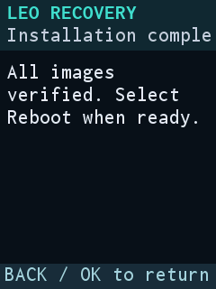
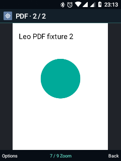

# 🦁 LEO · Android on the Nokia 6300 4G

**Small screen. Real keys. A second life for a Nokia.**

Leo is an experimental **Android 8.1** port for the **Nokia 6300 4G TA-1286**.
What started as a KaiOS dump now boots from internal storage, makes calls,
plays music and tunes into FM radio. **Leo Visual** brings a native keypad
interface with its own Home, apps, settings and softkey bars, inspired by KaiOS
and Symbian.

`Android 8.1 / API 27` · `ARMv7 / 32-bit` · `240 × 320` · `Dual SIM` · `Leo Visual`

**Updated: 28 October 2026** · **Installed version: 0.14.0-dev / code 14**

[What works](#what-works) · [Screenshots](#screenshots) · [Controls](#keypad-controls) ·
[Audit](#project-audit) · [Roadmap](#roadmap) · [Build](#building-leo) · [Docs](#documentation)

> **Working prototype for experimental use.** Clean installation through Leo
> Recovery has been tested on the development phone. Full KaiOS restoration and
> QFIL flashing remain untested. Offline checks do not establish hardware support.

## Installation and recovery

[Download the private release](https://github.com/smp971/nokia-6300-android81/releases/tag/leo-0.14.0-dev-20261028)
· [Choose a package](android81/GITHUB-PACKAGES.md)
· [Installation procedure](android81/FLASH-FROM-STOCK.md)

**Leo Recovery 0.2** is a standalone native recovery for D-pad, OK and softkeys,
with a dedicated RGB565 renderer for the 240 × 320 display. Direct boot, physical
keys, root ADB, SD backup and clean installation have passed on the phone.
Installation writes **system → blank userdata → boot**, checking each complete
partition's SHA-256 after writing. It erases internal Android user data. The
previous userdata was backed up and verified on both SD and PC before the test.

First boot configured Leo Home, keypad IME, dialer, audio bootstrap and root
broker. Both SIMs registered for voice. **The published ROM needs the included
post-install bootstrap fix** for accessibility, the global menu/mouse and legacy
launchers. That fix is already applied on the phone. The old Leo Shell APK was
subsequently removed there; Launcher3 remains disabled. The tested ROM ZIP has
not been silently replaced with an untested rebuild.

After a wipe, choose the data SIM and configure network/Wi-Fi preferences again.
LTE/IMS have not been revalidated on the fresh installation. USB/ADB still drops
occasionally; disconnecting USB for ten seconds and reconnecting restored it.

| Package | Purpose and limits |
| --- | --- |
| Clean Leo ROM | Tested system/boot installation with blank userdata; requires the documented post-install fix |
| Leo Recovery | Native SD installer, boot/system/recovery backup, diagnostics and experimental KaiOS SD boot |
| Root ADB recovery entry kit | Bootstrap from the known rooted KaiOS installation; not a signed stock OTA |
| KaiOS restore ZIP | Verified original boot/system payloads; full restoration untested, data reset separate |
| QPST/QFIL candidate | Recovery partition only; offline checks passed, EDL programmer/flash untested |

These are not full-device images. They do not restore personal data, GPT,
bootloader, modem/NV or calibration partitions. QFIL needs an intact partition
layout. See [Leo Recovery](android81/LEO-RECOVERY.md) and
[QFIL recovery](android81/QFIL-RECOVERY.md) before choosing a procedure.

**KaiOS from SD:** the one-shot selector booted the KaiOS menu while retaining
internal Leo. Root ADB confirmed SD loop images for system/data/cache and
read-only internal OS partitions. A normal reboot returned to Leo. USB remains
intermittent; KaiOS radio/media services need separate tests.
[Architecture and evidence](android81/KAIOS-SD.md).

<a id="leo-în-imagini"></a>

## Screenshots

Real phone captures retain the language selected when taken. Leo supports
English and Romanian. Older call screens below are **local demos**, not live calls.

| Clean-install Home | App menu | Global menu over Android Settings |
| :---: | :---: | :---: |
|  |  |  |

| Native recovery | Installation complete | Leo Night incoming-call demo |
| :---: | :---: | :---: |
|  |  |  |

| Music player preview | Clock | PDF reader |
| :---: | :---: | :---: |
|  |  |  |

<a id="tabelul-funcțiilor"></a>
<a id="ce-poți-face-deja"></a>

## What works

This table combines documented development tests. **Not every feature was
retested after the latest wipe.** A confirmation covers the specific TA-1286
test, not every accessory, carrier or scenario.

| Feature | Demonstrated behavior and remaining limits |
| --- | --- |
| 🏠 **Home and navigation** | Default Leo Home; native grid/list, grouped notifications, keypad lock, weather/alarm/media cards, app order and shortcuts. Leo lists wrap between first and last item. |
| 🖱️ **Global menu and pointer** | Menu over external Android apps through Leo accessibility. Pointer movement, click and edge scrolling tested. Accessibility was repaired after the wipe; menu captured over Android Settings. |
| 🗂️ **Tasks and recents** | Leo recents and Android tasks, switching and confirmed closing through the root service. Active calls and telephony windows protected. |
| ⌨️ **Text input** | Multi-tap, extended Romanian T9, personal dictionary, optional learned choices, capitals, diacritics and symbols. English UI does not add English T9. |
| 📞 **SIM 1 calls** | Incoming/outgoing calls with two-way audio and keypad answer/end. USB disconnected during outgoing-call tests. |
| 📶 **SIM 2 / IMS** | Incoming/outgoing VoLTE with two-way audio and concurrent LTE data confirmed before the wipe. SMS send, delivery and reception confirmed. Fresh-install LTE/IMS, DTMF, handover and VoWiFi remain unvalidated. |
| 👥 **Contacts / SMS** | Multiple numbers, photos, favorites, VCF preview, T9 lookup, bubble conversations, drafts, folder tabs, unread markers, SIM colors, GSM-7/Unicode counters, templates, search and pin/archive. Carrier tests are separate from UI fixtures. MMS unimplemented. |
| 🌐 **Connectivity** | Earlier LTE data tests; Wi-Fi and hotspot Internet confirmed using another phone. Both SIMs voice-registered after clean installation; default data SIM initially unset. |
| 🔊 **Audio / vibration** | Speaker, earpiece, wired stereo headphones, Bluetooth A2DP speaker and physical vibration confirmed. Bluetooth microphone/HFP, variable vibration amplitude and concurrent call/media cases need tests. Audio card/server present after wipe; listening tests not repeated. |
| 🎵 **Music** | Artwork, progress, keypad transport, real visualizer, artists/albums, favorites, search, playlists, editable queue, shuffle/repeat, LRC lyrics and sleep timer. MP3/FLAC/AAC/OGG/WMA v2 samples played; not universal profile support. |
| 📻 **FM radio** | Tuning, seek, scanned stations, favorites, headphones/speaker and RDS name confirmed. Headphones are the antenna; sessions limited to one hour. |
| 🎙️ **Recorder** | AAC/M4A, pause, internal/SD save, voice-reactive meter and renaming confirmed earlier. New quality profiles need separate recording tests. |
| 📷 **Camera** | BF20A1/HAL1, preview and OK-key JPEG at 480 × 640, including earlier post-reboot capture. Flashlight and capture LED pulse confirmed. Video unimplemented; Auto flash, exposure quality and long sessions unvalidated. |
| 📂 **Files / transfer** | Internal/SD browsing, multi-selection, search/sort, images, storage analysis and export location. Copy/move hashes and USB MTP confirmed. Bluetooth text-file transfer worked both ways with Samsung. |
| 🧰 **Daily tools** | Calculator, pinned notes/checklists, TXT export, T9 search, local Calendar with recurrence/notifications. Clock: Time, Alarms, World, Timer and Stopwatch; weekday alarms, snooze, pause/resume and laps. Snooze scheduling checked; eventual sound needs confirmation. |
| 🌤️ **Weather** | Configurable city, Bucharest default, Open-Meteo model forecast, seven days, sunrise/sunset and timestamped cache. Live forecast displayed on phone. |
| 🎨 **Personalization** | Material Night and Leo Night/Nordic/Solar collections, accents/app themes, lock wallpaper, app reordering, shortcuts, dialer favorites and quick-settings volume. |
| 💾 **Leo backups** | Supported preferences, themes, app order, notes, dictionary, favorites, Calendar and templates. Selective restore with validation/rollback copy; separate contact/SMS archive with duplicate skipping. Accounts excluded; not a full userdata backup. |
| 📚 **Reader / games** | TXT/EPUB, Markdown/PDF, resume/bookmarks, adjustable text, PDF keypad zoom, Snake, Sudoku and 15 Puzzle. Local parser/UI tests passed; long sessions/all game flows not exhaustively validated. |
| ✉️ **Email / web** | Configurable IMAP/SMTP and keypad text browser. IMAP reception confirmed; SMTP unvalidated. Text browser does not execute JavaScript. Existing WebView ran local HTML/JS apps with GPU limitations. |
| 🖥️ **Terminal / apps** | Physical-keyboard terminal; typing/executing `pwd` confirmed. Root broker authorized against the new Leo UID. Android app list, converter, downloads and diagnostics; external app keypad compatibility varies. |
| 📦 **Local updates** | Metadata/integrity checks, Android sessions and previous-APK backup. Validation/rejection tested locally; complete phone-UI update/rollback unproven. |
| 🛰️ **GPS / NFC** | Experimental GNSS HAL/provider/request lifecycle checked; 30-second test saw no satellites or fix. NFC checked and unavailable on this device. |

Full earlier evidence and screenshots remain in the
[preserved Romanian README](README.archive-2026-10-28-ro.md).

<a id="din-taste"></a>

## Keypad controls

| Key / context | Action |
| --- | --- |
| D-pad + OK | Move/select; Leo lists wrap around |
| Left / right softkey | Footer action; right usually goes back or deletes text |
| Dedicated Menu | Global menu over other apps; hold for contextual help |
| Home · `0` / `1` / short `5` | Now Playing / local global search / quick access |
| Home · `*` / `#` | Switch / open Home card |
| Pointer · arrows / OK | Move / click |
| Pointer · hold ↑/↓ at a vertical edge | Scroll until released, on views accepting swipe gestures |
| Pointer · `*` / `#` | Manual scroll mode / pointer off |
| App menu · `*` / `#` | Previous / next category |
| Messages · left / right | Switch folder |
| Camera · OK in preview | Save under `Pictures/Leo` |

**Leo Visual accessibility** must be enabled. Keypad lock, calls and alarms take
precedence. Choose UI language under **Settings → Appearance → Personalization →
Language / Limbă**. [Localization guide](android81/LOCALIZATION.md).

<a id="auditul-proiectului"></a>

## Project audit

| Area | Evidence | Limit |
| --- | --- | --- |
| Clean install | All OS images written/verified; first boot, Home/IME/dialer/root checked | Published ZIP needs post-install fix; Python installer writes and stock restore untested |
| Recovery | RGB565 display, keys, ADB, backup and native install confirmed | QFIL programmer/transport experimental; no GPT/bootchain repair |
| Fresh setup | SIM voice registration, audio card/server and root broker; accessibility repaired | Data SIM `-1`, network modes `0/0`, observed GSM/EDGE; LTE/IMS need setup/retest |
| UI / apps | Shared native components and keypad dialogs | Special screens need individual audits; not all external Android apps are adapted |
| Build | 590 AOSP projects pinned, patches/device sources/recipes tracked | Clean-host full rebuild and bit-for-bit reproducibility unvalidated; private blobs required |
| Tests | Latest host run: **54 passing tests**, including QFIL CRC/geometry/target guards | Historical Android runs overlap and are not summed as one coverage figure |
| Security | Development build, stock-derived kernel and proprietary hardware components | Not a hardened production release; policy and licensing work remains |

Raw personal data, credentials and device-unique partitions are outside the
release asset list. Firmware archives are separate private Release assets.
[Package validation status](android81/GITHUB-PACKAGES.md).

<a id="ce-mai-avem-de-construit"></a>

## Roadmap

- **Install readiness:** integrate the fix into a new ROM/catalog, validate that
  exact package and test full KaiOS restore.
- **UI maturity:** consistent spacing, icons, focus, empty/loading/error states,
  themes and large text across special screens.
- **Telephony:** fresh-install LTE/IMS, DTMF, handover, VoWiFi and Bluetooth mic.
- **Hardware:** long camera sessions, Auto flash/exposure, video and GPS fix.
- **Apps:** SMTP end-to-end, WebView limits, T9 edge cases and external keypad apps.
- **Release quality:** clean-host rebuild, USB stability, battery/long-session
  measurements and a hardened release configuration.

User-deferred checks remain deferred, not automatically resolved.

<a id="pentru-cei-care-vor-să-construiască"></a>

## Building Leo

| Development phone | Configuration |
| --- | --- |
| Model | Nokia 6300 4G · **TA-1286** |
| Platform | msm8909 · Cortex-A7 · ARMv7 / 32-bit Binder |
| Display / GPU | 240 × 320 · Adreno 304 |
| Base | AOSP `android-8.1.0_r81`, product `aosp_leo_go-eng` |
| Kernel | Stock-derived `4.9.240-perf-g4f9e270fd77f`, with UHID; not mainline |
| Memory / storage | Low-RAM, about 256 MiB zRAM; about 800 MiB system and 2.3 GiB data, internal |
| UI | Native Leo Visual + Leo Keypad; shell does not depend on WebView |

The project uses Go configuration; Android Go certification and Google services
are not part of the port. **[Start with the build guide →](android81/REBUILD.md)**

Development uses Windows + WSL/Linux, Java 8 and a separate AOSP checkout.
Source files do not replace hardware blobs/local inputs. Build and flash are
separate operations.

```text
android81/
  visual-shell/       Home, native apps, menus and settings
  keypad-ime/         Multi-tap and T9 keyboard
  device/nokia/leo/   AOSP, init, keylayout and audio policy
  audio-runtime/     Qualcomm audio integration
  fm-runtime/        FM backend and routing
  radio-runtime/     Modem integration
  leo-recovery/      Native recovery and early SD selector
  repro/             Pinned AOSP manifest and patches
  screenshots/       Selected documentation captures
  local/, output/    Private local inputs and artifacts
```

<a id="harta-proiectului"></a>

## Documentation

Current operating/build guides are **English**. Dated reports and archived
READMEs remain **Romanian**. The [documentation index](android81/README.md)
separates current instructions from history.

| Guide | Purpose |
| --- | --- |
| [Packages](android81/GITHUB-PACKAGES.md) | Downloads, required fix and validation status |
| [Flash from stock](android81/FLASH-FROM-STOCK.md) | Rooted KaiOS entry, clean install and restore |
| [Leo Recovery](android81/LEO-RECOVERY.md) | Native menu, guards and build |
| [KaiOS on SD](android81/KAIOS-SD.md) | One-shot boot and isolation limits |
| [QPST / QFIL](android81/QFIL-RECOVERY.md) | Experimental recovery-only rescue |
| [Rebuild](android81/REBUILD.md) | Pinned sources, tools and private dependencies |
| [App releases](android81/RELEASE-APPS.md) | Visual/Keypad APK bundles |
| [Recovery bundles](android81/RECOVERY-BUNDLE.md) | Snapshot/update versus clean-install schemas |
| [Runtime updates](android81/RUNTIME-UPDATE.md) | Capture, update and rollback |
| [Localization](android81/LOCALIZATION.md) | English/Romanian UI and catalog |
| [Web-app SDK](android81/web-app-sdk/README.md) | Local HTML/keypad apps |

Historical reports (Romanian): [camera](android81/CAMERA-RUNTIME.md),
[UI/global menu](android81/LEO-UI-FOUNDATION.md), [FM](android81/FM-INVESTIGATION.md),
[audio](android81/AUDIO-BRINGUP.md), [IMS](android81/IMS-RUNTIME.md),
[T9](android81/KEYPAD-IME.md), [lab log](android81/STATUS.md).
Earlier milestones remain in the [28 October Romanian snapshot](README.archive-2026-10-28-ro.md)
and the [20 October](README.archive-2026-10-20.md) / [23 October](README.archive-2026-10-23.md) archives.

## Keep building

Useful reports include **phone variant, tested version, steps and observed
result**. Clear hardware tests help as much as code changes. Unresolved problems
deserve the same visibility as working features.

Contributions to code, tests, translations, documentation and a better keypad
experience are welcome.
