# 🦁 LEO · Android pe Nokia 6300 4G

**Un ecran mic. Taste adevărate. O viață nouă pentru un Nokia.**

Leo este un port experimental de **Android 8.1** pentru **Nokia 6300 4G TA-1286**,
cu o interfață construită pentru D-pad și tastatura fizică. A început cu un dump
KaiOS și a crescut până la un telefon care pornește din memoria internă,
primește apeluri, redă muzică și ascultă radio FM.

Ideea proiectului: să păstrăm plăcerea unui telefon cu taste și să construim în
jurul lui un sistem cu personalitate. **Leo Visual** aduce meniuri colorate,
bare pentru softkey-uri, aplicații native și detalii inspirate de KaiOS și Symbian.

`Android 8.1 / API 27` · `ARMv7 / 32-bit` · `240 × 320` · `Dual SIM` · `Leo Visual`

**Actualizat: 26 octombrie 2026** · **Versiune instalată: 0.7.0-dev / cod 7**

Ultimele etape: [Leo 0.5 · meniu, ferestre și bliț](android81/LEO-MATURITY.md) · [Camera BF20A1](android81/CAMERA-RUNTIME.md) ·
[UI coerent, meniu global și mouse](android81/LEO-UI-FOUNDATION.md) ·
[Pachetul de buzunar](android81/LEO-POCKET-SUITE.md) ·
[Recompilare și pachet de aplicații](android81/RELEASE-APPS.md).
Versiunea 0.5.0-dev include etapele anterioare. Integrarea inițială a camerei este
documentată la `1e87b06`, iar fundația UI și derularea mouse-ului la `420d47d`.

[Ce funcționează](#ce-poți-face-deja) · [Capturi](#leo-în-imagini) ·
[Comenzi](#din-taste) · [Audit](#auditul-proiectului) · [Ce urmează](#ce-mai-avem-de-construit) ·
[Recompilare](#pentru-cei-care-vor-să-construiască) · [Documentație](#harta-proiectului)

> **Starea proiectului: prototip funcțional, utilizare experimentală.**
> Sursele și uneltele sunt disponibile; un ROM release instalabil și o procedură
> publică de flash complet validată sunt încă de construit.

## Ce este nou

**Leo 0.7 este instalat și verificat pe Nokia:** filtre în istoricul apelurilor, selecție text SMS, file
comune, zoom și previzualizare foto, backup cu alarme și preferințe. Controlerul
IMS nou limitează recuperarea automată a lipsei de voce. Au trecut 10 verificări
ale filelor Telefon, 26 de contracte locale și 13 verificări ale camerei. Vocea IMS
și datele LTE sunt active; declanșarea automată pe o defecțiune reală rămâne de urmărit.
[Implementare, rezultate și limite](android81/LEO-07-POLISH.md).

**Leo 0.6 · conectivitate:** apel VoLTE de ieșire pe SIM 2, cu voce în ambele
sensuri și date LTE păstrate; SMS SIM 2 trimis, livrat și primit. Leo afișează
starea IMS pe SIM-ul selectat. Sunt adăugate comenzile Bluetooth HFP (proba cu
cască amânată), atașamente Email (SMTP real amânat), temporizator/rafală/expunere
în Cameră și aplicația GPS cu runtime GNSS experimental. Poziția GPS și filmarea
nu sunt declarate funcționale. [Rezultate și limite](android81/LEO-06-CONNECTIVITY.md) ·
[Pachet local cu verificări și revenire](android81/RUNTIME-UPDATE.md).

**Leo în engleză și română:** limba interfeței se alege din Setări → Aspect →
Personalizare → Language / Limbă. Catalog comun pentru shell, aplicații și
mesajele tastaturii; datele personale și dicționarul T9 românesc sunt păstrate.
[Traducere, compilare și capturi](android81/LOCALIZATION.md).

**Interfață și pornire:** antete comune în aplicațiile Leo, meniu de oprire din
taste și inițializare radio începută la aproximativ 26 s, față de 42 s anterior.
Ambele SIM-uri s-au înregistrat după reboot. Alegerea SIM-ului inițiază direct
apelul, fără confirmare suplimentară. [Schimbări, măsurători și capturi](android81/LEO-STARTUP-CHROME.md).

**Rețea, 24 octombrie:** un blocaj `POWER_OFF` pe ambele SIM-uri după pornire a
fost recuperat prin restartul serviciilor RIL. Vodafone/LTE și vocea Orange sunt
din nou înregistrate. Este instalată o protecție limitată pentru aceeași stare;
după reboot a raportat `HEALTHY`, fără restart; recuperarea unui nou blocaj rămâne de probat. [Diagnostic și limite](android81/RADIO-RECOVERY.md).

**Leo 0.5 aduce ordine în meniu și mai mult control din taste.**

- **22 de intrări vizibile, șase categorii:** Toate, Comunicare, Media, Unelte,
  Relaxare și Sistem. Cele 35 de ID-uri rămân stabile; uneltele de configurare
  sunt accesibile în Setări, fără pictograme duplicate în meniu. `*` / `#`
  schimbă categoria.
- **Cameră direct în vizor:** progres de salvare, ultima fotografie și Galerie
  în Opțiuni. Lanternă confirmată fizic; modul Pornit a activat LED-ul în timpul
  capturii. Auto este disponibil, dar comportamentul în funcție de lumină rămâne de verificat.
- **Telefon și Contacte:** identitate și fotografie în istoric, detalii cu durată,
  dată/SIM și acces la contact, SMS sau ecranul de apelare.
- **Dosare SMS:** Toate, Primite, Trimise, În așteptare și Eșuate; stânga/dreapta
  schimbă dosarul. Căutarea în toate mesajele și ciornele rămân disponibile.
- **Aplicații recente:** recente Leo și ferestre Android, comutare și închidere
  cu confirmare din meniul global. Închiderea se aplică ferestrei alese.
- **Ghid inițial extins:** zece pagini, inclusiv temă, tastatură și comenzile
  globale. Formularele au margini și spațiere comună.

[Implementare, probe și limitele etapei 0.5](android81/LEO-MATURITY.md).

## Leo în imagini

**24 octombrie · categorii și ghid:** capturi reale, fără date personale.

| Media · grilă filtrată | Ghid · comenzile telefonului | Aplicații recente |
| :---: | :---: | :---: |
| 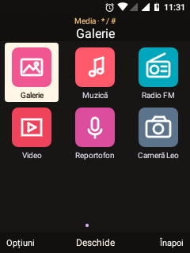 | 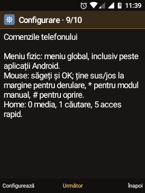 | 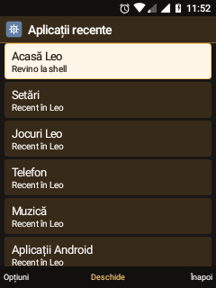 |


**23 octombrie · finisare UI:** antet compact, liste cu detalii secundare și bară
de taste actualizată fără refacerea ecranului. [Audit și verificări](android81/LEO-UI-FOUNDATION.md).

| Componente comune · date demo | Meniu global peste Setări Android |
| :---: | :---: |
| 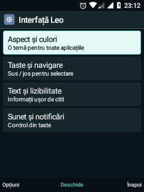 | 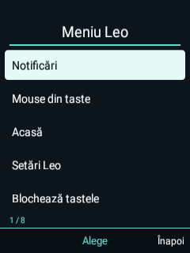 |

Capturile de mai jos documentează aspectul flat din **20 octombrie 2026**.
Ele ilustrează etapele anterioare; cele două capturi de mai sus sunt din 23 octombrie.
Culori uniforme, pictograme fără reflexe și selecții clare pentru D-pad.
Apasă o imagine pentru dimensiunea originală.

| Acasă · ambele SIM-uri | Aplicații · din taste | Setări cu taburi |
| :---: | :---: | :---: |
| <a href="android81/screenshots/leo-flat-20261020-home.png">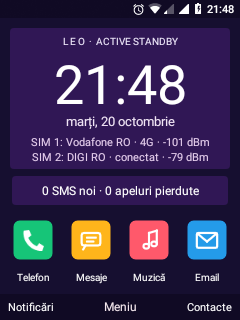</a> | <a href="android81/screenshots/leo-flat-20261020-apps.png">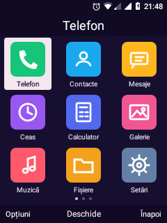</a> | <a href="android81/screenshots/leo-flat-20261020-settings.png">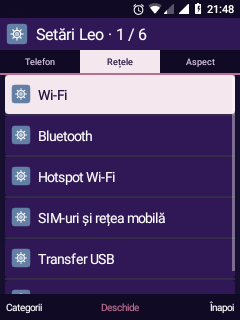</a> |
| **Player muzical** | **Calculator** | **Meniul de opțiuni** |
| <a href="android81/screenshots/leo-flat-20261020-music.png">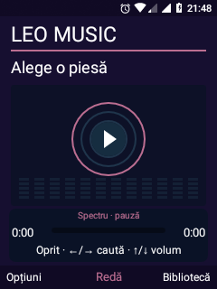</a> | <a href="android81/screenshots/leo-flat-20261020-calculator.png">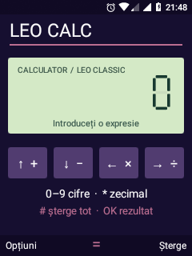</a> | <a href="android81/screenshots/leo-flat-20261020-menu.png">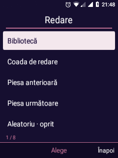</a> |

**Telefon Leo Night:** interfață proprie pentru apelare și convorbire, conectată
la Android Telecom. Ecranele de apel din aceste capturi sunt **demo locale**.

| Apelare | Apel primit · demo | Convorbire · demo |
| :---: | :---: | :---: |
| 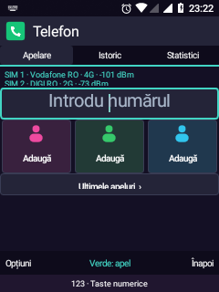 | 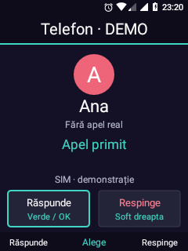 | 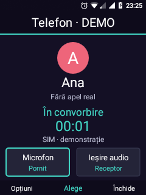 |

**Ceas și Meteo, pe aparat:** [funcții și probe](android81/LEO-CLOCK-WEATHER.md).

| Ceas · cinci file | Ora pe glob | Meteo București |
| :---: | :---: | :---: |
| 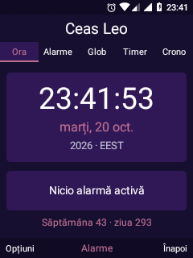 | 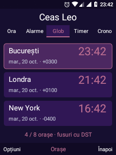 | 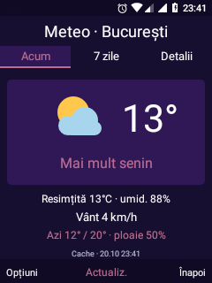 |

**Agenda, fișierele și backup-ul:** capturi noi de pe aparat, cu date demonstrative locale.

| Contact · fotografie | Numere multiple | Selecție fișiere |
| :---: | :---: | :---: |
| 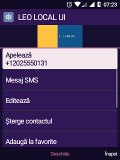 | 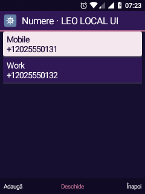 | 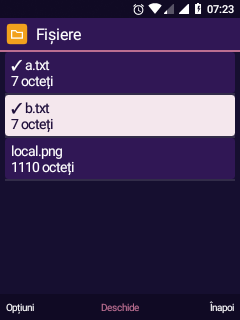 |
| **Galerie · zoom** | **SMS · contor** | **Backup · previzualizare** |
| 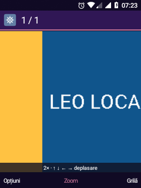 | 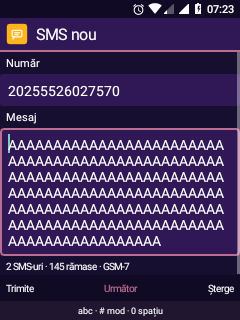 | 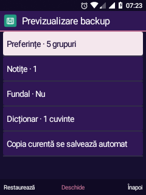 |

**Integrare nouă:** căutare globală, stiluri pe aplicații și backup selectiv al agendei/SMS.
Capturile folosesc exclusiv date fictive; [funcții și limite](android81/LEO-SIX-INTEGRATION.md).

| Caută în Leo | Stil pe aplicație · mostră | Restaurare selectivă |
| :---: | :---: | :---: |
| 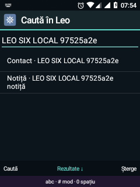 | 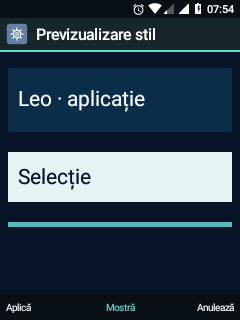 | 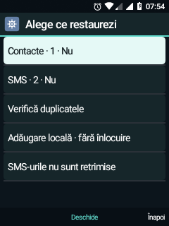 |

**Material · Noapte** aduce suprafețe închise, accent turcoaz și carduri rotunjite.
„Media curentă” reunește Muzică și FM; capturile următoare sunt demonstrații vizuale,
fără redare audio pornită de probă.

| Media curentă · Muzică | Player muzical | Media curentă · FM |
| :---: | :---: | :---: |
| 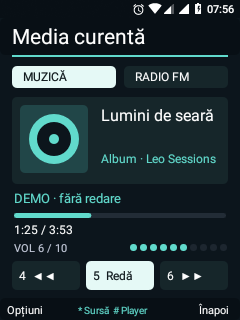 | 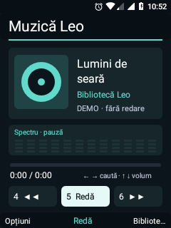 | 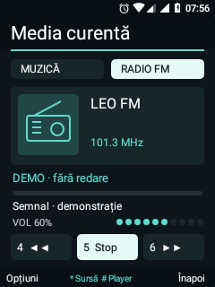 |

**Aplicațiile zilnice, mai coerente:** coperți și favorite în bibliotecă, albume
foto, conversații cu SIM-uri colorate, carduri la blocare și Calendar recurent.
[Detalii și limite](android81/LEO-DAILY-POLISH.md).

| Muzică · albume | Galerie · foldere | Mesaje · SIM-uri |
| :---: | :---: | :---: |
| 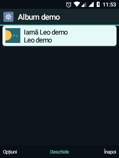 | 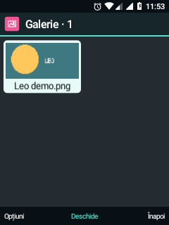 | 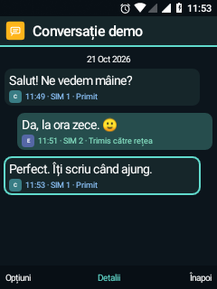 |
| **Calendar · zi cu eveniment** | **Blocare · informații** | |
| 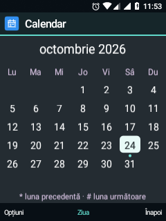 | 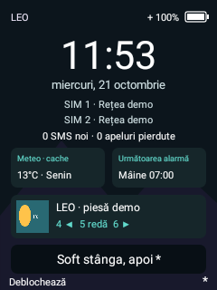 | |

**Mai personal, în fiecare zi:** acces rapid Home, alarme pe zile, notițe fixate,
slideshow, restaurare pe categorii și analiză de stocare.
[Comenzi, probe și limite](android81/LEO-DAILY-EXTRAS.md). Datele din capturi sunt demonstrative.

| Acces rapid | Alarme pe zile | Notițe fixate |
| :---: | :---: | :---: |
| 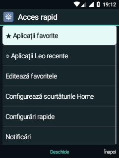 | 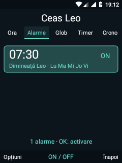 | 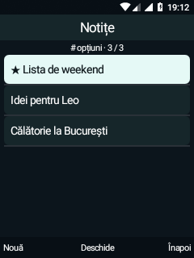 |
| **Galerie · rotire** | **Categorii fișiere** | **Backup pe categorii** |
| 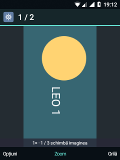 | 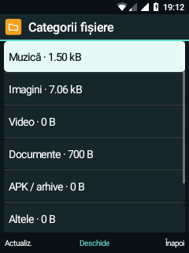 | 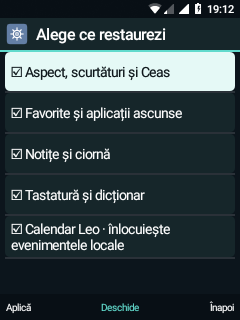 |

**Mai aproape de un telefon complet:** contacte recunoscute cu fotografie, răspuns
rapid și șabloane, ceas de birou, colecții vizuale și versuri locale.
[Comenzi și limite](android81/LEO-COMFORT.md).

| Telefon · contact fictiv | Șabloane SMS | Ceas de birou |
| :---: | :---: | :---: |
| 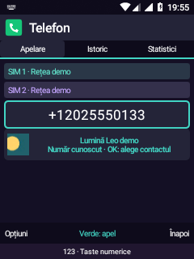 | 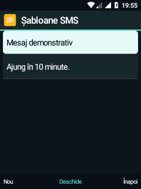 | 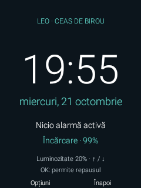 |
| **Colecție · previzualizare** | **Versuri locale originale** | **Ajutor · taste** |
| 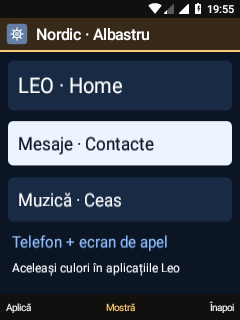 | 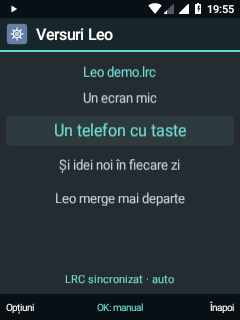 | 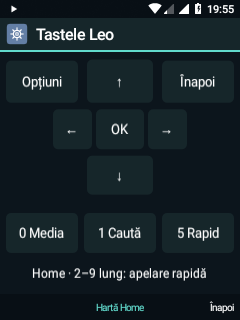 |

**Etapa 0.4, inclusă în 0.5:** include etapele anterioare, cititorul TXT/EPUB,
jocurile pentru taste, colecțiile vizuale, panoul de conexiuni, actualizatorul
local și Cameră Leo. Catalogul are **36 de ID-uri stabile**; meniul afișează acum **23 de intrări**, cu ordine configurabilă.

Pentru cameră sunt publicate sursele și documentația, fără fotografiile personale
folosite în probe. Captura „Componente comune” este un ecran de test randat real
pe aparat, cu texte demonstrative; nu este o aplicație nouă de setări.

## Ce poți face deja

**Home cu informații utile:** carduri opționale, fără servicii noi de polling.

| Meteo | Următoarea alarmă | Muzică / FM |
| :---: | :---: | :---: |
| 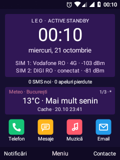 | 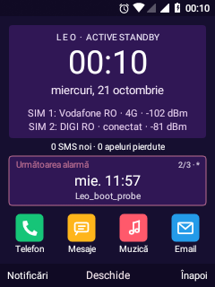 | 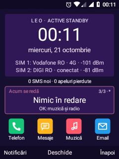 |

„Confirmat” înseamnă că proba descrisă a trecut pe aparatul de dezvoltare.
Limitele și scenariile rămase sunt indicate separat.

| Funcție de bază | Ce merge astăzi |
| --- | --- |
| 🏠 **Home și navigare** | Leo este launcherul principal. Carduri opționale Meteo, următoarea alarmă și Muzică/FM; `*` schimbă cardul, `#` îl deschide. D-pad, softkey-uri, notificări grupate, blocare și mouse din taste. Listele și meniurile Leo au navigare circulară; `1` pe Home deschide căutarea globală locală; `5` scurt deschide Acces rapid, cu favorite și recente Leo. |
| 🗂️ **Ferestre și recente** | Recente Leo și task-uri Android; comutare și închidere cu confirmare prin serviciul root existent. Un task Settings creat pentru probă a fost comutat și eliminat. Leo revine la Home; ferestrele de telefonie și apelurile active sunt protejate. |
| 🖱️ **Meniu global și mouse** | Meniu fizic disponibil și peste aplicațiile Android, cu serviciul Leo de accesibilitate activ. Activarea/oprirea mouse-ului și deplasarea cursorului verificate peste Setări Android; derulare automată sus/jos la margine cu tasta ținută, plus mod manual pe `*`. |
| 📷 **Cameră** | O cameră BF20A1 expusă prin HAL1; vizor, declanșare cu OK și JPEG 480 × 640 salvat local. Pornire automată și captură după reboot verificate. Ieșirea la Home a păstrat procesele launcherului și serviciilor camerei. Lanternă confirmată fizic și impuls LED în timpul capturii; Auto și calitatea expunerii cu bliț rămân nevalidate. Video neimplementat. |
| ⌨️ **Scriere** | Multi-tap și T9 românesc extins, dicționar personal, memorare opțională a alegerilor, majuscule, diacritice și simboluri. |
| 📞 **Apeluri pe SIM 1** | Apel primit și două apeluri inițiate cu sunet în ambele sensuri, confirmate real; răspuns și închidere din taste. USB s-a întrerupt la apelurile inițiate. |
| 👥 **Contacte și SMS** | Contacte locale cu numere multiple, fotografie, favorite și previzualizare import VCF; alegerea numărului înainte de apel/SMS. Telefonul prioritizează numerele recunoscute și arată fotografia/inițialele; căutare T9 în nume. Răspuns rapid pe 5, șabloane editabile și căutare T9 în conversație; contor GSM-7/Unicode, necitite evidențiate, SIM/stare și cerere de raport de livrare; primirea raportului real încă nevalidată. Dosare Primite/Trimise/În așteptare/Eșuate, verificate cu date locale fictive. Trimitere și recepție SMS pe SIM 1 confirmate în probele anterioare. Conversații Leo cu bule și ciorne locale. |
| 🌐 **Conectivitate** | Date LTE pe SIM 1, Wi-Fi și hotspot cu Internet verificat de pe un alt telefon. Ambele SIM-uri sunt afișate și înregistrate pentru voce. |
| 🔊 **Audio** | Difuzor, receptor, căști stereo cu fir și boxă Bluetooth A2DP. Bipuri pe boxă confirmate după integrarea modulului audio lipsă. |
| 📳 **Vibrații** | Calea haptică audio KaiOS este activată: trei impulsuri confirmate fizic. API-ul Android este adaptat și verificat prin HAL/PCM; proprietățile și biblioteca se încarcă după reboot. |
| 🎵 **Muzică** | Player Material în același stil cu Media curentă: copertă mare, titlu pe două rânduri, progres, comenzi 4/5/6 și vizualizator audio real; artiști și albume cu miniaturi, favorite, căutare T9/text, liste salvate, coadă editabilă, shuffle/repeat persistente, versuri locale LRC, oprire temporizată și reluarea ultimei sesiuni la cerere. Fișiere de probă MP3, FLAC, AAC, OGG și WMA v2 redate. |
| 📻 **Radio FM** | Acordaj, căutare înainte/înapoi, canale scanate, favorite, căști/difuzor și nume RDS afișat, confirmate manual. |
| 🎙️ **Reportofon** | Înregistrări AAC/M4A, pauză, salvare intern/SD, indicator care reacționează la voce și redenumire confirmată. |
| 📂 **Fișiere și transfer** | Fișiere interne și SD, selecție multiplă cu `5`, căutare, sortare și spațiu disponibil; imagini deschise în Galeria Leo cu zoom și deplasare. Copiere/mutare verificate prin hash anterior; USB MTP confirmat. Analiză la cerere pe categorii, top 20 fișiere mari și locație pentru exporturi/înregistrări noi. |
| 🧰 **Unelte zilnice** | Calculator, Notițe cu fixare, liste de bifat, export TXT și căutare T9; Calendar local cu agenda pe 90 de zile, recurențe și notificări, plus Ceas cu cinci file: Ora, Alarme, Glob, Timer și Crono. Ceas de birou cu luminozitate locală și baterie. Alarme pe zile ale săptămânii și amânare 5/10/15 minute; Timer cu pauză/continuare și cronometru cu ture. Programarea amânării este verificată; sunetul ei la termen rămâne de probat. |
| 🌤️ **Meteo** | București implicit, oraș configurabil, vreme modelată Open-Meteo, șapte zile, răsărit/apus și cache local cu data actualizării. Prognoză reală afișată pe telefon. |
| 🎨 **Personalizare** | Material · Noapte, colecții complete Leo Night/Nordic/Solar cu moștenire în Telefon, teme și accente, teme individuale pentru aplicațiile acceptate cu previzualizare, fundal opțional la blocare, reordonarea aplicațiilor, scurtături, trei favorite în dialer și configurări rapide cu volum. |
| 💾 **Backup Leo** | Export și restaurare locală pentru preferințele acceptate, teme/fundal, ordinea aplicațiilor, notițe și dicționar personal. Versiunea 2 include favorite muzicale/aplicații, Calendar Leo, șabloane SMS și restaurare pe categorii, cu validare și copie de revenire; citește și v1. Contactele și SMS-urile au acum o arhivă separată cu restaurare selectivă și omitere a duplicatelor; conturile rămân excluse. |
| 🖼️ **Galerie și aplicații Android** | Albume foto pe foldere, șase miniaturi mari, informații originale, slideshow și rotire de afișare; aplicații Android cu favorite și intrări ascunse reversibil. |
| 🌙 **Profiluri sonore** | Normal, Silențios, Exterior, Noapte și profil personal. Revenirea sunetului după Noapte → Normal confirmată. |
| 📚 **Cărți și jocuri** | Cititor TXT/EPUB cu reluare, semne de carte și text reglabil; Snake, Sudoku și Puzzle 15 pentru taste. Parserul EPUB, afișarea textului și selecția în joc au probe Android locale; sesiunile lungi și toate fluxurile de joc nu sunt validate integral. |
| ✉️ **Email și browser** | Client IMAP/SMTP configurabil și browser text controlat din taste. Primirea IMAP are confirmare anterioară; SMTP rămâne nevalidat. Browserul text are probe de navigare, dar nu execută JavaScript; WebView are limite GPU documentate. |
| 🖥️ **Terminal și unelte** | Terminal Leo cu tastatura fizică: scrierea și executarea `pwd` au fost confirmate manual. Accesul root depinde de configurația de dezvoltare a portului. Convertor, descărcări, diagnostic și panou de conexiuni disponibile. |
| 📦 **Actualizări locale** | Actualizator pentru pachetele Leo, cu verificări de integritate/semnătură și copie a APK-urilor precedente. Validarea metadatelor și respingerea pachetului greșit au probe Android; un ciclu complet de actualizare și recuperare prin aplicație rămâne de demonstrat. |

**Scurtătura nouă:** din Home, apasă **0** pentru **Media curentă** — un singur loc
pentru muzică și FM, volum și acces la player. Catalogul păstrează **35 de identificatori**, cu **22 de intrări în meniul pe categorii**; Ajutorul este în Setări;
aplicațiile Android instalate au propria listă, iar compatibilitatea cu tastele variază.

Pentru telefonia pe SIM 2, DTMF, VoLTE/VoWiFi și probe după repornire, consultă
limitele de mai jos. [Matricea tehnică și probele anterioare](README.archive-2026-10-20.md#tabelul-funcțiilor)
păstrează detaliile fiecărei funcții.

## Din taste

| Tastă / context | Acțiune |
| --- | --- |
| D-pad + OK | Navigare și selecție; listele Leo se parcurg circular |
| Soft stânga / dreapta | Acțiunea afișată în bara de jos; dreapta revine sau șterge în editor |
| Meniu fizic dedicat | Deschide meniul global Leo, inclusiv peste alte aplicații |
| Home · `0` / `1` / `5` scurt | Media curentă / căutare globală / acces rapid |
| Home · `*` / `#` | Schimbă / deschide cardul Home |
| Mouse · săgeți / OK | Deplasează cursorul / clic |
| Mouse · ↑/↓ ținut la marginea sus/jos | Derulează vertical; repetarea se oprește la eliberare |
| Mouse · `*` / `#` | Comută modul manual de derulare / oprește mouse-ul |
| Meniu aplicații · `*` / `#` | Categoria anterioară / următoare |
| Mesaje · stânga / dreapta | Schimbă dosarul de mesaje |
| Cameră · OK în vizor | Salvează o fotografie în `Pictures/Leo` |

Meniul global folosește serviciul Android de accesibilitate **Leo Visual**.
Acesta trebuie să fie activ; nu depinde de aplicația aflată în prim-plan.
Blocarea tastelor și protecțiile pentru apeluri/alarme au prioritate.
Derularea mouse-ului funcționează pe suprafețe care acceptă gesturi de glisare.
[Comportament și probe](android81/LEO-UI-FOUNDATION.md#meniu-global-și-mouse).

## Auditul proiectului

Audit actualizat la **24 octombrie 2026**, pe baza surselor și a rezultatelor
consemnate. „Confirmat” se referă la proba descrisă pe TA-1286; nu certifică toate
scenariile. Nu au fost repetate probele fizice vechi pentru această actualizare
de documentație.

| Zonă | Stare actuală | Dovezi și limite |
| --- | --- | --- |
| **Sistem și hardware** | Boot intern și mai multe subsisteme utilizabile | Android 8.1, profil low-RAM, GPU, taste, conectivitate, audio și vibrații documentate. GPS și alte integrări de senzori rămân incomplete. |
| **Cameră** | Fotografiere de bază funcțională | BF20A1, HAL1, vizor, JPEG 480 × 640 și pornire automată. Fluxul vizor → fotografie → Home a trecut fără repornirea proceselor urmărite. Deschiderea poate dura câteva secunde; LED-ul a fost confirmat; video, Auto și sesiuni lungi rămân de lucrat. [Detalii](android81/CAMERA-RUNTIME.md). |
| **Interfața Leo** | Fundație comună finisată, meniu filtrat pe categorii | 66 de activități moștenesc baza comună; nu toate ecranele lor folosesc exclusiv acea compoziție. Home, Telefon, player și alte ecrane speciale necesită audit individual. Nu este revendicat un redesign complet al fiecărui ecran. |
| **Meniu și accesibilitate** | Meniu global și mouse verificate în afara shell-ului | Probă peste Setări Android: deschidere meniu, pornire/oprire cursor, deplasare și derulare la margine. Testul de captură UI păstrează serviciul activ. [Audit UI](android81/LEO-UI-FOUNDATION.md). |
| **Telefonie** | Apeluri/SMS SIM 1; VoLTE primit și de ieșire plus SMS în ambele sensuri pe SIM 2; IMS pornește automat și recuperează clientul | Leo Night pe Android Telecom. Apelul VoLTE de ieșire a păstrat datele LTE; SMS SIM 2 are confirmare de livrare și răspuns recepționat. DTMF rămâne de verificat; întreruperile USB rămân documentate. |
| **Media** | Muzică, FM/RDS, căști și A2DP cu confirmări reale | Microfonul Bluetooth, HFP și toate variantele de codec nu sunt validate. Fișierele media de probă nu echivalează cu suport universal pentru orice profil. |
| **Surse** | 166 fișiere Java în shell, 37 de fișiere Java de probe Android și 5 Java host; modul comun de traducere separat | Inventar de fișiere, nu acoperire a testelor; tastatura și uneltele native sunt separate. |
| **Recompilare** | 590 de proiecte AOSP fixate la SHA, patch-uri și rețete în repository | Rebuild integral pe PC curat nevalidat. Dump-ul și componentele proprietare sunt intrări private separate. |
| **Verificări** | Probe automate locale și confirmări hardware păstrate distinct | 77 de verificări Android au trecut în etapa 0.4 (32 fluxuri, 16 organizator, 11 browser, 18 PocketSuite). Ulterior: 13 verificări ale adaptorului camerei cu HAL fictiv, 18 PocketSuite reverificate, 16 UI Foundation și 86 Maturity în etapa 0.5; cele 16 UI Foundation au fost reverificate și pe 0.5. Sunt rulări diferite, cu suprapuneri; nu se însumează ca o suită unică. |
| **Livrare** | Pachet local de actualizare a celor două aplicații, cu hash-uri verificate | Snapshot-ul recent a fost colectat din APK-urile construite (`rebuilt=false` în manifestul pachetului). Nu este ROM complet și nu include runtime-ul proprietar al camerei. |
| **Securitate și licențe** | Build de dezvoltare, integrare hardware cu componente stock | Serviciile camerei rulează root în politica permisivă existentă. Întărirea SELinux și clarificarea licenței codului Leo rămân de făcut. Blobs, chei, fotografii personale și jurnale brute nu sunt publicate. |

## Ce mai avem de construit

Prioritatea curentă este maturizarea interfeței și a aplicațiilor. Probe suplimentare
de USB, performanță, autonomie și telefonie SIM 2 sunt amânate la alegerea
utilizatorului; statutul lor nu devine automat „rezolvat”.

| Direcție | Următorul pas | Criteriu de finalizare |
| --- | --- | --- |
| **UI coerentă · activ** | Home, meniu, Telefon, player și aplicații speciale: ierarhie, spațiere, iconuri, stări goale/încărcare/eroare | Verificare ecran cu ecran la 240 × 320, text normal/mărit și teme, fără suprapuneri și cu toate acțiunile accesibile din taste |
| **Telefon Leo Night** | Finisarea interfeței proprii și a fluxurilor pe backend Telecom | Scenarii complete din taste; SIM 2 și DTMF se validează separat când interfața este matură |
| **Cameră și hardware** | Fotografiere îndelungată, alte moduri, orientare, video/bliț; apoi GPS | Probe reale și limite documentate pentru fiecare funcție; o cameră enumerată nu dovedește toate modurile |
| **Aplicații** | Email SMTP, browser/WebView, scenarii T9 și aplicații Android | Fluxuri complete utilizabile din taste și rezultate reale documentate |
| **Release de proiect** | Rebuild pe mediu curat, versiuni identificabile, instalare și recuperare documentate | Alt mediu reconstruiește pachetul din intrările declarate; procedura de ROM complet rămâne o etapă separată |
| **Validări ulterioare** | USB/ADB, autonomie, sesiuni lungi, accesorii și SIM 2 | Măsurători și probe separate, reluate când sunt prioritizate |

### Limite cunoscute, pe scurt

- **Calitatea vocii în apel:** după selectarea explicită a profilului de calibrare
  KaiOS dedicat Leo, utilizatorul a confirmat că sunetul este în regulă în proba
  de apel în ambele sensuri. După reboot, profilul Leo s-a păstrat și HAL-ul a revenit activ; nu s-a repetat apelul.
  [Investigație și revenire](android81/AUDIO-CALL-QUALITY.md).

- **Pornirea radioului:** a fost observat un boot cu ambele SIM-uri `READY`, dar
  radio `POWER_OFF`. Recuperarea manuală a serviciilor a reușit; protecția automată
  a pornit după reboot și a raportat `HEALTHY`; recuperarea unui nou blocaj nu este încă probată. [Detalii](android81/RADIO-RECOVERY.md).

- **Camera:** vizor și JPEG 480 × 640 funcționale în portul HAL1; filmarea nu este implementată. Lanternă și activarea LED-ului la captură au probe; modul Auto și expunerea în diferite scene rămân de validat. [Detalii și izolarea interfeței](android81/CAMERA-RUNTIME.md).
- **GPS:** aplicație și runtime GNSS experimental adăugate; încărcarea HAL-ului a trecut. Pornirea automată, furnizorul Android și ciclul cererii au trecut; în proba de 30 s nu au fost observați sateliți și nu s-a obținut o poziție. Ceilalți senzori Android au integrare incompletă.
- **Vibrații:** calea audio funcționează fizic și prin API-ul Android adaptat. Amplitudinea variabilă, efectele predefinite și scenariile simultane cu apel/media nu sunt validate. [Corecția și probele](android81/LEO-HOME-HAPTICS.md#vibrații-cauza-și-corecția).
- **VoLTE:** apel primit pe SIM 2 confirmat, cu sunet în ambele sensuri și date LTE simultane. [Pornirea automată și recuperarea clientului IMS](android81/IMS-RUNTIME.md) sunt integrate și verificate; apelul VoLTE de ieșire pe SIM 2 a fost validat ulterior cu voce și date LTE; handover-ul rămâne nevalidat. **VoWiFi:** nevalidat.
- **MMS:** neimplementat; pagina de diagnostic arată serviciul Android și configurația operatorului. SMS pe SIM 2 este confirmat în ambele sensuri, inclusiv livrarea mesajului trimis.
- **Email / web:** primirea IMAP a funcționat; SMTP este nevalidat. Browserul text nu execută JavaScript, iar WebView a avut crash-uri GPU.
- **FM și accesorii:** căștile sunt antena FM; o sesiune este limitată la o oră. HFP, microfonul Bluetooth și apelurile prin căști mai au nevoie de verificări.
- **Performanță și securitate:** platformă Android 8.1 veche, kernel derivat din stock și build de dezvoltare; actualizările și o configurație de release întărită rămân de planificat.

## Pentru cei care vor să construiască

| Aparatul de dezvoltare | Configurație |
| --- | --- |
| Model | Nokia 6300 4G · **TA-1286** |
| Platformă | Qualcomm msm8909 · Cortex-A7 · ARMv7 / Binder 32-bit |
| Ecran / GPU | 240 × 320 · Adreno 304 |
| Bază software | AOSP `android-8.1.0_r81`, produs `aosp_leo_go-eng` |
| Kernel | Derivat din stock `4.9.240-perf-g4f9e270fd77f`, cu UHID; fără mainline |
| Memorie / stocare | Profil low-RAM, zRAM ~256 MiB; `/system` ~800 MiB, `/data` ~2,3 GiB, pe memoria internă |
| Interfață | Leo Visual nativ + Leo Keypad; fără dependență de WebView pentru shell |

Profilul low-RAM folosește configurația Go a proiectului; certificarea Android Go
și serviciile Google nu fac parte din port.

**[Începe cu ghidul de recompilare →](android81/REBUILD.md)**

Mediul utilizat este Windows + WSL/Linux, cu Java 8 și un checkout AOSP separat.
Repository-ul conține surse și rețete de dezvoltare. Pentru reconstruire sunt
necesare și intrările locale descrise în ghid, inclusiv componentele originale.

```text
android81/
  visual-shell/       Home, aplicații, meniuri, bibliotecă și setări Leo
  keypad-ime/         Tastatură multi-tap și T9
  device/nokia/leo/   Configurație AOSP, init, keylayout și politica audio
  audio-runtime/     Integrarea audio Qualcomm
  fm-runtime/        Backend FM și rutare audio
  radio-runtime/     Integrarea modemului
  repro/             Manifest AOSP fixat și modificări pentru recompilare
  screenshots/       Capturi selectate pentru documentație
  local/, output/    Intrări și rezultate locale, ignorate de Git
```

## Harta proiectului

| Vrei să urmărești… | Începe de aici |
| --- | --- |
| Leo 0.6: SIM 2, HFP, GPS, Email și cameră | [Rezultate și limite](android81/LEO-06-CONNECTIVITY.md), [actualizare cu runtime-uri](android81/RUNTIME-UPDATE.md) |
| Camera BF20A1, pornire și limite | [Integrarea runtime-ului camerei](android81/CAMERA-RUNTIME.md), [investigația inițială](android81/CAMERA-PORT-AUDIT.md) |
| Maturizarea Leo · 0.5 | [Categorii, ferestre, SMS, ghid și bliț](android81/LEO-MATURITY.md) |
| UI, meniu global și mouse | [Fundația vizuală, probe și limite](android81/LEO-UI-FOUNDATION.md) |
| Sursele și recompilarea | [REBUILD](android81/REBUILD.md), [configurația dispozitivului](android81/device/nokia/leo/) |
| Stabilitate și apeluri inițiate | [Probe SIM 1, întreruperea USB și DeskClock](android81/STABILITY-PHONE-20261020.md) |
| Aplicații · 0.4.0 · instalat | [Teme, cărți, jocuri, conexiuni, actualizator și cameră experimentală](android81/LEO-POCKET-SUITE.md) |
| T9 și Browser · probe Android trecute | [Cuvinte și pagini din taste](android81/LEO-KEYPAD-WEB.md) |
| Organizator · probe Android trecute | [Calendar, Galerie, playlisturi, notificări, program sonor și diagnostic](android81/LEO-ORGANIZER.md) |
| Fluxuri noi · probe Android trecute | [Fișiere, partajare, contacte, Home și aplicații](android81/LEO-PROJECT-FLOWS.md) |
| Pachet aplicații numerotat | [Release apps, manifest și verificare](android81/RELEASE-APPS.md) |
| Leo pentru fiecare zi | [Telefon, SMS, ceas de birou, colecții, LRC și ajutor](android81/LEO-COMFORT.md) |
| Acces rapid și unelte personale | [Ceas, Notițe, Galerie, Backup și Stocare](android81/LEO-DAILY-EXTRAS.md) |
| Șase rafinări zilnice | [Home, notificări, T9, stil flat și măsurări](android81/LEO-DAILY-REFINEMENTS.md) |
| Centrul media | [Muzică, A2DP și recuperarea tastelor](android81/LEO-MEDIA-CENTER.md) |
| FM, scanare, RDS și difuzor | [Portarea FM](android81/FM-INVESTIGATION.md) |
| Shell-ul și aplicațiile pentru taste | [Leo Visual](android81/VISUAL-SHELL.md), [aplicațiile de sistem](android81/LEO-SYSTEM-APPS.md) |
| T9 și personalizare | [Tastatura](android81/KEYPAD-IME.md), [îmbunătățirile Leo](android81/LEO-UPGRADES-20261020.md) |
| Conectivitatea și setările | [Setări și conectivitate](android81/LEO-CONNECTIVITY-SETTINGS.md), [setări native](android81/LEO-NATIVE-SETTINGS.md) |
| Grafică și timpi de răspuns | [Integrarea Adreno](android81/ADRENO-INTEGRATION.md), [măsurarea latenței](android81/UI-LATENCY.md) |
| Fișiere, ciorne, înregistrări și baterie | [Unelte zilnice](android81/LEO-DAILY-TOOLS.md) |
| Starea tehnică detaliată și evoluția | [STATUS](android81/STATUS.md), [README-ul anterior, arhivat integral](README.archive-2026-10-20.md) |

## Construim mai departe

Sunt utile rapoartele care spun **varianta telefonului, versiunea testată, pașii și
rezultatul observat**. O funcție se poate confirma printr-o probă mică și clară;
problemele rămase merită aceeași vizibilitate ca reușitele.

Leo este încă un proiect în lucru, cu mult loc pentru contribuții: cod, teste,
traduceri, documentație și idei pentru o interfață mai plăcută din taste.

---

Versiunile anterioare sunt păstrate integral: [20 octombrie](README.archive-2026-10-20.md)
și [înaintea actualizării din 23 octombrie](README.archive-2026-10-23.md).
Această pagină este prezentarea și auditul curent.
