# Nokia 6300 4G (nokia-leo)

**Port Android 8.1 / Leo · TA-1286 · experimental**

Ultima actualizare: **19 octombrie 2026**

Android pornește din memoria internă, cu accelerare Adreno și interfață pentru
taste. Datele LTE, redarea audio și un apel primit cu sunet în ambele sensuri
au fost confirmate în probele descrise mai jos.

> **Starea portului: pornește, utilizare experimentală.** Pornirea are încă probleme de stabilitate,
> hardware încă neintegrat și aplicații instabile. Repository-ul nu oferă încă
> un ROM complet instalabil. Acesta este un proiect Android, independent de portul postmarketOS.

| Dispozitiv | Nokia 6300 4G |
| --- | --- |
| Producător / variantă testată | HMD Global / **TA-1286** |
| Nume de cod | `leo` / `nokia-leo` |
| Tip | Telefon cu taste, D-pad, două SIM-uri; fără touchscreen |
| Platformă | Qualcomm `msm8909`, Cortex-A7; ARMv7, userspace/Binder 32-bit |
| GPU | Adreno 304, GLES 3.0 |
| Ecran | 240 × 320, SPI, ieșire RGB565 |
| Sistem original | KaiOS 2.5.4, Gecko 48.0a2 |
| Sistem portat | AOSP `android-8.1.0_r81`, produs `aosp_leo_go-eng` |
| Kernel utilizat | Derivat din stock `4.9.240-perf-g4f9e270fd77f`, cu UHID pentru mouse Bluetooth; nu mainline |
| Profil memorie | `ro.config.low_ram=true`, zRAM aproximativ 256 MiB |
| Partiții utilizate | Intern: `/system` aproximativ 800 MiB, `/data` aproximativ 2,3 GiB |
| Interfață | **Leo Visual**, HOME nativ; **Leo Keypad**, multi-tap / T9 local |
| Configurație dispozitiv | [device/nokia/leo](android81/device/nokia/leo/) |
| Pachet de instalare | Indisponibil; surse, patch-uri și scripturi de dezvoltare |

Profilul pentru memorie redusă nu reprezintă certificare Android Go. Serviciile
Google nu sunt incluse. Kernelul și componentele Qualcomm necesare provin din
sistemul original; shell-ul nu depinde de WebView.

**Recompilare:** [surse, manifest AOSP fixat și comenzi de build](android81/REBUILD.md).

**Cuprins:** [Funcții](#tabelul-funcțiilor) · [Capturi](#capturi) ·
[Instalare](#instalare) · [Pornire și recuperare](#pornire-și-recuperare) ·
[Probleme](#probleme-cunoscute) · [Dezvoltare](#dezvoltare) ·
[Documentație](#documentație) · [Contribuții](#contribuții)

## Tabelul funcțiilor

Stările se referă exclusiv la portul Android și la probele efectuate pe TA-1286.
Nu sunt stările portului postmarketOS și nu garantează toate scenariile de utilizare.

| Stare | Semnificație |
| --- | --- |
| **Funcțional** | Proba descrisă a trecut pe telefon, în limitele menționate |
| **Parțial** | Numai o parte funcționează sau există o problemă cunoscută |
| **Nefuncțional** | Componentă neintegrată sau probă eșuată |
| **Netestat** | Nu există încă o probă suficientă |
| **Experimental** | Rezultat într-o probă temporară, fără validare ca funcție permanentă |

### Sistem, interfață și stocare

| Funcție | Stare | Ce am verificat / limită |
| --- | --- | --- |
| Android pe memoria internă | **Funcțional** | `/system` read-only, `/data` read-write; sistemul nu mai depinde de cardul SD. |
| Pornire și repornire | **Parțial** | Corecție NetworkPolicy instalată; după recuperare nu s-a raportat ANR. Proba de autostart conectivitate a fost urmată de 900E; cauza rămâne în investigare. |
| USB / ADB / root | **Parțial** | Diagnostic, instalare și control funcționale; după unele reporniri conexiunea cere reconectarea cablului. Uneltele au acum timeout pentru a evita așteptarea nelimitată. |
| Leo Visual / HOME | **Funcțional** | Shell implicit nativ; listă/grilă cu 23 intrări pe trei pagini, pictograme colorate și scurtături pe Home, preferințe salvate și bară de acțiuni. Leo clasic eliminat pentru utilizatorul activ. |
| Meniu global | **Funcțional** | Tasta Meniu dedicată deschide comenzile peste alte aplicații; stil comun „Alege / Înapoi”. |
| Notificări native Leo | **Parțial** | Notificare sintetică citită, deschisă prin PendingIntent și eliminată din taste. Ascultător propriu autorizat explicit pe low-RAM; fără răspuns direct la notificări. |
| Configurări rapide Leo | **Parțial** | Wi-Fi și Bluetooth oprite/repornite din taste; luminozitate salvată și restaurată. Hotspot/SIM deschid paginile native; vibrator nedetectat. |
| Indicatoare SMS / apeluri pierdute | **Parțial** | SMS și apel pierdut sintetice afișate pe Home și pe ecranul blocat, apoi confirmate separat la citire. Marcarea conversației păstrează un SMS mai nou. Fără apel/SMS real inițiat în această probă. |
| Configurare inițială | **Parțial** | Șapte pagini native; navigare și finalizare verificate. Leo rămâne în română; limba Android se schimbă separat. |
| Mouse din D-pad | **Parțial** | Deplasare cu accelerare la menținere, oprire la eliberare și clic verificate; compatibilitatea tuturor aplicațiilor și derularea nu sunt complet validate. |
| Listă Aplicații Android | **Funcțional** | 12 activități lansabile detectate, iconuri și sortare; Calculator și revenire în listă verificate. Nu validează toate aplicațiile. |
| Tastatură fizică / D-pad | **Funcțional** | Mapare adaptată și confirmări pe telefon; aplicațiile Android nu sunt toate adaptate la taste. |
| Introducere multi-tap din taste | **Funcțional** | IME implicit, inclus în împachetare; hook nou la boot încă neverificat prin reboot; 11 probe în editor local: litere, diacritice, majuscule, ștergere și câmp numeric. Compatibilitatea tuturor aplicațiilor nu este încă verificată. |
| Predicție T9 | **Parțial** | Dicționar românesc local propriu; zece probe reale și 424 verificări JVM trecute. Fără învățare sau dicționar complet; motorul KaiOS nu este executat. |
| Bară de stare Android | **Funcțional** | Vizibilă împreună cu Leo Visual; nu confirmă singură funcționarea fiecărui serviciu afișat. |
| Accelerare Adreno | **Funcțional** | Renderer Qualcomm și test Android HARDWARE bitmap verificate, inclusiv după reboot. |
| Fluiditate generală | **Parțial** | Listele Leo reutilizează rândurile și actualizează numai selecția: p95 HWUI Configurări 7–8 → 5 ms în probe controlate. Prezentarea la aproximativ 29 Hz și erorile EGL rămân; nu este latența completă tastă–ecran. [Măsurători](android81/PERFORMANCE-AUDIT.md). |
| Profil pentru memorie redusă | **Funcțional** | `low_ram` și zRAM verificate software; nu înseamnă că orice aplicație rulează fluent. |
| Baterie / alimentare USB | **Parțial** | Nivel, tensiune, temperatură și alimentare citite; autonomia și ciclul complet de încărcare sunt netestate. |
| Card microSD FAT32 | **Parțial** | Aproximativ 32 GB, PUBLIC/VISIBLE după reboot; folder și fișier UTF-8 create din Fișiere Leo, citire prin provider verificată. Configurația vold reparată fără formatare; scoaterea la cald și alte carduri sunt netestate. |
| MTP | **Funcțional în probe** | Transfer PC → memoria internă / microSD → PC, hash identic; confirmat și de utilizator. Pornire/oprire din Setări Leo → Rețele → Transfer USB, cu ADB în ambele moduri. Transferurile mari rămân netestate. [Detalii](android81/MEDIA-RUNTIME.md). |
| Iluminarea tastelor | **Funcțional** | Pornire la apăsare fizică, nivel 20/40 și timeout de 8 secunde; iluminare confirmată de utilizator. |
| Vibrații | **Nefuncțional** | HAL-ul lipsă a fost instalat; Android vede vibratorul și driverul raportează activare, dar utilizatorul nu simte motorul. |
| Animație de pornire LEO | **Funcțional** | Logo original și puncte mov animate, 240×320, 6 cadre/s; confirmate pe telefon la reboot, apoi meniul Leo. |

### Telefonie, sunet și conectivitate

| Funcție | Stare | Ce am verificat / limită |
| --- | --- | --- |
| Modem și două SIM-uri | **Funcțional** | Ambele SIM-uri READY și ambele sloturi înregistrate pentru voce, inclusiv după reboot. |
| Date mobile LTE / 4G | **Funcțional** | SIM 1: conexiune Android validată și două răspunsuri ping externe după reboot. Nu confirmă datele pe SIM 2 sau toate rețelele/APN-urile. |
| Setări rețea mobilă / opțiune 4G | **Funcțional** | Pagina și taburile SIM verificate; opțiunea LTE este expusă. Statisticile de trafic indisponibile sunt dezactivate. |
| Ecran de apel pentru taste | **Funcțional** | Apelul primit deschide interfața completă; răspunsul și închiderea din taste au fost confirmate pe apel real. |
| Apel primit și audio în ambele sensuri | **Funcțional** | După repararea inițializării și reboot: sonerie, receptor și conversație în ambele sensuri confirmate pe apel real. Stabilitatea pe termen lung rămâne de urmărit. |
| Apel inițiat de pe Nokia | **Parțial** | SIM 1: destinatarul a confirmat soneria, fără sunet în vechea probă. Audio este acum reparat pentru apel primit; apelul inițiat necesită retestare. |
| Respingere apel real / apel în așteptare / conferință | **Netestat** | Respingerea a trecut în simulare; scenariile reale necesită probe separate. |
| Tasta roșie | **Parțial** | Mapată ENDCALL; revenirea Acasă în repaus a fost verificată prin codul fizic. Apelul real a fost închis cu soft dreapta. |
| DTMF, microfon mut, difuzor și volum în apel | **Parțial** | Comenzi implementate; DTMF și comutările microfon/difuzor au trecut în simulare. Transportul DTMF și toate efectele audio în apel real sunt netestate. |
| SMS Leo | **Parțial** | SIM 1: trimitere/recepție confirmate anterior. Conversații cu bule, căutare, redirecționare și copiere verificate pe date fictive. Arhivă locală de ieșire adăugată pentru mesajele trimise lipsă: 20 probe SQLite/receiver și afișare de stări; fără o nouă probă radio completă. SIM 2 încă de validat; fără MMS/raport de livrare. |
| MMS | **Nefuncțional** | Nu este implementat în Mesaje Leo. |
| Difuzor / AudioTrack | **Funcțional** | Bipuri PCM și muzică OGG confirmate; modulele sunt preîncărcate înainte de zygote, iar HAL-ul Qualcomm pornește după pregătirea DSP-ului. [Detalii](android81/AUDIO-KEYLIGHT-20261019.md). |
| Receptor de apel | **Funcțional** | Politică Earpiece și mixer corectate; bipuri fără forțarea manuală a mixerului și apel primit cu sunet confirmate. |
| MediaPlayer / fișiere OGG | **Parțial** | Decodorul Vorbis și configurația codec corectate; redare OGG confirmată auditiv. Nu validează toate formatele sau aplicațiile media. |
| MP3 / FLAC / AAC | **Parțial** | Fișiere sintetice redate prin MediaPlayer; poziții de 2,8–2,9 secunde verificate. Nu validează toate profilurile, containerele sau fișierele. |
| WMA în Muzică Leo | **Parțial** | WMA v2 decodat local și redat din Leo, confirmat auditiv. Pregătire în cache cu limite de dimensiune; alte variante și DRM nevalidate/nesuportate. [Formate](android81/MEDIA-RUNTIME.md). |
| Microfon în convorbire | **Funcțional** | Conversație în ambele sensuri confirmată după corecția audio și reboot; înregistrarea separată rămâne nevalidată. |
| Căști / alte rute audio | **Netestat** | Fără validare completă pentru accesorii și schimbarea rutelor. |
| Client IMS | **Experimental** | Port compilat, cu înregistrare IMS voce pe SIM 1 într-o probă controlată. Activarea a fost retrasă; nu pornește automat. |
| VoLTE | **Netestat** | Înregistrarea IMS nu dovedește un apel VoLTE; apelul primit reușit nu a fost identificat ca VoLTE. |
| VoWiFi | **Nefuncțional** | IMS/VoWiFi neintegrat; conectarea Wi-Fi de probă nu validează apeluri Wi-Fi. |
| Wi-Fi | **Funcțional** | Asociere COMPLETED, adresă și 2/2 ping prin wlan0 după două porniri cu inițializare timpurie. Stabilitatea pe termen lung necesită observație. |
| Bluetooth | **Parțial** | ON după reboot; mouse BLE conectat prin HID, mișcare și clic confirmate de utilizator. Accesoriile audio și alte profiluri nu sunt validate. |
| Hotspot | **Funcțional** | WPA2 pornit/oprit din Leo; DHCP și partajare mobilă active. Utilizatorul a confirmat acces web de pe alt telefon cu datele mobile ale clientului oprite. |

### Aplicații și alte componente hardware

| Funcție | Stare | Ce am verificat / limită |
| --- | --- | --- |
| Setări Android | **Parțial** | Se deschide după corecții; unele categorii nu au suport hardware funcțional. |
| Calculator | **Funcțional** | Pornire și `2 + 2 = 4` verificate; introducerea din proba inițială a fost prin ADB. |
| Calculator Leo | **Funcțional** | Instalat; 29 cazuri JVM trecute; priorități, zecimale și împărțire la zero verificate pe telefon. |
| Notițe Leo | **Funcțional** | Scriere multi-tap, salvare/redeschidere, editare fără duplicare, ciornă și ștergere confirmată testate pe nota de probă; fără teste de volum sau pierdere a alimentării. |
| Contacte Leo | **Funcțional** | Creare, căutare, editare și ștergere verificate pe un contact local de probă. Contactele sincronizate și structurile complexe rămân nevalidate. |
| Contacte · T9 / VCF / apelare rapidă | **Parțial** | Parser VCF 2.1 quoted-printable, 3.0 UTF-8 și 4.0; import/export prin provider și căutare T9 verificate pe date sintetice. Importul adaugă copii, fără deduplicare. Menținerea tastei 9 a deschis numărul sintetic pentru confirmare, fără apel real. |
| Telefon Leo | **Parțial** | Tastatură numerică, istoric și alegere SIM implementate; două conturi SIM afișate. Nu a fost inițiat un apel în această probă. |
| Ceas Leo | **Parțial** | Oră/cronometru testate; temporizatorul și alarma proprie au declanșat în fundal, inclusiv după terminarea procesului. Utilizatorul confirmă sunetul temporizatorului. Recuperarea la reboot și celelalte rute/volume nu sunt validate. |
| Calendar Leo | **Parțial** | Interfață nativă, lună/agendă; salvare de eveniment în calendarul local Android verificată. Creare, persistență după reboot, editare și ștergere verificate; fără recurențe/remindere. |
| Fișiere Leo | **Parțial** | Folder și text UTF-8 create; provider read-only și respingere acces în afara rădăcinii verificate. Persistență după reboot, editare text, redenumire de fișier și ștergere fișier/folder gol verificate; deschiderea externă depinde de aplicațiile instalate. |
| Galerie Leo | **Funcțional** | Miniaturi, vizualizare și zoom verificate cu imagine sintetică. Până la 500 imagini; fără albume/editor foto. |
| Fundaluri și teme Leo | **Funcțional** | Patru teme, alegere imagine din Galerie, aplicare/eliminare pe HOME verificate. |
| Convertor Leo | **Funcțional** | Șase categorii; 137 verificări JVM și probă 100 °C → 212 °F pe telefon. |
| Setări Leo / profiluri | **Parțial** | Patru taburi din D-pad, pagini native de conectivitate, SIM, timp, localizare și aplicații. APN, operator avansat și permisiuni folosesc Android. Vibrator detectat software, fără vibrație fizică. |
| Preferințe SIM din Leo | **Parțial** | Salvare apeluri/SMS pe SIM 1 verificată fără trafic de probă; schimbarea efectivă a SIM-ului de date și SIM 2 rămân de verificat. |
| Dată și oră din taste | **Parțial** | Oră automată, format 12/24 și respingerea datei invalide verificate. Aplicarea manuală a unei date valide/altui fus nu a fost testată. |
| Aplicații / permisiuni din Leo | **Parțial** | Listă uzuală/completă, informații și starea permisiunilor; administrarea completă se deschide în Android. |
| Favorite | **Funcțional** | Marcaj Android STARRED, listă proprie și probă pe contact sintetic, curățat după verificare. |
| Ecran de blocare Leo | **Funcțional** | Ceas, dată, baterie și ambele SIM-uri, cu tema/fundalul HOME. Blocare automată la stingere și expirarea combinației verificate. Deblocare: soft stânga → *. Protecție contra apăsărilor accidentale, fără PIN. |
| Descărcări Leo | **Parțial** | Interfață DownloadManager implementată și deschisă; transferul efectiv nu a fost validat. |
| Muzică / Video Leo | **Parțial** | Bibliotecă și controale native; WMA redat prin serviciul Muzică Leo. MP3/FLAC/AAC verificate prin MediaPlayer. Redarea video și compatibilitatea tuturor fișierelor rămân de validat. |
| Reportofon Leo | **Parțial** | AAC/M4A, pauză, serviciu foreground și listă implementate; microfonul nu este pornit fără placă audio. Înregistrarea reală rămâne nevalidată. |
| WebView Android | **Parțial** | HTML local afișat, dar ulterior crash GPU în audit. Nu este motorul browserului text Leo. |
| Browser text Leo | **Parțial** | HTTPS example.org, favorite și istoric verificate pe telefon. Reader HTML/text fără JavaScript, formulare web sau motor modern complet. |
| Email | **Parțial** | Email Leo: editor din taste și interfață pentru conturi/foldere/mesaje. Eroarea de resurse AOSP a fost reparată, configurarea se deschide. Conturile reale, sincronizarea și trimiterea rămân netestate. [Detalii](android81/LEO-STYLE-EMAIL.md). |
| Cameră | **Nefuncțional** | Android raportează zero dispozitive. Audit offline: 23 componente originale și 16 biblioteci Android, fără dependențe declarate lipsă; încărcarea izolată a HAL-ului QCamera a reușit pe telefon. Senzorul, daemonul și captura rămân nevalidate. [Audit](android81/CAMERA-PORT-AUDIT.md). |
| GPS / localizare reală | **Nefuncțional** | Fără provider GPS funcțional sau fix real confirmat. |
| Senzori Android | **Nefuncțional** | SensorService nu detectează senzori; descrie integrarea software, nu inventarul fizic. |

## Capturi

### Interfața Leo actualizată

Teme comune, pictograme mai vizibile și un dialer cu trei favorite, telemetrie
pentru ambele SIM-uri și taburi pentru istoric/statistici. Cifrele se introduc din
tastele fizice. [Comenzi și limite](android81/LEO-STYLE-EMAIL.md).

| Home | Aplicații | Telefon |
| --- | --- | --- |
| 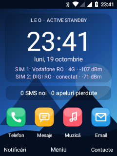 | 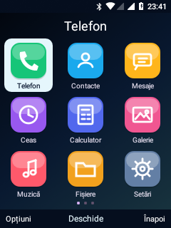 | 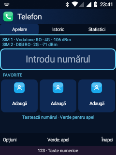 |

| Statistici apeluri | Email Leo | Calculator |
| --- | --- | --- |
| 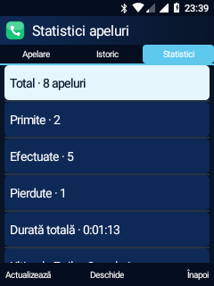 | 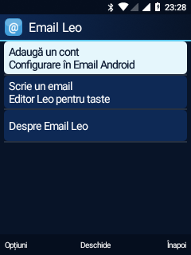 | 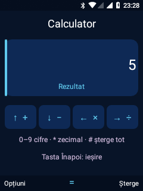 |


| Pornire LEO · captură din proba pe telefon | Card SD în Fișiere Leo |
| --- | --- |
|  | 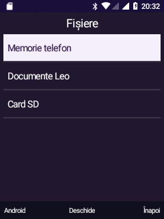 |

| Conversație SMS · date fictive | Opțiuni din taste |
| --- | --- |
| 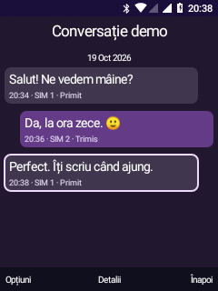 | 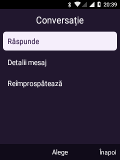 |

| Căutare fără diacritice · demo | Redirecționare · demo | Arhiva de ieșire · stări fictive |
| --- | --- | --- |
| 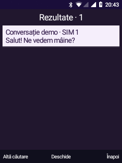 | 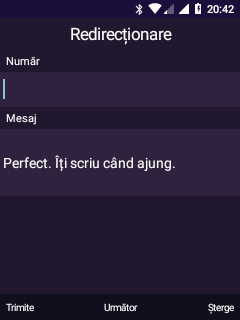 | 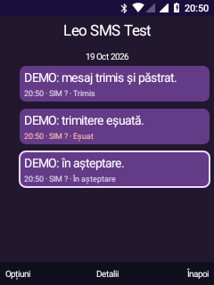 |

Capturi reale la 240 × 320. Ecranele de test IME și mouse nu reprezintă aplicații
complete; capturile istorice ale apelurilor sunt simulări. Apelul real este documentat separat.

| HOME / dual SIM | Listă aplicații | Meniu global |
| --- | --- | --- |
| 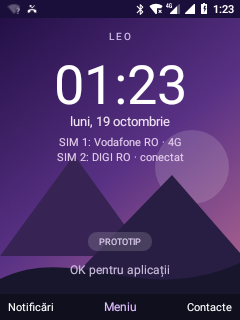 | 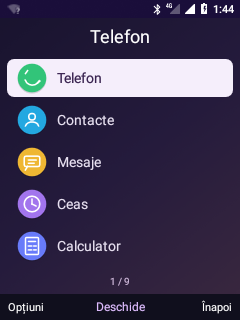 | 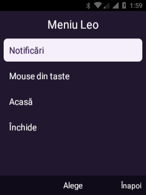 |

| Aplicații Android | Ceas / cronometru | Multi-tap românesc |
| --- | --- | --- |
| 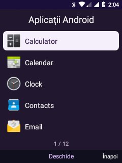 | 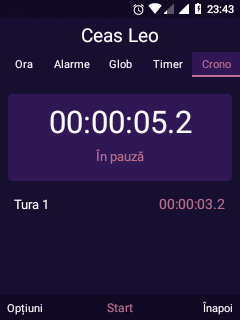 | 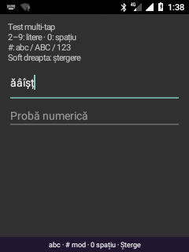 |

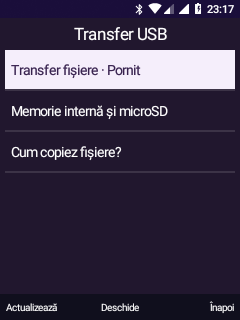

[Toate capturile păstrate în proiect](android81/screenshots/).

| Contacte Leo — date sintetice | Telefon Leo |
| --- | --- |
| 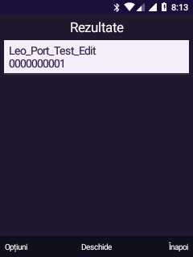 | 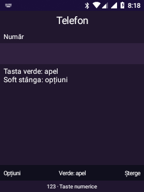 |

| Ciornă SMS de probă | Alarmă declanșată în fundal |
| --- | --- |
| 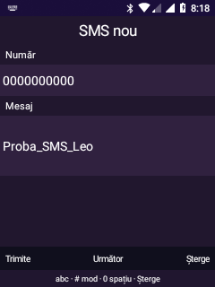 | 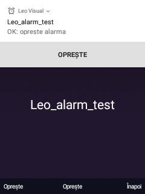 |

## Instalare

Nu există o imagine release, un pachet OTA sau o procedură de flash validată
pentru public. Scripturile actuale depind de arborele AOSP, intrările proprietare
locale, configurația WSL și verificările aparatului de dezvoltare.

Sistemul testat rulează din memoria internă: `/system` read-only și `/data`
read-write. Etapele inițiale de pe microSD sunt păstrate în documentație ca istoric,
nu ca instrucțiuni pentru configurația curentă. Nu folosim `pmbootstrap` pentru acest port Android.

Puncte de plecare pentru dezvoltare:

- [Configurația AOSP a dispozitivului](android81/device/nokia/leo/).
- [Pregătirea inițială — document istoric](android81/README.md).
- [Rezultate și istoric tehnic](android81/STATUS.md).

## Pornire și recuperare

Android, ADB și serviciile de bază au revenit după repornire în probele efectuate.
Corecția NetworkPolicy este în testare; vezi [auditul actual](android81/FIVE-TRACK-AUDIT.md). USB poate
dispărea temporar; lipsa ADB nu dovedește singură că telefonul nu a pornit.

Recovery-ul de diagnostic cu ADB a fost folosit în dezvoltare. Nu există aici o
procedură universală de deblocare/flash/recovery pentru toate variantele Nokia.
Comenzile și combinațiile de taste de pe paginile altor dispozitive nu sunt
instrucțiuni validate pentru acest port.

## Probleme cunoscute

- Corecție NetworkPolicy instalată; stabilitatea pornirii necesită observație suplimentară.
- Wi-Fi și Bluetooth pornesc automat în noua ordine de inițializare; stabilitatea pe termen lung și accesoriile audio necesită probe. ADB are încă întreruperi care pot cere reconectarea cablului.
- Cameră, GPS și integrarea senzorilor nefuncționale în auditul documentat.
- WebView a prezentat crash GPU; autentificarea și mesajele reale Email rămân nevalidate.
- Aplicațiile Android nu sunt toate controlabile complet din taste; cursorul este o opțiune de acces.
- SIM 2, audio la apel inițiat după recuperare, accesorii audio, autonomia și încărcarea completă necesită probe; MMS neimplementat.
- Înregistrarea IMS experimentală nu validează VoLTE sau VoWiFi.

Corecția DispSync/HWC1 a redus mediana **tastă → începutul desenării** de la
aproximativ **1005 ms la 18 ms** în două probe de câte 16 apăsări. Nu este o
măsurare optică sau un test FPS. [Metodă și limite](android81/UI-LATENCY.md).

## Dezvoltare

Mediul actual: Windows + WSL (`kaios`), Java 8 și AOSP separat în
`/root/android81-leo/src`. Arborele AOSP și componentele proprietare nu sunt
incluse. Clonarea repository-ului nu furnizează singură toate intrările de compilare.

```text
android81/
  device/nokia/leo/    Configurație AOSP, init, keylayout, componente native
  visual-shell/       HOME, aplicații Android, meniuri, pointer și Ceas Leo
  keypad-ime/         Introducere text multi-tap din taste
  call-ui/            Adaptarea comenzilor de apel și demonstrații locale
  audio-runtime/      Integrarea audio
  radio-runtime/      Integrarea radio
  screenshots/        Capturi selectate
  local/              Copii KaiOS și intrări locale, ignorate de Git
  output/             Artefacte și rezultate de test, ignorate de Git
analysis/             Unelte de analiză a dump-ului
kaios31/              Investigația unui sistem donator
```

### Aplicațiile KaiOS și shell-ul Leo

Copia locală păstrează 63 de arhive și registrul celor 64 de intrări, cu verificare
SHA-256. Aplicațiile privilegiate KaiOS nu rulează prin simpla copiere: folosesc
API-uri Gecko ce necesită înlocuitori Android. Codul nou Leo este o adaptare nativă
a fluxurilor analizate. **Ceas Leo**, **Calculator Leo** și **Notițe Leo** sunt
instalate. Contacte, Telefon, Mesaje, alarme și temporizator sunt integrate;
stările și limitele fiecăruia sunt în [fișa aplicațiilor de sistem](android81/LEO-SYSTEM-APPS.md).
Multi-tap și predicția T9 locală de bază funcționează; dicționarul complet și învățarea nu sunt implementate.

- [Planul proiectului și criterii de acceptare](android81/PROJECT.md).
- [Portarea aplicațiilor: copie, matrice și rezultate](android81/KAIOS-APP-PORTS.md).
- [Inventarul KaiOS](android81/KAIOS-UI-INVENTORY.md).

### Următoarele etape

1. Validarea apelurilor inițiate, a SMS-urilor reale și a recuperării alarmelor după reboot; continuarea cu Calendar/Fișiere.
2. Eliminarea ANR-ului la boot și repetarea probelor de stabilitate/performanță.
3. Finalizarea conectivității și continuarea integrării hardware.
4. Probe reale separate pentru apeluri inițiate, SMS, ambele SIM-uri și rutele audio.
5. Investigarea predicției T9 și a IMS/VoLTE/VoWiFi, cu validare distinctă pentru fiecare.

## Documentație

| Subiect | Document |
| --- | --- |
| Stare și istoric | [STATUS](android81/STATUS.md), [audit inițial](android81/FUNCTION-AUDIT-2026-10-18.md) |
| Shell, meniu, mouse și aplicații Android | [VISUAL-SHELL](android81/VISUAL-SHELL.md) |
| Setări cu taburi, Wi-Fi, Bluetooth și hotspot | [LEO-CONNECTIVITY-SETTINGS](android81/LEO-CONNECTIVITY-SETTINGS.md), [CONNECTIVITY-BRINGUP](android81/CONNECTIVITY-BRINGUP.md) |
| SIM-uri, dată/oră, localizare, aplicații și blocare vizuală | [LEO-NATIVE-SETTINGS](android81/LEO-NATIVE-SETTINGS.md) |
| Corecția paginii Connected devices | [SETTINGS-CONNECTED-DEVICES](android81/SETTINGS-CONNECTED-DEVICES.md) |
| Calculator și Notițe Leo | [LEO-CALCULATOR-NOTES](android81/LEO-CALCULATOR-NOTES.md) |
| Contacte, Telefon, Mesaje, alarme | [LEO-SYSTEM-APPS](android81/LEO-SYSTEM-APPS.md) |
| Tastatură multi-tap | [KEYPAD-IME](android81/KEYPAD-IME.md) |
| Grafică / performanță | [ADRENO-INTEGRATION](android81/ADRENO-INTEGRATION.md), [UI-LATENCY](android81/UI-LATENCY.md) |
| Optimizarea listelor și timeout ADB | [PERFORMANCE-AUDIT](android81/PERFORMANCE-AUDIT.md) |
| Animație de pornire și repararea SD | [BOOTANIMATION-SD](android81/BOOTANIMATION-SD.md) |
| Radio și date | [RADIO-BRINGUP](android81/RADIO-BRINGUP.md), [LTE-BRINGUP](android81/LTE-BRINGUP.md) |
| Audio / codec-uri / setări mobile | [AUDIO-BRINGUP](android81/AUDIO-BRINGUP.md), [PHONE-AUDIO-FOLLOWUP](android81/PHONE-AUDIO-FOLLOWUP.md) |
| Apeluri din taste | [CALL-KEYPAD](android81/CALL-KEYPAD.md) |
| IMS experimental | [IMS-PORT](android81/IMS-PORT.md) |
| Analiza interfeței KaiOS | [KAIOS-ALTERNATIVE](android81/KAIOS-ALTERNATIVE.md), [KAIOS-UI-INVENTORY](android81/KAIOS-UI-INVENTORY.md) |

## Contribuții

Dezvoltarea și probele sunt urmărite în [commit-uri](https://github.com/smp971/nokia-6300-android81/commits/main).
Un raport util include varianta telefonului, commit-ul, pașii de reproducere,
rezultatul observat și jurnalul relevant fără date personale. O simulare sau
prezența unei iconițe nu justifică marcarea unei funcții hardware drept funcțională.

Repository-ul păstrează surse, patch-uri, scripturi și documentație. Dump-urile,
binarele proprietare, dicționarele vendor, imaginile generate, APK-urile, cheile
și datele personale rămân locale. Documentele istorice pot descrie blocaje rezolvate;
tabelul de mai sus este rezumatul actual. Experimentele anterioare inițializării
Git nu au commit-uri retroactive.

## Referințe

Structura fișei este inspirată de paginile Devices din postmarketOS, de exemplu
[Nokia N900](https://wiki.postmarketos.org/wiki/Nokia_N900_%28nokia-n900%29):
identificare, funcții, instalare, pornire și documentație. Stările și rezultatele
de aici provin din proiectul Android Leo, nu din acea pagină.

### Audit curent și aplicații noi

[Rezultate și limite pentru cele cinci direcții](android81/FIVE-TRACK-AUDIT.md).

| Calendar Leo · eveniment sintetic | Fișiere Leo · text sintetic |
| --- | --- |
| 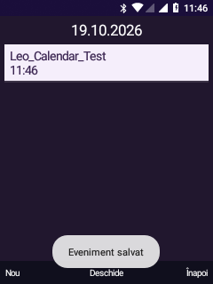 | 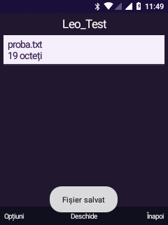 |

### Suita Leo pentru taste

[Aplicații, comenzi, probe și limite](android81/LEO-APP-SUITE.md): Galerie, Fundaluri, Convertor, Setări, Descărcări, Muzică/Video, Reportofon, Favorite, blocare taste și T9 local.

| Meniu Leo · aplicații noi | Galerie · probă sintetică | Convertor |
| --- | --- | --- |
| 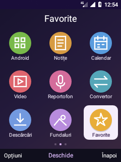 | 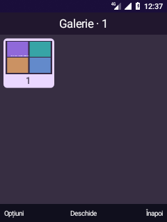 | 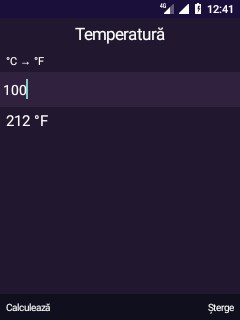 |

| Profil silențios | Blocare taste | T9 local |
| --- | --- | --- |
| 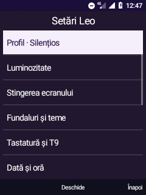 | 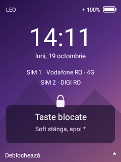 | 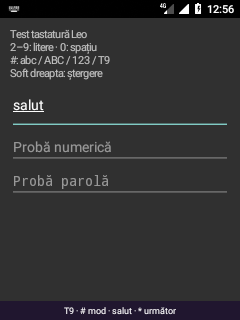 |


### Setări Leo organizate pe categorii

Stânga/dreapta schimbă tabul, sus/jos selectează o intrare, OK deschide submeniul.

| Rețele | Aspect |
| --- | --- |
| 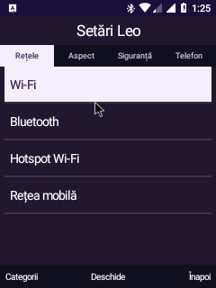 | 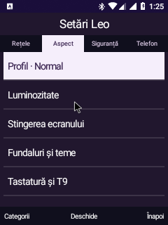 |

| Siguranță | Telefon |
| --- | --- |
| 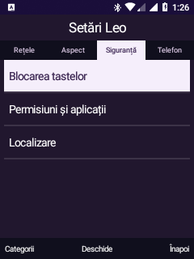 | 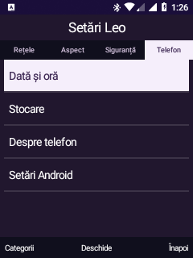 |


### Blocare vizuală și pagini de setări native

| Ecran de blocare | Blocare automată |
| --- | --- |
|  | 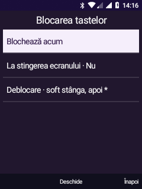 |

| Dată și oră | Aplicații |
| --- | --- |
| 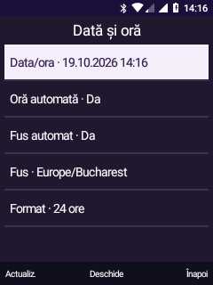 | 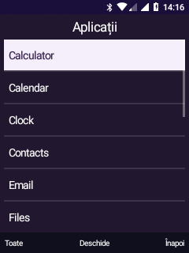 |

### Șase extensii pentru shell

[Notificări, configurări rapide, Contacte/VCF, indicatoare, browser text și ghid inițial](android81/LEO-SHELL-FEATURES.md).


Capturile de mai jos folosesc SMS, apel pierdut și contact **sintetice**, fără
transmisie prin modem. Browserul afișează pagina publică de probă example.org.

| Indicatoare pe Home | Indicatoare la blocare |
| --- | --- |
| 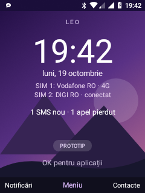 | 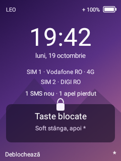 |

| Notificări native | Configurări rapide |
| --- | --- |
| 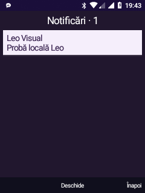 | 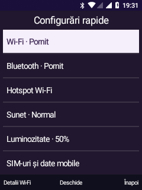 |

| Contacte · cifre T9 | Browser text · HTTPS |
| --- | --- |
| 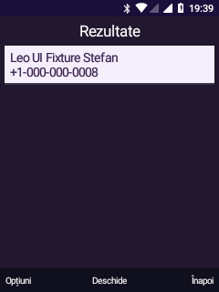 | 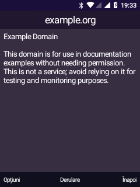 |

| Ghid inițial |
| --- |
| 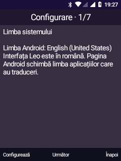 |
