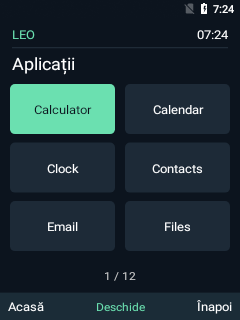
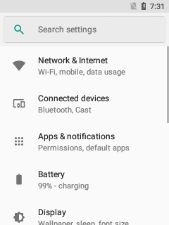
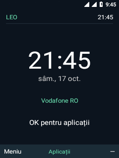

# Nokia 6300 4G TA-1286 — experimental Android 8.1 bring-up

Repository local pentru sursele, configurarile si uneltele dezvoltate in acest
proiect. Dump-urile, datele private, cheile ADB, kernelul precompilat, imaginile
generate si rapoartele brute raman local, in afara Git. Capturile selectate
pentru documentatie sunt incluse in `android81/screenshots`.

- `android81/device/nokia/leo`: produs AOSP, initializare, tastatura si componente native.
- `android81`: scripturi de compilare, patch-uri AOSP reproductibile, impachetare si diagnostic.
- `analysis`: unelte de analiza a dump-ului.
- `kaios31`: sursele investigatiei donatorului KaiOS.

Starea experimentelor si rezultatele verificarilor sunt in `android81/STATUS.md`.
Instructiunile de lucru sunt in `android81/README.md`. Arborele AOSP 8.1 este
separat, in WSL: `/root/android81-leo/src`, android-8.1.0_r81. Modificarile sale
locale se aplica prin scripturile din acest repository; nu este copiat aici.

Istoricul incepe cu starea existenta la initializarea Git. Experimentele vechi
nu au commit-uri retroactive; documentatia pastreaza rezultatele lor.
Modificarile viitoare se salveaza in commit-uri distincte, cu verificarea efectuata
si limitarile cunoscute. Sursele sunt sincronizate in repository-ul privat GitHub
`smp971/nokia-6300-android81`.

## Capturi de pe telefon

Android 8.1 ruleaza de pe memoria interna. Leo Shell afiseaza aplicatiile,
bara de stare Android si actiunile tastelor soft. Setari se deschide dupa
corectarea verificarii serviciului Wi-Fi Direct absent. Prezenta categoriilor
de conectivitate nu inseamna ca Wi-Fi sau Bluetooth functioneaza. Dupa corectarea
sincronizarii celor doua procese RIL, ambele SIM-uri se inregistreaza pentru voce
si dupa repornire. Apelurile, SMS-urile si conexiunea de internet nu sunt testate.

| Leo Shell | Setari | Retea dupa repornire |
| --- | --- | --- |
|  |  |  |

Capturi reale la 240 x 320, obtinute prin ADB pe 16–17 octombrie 2026.
Capturile initiale au ceasul nesincronizat.

Acesta este un prototip de diagnostic, nu un ROM pregatit pentru utilizare zilnica.
Scripturile de flash valideaza tinta; consultati sursele inainte de executare.
