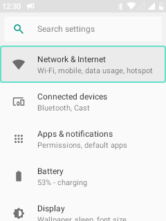

# Android keypad navigation

Leo remains the Home interface, while the native Android system components also receive keypad navigation. This is an incremental Android 8.1 adaptation, not a claim that every third-party application works without a pointer.

## Installed on 5 November 2026

The common app-local adapter is installed in Settings, SystemUI and PackageInstaller. The update retains each package identity, development signer, manifest, resources and application data.

| Control | Behaviour |
| --- | --- |
| Up / Down | Select actionable controls, with a visible mint outline. Existing circular traversal is retained. |
| Left / Right | Select neighbouring buttons or tabs in the same horizontal row. No wrapping into unrelated rows. SystemUI notification-panel switching retains priority. |
| OK / Enter | Activate once; holding the key does not repeatedly click. |
| Sliders | Left/right adjusts the selected or focused slider. The slider receives the matching key release. |
| Long read-only pages | Up/down scrolls native ScrollView content when there are no actionable controls; horizontal scroll containers support left/right. |
| Off-screen actions | Empty clipped rectangles no longer deduplicate distinct off-screen controls. Selecting an action reveals it. |
| Text fields and native adapter lists | Keep their own Android key handling. |
| Back, call and volume keys | Remain under their existing handlers. |

The dedicated Menu key still opens Leo's global menu, including pointer mode. Native Settings retains its Android/Leo softkey menu. Permission grants remain Android decisions: keypad navigation does not bypass permission or lock security.

## Validation

| On-device check | Passed |
| --- | ---: |
| Existing common-helper regression tests | 17 |
| Horizontal geometry, read-only scrolling, off-screen controls and slider key pairing | 31 |
| Real Settings, menu, silent fixture notification, panel switching and Back | 12 |
| Real fixture permission denial and native volume slider | 7 |
| **Total** | **67** |

Tests used local fixtures; no calls, SMS, media playback or connectivity switches were triggered. The native volume probe restored the previous volume values. The first native UI attempt ran with the display asleep and was excluded; the integration test now explicitly wakes the screen. The initial read-only fixture was corrected to actually contain scrollable content before counting a pass.

Original APKs were saved and hash-verified before installation. A phone-side 900-second rollback protected installation until all checks passed; acceptance cancelled that rollback. The final system APK hashes are recorded locally in output/framework-keypad/keypad-incremental-build.json. No reboot was needed or performed in this verification.



## Build and installation

The ordinary AOSP workflow remains:

```sh
bash android81/build-framework-keypad.sh --apps-only
bash android81/build-framework-keypad-tests.sh
```

While WSL is unavailable, Windows can rebuild just the app-local helper in verified APK backups:

```powershell
python android81/build-framework-keypad-tests-windows.py
python android81/install-system-keypad.py backup --only all --backup-dir android81/output/android-keypad-v2-before
python android81/build-system-keypad-windows.py --baseline-dir android81/output/android-keypad-v2-before
python android81/install-system-keypad.py install --only all --backup-dir android81/output/android-keypad-v2-before --rollback-seconds 900 --aapt android81/output/windows-build-tools/build-tools/android-9/aapt.exe
# After successful device checks:
python android81/install-system-keypad.py ack --only all --backup-dir android81/output/android-keypad-v2-before
```

The portable tool cache needs JDK 8, Android API 27 android.jar, Windows Android build-tools 28.0.3, dexlib2 2.5.2, Guava 27.1-android, jsr305 3.0.2 and the matching AOSP development signing material. These tools and original APKs are not bundled in Git. Both scripts accept --tools for another cache location. The native aapt installer option avoids depending on WSL for APK identity validation.

The incremental builder replaces only LeoKeypadNavigation and its nested classes. It rejects absent helpers, unrelated class-set changes, unexpected signers and changed non-code APK entries. Other DEX class definitions are retained. PackageManager checks installation compatibility. This fallback is not a full AOSP build.

## Remaining scope

- The DecorView source hook exists, but framework.jar and ART boot images have not been migrated or installed by this update. Android windows outside the three adapted packages do not automatically gain this helper.
- Custom canvases, WebViews, games and third-party applications can require per-app support or Leo pointer mode.
- Not every Settings detail page, picker and system dialog has been validated. Native adapter lists retain their own edge behaviour rather than adopting a blanket global wrap rule.
- These are installed package updates. Existing recovery/release ZIPs were not rebuilt, and clearing userdata may revert to the APK versions in the system base.
