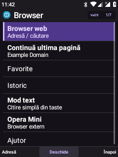
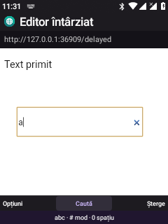
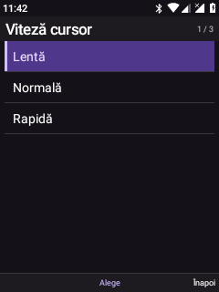
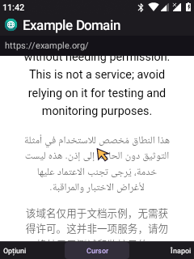
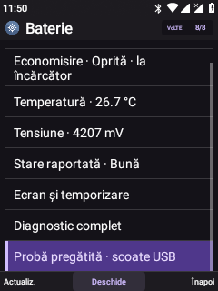

# Browser and daily reliability

This batch extends the graphical browser while retaining catalog ID 19 and the
text reader's existing `browser` preference keys. The running build remains an
application data update, separate from the bundled system APK.

## Shared start page

The hub adds Continue, Favorites and History. Favorite records retain the old
`url` / `title` JSON schema; the lists are bounded to 30 and 50 records, with
duplicate URLs moved to the front. Invalid/non-HTTP URLs are filtered. Both
browser processes use a non-exported, UID-checked main-process provider so
independent SharedPreferences caches cannot overwrite each other's records.
The text reader's font preference also uses this single writer.

Continue stores the last URL, title and scroll position. It does not save HTML
field contents or passwords. Web history follows SPA history events as well as
full page loads. Favorites can be added from the graphical page's Options;
removal and clearing in the hub require confirmation.

## Editing and pointer

Web editor softkeys reflect the actual EditorInfo action: Search, Send, Go,
Done, Next or a new line. The right softkey (scan 158) remains the keypad IME's
deletion key; the dedicated Back key (scan 14) retains navigation. Left/right
arrows move the text caret while editing. Native menus leave the page's DOM
and text in place. The earlier delayed-focus/proxy-editor fix remains in use.

Pointer speed has three saved levels. `*` switches to explicit scrolling, with
an amber pointer and OK returning to pointer movement. Edge scrolling remains.
Options cycles visible, enabled links and fields in the current document's tab
order. WebView 61 did not reliably wrap focus through native Tab alone, so the
command focuses document controls directly when page scripts are enabled, with
native Tab / Shift-Tab as the script-disabled fallback. It does not read field
contents, expose a JavaScript bridge or add a background movement timer.
Entering from pointer mode starts at the first/last control; later steps retain
the current document position. Focus is applied after the native Options window
has closed, without requesting editor focus again through its proxy view.

## Service reconnection

The main process checks the existing keypad and notification connections on
foreground entry and package/boot recovery. The notification repair first asks
Android to rebind. For a retained dead binder it temporarily cycles only its own
already enabled component, without killing the app or changing listener grants.
Oreo's [PackageManagerService](https://android.googlesource.com/platform/frameworks/base/+/android-8.1.0_r81/services/core/java/com/android/server/pm/PackageManagerService.java)
batches `DONT_KILL_APP` component broadcasts for ten seconds, so the fallback keeps
the component disabled for fifteen seconds before restoring its exact original
state. A short cycle was coalesced and did not repair the binding. The temporary
component state is journaled across process death. An ungranted or disabled
component is not enabled by a new repair, and another listener's access is preserved.

Keypad-service repair also journals the original accessibility list and enabled
flag, restoring both if the process is stopped mid-repair. This avoids stranding
the Menu service after a package update or a forced test stop. No repeating
screen-off polling service is introduced.

## Resources and unplugged battery trial

`profile-shell.py --all-processes` covers the launcher, its child processes,
the keypad IME and an AOSP WebView process if present. It records per-process
CPU windows, RSS, threads and PSS. A changing process set produces no aggregate
CPU estimate, and missing PSS remains unknown. These USB-connected snapshots do
not measure discharge or full-device autonomy.
`--include-media` additionally reports the shared Android audio/codec daemons
as a separate scope. Their entire cost cannot be attributed to the radio app.

The existing Battery settings trial can now be armed while USB is connected.
An actual unplug battery broadcast starts it; reconnecting saves the final
snapshot automatically. The main process observes battery broadcasts without
polling, wake locks or extra alarms. Saved data includes levels, monotonic elapsed
and awake time, boot identity, raw charge-counter readings and the stop condition.
Manual trials retain their charging/reboot interruption guard. A constant charge
counter or unchanged percentage is labelled as insufficient resolution rather
than converted into hours of battery life.

## Newer WebView assessment

The handset currently selects `com.android.webview` 61.0.3163.98; its provider
list contains only that package, with minimum version code 316409800 and
multiprocess rendering disabled. A regular Chrome APK is not automatically an
eligible replacement. Chromium documents the [provider name, signature, target
SDK and native-library requirements](https://chromium.googlesource.com/chromium/src/+/HEAD/android_webview/docs/webview-providers.md).

The exact original APK was copied and verified locally: SHA-256
`59d1faa0aa17d77ee3c9f2fd0e74f877dec2e506aede3cd7e771b214ae2ae133`,
53,156,833 bytes, minimum SDK 21, target SDK 27. Its development certificate
SHA-256 is `a40da80a59d170caa950cf15c18c454d47a39b26989d8b640ecd745ba71bf5dc`.
This makes the package/signature and exact fallback concrete before a provider
experiment; the proprietary/native driver compatibility remains a hardware test.

A candidate must support API 27 and ARMv7, implement at least the API 27 WebView
surface and match the configured provider/signing requirements. It must pass the
local graphical/editor/scroll/history suite, native keyboard and low-memory tests,
plus measured RAM and software-rendered SVG on the actual Adreno driver. The
reference accelerated SVG path previously crashed with SIGBUS. A provider trial
therefore needs a separately validated APK and a rollback to the exact original.
Google's [Chrome support announcement](https://support.google.com/chrome/blog/352616098/sunsetting-chrome-support-for-android-8-0-oreo-and-android-9-0-pie?hl=en-GB)
names Chrome 138 as the last Chrome version for Android 8/9; this alone does not
validate any WebView APK for this port. This application batch does not promote
a different provider into the ROM.

## Validation record

The signed candidate compiled all **283 Java sources**. The DEX audit retained
all **431** baseline dependency classes, with 2,240 candidate classes and no
duplicates or new external dependencies. Device suites passed **691 graphical
browser checks**, **26 state/battery/journal checks** and **188 daily UI checks**
(905 assertions total). The host suite passed **73 checks**. The standard five
physical keypad routes passed, along with the actual Home → Browser → address
route, hardware `*` scrolling and the cursor-speed menu on the 240 × 320 handset.

The private browser provider rejected an outside caller. After instrumentation
stopped the launcher process, both own services rebound automatically. A separate
revoked-listener check confirmed that Retry did not restore notification access;
the pre-test grant was then restored. Home, appearance, accessibility, notification
access and keypad IME matched their original settings. Media volume was restored
to 6 after the muted radio trial, playback stopped, and test packages/files were
removed. The Home crash-loop guard was reset through Recovery → Start Home after
repeated forced test stops; the harness now allows its two-second health check to
complete before ending instrumentation.

### Resource snapshots

Three samples 15 seconds apart, on the signed feature APK identified below. PSS is in MiB and CPU is a
percentage of one CPU core. These are snapshots, with different garbage-collector
and process lifetimes; they are not a controlled before/after optimization claim.

| Scenario | App + IME/WebView PSS | Shared audio PSS | App CPU | Shared audio CPU |
| --- | ---: | ---: | ---: | ---: |
| Home, services ready | 30.81 | — | 0.233% | — |
| Example.org graphical page | 51.72 | — | 0.334% | — |
| Home after browser close | 26.92 | — | 0.266% | — |
| Internet radio, screen asleep | 26.93 | 12.87 | 1.503% | 11.868% |

The browser child was gone by the post-close Home samples, which contained only
the launcher and keypad processes. Radio remained in MediaSession state 3 before
and after sampling, with music volume zero. Its combined listed PSS was 39.80 MiB
and combined CPU 13.371%; shared audio services can also serve other OS work.

### Physical battery trial

The new event-driven trial is armed on the handset. Physical unplug/reconnect
results will be recorded separately; USB-connected resource samples do not
establish autonomy. The armed state was verified from the actual saved preferences
and the Battery UI before handing cable control to the user.

### Artifacts

Browser-feature **data-update** APK verified for this report:
`c9a9822938f9e269162f9c23f76d1bf2f141bd4911aa3238578254758d064dbf`.
Bundled system base SHA-256:
`abcb93b6ee1305ededb7e52105a2d5dc232f8c795e67420834e49564cb89f0e6`.

The source also clarifies the Battery Help wording: USB-armed trials save at
reconnect, while manually started legacy trials must be stopped before charging.
This help-text-only follow-up built and passed the same DEX/signature audit as
`a7a094767c35ef6526bbc4a0d1d2333f707737706e173f061bb51b5b092bef52`.
It was not installed during this browser measurement batch. The cable trial
never started before the later shell work; the [21 November shell update](SHELL-SIX-OPTIMIZATIONS.md)
includes the clarified wording and records the newly installed APK. The still
armed physical trial will therefore measure that newer build when unplugged.

| Hub with Continue | Contextual search editor | Cursor speeds |
| --- | --- | --- |
|  |  |  |

| Explicit scrolling | Prepared battery trial |
| --- | --- |
|  |  |
