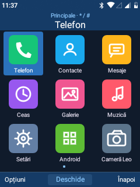
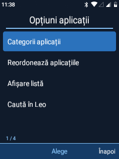
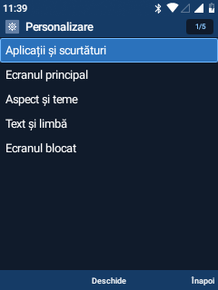

# Classic compact Leo

This iteration returns Leo to a classic Symbian/Android-inspired appearance and reduces the number of choices shown at once. It keeps Android 8.1 underneath and preserves stable application IDs, user data and custom Home transforms.

## Organisation

| Area | New organisation |
| --- | --- |
| Launcher | Nine essential apps on the first 3×3 page. Communication, Media, Tools, Entertainment, System and All retain the remaining apps. |
| App-menu options | Categories, reorder, grid/list and search: four actions instead of thirteen unrelated shortcuts. |
| Home options | Home editor, wallpaper and quick Home access. Notifications, pointer, media and quick settings remain in their existing global entry points. |
| Personalization | Five groups: Apps and shortcuts; Home; Appearance and themes; Text and language; Lock screen. |
| Network settings | Six entries; traffic counters and the connections dashboard are under More. |
| Appearance settings | Three entries: Display/keypad, Personalization, Keyboard/text. |
| Phone settings | Six entries; diagnostics, Android controls, initial setup, Studio and readiness are under Advanced tools. |
| Wallpaper/theme selection | Five entry points; the complete legacy palette list remains under Advanced themes. |

The first page contains Phone, Contacts, Messages, Clock, Gallery, Music, Settings, Android apps and Camera. It follows the relative order saved by the user. All 24 launcher apps remain reachable through categories and All; the 14 settings-only utilities retain their existing settings entry points. Reordering uses the complete launcher set rather than only the nine essential apps. Sound profiles remain in the Sound settings category.

The category IDs 1–5 are retained. Category 0 now means Essentials; category 6 is All. The existing * / # category navigation can reach All directly by moving backward from Essentials.

## Appearance

The optional Leo Classic pack adds dark blue surfaces, blue selection, compact headers and list rows, coloured app icons and the included blue Orbit wallpaper. The complete pack selects grid mode, clears per-app colour overrides and applies a common palette to Phone as well. Existing high-contrast and text accessibility preferences remain available.

Switching packs now reloads the saved grid/list preference when Home resumes. The previous visual settings and wallpaper are retained by the existing theme checkpoint. Theme restoration affects appearance, not the new menu organisation.

## Validation

Twenty focused on-device checks passed for the style registry, classic pack/grid/wallpaper, nine primary entries, unique category coverage, retained apps, custom ordering, grouped Personalization/Settings/Wallpaper pages, Back and external dependency loading. Fixtures used separate preferences/files; the test restored the previous Settings tab. No calls, SMS, media playback or network toggles were used.

The icon grid, four-action app context menu and five-group personalization page were also inspected from actual device screenshots. The global accessibility menu service was confirmed connected after instrumentation.

The APK class audit passed with 1526 classes, including all 59 original external dependency classes and no duplicates. The APK signature verified, the installed app and system base match, and the system partition was remounted read-only. No reboot or new recovery/release ZIP was produced for this iteration.
