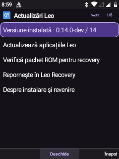

# Daily tools · search, multitasking and guided setup

Six additions extend existing Leo components rather than creating parallel apps. The installed interface remains Leo Material; changing presentation mode is optional.

## Finding and switching

- From Home, a short press on **2–9** opens local search with the digit already entered. The field starts in numeric mode so following keypad presses remain digits. Names and app titles can match their numeric T9 representation; a number result opens Phone without placing a call.
- **1** still opens text search; **0** still opens current media. Long presses on 2–9 retain configured app/speed-dial shortcuts. A selected media/favorite card keeps its own 4/5/6 controls.
- Search categories include an **abc / 123 input toggle**. App-only, contact-only and music-only searches avoid the unrelated expensive provider scans. Existing local SMS/calendar/file search remains under All/Other. Search is bounded and creates no persistent index.
- Hold the **dedicated physical Menu key** for about 650 ms to open Recent apps. A short press retains the global menu. Context help remains in that menu and can be restored as the long-press action in Personalization.
- Recent apps → Options offers **Return to previous app** and the selected app's existing actions. Return prefers the latest Leo launch recorded in Home history, then an Android task when no Leo entry is available. This is a navigation shortcut, not a general Android Alt-Tab history. Closing an Android task retains its confirmation and call guard.

## Simple and full modes

Personalization → Apps and shortcuts → **Interface mode** offers:

| Mode | Launcher | Settings |
| --- | --- | --- |
| Simple | Phone, Contacts, Messages, Clock, Music, Settings | Six everyday entries with an explicit All settings route |
| Full | Existing categories and app ordering | Existing six settings categories |

No packages are disabled or removed. Switching modes preserves custom app order, Home objects and app data. Full remains the default. The same section configures Hold Menu and Type from Home; existing short-key Home behaviour can be restored there. The three preferences are included in Leo configuration backup.

## Transfer centre

Global Menu → More → **Transfer centre**, or Settings → Storage → Downloads, opens a combined snapshot of DownloadManager downloads and Bluetooth OPP records, plus USB transfer access. It displays service status, progress where known and routes the selected record to the existing controls.

Downloads retain open/retry and confirmed cancellation/deletion. Bluetooth retains incoming-file acceptance, confirmed cancellation and completed-file actions. The hub refreshes when opened/resumed or with its Refresh softkey; it does not run a new background polling service. The download list and Bluetooth list keep their existing foreground refresh behaviour. At most 100 download records are loaded in the hub. No new transfer is started by opening it.

## Setup guide

Settings → Phone → Advanced tools → Initial setup now has **eleven resumable steps**, a progress indicator, left/right navigation, a mode chooser and a final status summary. The guide opens the existing language, date/time, Wi-Fi, SIM, keypad, notification and appearance pages. It changes no network/SIM preferences by itself. Existing users are not forced through setup again.

## Updates and recovery

Settings → Phone → Updates now starts with the installed version and separates:

1. **Leo app updates:** existing manifest/hash/certificate validation, Android installation confirmation and the previous APK pair for rollback. This does not restore app data.
2. **ROM packages for recovery:** a local verifier for the exact package approved by the deployed Leo Recovery catalog. It checks the file, length and whole-file SHA-256. A package is considered ready only at its original SD path with a recognized recovery image.
3. **Reboot into Leo Recovery:** explicit confirmation, exact development-device serial-token check, recovery-image hash check and active-call guard. It does not write a BCB/OTA command or initiate installation automatically.

The approved ROM is `leo-fresh-0.14.0-dev-20261027-232615.zip` (351257972 bytes; SHA-256 `5f65e7e7b0c8ce0ce8b24cf5ff9617e3d078a2a76172c4f4df7628063bdd9478`). Recovery expects it in `LeoRecovery/packages/` on the removable SD card. The recovery pin is taken from the checked-in [hardware validation](leo-recovery/hardware-validation.json); the ROM digest matches [package validation](leo-recovery/package-validation.json).

**That clean ROM erases internal data and restores the older published base. It does not contain these later UI changes.** Verification and recovery entry do not turn it into a current ROM update. Installation remains a manual action inside recovery, with its existing backup/power/partition guards. Generic OTA ZIPs and newly built ROMs need a separately reviewed recovery catalog update. Neither recovery nor the published ROM was rebuilt here.

## Validation · 6 November 2026

**33 on-device checks passed:** search matching and numeric input, simple/full visibility, backup allowlist, access to full settings, eleven-step wizard navigation and mode dialog, ROM metadata/device-token rejection, rejection of an unapproved local file, SD-path exclusion, update-page separation and recovery confirmation, previous-app controls and asynchronous transfer-hub loading. A first fixture attempted to use Recent apps before its asynchronous load completed; the final fixture waits for the actual page.

The installed recovery partition was read and its SHA-256 matched the approved image. Physical Menu hold opened Recent apps, and a short Home 2 press opened local search. APK signature and dependency coverage checks preserve all 59 external dependency classes without duplicates. Runtime and system-base APK hashes are verified after synchronization; the system partition is returned to read-only.

No real calls, messages, downloads, Bluetooth transfers, ROM installation, rollback or reboot were performed by these checks. The safe entry/confirmation paths were tested; end-to-end recovery installation and previous-version rollback were not repeated. Existing hardware-validation results remain separate from this UI work.

Sources are in `visual-shell/`, including `ShellMode.java`, `RecoveryPackage.java` and `tests/DailyEnvironmentTests.java`. Use the normal [rebuild guide](REBUILD.md). The new helper classes need no additional Android components or permissions.
