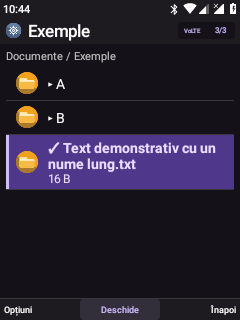
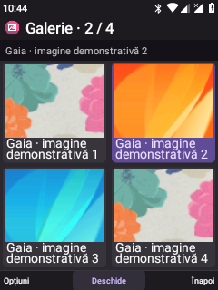
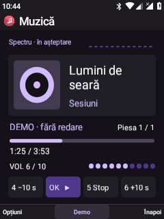
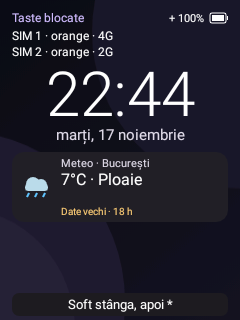

# Daily UI and resource checks, 17 November 2026

This batch covers the first five agreed improvements. The handset runs a
Leo Visual data update; it does not install the private clean ROM candidate.

## Native pages and keypad behavior

- Files shows readable sizes and a storage breadcrumb. Folder bookmarks use
  full paths and stable file identities, so returning from a child restores
  the selected parent entry. Scans show a loading state and reject stale
  results after leaving the page. Empty folders have an explicit message.
- Gallery shows four larger thumbnails per page, two-line names and the
  selected filename below the heading. The viewer reports loading/decode
  failure and retains the grid selection on Back. Album counting reads the
  favorites set once. Recreation retains the album and selected image URI.
- The music player uses the shared native heading and softkeys around its
  existing audio panel. Titles and the remaining Canvas labels share
  `CanvasText`, including the accessibility text scale.
- Discrete actions in these pages use `KeyRelease`. Canceled or repeated
  presses do not activate a second action. Held seek arrows retain their
  existing transport behavior. Files uses the shared dirty-form guard to
  retain an unsaved draft when the user continues editing.
- Lock shows the two SIM descriptions on separate lines. The saved weather
  observation has an age and a visible old-data state after six hours, with
  unknown/future timestamps handled separately. Rendering never fetches
  weather. Unlock requires completed softkey and star presses; a canceled
  press cannot unlock the phone.

## Shared implementation and Home entry

`AppCatalog` now owns all 48 stable IDs, labels, destinations and route extras.
Existing order, favorites and shortcuts keep their meaning. Main delegates
launching to this catalog, including Video, Favorites and Podcast extras.
`CanvasText`, `KeyRelease`, `ScreenTicker` and the common form guard provide
shared behavior without another library or service.

The exported `.MainActivity` remains Android Home. Commands using `open_app`,
`open_menu` and `edit_home` enter through the private `.InternalHome` activity
alias. Internal callers have been migrated. Public Home strips these extras
from a copy of the incoming Intent. A separate test APK under its own UID
attempts the private alias and a public lock command; its probe report records
the result. This deliberately closes the previously public command boundary.

`RowArtwork` limits decoded cache bytes to 384 KiB, pending decodes to eight,
and remembered decode failures to 48. Gallery keeps its existing 2 MiB cache.
`ScreenTicker` schedules UI refreshes only while resumed and interactive.
The playing music panel refreshes at 250 ms; paused/demo pages use events.
Screen-off and pause stop its timer and release the audio visualizer.

## Validation and reproducibility

The full-source Windows build compiles 277 Java files. The candidate retains
all 431 baseline dependency classes in the DEX audit, without duplicates.
The handset suites passed 174 daily UI checks, 48 previous polish checks and
72 theme checks. The local host suite passed 69 checks, including six tests
for process stat parsing, clock ticks and CPU calculations.

The daily suite uses isolated app-owned files and bundled Gaia artwork;
the player screenshot is a silent demo. Preferences are restored and fixture
files removed. Screenshot and shell automation uses
`FLAG_DONT_SUPPRESS_ACCESSIBILITY_SERVICES`. The first version of this test
used default automation flags, which suspended accessibility services during
testing; hardware routing must be checked after the target services reconnect.
After the repeated instrumentation runs, a normal reboot restored the live
accessibility binding. The physical keypad smoke then passed all five routes,
including global Menu to Settings and switching Settings tabs. This also
checks normal boot with the updated data APK, without a clean ROM installation.

```powershell
python android81/build-pocket-apps-windows.py
python android81/build-pocket-tests-windows.py --daily-polish
python android81/framework-command.py --timeout 180 /system/bin/am instrument -w ro.leo.visual.dailychecks/ro.leo.visual.KeyShellDailyUiTests
python android81/smoke-leo-keypad.py --serial 695d
python -m unittest discover -s android81/tests
```

## Resource measurements

`profile-shell.py` samples the explicit API 27 handset. CPU time uses the
running process's `AT_CLKTCK` value, rather than assuming the kernel tick rate.
It records RSS, full `dumpsys meminfo`, screen state, battery state and APK hash.
CPU percentages describe one core and include the diagnostic sampling overhead.
PSS and RSS describe the shell process, not the entire Android system.

```powershell
python android81/profile-shell.py --serial 695d --label home --samples 3 --interval 15 --screen awake --output android81/output/daily-polish/home.json
```

The baseline APK is
`c6c0b962246feb12100816cf7bf203b440f71bb408dabf5a4857f5513b71d683`.
Its 30-second windows measured 0.033% CPU on Home and 0.000% with the screen
asleep, with approximately 53 MiB RSS and 29–30 MiB PSS. This was already low
CPU usage; the new work does not claim a measured standby improvement.

Final measurements on the updated APK, after the normal reboot, used three
samples 15 seconds apart. PSS comes from the final `dumpsys meminfo` capture.

| Scenario | Display | CPU, one core | RSS | PSS |
| --- | --- | ---: | ---: | ---: |
| Home | Awake | 0.000% | 47.71 MiB | 19.19 MiB |
| Standby | Asleep | 0.000% | 48.25 MiB | 19.56 MiB |
| Silent player demo | Awake | 0.033% | 50.19 MiB | 21.33 MiB |
| Internet radio, actual playback | Asleep | 2.200% | 53.37 MiB | 23.78 MiB |

The radio session used the existing România Actualități preset. Android's media
session reported playing before and after sampling. Music volume was muted for
the test and restored to its original value afterward. Playback was stopped.
The baseline had a different process lifetime; lower post-reboot memory is
not evidence of an equivalent reduction caused by this patch.

USB power was connected and the battery reported full. These short diagnostic
windows cannot establish battery life, discharge current or long-term savings.
The observed kernel command line includes `lpm_levels.sleep_disabled=1`.
The [MSM reference implementation](https://android.googlesource.com/kernel/msm/+/9a87b7449d33f565ea0f99864e4afb80eeba1c03/drivers/cpuidle/lpm-levels.c)
uses this parameter to restrict low-power selection. This is a separate kernel
investigation; no deep-sleep parameter is changed by the UI update.
The corresponding parameter was unavailable at the checked sysfs path;
the command line alone does not establish which sleep states this kernel uses.

## Captured pages

Files and Gallery use isolated test fixtures. Gallery displays the bundled
Gaia sample artwork. The lock capture shows actual saved weather, including
its old-data state.

| Files | Gallery |
| --- | --- |
|  |  |

| Player demo | Lock |
| --- | --- |
|  |  |

## APK identity

The tested data APK SHA-256 is
`9fd91e85020bd436f783651495106e3456506fe62a5691d7c912a678f04bc7d8`.
The handset's bundled system base is
`abcb93b6ee1305ededb7e52105a2d5dc232f8c795e67420834e49564cb89f0e6`.
The previously prepared private ROM ZIP predates this batch.
