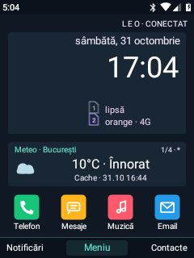

# Dashboard symbols and keypad wake — 31 October 2026

The Home forecast card now includes a native vector weather symbol driven by
the cached forecast condition code. It distinguishes clear/partly cloudy,
cloudy, fog, rain, snow and thunderstorms. Missing forecast data uses a neutral
cloud/question symbol. Icon state is included in the card signature, so a
condition change can refresh the icon even when other text is unchanged.
The symbol occupies its own space beside the forecast text.

Home's SIM rows show small chip symbols, with a slot numeral and distinct colour,
instead of the literal SIM-prefix text. Operator, network type and unavailable
states remain visible. The dBm suffix and its Home preference were removed;
Home no longer subscribes to signal-strength callbacks just to redraw that
number. Other diagnostic pages retain their own telemetry.

SIM 1 and SIM 2 are separate [Home editor](HOME-EDITOR.md) items. Migration maps
their previous shared transform onto each row, preserving position, scale,
rotation and visibility to integer-pixel precision. New independent layouts
are saved and backed up with the appearance settings.

## Wake from physical keys

The existing `leo_keylight` observer now monitors only the named built-in
`matrix_keypad`, `gpio-keys` and `qpnp_pon` input devices. A whitelist covers
their known keypad scan codes; headset input and external keyboards are excluded.
The normal Power-key wake/sleep behavior is retained.

On a key-down with the display backlight off and Android boot complete, the
observer requests Android WAKEUP using the system-UID input command. The helper
is rate-limited and runs only for a wake request. Original input is neither
grabbed nor recorded. The existing eight-second key-illumination timeout remains;
idle observation blocks in poll. Android/Leo keypad locks and PINs remain active.

Oreo's key-layout parser in this checkout does not expose the old WAKE flags.
The observer path avoids changing key meanings or marking the built-in keypad
as an external keyboard. `/system/bin/input` is a shell script without a
shebang here, so the helper explicitly launches it through `/system/bin/sh`.

Build with `build-keylight.sh` or the existing `leo-keylight` device module.
The updated native service and Leo Visual were installed with verified local
backups, and the system partition was returned read-only. An independent timed
rollback protected initial native-service installation and was acknowledged
after successful wake checks. The existing service was restarted; Android,
boot, recovery and radio were not restarted or rewritten.

## Checks

- 28 isolated Home-editor checks, including rotated legacy SIM migration,
  independent movement, save/reload and backup-key validation.
- 4 isolated weather-cache/icon-state checks; no network or user cache changes.
- Six synthetic EV_KEY down/up probes through the actual built-in input devices:
  digit, D-pad, left softkey, Back, star and pound. Each changed PowerManager
  from Asleep to Awake, with Home still the resumed activity. USB was attached;
  battery-only deep-suspend wake remains a manual check.
- The new weather/SIM rendering was captured on the phone with its saved layout.

The release ZIP has not been replaced. Future image assembly must include the
updated native service and Leo Visual APK.
