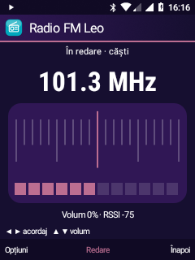
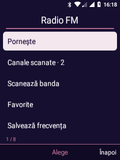

# Radio FM pe Nokia 6300 / Leo

20 octombrie 2026. **Recepție reală confirmată de utilizator în căști, pe 101,3 MHz.**
Interfața Leo și backend-ul sunt experimentale; verificările și limitele sunt separate mai jos.

## Ce funcționează

- Calibrare cu utilitarul original, activare RX, acordare și oprire prin `/dev/radio0` (`radio-iris`, QTI FM Radio Transceiver).
- Scanare 87,5–108 MHz, pas 100 kHz; semnalul maxim al probei inițiale a fost pe 101,3 MHz. Valorile RSSI sunt date brute semnate ale driverului, fără calibrare separată în laborator.
- Redare FM reală prin HAL-ul Qualcomm: `handle_fm` și `fm_volume`, usecase `play-fm`, PCM18 playback/capture active.
- Pagină nativă Radio FM Leo, intrarea stabilă 25 din meniul de 26 aplicații. D-pad acordaj/volum, favorite locale, frecvență directă.
- Conexiune locală autentificată între Leo și procesul root; niciun serviciu de rețea. Aplicația se verifică prin UID, iar clientul verifică serverul root.

Proba instrumentată a trecut: receptor real din UID-ul Leo, acordare din D-pad, favorite, rezultate de scanare persistente, volum, comandă difuzor/căști, oprire la pierderea focusului, repornire și oprire cu OK. Scanarea a lăsat două rezultate de semnal în proba curentă. Confirmarea auditivă a difuzorului și oprirea la scoaterea fizică a căștilor sunt consemnate separat. Rezultatele scanării sunt **vârfuri de semnal**, nu identificări RDS garantate de posturi; unele pot fi zgomotoase. Scanarea amuțește receptorul temporar și revine la frecvența anterioară.

## De ce inițializarea originală eșua

`fm_qsoc_patches 199217 0` ieșea cu 255 înainte de a deschide radioul. Urma locală a arătat că `ro.qualcomm.bt.hci_transport` lipsea. Un strat de compatibilitate furnizează valoarea `smd` **numai procesului utilitarului FM**, în acord cu transportul Iris/SMD folosit de kernel. Proprietățile globale, bibliotecile sistemului și serviciile Bluetooth/modem nu se modifică.

După corecție: calibrare cu succes, STATE=RX acceptat, acordare pe 100 MHz și bandă raportată 87,5–108 MHz; închiderea STATE=OFF și a transportului a trecut. Scanarea ulterioară și ascultarea au confirmat recepția la 101,3 MHz.

`G_TUNER` întorcea EINVAL în proba pasivă fiindcă radioul era oprit. Driverul de referință acceptă această citire numai în mod RX/TX. Portul utilizează numai RX; nu expune mod de emisie.

## Backend și limite

Fișierele runtime proprii și utilitarul original sunt păstrate root-only în `/data/leo-fm`. Dependențele QMI se reutilizează din runtime-ul modemului existent; `libqcci_legacy.so` este extras local din dump. Calibrarea originală este în `/data/misc/fm/Riva_fm_cal`; nu se publică în Git.

Serviciul Android rămâne foreground în timpul redării și are acțiune Oprește în notificare. Monitorizează pierderea focusului audio, deconectarea căștilor și starea apelurilor pentru SIM-urile active. Nu inițiază apeluri și nu pornește automat la boot.

Sesiunea root primește heartbeat la trei secunde și se închide la deconectarea clientului sau lipsa comenzilor timp de 18 secunde. Există o limită de o oră pe sesiune și cleanup supravegheat separat. Aceste mecanisme de userspace nu pot recupera un blocaj în kernel. Probele scurte au watchdog de 25/30/45 secunde. Scanarea verifică deconectarea clientului între frecvențe.

La oprire, aplicația face shutdown pe ambele sensuri ale socketului. Simplul close lăsa citirea blocată și întârzia repornirea până la expirarea heartbeat-ului; problema a fost corectată și repornirea rapidă a trecut proba.

Comutarea căști/difuzor folosește API-ul AudioSystem al platformei pentru ieșirea primară, apoi selectarea rutei FM. La oprire se restaurează ruta indicată de politica Android. Nu schimbăm preferințele globale de forțare a difuzorului. Căștile trebuie să rămână conectate ca antenă, inclusiv la redarea pe difuzor.

Rămân de validat: RDS/nume post, sesiuni îndelungate, consumul real pe baterie, toate scenariile de apel și reluarea manuală după reboot. Nu înregistrăm programe radio în aceste probe.

## Utilizare

Meniu Leo → Radio FM → OK pentru pornire/oprire. Stânga/dreapta: pas 0,1 MHz. Sus/jos: volum FM. Opțiuni oferă canale scanate, scanare, favorite, salvarea frecvenței și comutarea difuzorului. Favoritele sunt limitate la opt; rezultatele scanării se păstrează local.

## Recompilare

Necesită arborele AOSP și runtime-ul modemului din proiect, plus dump-ul original local.

```sh
bash android81/build-fm-diagnostic.sh
bash android81/build-fm-route.sh
bash android81/build-visual-shell.sh
```

Pe PC, cu radioul oprit:

```text
python android81/stage-fm-trial.py
```

Scriptul verifică hash-urile, încarcă fișierele atomic în directorul privat și testează linker-ul prin afișarea utilizării utilitarului, fără inițializare FM. APK-ul Leo se instalează separat. Nu se scriu boot/recovery și nu se înlocuiesc biblioteci Android.

Probe native prin `framework-command.py`:

```text
/data/leo-fm/trial --watchdog-test
/data/leo-fm/trial --receive
/data/leo-fm/trial --scan
/data/leo-fm/trial --route-check
/data/leo-fm/trial --listen 101300
```

Ultima comandă redă 15 secunde la volum redus și se rulează numai după anunțarea utilizatorului. Logul este root-only, `/data/leo-fm/trial.log`.

`FmTests` din APK-ul separat de instrumentare verifică receptorul real cu volum zero, acordarea din taste, favoritele, scanarea, rutele audio, pierderea focusului și repornirea. Nu inițiază apeluri/SMS. Opțiunea `-e keep-scan true` păstrează în mod explicit rezultatele scanării pentru utilizare; celelalte preferințe sunt restaurate.

## Surse de referință

- [Driver Iris și controalele RX](https://android.googlesource.com/kernel/msm/+/b3c1477026089ba53fe791515dbe125b2b147779/drivers/media/radio/radio-iris.c)
- [Transportul Iris SMD](https://android.googlesource.com/kernel/msm/+/b3c1477026089ba53fe791515dbe125b2b147779/drivers/media/radio/radio-iris-transport.c)
- [Extensia FM a HAL-ului msm8909](https://android.googlesource.com/platform/hardware/qcom/audio/+/582e0a5/msm8909/hal/audio_extn/fm.c)

Acestea sunt repere de implementare; comenzile private și comportamentul au fost verificate pe telefon. Sursele proprii sunt în `fm-runtime/`, `FmActivity.java` și `FmService.java`. Componentele originale extrase și datele de calibrare rămân locale.

## Capturi de pe telefon

| Acordaj și semnal măsurat | Meniu din taste |
| --- | --- |
|  |  |
