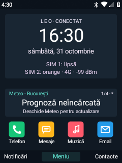
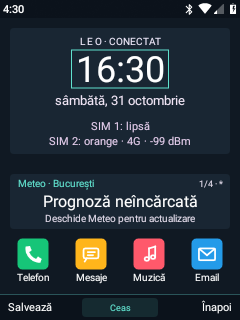

# Home editor and Android notifications — 31 October 2026

Home now opens the standard Android notification shade from its left softkey
and Down shortcut. The global Leo menu's Notifications entry opens the same
panel over other apps. The existing Leo notification browser remains available
under Android controls as an alternative, and as a fallback if the keypad
accessibility service is disconnected. The service was re-enabled on the phone;
notification-listener access was already enabled. Locked-keypad guards remain.

SystemUI no longer displays numeric SIM-slot labels. Android still controls
both signal groups and their network-type indicators; removing the extra labels
avoids collisions with LTE/4G on the narrow display. Home's detailed SIM rows
retain their identities.

The permanent SMS / missed-call summary row has been removed from Home.
Phone and Messages instead show a small dot when their existing unread state
is nonzero. There is no zero counter or badge number. The same icon renderer
provides the dots in Home shortcuts and the app grid/list; acknowledging calls
or reading messages uses the existing unread-state mechanisms. The old summary
visibility preference now controls notification dots.

## Edit Home on the phone

Open **Personalization → Home card order and selection → Home editor**.
The page's Options menu also contains **Home editor**. The preview is the actual
Home canvas with a selection outline, using the current wallpaper and live data.

- `*` / `#`: previous / next element.
- D-pad: move the selected element in two-pixel steps, including held repeats.
- OK: size, rotation, alignment, visibility and reset commands.
- Left softkey: save and leave the editor.
- Back / right softkey: continue editing, save or discard.

Eight editable groups cover the information-panel background, network banner,
clock, date, SIM 1, SIM 2, card carousel and shortcut row. The two SIM rows are
consecutive in the editor selector and can move, rotate or hide independently.
Legacy combined-row layouts are migrated without resetting their placement.
Size ranges from 50–150%;
each element can rotate in 90-degree steps and align freely, left, centre or
right. Rotation applies to the selected Home element. The Android status bar,
system orientation and the fixed softkey controls keep their normal behavior.
Hidden elements remain dimly visible while editing so they can be recovered.
The pointer pauses when entering the editor to give D-pad control to the layout.

Changes remain a draft until saved. Individual and whole-screen resets are
available; the whole-screen reset requires confirmation. Bounds keep elements
above the softkey bar, including after rotation. Layouts are stored separately
in `home-canvas` and included in the appearance category of Leo backups.
Existing backups without this optional group remain readable. Card content,
card order and individual shortcut assignments use their existing settings.

## Validation

The app and patched SystemUI compiled, were installed on Nokia `695d`, and
their system-base copies were synchronized with hash-verified local backups.
SystemUI's timed installation rollback was acknowledged after the status bar
rendered correctly. The standard Android notification shade opened through the
Home shortcut. The editor responded to an injected D-pad move and its discard
menu. Twenty-eight isolated on-device checks passed for draft/save/reload, all four
rotations at screen edges, hidden-element canvas state, reset behavior, separate
SIM movement, legacy-placement migration and backup support for the second row.
These checks did not modify user Home preferences or place calls/send messages.

The text-movement follow-up uses measured glyph widths and font metrics for the
network banner, clock and date. The icon/text bounds of each SIM row are separate. Their
selection bounds no longer reserve an almost full-width row. Regression checks
verify movement through the available horizontal space in both directions.

The published ROM ZIP is unchanged; future ROM assembly must use these updated
Leo Visual and SystemUI builds.
