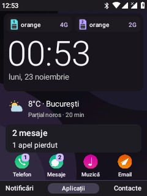
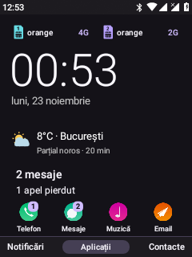
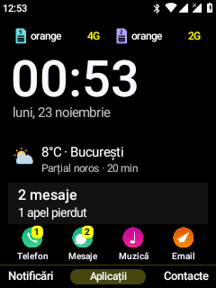
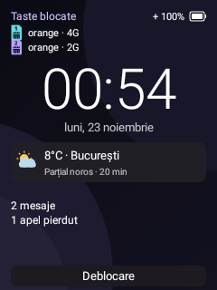
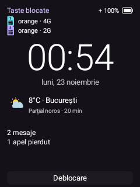
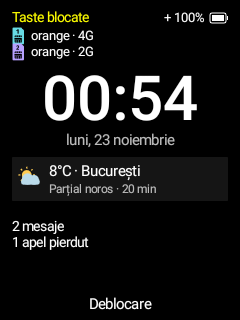

# Home and standby refresh · 23 November 2026

The keypad dashboard and standby share three presentation presets while retaining
the existing Gaia app/SIM artwork, app identities, shortcut assignments and theme
indices. This is a Leo Visual **data APK update**; it does not replace the ROM,
SystemUI, PackageInstaller, keyboard or modem.

## The six changes

1. **Balanced Home layout.** SIM operators and serving technologies remain above
   the large clock. Date, weather, contextual information and four shortcuts have
   separate vertical regions. Shortcut positions stay stable when a card appears.
2. **Permanent compact weather.** A two-line observation appears independently
   of notifications/media. It shares its renderer with standby and can be focused
   with Left/Right and opened with OK. It uses the Weather app's saved observation;
   rendering never fetches a forecast. Unknown, future and old timestamps are
   labeled explicitly. A stale-data warning takes precedence over a long condition.
3. **Explicit notifications.** Home distinguishes message and missed-call counts,
   with singular/plural labels and no zero counters. Telephone and Messages icons
   have numeric badges capped at `99+`, sized outside the icon scaling transform.
   Home does not read notification bodies to choose a card.
4. **Shared standby presentation.** The lock view uses the same SIM artwork,
   weather presentation, active colors and full accessibility text scale. Alarm,
   unread counts and media/notification content occupy distinct rows. Preference
   changes refresh a visible standby immediately; listeners stop on pause.
5. **Clear softkeys.** Idle Home labels OK as **Applications**. Standby initially
   shows **Unlock**; the star instruction appears only after the first completed
   softkey press. The three-second sequence and canceled-release protection remain.
6. **Three presets.** Colorful classic keeps the active theme and wallpaper;
   Minimal removes wallpaper and heavy panel fills; High contrast uses black,
   light text, yellow focus and stronger clock lettering. High contrast enforces
   at least the middle text size locally, without changing other apps' accessibility
   settings. Minimal/contrast do not decode the Home wallpaper.

## Keypad routes and persistence

- **Apps → left softkey → Personalization → Home and standby**.
- **Settings → Personalization → Home screen → Home and standby**.
- The standalone **Home layout** page also offers the same picker, returning focus
  to its preset row after selection. Back cancels without changing the selection.
- Left/Right visits visible shortcuts, compact weather and contextual cards. Back
  clears focus; OK on compact weather opens the existing Weather activity.
- The existing `home-weather` switch controls the compact observation. Manual
  card mode keeps its order and enabled types; weather is not duplicated when the
  compact observation is visible. Hiding it in the editor allows a weather card.
- The `appearance/home-style` integer is `0` classic, `1` minimal, `2` contrast.
  Backup validates its type/range. No global palette, accessibility setting,
  wallpaper file, app order or shortcut assignment is overwritten by a preset.
- The editable weather element is appended as ID `8`. IDs `0–7` and their saved
  transforms retain their meanings. Backup accepts only the nine known elements;
  old layouts without the new item receive its default transform.

The existing screen-aware clock ticker remains: minute/event refreshes while
visible, retaining Home's bounded startup registration retry, and stopped while
paused or with the display off. No animations, service,
network timer or external UI dependency was added. The standby remains an
accidental-key guard, with the existing Android security boundary.

## Device validation

Windows compiles all 291 production Java sources. APK verification checks signing,
the unchanged manifest, retained external dependency classes and duplicate classes.
The baseline installed shell SHA-256 is:

`4058e901559b260cc6299efedcdebd54564a9832826ad3c22a0bf5a11ad32e20`.

Installed candidate SHA-256:

`57e19fb585ce053c1430c858a4fb23342187fc9cfd7f20a1378110674cc6bf70`.

- **700 Home/standby checks passed**, including the 18 themes × three text sizes
  × three presets, default-layout separation, hidden-element focus, weather entry,
  presets via the native list/dialog, retained transforms and staged unlocking.
- **188 existing daily UI checks passed** on that same APK, including private Home
  entry, file/gallery/media/browser presentation, canceled releases and screen ticker.
- **89 host tests passed**. APK audit preserves all **431 external dependency
  classes**, with **2,252 total classes**, no duplicates, and unchanged manifest
  bytes and signing certificate.
- **Five physical keypad routes passed**. An additional physical D-pad/OK/Back
  trial opened the three-preset picker and canceled it without changing the user's
  preset. Home, accessibility, notification listener and keypad IME were rechecked.

The bundled system shell remains at `abcb93b6…`; PackageInstaller's previously
corrected data update remains at `98e90bad…`. No ROM rebuild or power-consumption
measurement is claimed. The previously armed unplugged battery trial remains
pending; USB stayed connected during these checks.

Device checks use the explicit API 27 Nokia `695d`. The Home/standby instrumentation
uses local forecast/unread fixtures, preserves accessibility during UI automation
and restores appearance, accessibility, weather, keyguard, setup and Home editor
preferences. It schedules no alarms and makes no calls, messages, weather requests
or media playback. Captured weather, unread counts and the notification example
are demonstrations. SIM registration in the captures comes from the handset.

```powershell
python android81/build-pocket-apps-windows.py
python android81/audit-visual-apk.py BASELINE.apk android81/output/pocket-apps-build/leo-visual.apk
python android81/build-pocket-tests-windows.py --home-standby
python android81/framework-command.py --timeout 180 /system/bin/am instrument -w ro.leo.visual.homestandbychecks/ro.leo.visual.HomeStandbyTests
python android81/build-pocket-tests-windows.py --daily-polish
python android81/framework-command.py --timeout 240 /system/bin/am instrument -w ro.leo.visual.dailychecks/ro.leo.visual.KeyShellDailyUiTests
python android81/smoke-leo-keypad.py --serial 695d
python -m unittest discover -s android81/tests
```

## On-device captures

| Colorful classic | Minimal | High contrast |
| :---: | :---: | :---: |
|  |  |  |
|  |  |  |

[Preset picker](screenshots/home-standby/presets.png) ·
[Largest Home text](screenshots/home-standby/home-large.png) ·
[Largest standby text](screenshots/home-standby/standby-large.png) ·
[Old observation](screenshots/home-standby/home-weather-stale.png) ·
[Missing observation](screenshots/home-standby/home-weather-empty.png) ·
[All standby information](screenshots/home-standby/standby-all-info.png) ·
[Second unlock step](screenshots/home-standby/standby-unlock.png)
