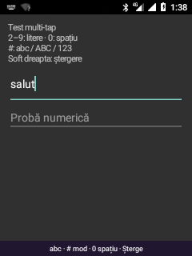

# Leo Multi-tap — introducere text din taste

**19 octombrie 2026.** IME Android separat, `ro.leo.keypad/.KeypadIme`, pentru
tastatura fizică a Nokia 6300. Folosește InputMethodService și InputConnection;
nu este un editor integrat doar în launcher și nu necesită WebView.

## Ce implementează prima versiune

- Multi-tap: apăsări repetate pe aceeași tastă aleg litera, cu confirmare automată după 850 ms.
- Moduri `abc`, `ABC`, `123`, schimbate cu `#` în câmpurile de text.
- Diacritice românești: ă, â, î, ș, ț și formele majuscule.
- Spațiu, semne de punctuație, ștergere și acțiunea editorului prin OK.
- Bară compactă de stare în loc de tastatură virtuală cu multe rânduri.
- Câmpurile Android Phone/Number/DateTime păstrează tratarea normală a cifrelor.
- Soft dreapta șterge și în câmpurile numerice.
- Fără permisiune INTERNET, predicție, salvare de cuvinte sau jurnalizare a textului introdus.

Aceasta **nu este încă predicție T9**. Motorul Kika/IMEConnect și dicționarul
românesc din dump nu au fost încă portate în acest IME; nu sunt incluse în APK
sau repository. Implementarea este originală, cu API-uri Android.

## Utilizare

| Tastă | În câmp de text |
| --- | --- |
| 2 | a, b, c, ă, â, 2 |
| 3 | d, e, f, 3 |
| 4 | g, h, i, î, 4 |
| 5 | j, k, l, 5 |
| 6 | m, n, o, 6 |
| 7 | p, q, r, s, ș, 7 |
| 8 | t, u, v, ț, 8 |
| 9 | w, x, y, z, 9 |
| 0 | Spațiu; în modul 123 introduce cifra 0 |
| 1 | Punctuație prin apăsări repetate |
| * | Altă secvență de simboluri prin apăsări repetate; în modul 123 introduce * |
| # | Schimbă abc → ABC → 123 → abc |
| Soft dreapta | Șterge litera în compunere sau caracterul anterior |
| Săgeți | Confirmă litera în compunere, apoi lasă editorul să deplaseze cursorul/focusul |
| OK | Confirmă litera în compunere; fără literă în compunere, execută acțiunea editorului sau inserează un rând nou |

Pentru două litere consecutive de pe aceeași tastă, așteaptă 850 ms sau apasă
săgeata dreapta între ele. Apăsarea lungă nu este o scurtătură separată pentru
cifră în această versiune; modul 123 permite introducerea rapidă a numerelor.

În câmpurile Phone/Number/DateTime, cifrele și simbolurile sunt lăsate editorului
nativ; `#` nu schimbă modul. Nu efectuăm apeluri sau cereri USSD în probe.
Înapoi dedicat, Meniu și tasta roșie păstrează acțiunile platformei; doar Back cu
scan code 158 este folosit ca ștergere. Dezactivează mouse-ul cu `#` înainte de
introducerea textului, deoarece acel mod rezervă tasta pentru oprirea cursorului.

## Validare și limite

**Rezultat pe telefon: toate cele 11 cazuri automate au trecut.** Android
raportează Leo Multi-tap ca IME selectat, conectat și cu bara de introducere
vizibilă. Utilizatorul a confirmat ulterior, pe tastatura fizică, scrierea
literelor și ștergerea corectă în editorul local. Această confirmare nu validează
predicția T9 sau compatibilitatea tuturor aplicațiilor.

| Cuvânt introdus din taste | Diacritice românești |
| --- | --- |
|  |  |

`verify-keypad-ime.py` trimite evenimente prin dispozitivul matrix_keypad într-un
editor local privat. Cele 11 cazuri verifică ciclarea, litere consecutive de pe
aceeași tastă, timeout, cuvânt, diacritice, majuscule, mod numeric în text,
ștergerea literei în compunere, ștergerea caracterului confirmat, cifre/*/# în
câmp Phone și ștergere în câmp Phone.

Editorul de probă compară rezultatul și înregistrează doar ID-ul testului și
un boolean, fără conținutul câmpului. Capturile și rezultatele brute se păstrează
local în `output/keypad-ime-test/`. Capturile selectate conțin numai text de test.

Integrarea ca IME o face disponibilă pentru editorii Android standard, dar
aplicațiile care interceptează tastele înaintea IME sau folosesc editoare proprii
pot necesita adaptări. Nu avem încă o probă completă pentru fiecare aplicație,
parole/PIN-uri, toate semnele Unicode sau predicție. Nu pretindem că înlocuiește
integral tastatura KaiOS.

## Build și activare

Surse: `keypad-ime/`. `build-keypad-ime.sh` folosește Java 8 și uneltele AOSP 8.1
locale pentru APK-ul ignorat `output/leo-keypad-ime.apk`.

După instalare, `activate-keypad-ime.py` salvează selecția și lista IME anterioare
în `output/keypad-ime-before.json`, apoi activează și selectează Leo Multi-tap.
Nu șterge celelalte metode de introducere. Selecția Android este persistentă;
nu s-a efectuat încă un reboot separat pentru această probă.

IME-ul decide să afișeze doar bara sa compactă, inclusiv cu tastatura fizică,
fără schimbarea setării globale care ascunde tastaturile virtuale mari.
Revenirea la vechea metodă folosește `ime set COMPONENTA_ANTERIOARĂ`, din copia
locală. Editorul privat de probă este `ro.leo.keypad/.EditorTestActivity`.

## Predicția T9: etapa următoare

În dump au fost identificate `js/keypad_t9.js`, `js/imeconnect_sdk.js` și
`vendor/dict/kika/Romanian.dict` (1.364.005 octeți). SDK-ul referă operații precum
`candidateWord`, `getComposingWords`, `setLanguage` și `importDictionary`.
Aceste constatări nu demonstrează compatibilitatea motorului cu Android.
Urmează analiza binding-ului IMEConnect și a formatului de dicționar, apoi
alegerea între adaptarea motorului și un motor predictiv propriu.
