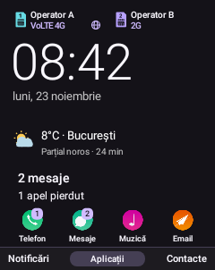

# Network badges, Android KaiSIP and keypad follow-up · 24 November 2026

## keySIP follow-up · 25 November 2026

The visible Android name is now **keySIP**. Its package `ro.n0d3.kaisip`, local
HTTPS origin and pinned upstream files stay unchanged to preserve the existing
account. Served title/About labels and notifications use the new name. This
section supersedes the older routing/validation status below.

The Android adapter uses the existing `AudioManager.MODE_IN_COMMUNICATION`
routing with voice-call volume keys and focus ownership. The route label was
reversed: it now correctly shows **Difuzor** for speaker and **Receptor** for
earpiece (or **Căști** when a wired/SCO route is reported). Native cellular
`MODE_IN_CALL` is still protected; no additional Telecom/root routing is added.

Two authorized, bounded live tests called the owner's chosen test extension **200**:

- Direct core call: registration ready, INVITE/ACK, `incall`, 17 RTP packets sent
  and 15 received. Speaker and receiver switches both passed.
- Window-key route **2 → 0 → 0 → Call**: registration ready, `incall`, communication
  audio mode 3, **26 RTP packets sent / 17 received**, 4,472 / 2,924 bytes.
  Speaker and receiver switches both passed. The runner then hung up its own call,
  ended its audio route and released its temporary wake lock.

These establish call signaling, media packet flow in both directions and Android
route state. **Audible voice quality, incoming calls, DTMF, messaging and PTT still
need human/peer trials.** No call audio was recorded, and reports contain no SIP
credentials, account/server identifiers, SDP or media payloads.

The repeatable host check is explicit and never scheduled:

```text
python android81/test-keysip-call.py --serial 695d --allow-live --destination 200
```

It requires the current production APK and existing account. Before starting
instrumentation (which restarts the app), it checks both cellular state and the
service's sanitized call-state hook; active or unreadable states are refused.
It builds/installs only its disposable runner, verifies an empty Home dashboard,
enters exactly 200, verifies that number before pressing Call, waits at most
25 seconds for connection, samples RTP, changes routes and hangs up its own call.
It removes the runner afterward, saves an ignored sanitized report and does not
retry automatically. Key injection exercises the Activity/JS path; it is not a
raw matrix-scancode test. A carrier/SIP call arriving during setup remains a
timing limitation of intrusive instrumentation; use the test only on an idle phone.

The first keypad harness attempt expected an empty `.dialnum` element. Upstream
renders a dashboard until the first digit, so that attempt stopped before dialing.
The corrected runner checks the actual empty dashboard; it does not count the
earlier attempt as a pass. Production call behavior was unchanged by this harness fix.

Installed keySIP APK SHA-256:
`424cf849b3a37fb9c4da2e960afda7c45f9056582c439527cac362d837687837`.
The permanent KeyShell WebUI stayed enabled during this live call check.
Node adapter contracts, including route labels, pass. Separate fresh-account
instrumentation remains isolated under `ro.n0d3.kaisip.fixture`.

The sections below retain the 24 November bring-up and evidence.

This is a source and data-APK update for the project's TA-1286, Android 8.1/API 27.
It retains the deployed [matrix wake/unlock changes](KEYPAD-WAKE-UNLOCK.md).
The bundled system APK and firmware/recovery archives have not been regenerated.

## Home network badges

- `VoLTE 4G` appears only for an LTE SIM whose IMS voice registration is live.
  LTE coverage alone never enables the VoLTE label.
- A small vector globe marks the default data SIM only when Android's current
  default network is cellular, has Internet capability and is validated.
  Wi-Fi, an unvalidated/captive connection and the other SIM do not enable it.
- Compact dual-SIM cards place carrier and technology on separate lines.
  Height and baselines follow the chosen text size. Existing Home item IDs,
  custom transforms, visibility and saved app order are preserved.
- The default-network callback is registered only while Home is resumed.
  There are no added network probes, background timers or bitmap assets.

These are device-rendered **240 × 302 Home canvas fixtures**, with synthetic
operator names and badge states. They demonstrate presentation; they do not
prove a carrier's current VoLTE service or simultaneous dual LTE.

| Classic | Minimal | High contrast |
| --- | --- | --- |
|  |  |  |

## KaiSIP Android port

The separate `ro.n0d3.kaisip` APK adapts
[smp971/KaiSIP](https://github.com/smp971/kaisip) at commit
`291b66d42e1b0b69061109592870a29be43bbdb6` (0.7.1). KaiSIP's MIT sources,
artwork and JsSIP 3.10.0 are included byte-for-byte with their notices and a
SHA-256 inventory in `kaisip-android/upstream.json`. Android-specific behavior
lives in the host/adapter files, outside those upstream assets.

The KeyShell catalog appends **ID 48**; old IDs, shortcuts and user ordering
remain compatible. Full mode now exposes 35 of 49 destinations; simple mode
still shows the same six. The launcher entry opens the separately installed app
and offers a useful missing-app state when it is absent.


Physical controls:

| Key | Action |
| --- | --- |
| D-pad / OK | Navigate KaiSIP; OK on a field opens its native editor |
| Left / right softkey | The commands printed at the bottom of KaiSIP |
| Native editor left softkey | Save this field; the next OK advances the original form |
| Native editor right softkey | Delete through the existing Nokia IME |
| Dedicated Back | Cancel/back; distinct from the right softkey |
| Dedicated Menu | Existing KeyShell global menu |
| Green / End | KaiSIP call controls, with held-key repeats ignored |

The original KaiOS account, contacts, history, messaging and PTT screens remain
present. Registration and an outgoing call's establishment/teardown were
verified with the owner's PBX on 24 November, after the compatibility correction
below. **Voice audibility, incoming calls, DTMF, messaging and PTT remain
unconfirmed on Android.** A compatible SIP account and WebRTC/WSS PBX are
required; this does not add a cellular or VoLTE service.

Implementation and resource boundaries:

- Bundled HTML/JS is served through an intercepted, app-owned HTTPS origin.
  External pages, file/content access, mixed content and third-party cookies
  are blocked. The Java bridge is limited to editor/session/audio controls.
- No account or PBX secret is bundled. Microphone access is requested only for
  a foreground audio capture request; this update's tests left it ungranted.
- The original permanent CPU/background mode remains **off by default**.
  A normal close destroys the WebView/service. An explicitly enabled continuous
  mode or an active call uses a visible foreground notification with Stop.
- The KaiOS SD logger is disabled on Android: no retained unbounded log,
  captured text, account trace or storage permission is added.
- Audio routing requests focus before changing modes, avoids taking over native
  `MODE_IN_CALL`, and restores only its own communication mode. Real routing
  still requires a SIP call trial.
- Software rendering avoids the Chromium GPU `SIGBUS` observed on the first
  accelerated trial, matching KeyShell Browser's existing device workaround.

Build without installing:

```powershell
python android81/build-kaisip-windows.py
python android81/build-kaisip-windows.py --fixture
python android81/build-kaisip-tests-windows.py --fixture
node android81/kaisip-android/tests/adapter-tests.js
```

The production APK is `android81/output/kaisip-android/kaisip-android.apk`.
Both builders use the local Windows SDK/JDK/test signing setup documented in
[REBUILD](REBUILD.md#leo-visual-on-windows). The app requests ordinary Android
permissions and does not use root or KeyShell's privileged services.

The optional fixture APK uses `ro.n0d3.kaisip.fixture`, a separate data directory
and an empty account. Run local instrumentation against that package once the
real app contains an account; do not run the fresh-account suite against the
owner's configured production package.

## Live account and legacy WebRTC correction

On 24 November, reopening the owner's configured app displayed **Înregistrat**.
The first authorized outgoing trial remained at **Se apelează** and did not ring
the destination. A bounded stage-only trace showed microphone acquisition
completing, followed by no offer or INVITE.

The installed Android WebView is **61.0.3163.98**. Runtime probes confirmed that
`RTCPeerConnection.prototype.addTrack` and `getSenders` were both `undefined`.
Pinned JsSIP 3.10.0 calls `addTrack` immediately after `getUserMedia`; its catch
there logs the error without ending the already created call UI. That explains
the stalled outgoing state and its retained call wake lock.

The Android host now loads the original, BSD-licensed
[webrtc-adapter 6.4.8](https://github.com/webrtcHacks/adapter/tree/v6.4.8) before
starting KaiSIP. It supplies the legacy Chrome track/sender compatibility.
The bundle and license are SHA-256 checked using `kaisip-android/webrtc-adapter.json`;
no KaiSIP or JsSIP upstream file was edited. An outgoing capability check also
returns a visible error before starting a call if those required APIs are absent.

The corrected trial advanced through microphone → offer → local description →
INVITE → remote answer → accepted/confirmed, then ICE connected/completed.
After approximately 92 seconds, the physical right softkey ended the call,
sent BYE and closed ICE; the KaiSIP call wake lock was released. This establishes
signaling, peer connectivity and teardown. **It does not establish audible,
bidirectional voice without the owner's listening result.** No audio recording
was made and account/server identifiers are excluded from this report.

The live call trial used APK
`f79802e6afcb8a45eccdf7d2dc68cf4b8d133323bbbc13fb2c50225c61c460c6`.
The final APK additionally includes the missing-API fail-fast guard, validated
by the Node contract checks and the repeated 17-check device fixture suite.

Earlier synthetic tests used legacy `addStream`, so they missed the actual
JsSIP track API boundary. The current suite uses `addTrack` and checks the sender
API; all **17 isolated device checks pass** in the disposable fixture package.
Node contract checks verify promise/error/receiver preservation, fail-fast dial
behavior and exclusion of payloads/secrets from diagnostics.

Optional `KaiSIPStage` diagnostics require a nonpersistent
`sys.leo.siptrace.until` BOOTTIME deadline of at most 20 minutes, are capped at
256 entries, and accept only stage names and bounded enum/number values.
They receive no destination, SIP bodies, SDP, ICE addresses or passwords.
The trial's diagnostic deadline was cleared and its temporary USB stay-awake
setting was restored to its original value (`0`). Permanent background mode
remains off.

## Validation and remaining checks

- Full KeyShell source build and APK compatibility audit: signer retained,
  existing external classes retained, no duplicate classes.
- 107 host checks pass, including the current catalog and boot-image guards.
- Home, accessibility, notification-listener and IME configuration were retained.
  The first cold physical-smoke attempt exceeded its six-second startup limit;
  after warming Home, the complete five-route run passed.
- 17 isolated KaiSIP device checks pass in the disposable fixture: secure local assets, keypad account
  editor, distinct Back behavior, default connection/CPU state, microphone
  denial, synthetic local Opus SDP offer, and destruction on normal close.
  The synthetic offer uses no ICE servers, microphone or remote peer.
- 725 Home/standby device checks pass; six preference groups match their
  before-test values exactly. All five physical Home/Menu/Settings routes pass.
  The real Home → launcher → KaiSIP route, global Menu over KaiSIP, and native
  editor right-softkey deletion were also verified.
- Installed KeyShell data APK SHA-256: `0c4b719ff41348fcb38523b104b9e839099fbbca007885485d62a97e56b9be11`.
- Installed KaiSIP APK SHA-256 after the legacy WebRTC correction:
  `cb2d66657bab9f2f0e0930847e79a29982e121048ffe13759f2d271432e88fba`.

The first Home test attempt reused an already running singleTask Home and
waited indefinitely for a new `onCreate`. The runner now observes resumed
activities with a bounded wait, and writes its sanitized result after restoring
preferences. This was a test harness issue; do not count that attempt as a pass.

## Intermittent double actions

The owner reports arrows, Back and dialer controls occasionally acting twice,
including after the display has been awake. The symptom did not recur in the
captured comparison: 148 raw events represented 74 complete physical presses,
with no repeat events or unmatched transitions. The shortest same-key release
gap was about 70 ms, so an arbitrary broad delay would also discard real input.
No general debounce change or confirmed fix is claimed.

For the next reproduction, the optional trace records only arrows, Back and
Call at accessibility, Home, dialer, base activity and dialog entry. It records
timing, action, repeat, scan and input-device IDs, never digits/text. Enable the
nonpersistent `sys.leo.keytrace.until` property with a future BOOTTIME deadline
of at most 20 minutes. Logging is capped at 400 route events and stops at that
deadline; it has no idle timer or wake lock. Pair it with the native observer's
bounded `--keys` mode and collect only the `KeyShellInput` log tag.
