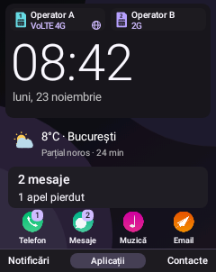
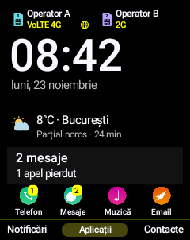
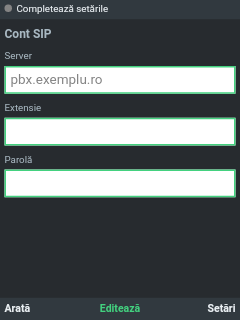

# Network badges, Android KaiSIP and keypad follow-up · 24 November 2026

This is a source and data-APK update for the project's TA-1286, Android 8.1/API 27.
It retains the deployed [matrix wake/unlock changes](KEYPAD-WAKE-UNLOCK.md).
The bundled system APK and firmware/recovery archives have not been regenerated.

## Home network badges

- `VoLTE 4G` appears only for an LTE SIM whose IMS voice registration is live.
  LTE coverage alone never enables the VoLTE label.
- A small vector globe marks the default data SIM only when Android's current
  default network is cellular, has Internet capability and is validated.
  Wi-Fi, an unvalidated/captive connection and the other SIM do not enable it.
- Compact dual-SIM cards place carrier and technology on separate lines.
  Height and baselines follow the chosen text size. Existing Home item IDs,
  custom transforms, visibility and saved app order are preserved.
- The default-network callback is registered only while Home is resumed.
  There are no added network probes, background timers or bitmap assets.

These are device-rendered **240 × 302 Home canvas fixtures**, with synthetic
operator names and badge states. They demonstrate presentation; they do not
prove a carrier's current VoLTE service or simultaneous dual LTE.

| Classic | Minimal | High contrast |
| --- | --- | --- |
|  |  |  |

## KaiSIP Android port

The separate `ro.n0d3.kaisip` APK adapts
[smp971/KaiSIP](https://github.com/smp971/kaisip) at commit
`291b66d42e1b0b69061109592870a29be43bbdb6` (0.7.1). KaiSIP's MIT sources,
artwork and JsSIP 3.10.0 are included byte-for-byte with their notices and a
SHA-256 inventory in `kaisip-android/upstream.json`. Android-specific behavior
lives in three host/adapter files, outside those upstream assets.

The KeyShell catalog appends **ID 48**; old IDs, shortcuts and user ordering
remain compatible. Full mode now exposes 35 of 49 destinations; simple mode
still shows the same six. The launcher entry opens the separately installed app
and offers a useful missing-app state when it is absent.



Physical controls:

| Key | Action |
| --- | --- |
| D-pad / OK | Navigate KaiSIP; OK on a field opens its native editor |
| Left / right softkey | The commands printed at the bottom of KaiSIP |
| Native editor left softkey | Save this field; the next OK advances the original form |
| Native editor right softkey | Delete through the existing Nokia IME |
| Dedicated Back | Cancel/back; distinct from the right softkey |
| Dedicated Menu | Existing KeyShell global menu |
| Green / End | KaiSIP call controls, with held-key repeats ignored |

The original KaiOS account, contacts, history, messaging and PTT screens remain
present. Real registration, incoming/outgoing SIP calls, audio routing, DTMF,
messages and PTT are **not yet validated on Android**. A compatible SIP account
and WebRTC/WSS PBX are required; this does not add a cellular or VoLTE service.

Implementation and resource boundaries:

- Bundled HTML/JS is served through an intercepted, app-owned HTTPS origin.
  External pages, file/content access, mixed content and third-party cookies
  are blocked. The Java bridge is limited to editor/session/audio controls.
- No account or PBX secret is bundled. Microphone access is requested only for
  a foreground audio capture request; this update's tests left it ungranted.
- The original permanent CPU/background mode remains **off by default**.
  A normal close destroys the WebView/service. An explicitly enabled continuous
  mode or an active call uses a visible foreground notification with Stop.
- The KaiOS SD logger is disabled on Android: no retained unbounded log,
  captured text, account trace or storage permission is added.
- Audio routing requests focus before changing modes, avoids taking over native
  `MODE_IN_CALL`, and restores only its own communication mode. Real routing
  still requires a SIP call trial.
- Software rendering avoids the Chromium GPU `SIGBUS` observed on the first
  accelerated trial, matching KeyShell Browser's existing device workaround.

Build without installing:

```powershell
python android81/build-kaisip-windows.py
python android81/build-kaisip-tests-windows.py
```

The production APK is `android81/output/kaisip-android/kaisip-android.apk`.
Both builders use the local Windows SDK/JDK/test signing setup documented in
[REBUILD](REBUILD.md#leo-visual-on-windows). The app requests ordinary Android
permissions and does not use root or KeyShell's privileged services.

## Validation and remaining checks

- Full KeyShell source build and APK compatibility audit: signer retained,
  existing external classes retained, no duplicate classes.
- 107 host checks pass, including the current catalog and boot-image guards.
- Home, accessibility, notification-listener and IME configuration were retained.
  The first cold physical-smoke attempt exceeded its six-second startup limit;
  after warming Home, the complete five-route run passed.
- 16 isolated KaiSIP device checks pass: secure local assets, keypad account
  editor, distinct Back behavior, default connection/CPU state, microphone
  denial, synthetic local Opus SDP offer, and destruction on normal close.
  The synthetic offer uses no ICE servers, microphone or remote peer.
- 725 Home/standby device checks pass; six preference groups match their
  before-test values exactly. All five physical Home/Menu/Settings routes pass.
  The real Home → launcher → KaiSIP route, global Menu over KaiSIP, and native
  editor right-softkey deletion were also verified.
- Installed KeyShell data APK SHA-256: `0c4b719ff41348fcb38523b104b9e839099fbbca007885485d62a97e56b9be11`.
- Installed KaiSIP APK SHA-256:
  `f71254e449e407e41c5e01b1d7a66b4e8f687de60d788cdf03fc02fb7f08eb16`.

The first Home test attempt reused an already running singleTask Home and
waited indefinitely for a new `onCreate`. The runner now observes resumed
activities with a bounded wait, and writes its sanitized result after restoring
preferences. This was a test harness issue; do not count that attempt as a pass.

## Intermittent double actions

The owner reports arrows, Back and dialer controls occasionally acting twice,
including after the display has been awake. The symptom did not recur in the
captured comparison: 148 raw events represented 74 complete physical presses,
with no repeat events or unmatched transitions. The shortest same-key release
gap was about 70 ms, so an arbitrary broad delay would also discard real input.
No general debounce change or confirmed fix is claimed.

For the next reproduction, the optional trace records only arrows, Back and
Call at accessibility, Home, dialer, base activity and dialog entry. It records
timing, action, repeat, scan and input-device IDs, never digits/text. Enable the
nonpersistent `sys.leo.keytrace.until` property with a future BOOTTIME deadline
of at most 20 minutes. Logging is capped at 400 route events and stops at that
deadline; it has no idle timer or wake lock. Pair it with the native observer's
bounded `--keys` mode and collect only the `KeyShellInput` log tag.
