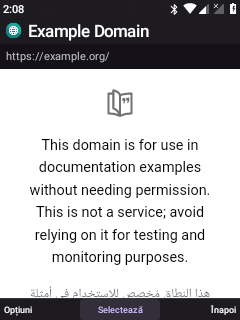
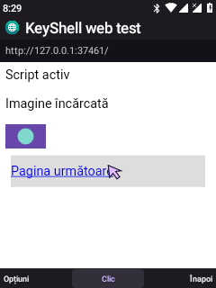
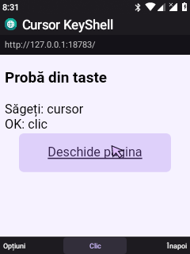

# KeyShell web browser

Catalog ID **19** opens the native **Browser** hub. It offers the graphical
browser, the existing text reader, address/search entry and optional Opera Mini
integration. Existing shortcuts, favorites and text-reader storage keep their
meaning. The hub and graphical page inherit the existing Browser-specific
theme override. Address entry includes **Open with** selection and retains a draft
when returning to the hub.

The shared Favorites/History/Continue hub, contextual editor keys, configurable
pointer and service-reconnection work are described in the
[daily-use report](BROWSER-DAILY-USE.md).

## Graphical page

The page uses shared KeyShell headers, address subtitle, progress, dialogs and
softkeys. Options include cursor on/off, address/search, reload, stop, text size, forward,
JavaScript on/off, text mode, help and close. Back follows page history.
The graphical page starts with its own visible cursor. D-pad moves it, holding
a direction accelerates it, and OK sends a single click on a complete uncanceled
key release. Reaching an edge scrolls the page. `#` switches between cursor and
normal keyboard navigation outside HTML text fields; **Options → Cursor** always
provides the switch. Clicking a text field hides the cursor and returns focus to
the WebView and keypad IME. The IME keeps its `#` mode shortcut while editing.
Guidance stays inside Help.

The input handoff follows WebView's actual editor connection, including its
threaded proxy input connection. A page can replace or focus a search field
after the click handler returns, as YouTube's mobile search does. The cursor no
longer takes focus back after a fixed 120 ms delay, and automatic editing mode
does not issue a second focus request. Input-connection notifications post their
UI changes to the view thread, following the [WebView API contract](https://developer.android.com/reference/android/webkit/WebView#onCreateInputConnection(android.view.inputmethod.EditorInfo)).

The pointer is a small page-local view, with no accessibility grant or global
overlay required. It draws only when its position/mode changes and schedules
movement only while a direction is held. Movement and pending touches stop when
the window loses focus, the activity pauses or the view detaches. Cursor mode
and relative position are saved with the page state.

WebView runs in the existing `:webapps` process, keeping its runtime out of
Home and sharing one WebView data directory on API 27. This does not loosen
the local web-app runtime's origin checks, CSP, resource allowlist or blocked
worker networking. No additional library or background service is introduced.

The reference ROM uses WebView **61.0.3163.98**. Accelerated rendering crashed
in `Chrome_InProcGp` with SIGBUS during a controlled SVG-image trial. The new
browser uses a software layer and disables acceleration for its own activity.
Images, scripts, navigation and history passed the same trial in this mode.
Modern-site compatibility remains tied to the ROM's WebView version.

HTTP/HTTPS pages are accepted; file/content/JavaScript URL navigation and URL
credentials are rejected. File/content access is disabled and no JavaScript
bridge is exposed. Certificate errors cancel loading. Web permission and file
upload requests are denied. Downloads use the existing DownloadManager after
confirmation and respect its saved Wi-Fi preference. Downloads, authenticated
sites, streaming video and long browsing sessions were not tested here.

Automatic keypad-service repair now runs only in the launcher process. Browser,
camera and local web-app processes no longer infer that the service is absent
from their own process and toggle its configuration unnecessarily.

## Opera Mini trial

The APK came from [Opera's official download page](https://www.opera.com/download),
redirecting to the official CDN's
[Opera Mini 99.8.2254.3041](https://download3.operacdn.com/ftp/pub/opera/android/mini/99.8.2254.3041/operamini-99.8.2254.3041.apk).
It declares minimum API 23 and ARMv7. Build-tools 34 `apksigner` verified its
original signature for API 27. It was installed separately; no vendor binary
is included in this repository or in the earlier private ROM.

```text
Package  com.opera.mini.native
APK      e901f7da2cc293a00e001124e616755ddab4d0ada45eb82d99c5701448b869e0
Signer   57acbc525f1b2ebd19196cd6f014397cc910fd18841e0ae850febc3e1e593ff2
```

On this port, onboarding opened but the main browser remained at its loading
logo. It is an optional compatibility experiment, not the validated browsing
path. Default-browser selection and optional data collection were skipped,
and the app was stopped after the trial. The graphical browser and text reader
work independently. Opera URL handoff resolves its HTTP `VIEW` handler instead
of reusing its launcher alias.

## Validation

The editor-focus fix passed **296 graphical browser checks** on the Nokia. These
cover actual cursor clicks on links, canceled and held OK, normal navigation,
edge scrolling and stopping after release, entering an HTML field with the keypad
IME, and returning to the pointer through Options. A field replaced and focused
after 450 ms reproduces the failure on the previous `e19bdc76…` build and passes
on this update, along with textarea and contenteditable input. The full Windows build
compiled **280** sources; the DEX audit retained all **431** baseline dependency
classes without additions or duplicates.

The live mobile YouTube search was checked separately with physical scan codes:
the built-in cursor clicked the search control, the keypad entered `ada`, and OK
submitted the search. The IME reported a live text editor (`inputType=0x840a1`)
with its input view shown, the cursor hid, and the page displayed the query's
results. No video was opened. The earlier one-field fixture alone did not cover
this site's delayed focus/proxy-editor transition.

Physical matrix-keypad scans also passed: left softkey opens the native address
form/page, Right moves the cursor, OK follows a local HTTP link, Back restores the
page, dedicated Menu opens/closes the global menu, `#` hides the cursor, and
Options → Cursor restores it. External HTTPS rendered with the cursor visible.
The standard Home/notifications/global-menu/Settings/tab smoke passed. Its first
attempt hit the harness's six-second Home-start command limit; starting Home
explicitly and rerunning completed all five routes.

The preceding browser build (`03ccaac8…`) passed **188 daily UI checks**,
**56 graphical browser checks**, **48 prior polish checks**, **72 theme checks**
and the physical keypad smoke. Its host suite passed **69 checks**.

The browser suite serves an isolated loopback HTTP fixture and checks actual
JavaScript output, image load completion, a link, Back, disabling scripts and
closing the page. The assertions need no public website. An external HTTPS page
and the native address-to-page route were checked separately on the handset.
Automation uses `FLAG_DONT_SUPPRESS_ACCESSIBILITY_SERVICES`; generic
`uiautomator dump` can suspend accessibility while inspecting its overlay.

```powershell
python android81/build-pocket-apps-windows.py
python android81/build-pocket-tests-windows.py --web-browser
python android81/framework-command.py --timeout 180 /system/bin/am instrument -w ro.leo.visual.webbrowserchecks/ro.leo.visual.WebBrowserDeviceTests
python android81/build-pocket-tests-windows.py --daily-polish
python android81/framework-command.py --timeout 180 /system/bin/am instrument -w ro.leo.visual.dailychecks/ro.leo.visual.KeyShellDailyUiTests
python android81/smoke-leo-keypad.py --serial 695d
```

KeyShell browser-feature APK used for the browser checks above:
`c9a9822938f9e269162f9c23f76d1bf2f141bd4911aa3238578254758d064dbf`.
The bundled system base is
`abcb93b6ee1305ededb7e52105a2d5dc232f8c795e67420834e49564cb89f0e6`.
The previous private clean ROM predates the browser. Resource measurements in
[the daily UI report](DAILY-UI-POLISH.md) refer to the preceding UI batch and
do not measure the separate WebView process.
The [21 November shell report](SHELL-SIX-OPTIMIZATIONS.md) records the newer
installed APK, UI refinements and current normal-service resource samples.

## Screenshots

| Browser hub | HTTPS page | Local image/JavaScript fixture |
| --- | --- | --- |
|  |  |  |



After temporary test packages were removed, Home, appearance, accessibility,
notification-listener access and IME settings matched the initial snapshot.
The notification listener was explicitly rebound after instrumentation, and
its live service binding was checked along with the accessibility connection.
The original music volume was restored and the handset was returned to Home.
