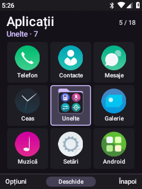
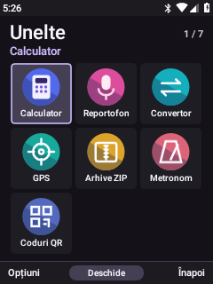
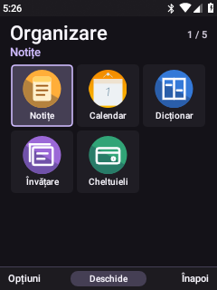
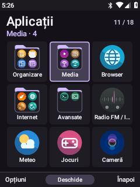
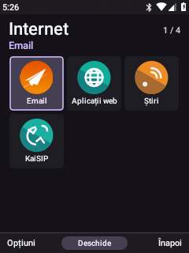
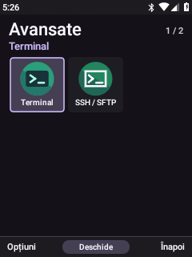
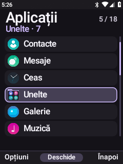

# KeyShell launcher folders · 25 November 2026

The Android 8.1 interactive shell now groups secondary apps in five actual
launcher folders. This uses the existing grid/list and physical keypad, with
no extra service, animation loop or bitmap cache.

## Default layout

The full menu has **18 entries instead of 35**: 13 direct apps and five folders,
across two grid pages. All 35 launcher apps remain reachable exactly once.

| Folder | Apps |
| --- | --- |
| Unelte / Tools | Calculator, Recorder, Converter, GPS, ZIP, Metronome, QR |
| Organizare / Organizer | Notes, Calendar, Dictionary, Study, Expenses |
| Media | Video, Books, Podcasts, Internet Radio |
| Internet | Email, Web Apps, News, KaiSIP |
| Avansate / Advanced | Terminal, SSH / SFTP |

Phone, Contacts, Messages, Clock, Gallery, Music, Settings, Android Apps,
Browser, FM Radio, Weather, Games and Camera remain direct entries.
Contextual tools already reached through Settings stay there.

## Keypad use and customization

- **OK:** open the selected folder or app. Arrows and page keys behave as before.
- **Back or right softkey:** return from a folder to its tile in the main menu.
  Back again returns to the dashboard. Returning from an app restores its folder
  and selection. Each folder remembers its last selected app.
- **Left softkey → Move to folder:** choose any of the five folders or Main menu.
  The current destination is marked. Empty folders disappear automatically.
- **Options → Menu without folders:** restore the flat menu. Turning folders
  back on keeps individual assignments. Simple mode still has six direct apps.
- **Reorder apps:** the existing saved app order controls member order. A folder
  occupies the position of its first member in that order.

Folder icons are vector drawings with up to four actual member icons. Grid,
list, all existing palettes and text sizes share the same rendering route.
Usage guidance stays in Info / Help.

## Persistence boundary

`AppCatalog` retains all 49 stable IDs and its flat order/shortcut formats.
Virtual IDs 1000–1004 are local to launcher presentation and cannot become
application shortcuts or launch intents. Search and recent-app history continue
to use real app IDs.

The separate `launcher-folders` preference group stores the optional `enabled`
boolean and validated `app0`–`app48` folder overrides (−1 for Main menu, 0–4 for
a folder). Invalid local overrides fall back to defaults. General backup includes
this group under Appearance and rejects incompatible types or folder values.
An older Appearance backup restores the default assignments rather than retaining
unrelated overrides. Existing saved launcher/category focus migrates to the
containing folder while preserving the actual child app.

## Device images

Actual 240 × 320 renders on TA-1286, using a temporary default order, Material
palette and Romanian labels. User appearance, assignments and focus are restored
after the capture fixture. The list example uses the largest text size.

| Main menu | Tools | Organizer |
| :---: | :---: | :---: |
|  |  |  |

| Second page | Media | Internet |
| :---: | :---: | :---: |
|  |  |  |

| Advanced | Large-text list |
| :---: | :---: |
|  |  |

## Reproduce checks

Fresh checks on TA-1286 / API 27, starting from Git `82ccc7e`:

- 322 device assertions: isolated membership/backup contracts, actual folder
  navigation, app return focus, move picker, empty folders, flat/grouped switching,
  persistence and 54 palette/text combinations with grid/list rendering.
- 107 host tests passed. Catalog/manifest audit retains 49 stable destinations,
  including the 14 contextual entries outside the launcher.
- Signed APK audit: 2,277 candidate classes, all 431 baseline external dependency
  classes retained, no duplicate classes; 298 production Java sources compiled.
- Physical event1 scans: arrows, OK 352, left softkey 139, Back 14 and right
  softkey 158 verified on Tools → Calculator → Tools → main menu → dashboard.
  Five standard Home/global Menu/Settings smoke checks also passed.
  A follow-up immediately after test-package removal exceeded the runner's
  six-second Home-command limit; explicitly warming Home and repeating the
  full five checks passed.
- Home, accessibility service, notification listener and keypad IME verified
  after replacement and instrumentation. The accessibility grant was restored
  when the ROM cleared it during the test restart.

Installed **data APK** SHA-256:
`b3fde737aae635d8dd1f883b1903431dbb48ebde40ba2f98515eaddea9d80d28`.
The bundled `/system/priv-app/LeoVisual/LeoVisual.apk` remains unchanged at
`abcb93b6ee1305ededb7e52105a2d5dc232f8c795e67420834e49564cb89f0e6`.
This batch updates the running app; it does not promote a system APK or flash
a ROM. The prior signed data APK and local preference snapshot are preserved
under the ignored `android81/output/launcher-folders/` directory.

```text
python android81/build-pocket-apps-windows.py
python android81/build-pocket-tests-windows.py --launcher-folders
python -m unittest discover -s android81/tests -q
python -X utf8 android81/audit-leo-shell.py
python android81/smoke-leo-keypad.py --serial 695d
```

The optional test APK runs
`ro.leo.visual.launcherfolderchecks/ro.leo.visual.LauncherFoldersTests` on API 27.
It uses isolated preferences for model/backup contracts, then backs up and restores
the UI settings around real folder navigation and a Calculator launch. It never
initiates a call, sends a message or starts recording/playback. The runner retains
accessibility automation flags; recheck Home, accessibility, listener and IME
after instrumentation because this ROM can clear the accessibility grant when
restarting the target process.
