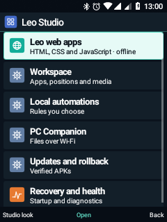
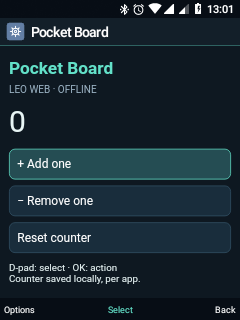

# Leo 0.10 · prima etapă a platformei

27 octombrie 2026 · Nokia 6300 4G TA-1286 · Android 8.1.

Cele șase direcții au puncte de intrare în **Leo Studio**. Este fundația unei
platforme în dezvoltare, nu finalizarea tuturor obiectivelor premium.

Deschidere: **Setări → Telefon → Leo Studio** sau **Meniu fizic → Leo Studio**.
Aplicațiile web apar separat în meniul principal.

| Direcție | Livrat | Limite |
| --- | --- | --- |
| Motor UI | Cache de 128 texte stilizate per ecran, liste reciclate, pictograme noi, aspect Studio · Grafit opțional | Reduce alocările la legarea rândurilor; nu schimbă compositorul și nu demonstrează eliminarea latenței întregului sistem |
| Aplicații web | HTML/CSS/JS local, D-pad/OK, localStorage pe origine, import ZIP cu confirmare, Pocket Board și SDK | WebView 61 existent; fără Internet sau API Android; compatibilitatea KaiOS nu este implementată |
| Multitasking | Ultimele 12 destinații, poziții în liste, documente web, acces la media și ferestre Android | Nu serializează memoria aplicațiilor sau editorii; Android poate închide procese |
| Automatizări | 16 reguli: căști, încărcător, Wi-Fi, Bluetooth → notificare Muzică/memento sau profil Noapte/Normal | Oprite la creare, activare explicită, serviciu vizibil, cooldown 30 s; evenimentele fizice nu sunt toate validate |
| Companion PC | Pagină web, token pe sesiune, status și upload/download în folderul Companion | HTTP local, sesiune 15 minute, maximum 16 MB/fișier; fără shell, capturi, contacte/SMS sau instalare de la distanță |
| Actualizări | Validarea ZIP/APK și copia precedentă existente, stare pornire și centru de recuperare | Revenire APK cu confirmare Android; nu este OTA de ROM sau rollback automat |

## Utilizare

- **Aspect:** Leo Studio → Aspect Studio → Aplică. Tema existentă poate fi
  selectată în continuare; contrastul ridicat are prioritate.
- **Web:** Aplicații web Leo → Pocket Board. D-pad alege, OK execută. Importă
  `.leoapp.zip` din Opțiuni sau Fișiere, apoi confirmă instalarea.
- **Spațiu de lucru:** Meniu → Spațiu de lucru. Nu se salvează parole, corpuri
  de mesaje, comenzi Terminal sau ecrane de apel activ.
- **Reguli:** creează regula, apoi activeaz-o explicit. Notificarea Muzică oferă
  deschiderea playerului, fără redare automată. Nu se execută acțiuni în apel.
  Profilurile cer accesul DND deja folosit de Leo.
- **PC:** conectează Nokia la Wi-Fi și pornește Companion. Introdu în browser
  adresa și tokenul afișate. Numai folderul privat `documents/Companion` este
  partajat; are acces direct din pagina telefonului. ZIP-urile încărcate se
  verifică și instalează ulterior din Actualizări pe telefon.
- **Recuperare:** trei porniri Home repetate rapid, cu pornirea precedentă
  neconfirmată, deschid centrul de recuperare. Procesul confirmă pornirea după
  două secunde. Centrul oferă Actualizări, Diagnostic și Home; nu șterge date.

## Arhitectură și audit

Runtime-ul web folosește o origine sintetică HTTPS per ID, servită din folderul
privat instalat. Accesul file/content, rețeaua, permisiunile și descărcările sunt
refuzate. CSP blochează conexiunile, formularele externe și cadrele. Nu există
`addJavascriptInterface`. Procesul separat folosește însă același UID Android
ca Leo: nu este un sandbox cu UID distinct sau un Chromium modernizat.
Pachetele web sunt importate explicit și nu sunt semnate criptografic.

Serviciile noi sunt neexportate. Companion pornește la cerere, se leagă de adresa
Wi-Fi și se oprește la schimbarea/pierderea ei sau după 15 minute. API-ul cere
Bearer token, verifică Host/Origin, limitează conexiunile și căile, nu suprascrie
fișiere. Tokenul nu este stocat în URL sau preferințe. Traficul HTTP nu este
criptat: folosește o rețea locală de încredere.

Automatizările, istoricul workspace și aplicațiile web nu sunt încă incluse în
backupul selectiv. Refacerea completă a sesiunilor, reguli temporizate avansate,
capturi prin Companion și recovery independent rămân etape viitoare.

Testele folosesc TCP loopback, pachete și fișiere temporare, reguli oprite și
motorul web real. Nu inițiază apeluri, mesaje, înregistrări sau transferuri
Bluetooth. Nu se rescriu boot, recovery, modem sau drivere.

Vezi [SDK-ul web](web-app-sdk/README.md) și [build-ul aplicațiilor](RELEASE-APPS.md).

## Rezultatele candidatului instalat

- 31 `PremiumPlatformTests`: TCP loopback, autentificare, Host/Origin, transfer,
  refuz suprascriere, ZIP-uri, cache, workspace și deschiderea paginilor.
- 5 `WebPlatformTests`: HTML/JS real, D-pad/OK, localStorage și lipsa bridge-ului.
- Regresie: 10 PhoneTabs, 26 SixPolish, 31 Complete09, 34 DailyUse08. Toate cele
  137 verificări au trecut cu `INSTRUMENTATION_CODE: -1`.
- Încă 6 probe reale PC → Nokia prin Wi-Fi: pagină Companion, API autentificat,
  refuz fără token, upload/download cu hash identic și refuz cross-origin.
  Sesiunea temporară s-a închis, iar fișierul de test a fost eliminat.
- Verificarea IMS nu a trecut: starea a rămas `registering`, cu LTE și date
  conectate pe SIM 2. Nu au fost modificate configurația radio sau driverele și
  nu s-a inițiat un apel; VoLTE nu este reconfirmat în această etapă.

| Leo Studio | Aplicație HTML locală |
| --- | --- |
|  |  |

Aspectul Studio · Grafit a fost aplicat pe telefon din meniul Studio și verificat vizual.
