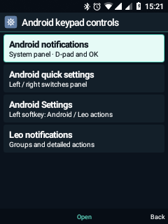
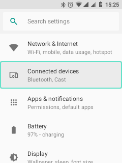
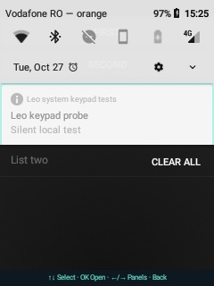

# Leo 0.11 · și Android primește taste

Leo rămâne interfața principală. Această etapă adaptează două componente
Android 8.1 existente: **SystemUI** și **Settings**. Nu înlocuiește toate
aplicațiile Android și nu este un nou ROM complet.

## Comenzi

Din meniul fizic Leo → **Android keypad controls / Android din taste**, sau
Setări Leo → Telefon → Android din taste:

- Notificări Android: panoul real al sistemului.
- Configurări rapide Android: panoul Android cu comenzile sale.
- Setări Android: aplicația originală, cu navigare suplimentară.
- Notificări Leo: lista și acțiunile deja existente în shell.

În panoul Android, **sus/jos** mută conturul mentă, **OK** activează elementul,
**dreapta** cere comenzile rapide, **stânga** revine la notificări și **Înapoi**
închide panoul. Legenda apare numai când panoul este deschis, în starea normală
de notificări, în afara ecranului Android de blocare și a modului doze.

În Setări Android, soft stânga deschide acțiunile Android/Leo. Tasta dedicată
Meniu păstrează meniul global Leo, inclusiv mouse-ul virtual. Câmpurile text și
listele Android bazate pe AdapterView păstrează comenzile native.

## Implementare și limite

`framework-keypad/LeoKeypadNavigation.java` este un adaptor Java mic, inclus în
fiecare dintre cele două APK-uri. Parcurgerea este limitată la 512 de vederi și
96 de acțiuni; controalele suprapuse cu aceleași limite sunt deduplicate.
Selecția poate avansa și când un container refuză focalizarea Android standard.
OK nu repetă activarea la menținerea tastei. Înapoi, volumul și tasta de apel
nu sunt interceptate de adaptor.

În această etapă nu se instalează `framework.jar`, imagini ART, framework-res,
boot, recovery sau drivere. Există și un hook de sursă pentru DecorView, însă
migrarea pe boot classpath trebuie validată separat, împreună cu imaginile ART
corespunzătoare. Build-ul `--apps-only` nu actualizează acel hook din framework.

Adaptarea nu garantează încă toate ferestrele, dialogurile, detaliile Wi-Fi sau
aplicațiile terțe. Nu modifică gestionarea Android a permisiunilor sau blocării
securizate. Panoul Leo și mouse-ul rămân disponibile pentru ecranele neadaptate.

## Recompilare și instalare pe dispozitivul de dezvoltare

Necesită checkout-ul AOSP și mediul descrise în documentația de recompilare.
Din WSL, în directorul `android81`:

```sh
bash build-framework-keypad.sh --apps-only
bash build-framework-keypad-tests.sh
```

Patcherul folosește ancore explicite și păstrează modificările AOSP existente.
În Windows, utilitarul de instalare verifică serialul Nokia, marcajul partițiilor
interne, identitatea APK-urilor, definiția DEX a adaptorului și hash-urile:

```powershell
python android81/install-system-keypad.py backup
python android81/install-system-keypad.py install
# Numai după verificarea rezultatului:
python android81/install-system-keypad.py ack
# Revenire explicită, fără ștergerea datelor aplicațiilor:
python android81/install-system-keypad.py rollback
```

Se poate selecta `--only systemui` sau `--only settings`. Revenirea automată
începe după 240 de secunde fără confirmare; pentru probe mai lungi există
`--rollback-seconds 600` (limite 60–900). Mecanismul rulează pe telefon,
independent de clientul ADB, și **nu supraviețuiește repornirii telefonului**.
Nu se repornește dispozitivul în timpul unei probe neconfirmate.

Actualizarea păstrează datele și verifică semnăturile prin PackageManager.
SystemUI este repornit după actualizări pentru eliminarea căilor APK expirate.
O excepție temporară Android de 20 de secunde permite pornirea serviciului
după actualizare; nu se schimbă politica permanentă de economisire a bateriei.
Copiile APK și rapoartele locale rămân în `output/`, în afara Git.

## Validare și constatări

- Adaptorul comun a trecut 17 verificări pe Nokia: navigare, activare unică,
  păstrarea editorului și listelor native, plus ieșirea dintr-un control cu
  focalizarea blocată de părinte.
- Probele native folosesc exclusiv o notificare locală silențioasă; nu activează
  comutatoare de rețea și nu deschid notificările utilizatorului.
- Inspecția Android necesită `FLAG_RETRIEVE_INTERACTIVE_WINDOWS`. Evenimentele
  injectate trebuie să specifice sursa tastaturii. Rezultatele inițiale care nu
  îndeplineau aceste condiții nu sunt considerate validări ale interfeței.
- Primele actualizări au coincis cu presiune de memorie și închideri de procese.
  Revenirea APK-urilor nu a eliminat imediat presiunea. După repornirea pe
  versiunea restaurată, Leo a rămas activ în timpul următoarelor probe.
- Starea raportată de WindowManager pentru keyguard poate rămâne incoerentă
  după înlocuirea SystemUI. Handlerul panoului folosește starea vizuală SystemUI;
  protecțiile Android ale ferestrelor nu sunt dezactivate.

## Rezultatul instalat · 27 octombrie 2026

**Leo Visual și T9: 0.11.0-dev / cod 11.** SystemUI și Settings sunt instalate
ca actualizări APK, cu datele păstrate. Confirmarea instalării a anulat
revenirea temporizată după încheierea probelor.

Au trecut **65 de verificări** pe Nokia, toate cu `INSTRUMENTATION_CODE: -1`:

| Probă | Rezultat |
| --- | --- |
| Adaptor comun, inclusiv focalizare refuzată de container | 17/17 |
| Componente Android instalate: Setări, selecție vizibilă, meniu, notificare locală deschisă cu OK, schimbare panouri și Înapoi | 12/12 |
| Pagina Leo Android din taste, navigare circulară și Înapoi | 6/6 |
| Regresia interfeței comune Leo și meniului de oprire, fără oprirea reală a telefonului | 30/30 |

Proba notificării verifică primirea unui Intent dedicat, nu simpla existență
a unei aplicații în fundal. Fixture-ul gestionează și `onNewIntent`; un
PendingIntent rămas de la o probă anterioară este înlocuit explicit.

Au rămas selectate tastatura `ro.leo.keypad/.KeypadIme` și serviciul global
Leo. La final, meniul Leo a revenit pe ecran. Nu s-au repetat apeluri, SMS,
probe de sunet, înregistrări sau modificări ale conectivității.

**Limite ale validării:** nu s-a făcut o nouă repornire cu aceste APK-uri finale,
nu s-au validat toate paginile Setări și nu s-au activat comutatoarele rapide
de rețea. Probele inițiale eșuate nu sunt incluse în totalul de mai sus.

| Punctul comun Leo | Setări Android | Panoul Android |
| --- | --- | --- |
|  |  |  |
