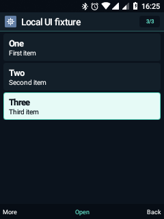
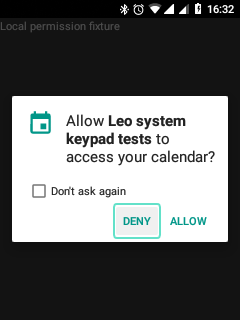
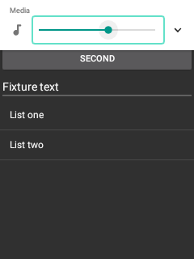

# Leo 0.12 · din prototip spre telefon de zi cu zi

27 octombrie 2026 · `0.12.0-dev`, cod 12 · Nokia 6300 4G TA-1286.

Această etapă acoperă cele cinci direcții acceptate: maturizare, interfață comună,
Android din taste, performanță și pachet de recuperare. Este o versiune de
dezvoltare instalată pe telefon; nu reprezintă certificarea unui ROM de producție.

## Ce s-a schimbat

| Direcție | Rezultat | Limita verificării |
|---|---|---|
| Pornire și diagnostic | Setări → Telefon → Daily readiness verifică Home, T9, meniul global, accesul la notificări și memoria; păstrează milestone-uri software pentru pornire | Verificări locale, fără apeluri automate sau măsurare optică |
| Interfață comună | Antetul listelor arată poziția curentă; bara softkey evită actualizări identice; pictogramele comune folosesc un cache limitat | Aspectul existent este păstrat; aplicațiile externe au propriul UI |
| Android din taste | SystemUI, Settings și PackageInstaller adaptate; dialogul de permisiuni și volumul se controlează din D-pad/OK | Hook-ul central DecorView nu este instalat; nu toate aplicațiile Android sunt adaptate |
| Performanță | Mai puține reconstruiri de text/pictograme și apeluri către IME; cache de 24 bitmap-uri de 54×54, aproximativ 274 KiB | Miniaturile asincrone rămân actualizabile; cache-ul static de rânduri este opt-in |
| Recuperare | Snapshot boot/system/recovery verificat SHA-256 și constructor offline pentru ZIP privat boot/system cu actualizările APK integrate | Flash-ul hardware nu a fost executat; ZIP prin ADB în recovery, nu „Apply update” semnat |

Partajarea textului GPS și deschiderea fișierelor externe folosesc selectorul Leo
din taste. Proba selectorului nu a trimis date către alte aplicații.

## Verificări efectuate

**95 de verificări Android** au trecut: 13 pentru noua etapă, 30 pentru fundația
UI, 10 pentru filele Telefon, 6 pentru pagina Android din taste, 12 pentru
SystemUI nativ, 17 pentru adaptor și 7 pentru dialogurile native.

Dialogul real de permisiuni al aplicației locale de test a fost refuzat din
taste. Sliderul nativ de volum a fost schimbat și readus la valoarea inițială;
nu s-a redat audio în această probă. Aplicația auxiliară de test a fost eliminată.
Verificările Telefon au navigat filele fără apeluri sau SMS.

Au trecut și **27 de verificări pe PC**: 11 pentru gardurile pachetului recovery,
5 pentru pachetul aplicațiilor și 11 pentru algoritmii proiectului. Testul vechi
al cardurilor Home a fost corectat pentru cele cinci carduri existente, inclusiv
Workspace; nu s-a schimbat algoritmul produsului pentru a satisface testul.

După instalare, o repornire completă a produs un boot ID nou, `boot_completed=1`,
procesele Leo și SystemUI active și tastatura T9 selectată. Home a înregistrat
primul milestone la **43,9 s**, iar confirmarea software la **46,0 s** de la boot.
Aceste valori nu măsoară primul pixel și nu constituie o medie de autonomie sau
un test de funcționare continuă. USB/ADB s-a deconectat ulterior: această problemă
rămâne deschisă și nu este ascunsă de rezultatul pozitiv al pornirii.

## Cadrele interfeței

Două probe înainte și două după, câte 40 de evenimente de navigare:

| Versiune | Mediana cadrului, ms | p95, ms |
|---|---:|---:|
| 0.11 · proba 1 | 10,18 | 12,77 |
| 0.11 · proba 2 | 10,21 | 11,80 |
| 0.12 · proba 1 | 5,48 | 7,24 |
| 0.12 · proba 2 | 5,44 | 8,63 |

Măsurarea folosește `FrameCompleted − IntendedVsync` din `gfxinfo`, nu întârzierea
fizică tastă–ecran. Activitatea de fundal nu este identică între probe. Rezultatul
arată reducerea lucrului aplicației în aceste trasee; nu promite eliminarea
oricărui lag sau un anumit FPS. Datele brute rămân local în `output/performance/`.

## Capturi de pe telefon

Sunt capturi din probe locale, fără conținutul conturilor utilizatorului.

## Ce rămâne de maturizat

- Deconectările USB/ADB după pornire și unele operații de sistem.
- Validarea controlată a restaurării din recovery și a pornirii sistemului rezultat.
- Autonomia fără USB, GPS în condiții bune de recepție, apelurile Bluetooth și emailul real, amânate anterior.
- Compatibilitatea aplicațiilor Android externe: adaptorul nu înlocuiește testarea fiecărei ferestre.
- Distribuția ROM-ului: componentele proprietare rămân private; cheile AOSP de dezvoltare și limitele Android 8.1 rămân cele ale portului.

[Construirea și verificarea pachetului recovery](RECOVERY-BUNDLE.md) ·
[Recompilarea aplicațiilor](RELEASE-APPS.md) ·
[Etapa anterioară](LEO-11-ANDROID-KEYPAD.md).
