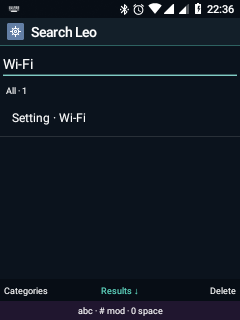
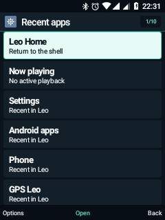
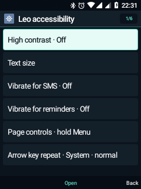
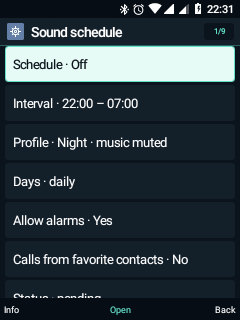

# Leo 0.13 · șase lucruri mai ușor de folosit

27 octombrie 2026 · `0.13.0-dev`, cod 13.

Această etapă completează funcțiile existente, păstrând aplicațiile și rutele
actuale. Nu introduce șase copii noi în meniul principal și nu schimbă driverele,
boot-ul, recovery-ul sau alegerea SIM-urilor.

| Funcție | Unde o găsești | Completarea din 0.13 |
|---|---|---|
| Căutare globală | Home → tasta 1 → soft stânga Categorii | Filtre pentru aplicații, contacte, setări, muzică și alte rezultate; căutarea include rute către setările uzuale, păstrează textul la recreare și indică încărcarea/numărul rezultatelor. Filtrul Setări evită providerii de contacte/media și scanarea fișierelor. |
| Multitasking | Meniul fizic global → Aplicații recente | Media curentă este fixată lângă Home, cu starea Muzică/Radio. Ferestrele Android sunt numite explicit recente; istoricul nu demonstrează că toate procesele încă rulează. Dacă brokerul Android nu răspunde, istoricul Leo rămâne accesibil. |
| Profiluri programate | Setări → Sunet → Program sonor | Rută directă și afișarea următoarei limite, inclusiv suspendarea după alegerea manuală a unui profil. Intervalele, zilele, favoritele și excepțiile pentru alarme existente sunt reutilizate. Programarea rămâne opt-in. |
| Descărcări | Setări → Stocare → Descărcări | Progres actualizat la două secunde cât lista este vizibilă și există transferuri în așteptare; rândurile sunt actualizate fără reconstruirea antetului când identitatea listei nu se schimbă. Reîncercare cu confirmare pentru intrări eșuate, detalii/cod de serviciu și selector Leo pentru deschidere. |
| Accesibilitate | Setări → Siguranță → Accesibilitate Leo | Repetarea săgeților: Sistem, Mai lent sau Pas cu pas. Contrastul și textul mărit existente rămân disponibile. Ritmul nou se aplică în activitățile Leo și Home; nu modifică tastatura Android globală, IME-ul, mouse-ul virtual sau aplicațiile externe. |
| Configurare inițială | Setări → Telefon → Configurare inițială | Ghidul își salvează pasul și îl reia după închidere. Finalizarea resetează poziția și păstrează marcajul de configurare completă. Un telefon deja configurat nu este trimis din nou automat prin ghid. |

Descărcările noi păstrează alegerea Wi-Fi/mobil. Reîncercarea creează o cerere
nouă cu politica de rețea curentă; intrarea veche rămâne disponibilă. Ștergerea
cere confirmare și poate elimina și fișierul. Nu există promisiunea de reluare
HTTP de la același octet sau un downloader independent de DownloadManager.

Pentru repetarea săgeților, modul Sistem păstrează comportamentul curent. Modul
lent permite repetări după 500 ms și la minimum 180 ms între ele. Pas cu pas
ignoră repetările unei apăsări ținute; apăsările noi și eliberările nu sunt
întârziate, iar cifrele și tasta de apel nu sunt filtrate.

## Verificări

Au trecut **27 de verificări noi pe telefon**: filtrarea căutării/rutele Setări,
ritmul tastelor și protejarea tastei de apel, reluarea ghidului, starea programului,
validarea URL-urilor și progresului, deschiderea paginilor și absența funcției NFC.

Pentru DownloadManager, un server HTTP temporar de pe `127.0.0.1` a returnat mai
întâi 404, apoi conținut text valid. Prima cerere a devenit eșuată, a doua a reușit,
iar conținutul citit a corespuns exact. Ambele au folosit constructorul de cereri
folosit de Nou/Reîncearcă. Doar transferurile și fișierele acestei probe au fost
eliminate; nu s-au contactat servere externe. Aceasta nu înlocuiește verificarea
fiecărui server HTTPS, a redirecționărilor sau a transferurilor mari.

Au trecut și **30 de verificări UI comune**, **10 de navigare Telefon** și **6
pentru Android din taste**: în total 73 de verificări Android în această etapă.
Pe PC au trecut 11 verificări de algoritmi și 5 ale pachetului de aplicații.
Preferințele de configurare și accesibilitate schimbate în probe au fost restaurate.
Nu s-au inițiat apeluri/SMS, nu s-a înregistrat și nu s-a redat audio.

## NFC: indisponibil pe acest telefon

Android nu declară `android.hardware.nfc`; nu există serviciu NFC, nod de
dispozitiv sau HAL NFC disponibil. Arborele dispozitivului conține nume generice
de pini NFC Qualcomm, iar fișierele de referință au permisiuni generice NFC;
acestea nu demonstrează existența unui controler montat pe placă.

[Specificația HMD](https://www.hmd.com/en_int/nokia-6300-4g/specs) nu listează NFC,
iar [specificația operatorului TruConnect](https://shop.truconnect.com/product/nokia-6300-4g/)
îl indică explicit ca absent. Împreună cu verificarea dispozitivului, acestea nu
oferă suport pentru activarea NFC pe TA-1286. Nu s-a adăugat un comutator fictiv
și nu s-au încărcat drivere experimentale. NFC nu poate fi creat doar printr-o aplicație.

## Capturi

Pachetul aplicațiilor se construiește cu [release-apps.py](release-apps.py).
Arhiva recovery construită la 0.12 rămâne snapshot-ul acelei versiuni: actualizarea
aplicațiilor la 0.13 nu o modifică și nu constituie o validare nouă de flash.
