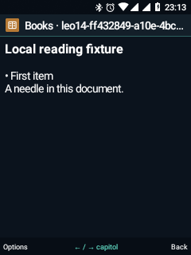

# Leo 0.14 · ziua ta, din taste

27 octombrie 2026 · `0.14.0-dev`, cod 14.

Șase completări ale aplicațiilor existente, fără încă șase pictograme duplicate
în meniu. Portul hardware și componentele Android native rămân cele existente.

| Funcție | Acces | Ce este nou |
|---|---|---|
| Ziua mea | Cardul Agenda de pe Home → OK sau Acces rapid → Ziua mea | Evenimentele Calendar Leo din ziua curentă, următoarea alarmă și elemente nebifate din listele Notițe. Fiecare rând deschide aplicația și înregistrarea corespunzătoare. |
| Activitatea contactului | Contacte → persoană → Activitatea contactului | Apeluri și SMS pentru toate numerele persoanei, într-o listă cronologică. Fotografii, grupe și aniversări existente sunt păstrate. |
| Galerie | Galerie → album | Cache de miniaturi limitat la 2 MiB, reutilizat între pagini și vizor; imaginile vizibile nu sunt reciclate la evacuarea din cache. Zoom, rotire, albume și favorite rămân disponibile. |
| Documente | Cărți Leo sau Fișiere → document | Markdown cu titluri, liste și blocuri monospace; căutare în TXT/Markdown/EPUB. PDF local cu pagini, zoom, deplasare, salt la pagină, semn de carte și reluarea ultimei pagini. |
| Notificări interactive | Notificări → notificare → Acțiuni | Amânare 5, 15 sau 60 de minute, prin serviciul Android. Acțiunile existente, RemoteInput și comenzile media ale aplicațiilor rămân accesibile din taste, atunci când sunt oferite de notificare. |
| Taste lungi | Home → 5 scurt → Apăsări lungi pe Home | Alegi aplicația deschisă prin apăsare lungă pe 2–9 sau revii la apelarea rapidă existentă, fără să pierzi numărul salvat. |

## Detalii care contează

**Agenda** citește Calendarul local Leo și listele `[ ]` din Notițe. Elementele
nebifate nu primesc termene inventate: sunt sarcini în așteptare, nu neapărat
întârziate. Lista arată cel mult 12 evenimente și 12 sarcini; alarma poate fi
și într-o zi viitoare. Cardul Home păstrează evenimentul apropiat și adaugă
numărul elementelor nebifate, actualizat prin mecanismul existent de cache.

**Activitatea contactului** compară formatele naționale și internaționale ale
numerelor. Citește cel mult 500 de apeluri, 1.000 de SMS-uri din provider și
câte 500 din tabelele locale Leo, apoi păstrează cele mai recente 80 de rânduri.
Mesajele oglindite sunt deduplicate după număr, dată și conținut. Nu este un
export complet de istoric și nu modifică marcajele de citire.

**Galeria** golește cache-ul la reîncărcare explicită și la închiderea activității.
Rotirea existentă este pentru vizualizare; nu rescrie fișierul original. Cache-ul
limitează miniaturile reținute, nu reprezintă o limită pentru toată memoria aplicației.

**Cititorul** păstrează suportul EPUB existent. Markdown folosește un subset
vizual local, fără executarea HTML, scripturilor sau linkurilor. Căutarea este
limitată la 50 de rezultate și păstrează offset-urile textului afișat, inclusiv
după eliminarea marcajelor Markdown.

PDF folosește PdfRenderer din Android: o singură imagine de pagină, de cel mult
1 megapixel, și fișiere locale de până la 32 MiB. `4/6` schimbă pagina, `7/9`
schimbă zoom-ul, iar săgețile deplasează pagina. Pagina și un semn de carte sunt
salvate local pentru fiecare versiune a fișierului. **Căutarea textului PDF nu
este implementată**; nici documentele criptate sau toate particularitățile PDF
nu sunt garantate. Preferințele cititorului PDF nu intră în backup-ul Leo actual.

**Notificările** permanente, în curs și de apel nu primesc amânare. Snooze ascunde
temporar notificarea prin Android; nu schimbă ora evenimentului Calendar sau a
alarmei. Pentru SMS Leo, „Răspunde în Leo” deschide compunerea existentă; nu
trimite automat. Pentru alte aplicații, răspunsul inline depinde de RemoteInput.

**Tastele** de apel și deblocare, precum și `0`/`1`, păstrează comenzile existente.
Modul grilă și comenzile `4/5/6` ale cardului media/favorite au în continuare
prioritate în contextul lor. Alegerea unei aplicații nu inițiază automat un apel.
Alegerea unui contact din Apelare rapidă readuce acea tastă în modul de apelare
rapidă. Noile atribuiri și ritmul săgeților sunt incluse în preferințele de backup;
cheile rezervate nu pot fi atribuite prin acest mecanism.

## Verificare

Au trecut **31 de verificări noi pe telefon**, **30 ale interfeței comune**,
**10 de navigare Telefon** și **6 pentru pagina Android din taste**: 77 în total.
Pe PC au trecut 11 verificări ale algoritmilor proiectului și 5 ale pachetului
de aplicații. Hash-urile APK-urilor instalate sunt verificate față de build.

Probele folosesc documente Markdown/PDF și o imagine create local, plus o
notificare locală fără sunet. Verifică parsarea, căutarea și deschiderea rezultatului,
pagina PDF/zoom/reluarea, reutilizarea miniaturii, numerele contactelor, scurtăturile,
RemoteInput și amânarea. Nu creează apeluri sau SMS-uri în istoricul real și nu
trimit mesaje. Fișierele și notificarea de probă sunt eliminate, iar preferințele
modificate sunt restaurate. Capturile păstrate conțin numai documente de test.

Testele de navigare așteaptă acum focusul ferestrei după confirmările de oprire;
`waitForIdleSync` singur nu garantează încheierea tranziției WindowManager.
Probele cu documente mențin ecranul aprins. Protecția ShellHealth a fost activată
de pornirile foarte scurte din seria de teste și a fost readusă în Home prin
ruta normală de recuperare; telefonul nu a fost repornit și protecția nu a fost dezactivată.

[Pachetul aplicațiilor și recompilare](RELEASE-APPS.md) ·
[Etapa precedentă](LEO-13-DAILY-TOOLS.md).
