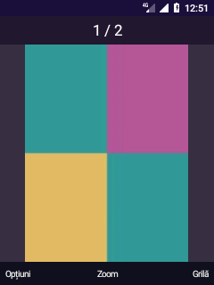
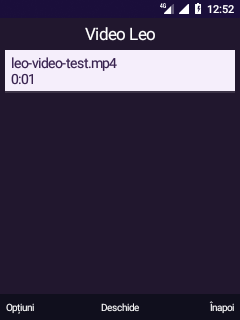
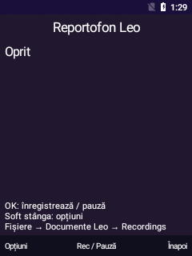

# Note de validare — suita Leo pentru taste

19 octombrie 2026. Implementări proprii Android 8.1 inspirate din fluxurile aplicațiilor KaiOS din dump. Nu rulează arhivele Gaia și nu includ dicționare, imagini sau cod proprietar KaiOS.

## Componente și limite

| Componentă | Implementare | Probă pe TA-1286 |
| --- | --- | --- |
| Galerie | MediaStore, grilă de 9 miniaturi/pagină, vizualizare, zoom 1×/2×/4×, imagine precedentă/următoare, orientare EXIF | Miniatură, vizualizare și zoom verificate cu imagine sintetică; rotație EXIF 90° verificată cu JPEG sintetic |
| Fundaluri / teme | Teme HOME Violet, Apus, Ocean, Pădure; imagine copiată în memoria privată la 240×302, aplicare/eliminare confirmate | Aplicare imagine, eliminare și tema Ocean verificate; tema inițială restaurată |
| Convertor | Lungime, masă, temperatură, volum, viteză, suprafață; unități explicite, respingere NaN/infinit/temperatură sub zero absolut | 137 verificări JVM; 100 °C → 212 °F verificat pe telefon |
| Setări Leo | Luminozitate, stingere ecran, profil, teme, ajutor tastatură, stocare și informații; legături la setările Android de dată/rețea | Luminozitate 50% și stingere la un minut verificate în SettingsProvider, apoi valorile originale restaurate |
| Profil sunet | Normal și Silențios prin AudioManager; Vibrații numai dacă Android raportează vibrator | Silențios și Normal verificate. Android nu detectează vibrator; opțiunea este marcată indisponibilă |
| Descărcări | DownloadManager: URL HTTP/HTTPS cu confirmare, numai Wi-Fi implicit, listă/progres/reîmprospătare, deschidere și anulare/ștergere confirmată | Activitatea se deschide. Proba efectivă de transfer local a fost respinsă de verificarea automată a comenzii; transferul nu este declarat validat |
| Muzică | Bibliotecă MediaStore, serviciu foreground, pauză/redare, ±10 s, volum, piesă precedentă/următoare și oprire din notificare | Biblioteca și comportamentul fără placă audio sunt verificate; redarea necesită stabilizarea driverelor |
| Video | Bibliotecă MediaStore, SurfaceView, pauză/redare, seek, volum, eliberarea playerului la părăsirea ecranului | Interfața și refuzul pornirii fără placă audio sunt verificate; decodarea/redarea reală rămân nevalidate |
| Reportofon | MediaRecorder AAC/M4A, serviciu foreground, pauză/continuare, oprire/salvare, listă și ștergere confirmată; limită 10 minute/64 MiB | Ecranul și refuzul pornirii fără placă audio verificate; captură/redare reale nevalidate |
| Favorite | Marcajul STARRED din ContactsContract; intrare dedicată în meniu și opțiune în contact | Contact sintetic adăugat, marcat, afișat la Favorite și șters după probă |
| Blocare taste | Ecran propriu, protecție contra apăsărilor accidentale; soft stânga apoi * în trei secunde | Apăsări obișnuite/Home blocate; secvența de deblocare verificată. Nu este un PIN sau o barieră de securitate; apelurile/alarmele au exceptare în cod, încă netestată pe apel real în această stare |
| T9 local | Dicționar românesc de bază, predicție după cod numeric, * următoarea sugestie, 0 acceptă cu spațiu, OK acceptă; abc/ABC/123/T9/T9 ABC prin # | 424 verificări JVM; zece probe reale: scriere, ștergere, acceptare, majuscule, schimbare sugestie, fallback, mod numeric, multi-tap, câmp telefon și parolă. Nu are învățare sau dicționar complet |

Galeria și bibliotecile listează maximum 500 de fișiere; Descărcări maximum 300 de înregistrări proprii. Galeria decodează imagini eșantionate la cel mult 640 px și doar miniaturile paginii curente. Zoom-ul este centrat, fără panoramare. Nu sunt implementate albume, editor foto, liste de redare persistente sau mod video fără sunet.

Fișierele Reportofon sunt în `Documente Leo/Recordings`. Un fișier `.part` rămas după pierderea alimentării nu este declarat înregistrare salvată. Serviciile media nu pornesc după reboot și nu încarcă module, nu modifică firmware-ul și nu încearcă recuperarea HAL-ului.

## Particularitatea profilului Android Go

Oreo ignoră `setNotificationPolicyAccessGrantedForUser` pentru toate dispozitivele low-RAM. `patch-leo-policy-access.py` permite doar pachetului `ro.leo.visual` să primească acordarea explicită din comanda existentă shell/system. Verificarea apelantului `checkCallerIsSystemOrShell()` rămâne activă; celelalte aplicații păstrează comportamentul original. `ro.config.low_ram=true` este păstrat.

Corecția este compilată cu `build-netpolicy-boot.sh` și instalată cu `install-netpolicy-boot.py`, împreună cu toate artefactele services ART/ODEX/VDEX potrivite și verificarea a 45 de dependențe de boot. Ultima pornire de probă: 26 secunde până la boot-completed, `/system` read-only. `activate-visual-home.py` acordă accesul pentru profiluri și WRITE_SETTINGS, plus permisiunile declarate ale aplicației.

## Construire și instalare

În WSL kaios:

```sh
bash android81/test-app-suite.sh
bash android81/build-visual-shell.sh
bash android81/build-keypad-ime.sh
```

Pe Windows, cu serialul 695d conectat:

```powershell
python android81/install-leo-app-suite.py
python android81/verify-keypad-prediction.py
```

Instalatorul refuză un apel activ/alarmă în curs, salvează și verifică SHA-256 pentru cele două APK-uri anterioare în `output/app-suite-before/`, apoi actualizează fără ștergerea datelor. Nu instalează patch-ul framework în mod implicit. Receiverul MY_PACKAGE_REPLACED reschedulează alarmele Leo după actualizarea APK-ului.

Numerele reale, inboxul, arhivele originale, copiile de APK și jurnalele brute rămân locale și nu sunt incluse în Git.

## Curățare și capturi

Contactul și cele patru fișiere media de probă au fost eliminate numai după verificarea identității/conținutului lor. Fișierele originale ale utilizatorului nu au fost șterse. Luminozitatea, timeout-ul, profilul Normal, tema Violet și preferința de afișare listă au fost restabilite după probe. Modul IME a rămas abc, blocarea tastelor oprită. T9 rămâne disponibil prin #.

Capturile folosesc doar ecrane de sistem sau date sintetice:

| Meniu | Galerie / EXIF | T9 |
| --- | --- | --- |
|  |  |  |

| Muzică · listă | Video · listă | Reportofon · interfață |
| --- | --- | --- |
|  |  |  |

Aceste trei capturi media demonstrează interfața și inventarierea, nu o înregistrare sau redare reușită.
