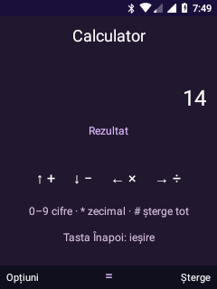
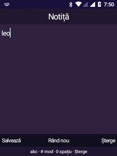

# Calculator și Notițe Leo

19 octombrie 2026. Adaptări Android native ale fluxurilor analizate în copiile
KaiOS locale. Nu rulează pachetele web originale și nu includ codul sau resursele
vendor. În arhivele de referință sunt `calculator` (`index.html`, `dist/bundle.js`)
și `notes` (`index.html`, `dist/bundle.js`, `dist/0.bundle.js`).

## Stare de validare

- APK Leo Visual compilat cu succes pentru Android 8.1.
- Motorul Calculator: **19 rezultate și 10 cazuri invalide/împărțire la zero**
  verificate automat pe JVM, fără dependență de interfață.
- APK instalat pe Nokia 6300, fără ștergerea datelor sau reboot. HOME și serviciul
  meniului global au fost reactivate după oprirea procesului pentru instalare.
- Calculator pe telefon: `2+3*4 = 14`, `0.1+0.2 = 0.3`, eroare pentru `1/0`;
  capturile reale au fost inspectate. Navigarea shell → Calculator → shell a trecut.
- Notițe: „leo” introdus prin scan codes fizice și Leo Multi-tap, salvat, redeschis
  după oprirea procesului; modificarea notei a păstrat același ID și o singură intrare.
- Ciorna a revenit după Home și oprirea procesului; renunțarea a păstrat nota salvată.
  „Păstrează” din confirmarea de ștergere a păstrat-o; confirmarea explicită a eliminat
  doar nota de probă. Fișierul inițial nu conținea alte notițe.
- Bara de comenzi a editorului este vizibilă deasupra IME după corecția `adjustResize`.
  Nu au fost probate încă limitele de volum, erorile reale de stocare sau un reboot.

| Calculator Leo | Notițe și IME |
| --- | --- |
|  |  |

## Calculator

Intrarea Calculator din meniul principal deschide acum activitatea Leo;
Calculatorul Android existent rămâne în Aplicații Android.

| Comandă | Funcție |
| --- | --- |
| 0–9 | Cifre |
| Sus / jos | Adunare / scădere |
| Stânga / dreapta | Înmulțire / împărțire |
| OK | Calcul |
| `*` | Separator zecimal |
| `#` | Șterge tot |
| Soft dreapta | Șterge ultimul caracter |
| Tasta Înapoi dedicată | Închide Calculatorul |
| Soft stânga | Opțiuni: ștergere, schimbare semn, procent și paranteze |

Expresiile folosesc prioritatea matematică normală, semne unare și paranteze.
Se utilizează `BigDecimal` cu `DECIMAL64` (16 cifre semnificative). `%` împarte
operandul precedent la 100: `200*10% = 20`, `10+50% = 10.5`.
Nu implementează convenția comercială a unor calculatoare pentru `+ procent`.
Expresia și rezultatul au limită de 120 caractere; intrările invalide sunt
semnalate fără închiderea aplicației. Interfața nu folosește IME sau motor web.

Teste reproductibile în mediul WSL existent:

```sh
bash android81/verify-calculator-engine.sh
bash android81/build-visual-shell.sh
```

## Notițe

Nouă intrare în meniul principal: ultimul element din listă sau a doua celulă
de pe pagina a doua a grilei, lângă Aplicații Android.

- Listă: sus/jos pentru selecție, OK pentru deschidere, soft stânga pentru notiță
  nouă. `#` deschide Opțiuni pentru notița selectată.
- Editor Android real, conectat la Leo Multi-tap: soft stânga salvează, OK introduce
  rând nou conform IME, soft dreapta șterge. Tasta Înapoi dedicată cere salvare,
  renunțare sau continuarea editării; dacă IME consumă prima apăsare pentru a se
  închide, următoarea ajunge la dialog.
- Ștergerea unei notițe salvate necesită două alegeri: Opțiuni → Șterge → Șterge
  definitiv. Opțiunea implicită a confirmării este Păstrează.
- Conținutul este păstrat în `files/notes.json`, scris prin `AtomicFile`; ciorna
  este separată în preferințe private, actualizată după editare și la `onPause`.
- O ciornă neterminată este redeschisă la relansare. Salvarea sau renunțarea o
  elimină. Nu se promite recuperare după pierderea alimentării în orice moment.
- Limită: 100 de notițe, câte 8.192 caractere. Nu există export, sincronizare,
  atașamente sau acces la fișierele altor aplicații.
- La eroare de citire a fișierului existent, aplicația nu permite salvarea peste
  el. La eroare de scriere, editorul și ciorna rămân disponibile.
- Nu sunt cerute permisiuni noi. Textul nu este trimis sau jurnalizat. Stocarea
  privată Android nu echivalează cu criptarea într-un sistem cu root.

## Probe efectuate pe telefon

1. Calculator: `2+3*4`, rezultat 14; `0.1+0.2`, rezultat 0.3; împărțire la zero
   și revenire în shell. Parantezele sunt validate pe JVM, nu încă fizic.
2. Notițe: notiță de probă introdusă cu multi-tap, salvare, redeschidere după
   oprirea procesului și editare fără duplicarea notei.
3. Ciornă: ieșire prin Home și redeschidere; renunțare fără modificarea notei salvate.
4. Ștergere: anulare fără pierdere de date, apoi confirmare pe nota de probă.
5. Capturi reale inspectate; rezultatele sunt reflectate în README.
