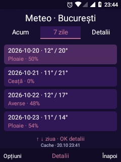
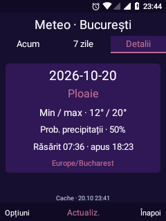

# Ceas cu taburi și Meteo Leo

Actualizare instalată pe aparatul de dezvoltare în 20 octombrie 2026.

## Ceas

Stânga/dreapta schimbă cinci file; sus/jos selectează alarma sau orașul.

| Filă | Funcții |
| --- | --- |
| Ora | Secunde, zi și dată, fus orar, săptămâna și ziua anului, următoarea alarmă Leo activă |
| Alarme | Listă cu ON/OFF din OK; Opțiuni pentru creare, editare și gestionare. Refolosește AlarmScheduler și editorul existent |
| Glob | Ora, data și offsetul fiecărui oraș, cu regulile DST din sistem; până la 8 orașe salvate, alese din 12 locații |
| Timer | Presetări de 1, 5, 10 și 25 minute, durată personalizată, pauză/continuare și resetare; alarma folosește backend-ul persistent existent |
| Crono | Start/pauză, continuare, până la 50 de ture, resetare și durată fără revenire la zero după 24 ore |

Cronometrul folosește elapsedRealtime. Starea existentă este migrată din aceleași
preferințe; o pornire nouă a telefonului invalidează rularea din boot-ul anterior.
Temporizatorul în pauză nu păstrează o alarmă programată. Continuarea reprogramează
durata rămasă. Redesenarea este oprită când aplicația nu este vizibilă; zecimile
se redesenează la 100 ms numai pe fila Crono în mers.

## Meteo

Aplicație nativă nouă, intrarea stabilă **26** în catalog (a 27-a aplicație).
Ordinea și ID-urile aplicațiilor anterioare sunt păstrate. Orașul inițial ales de
utilizator este **București**.

- **Acum:** temperatură, stare, temperatură resimțită, umiditate, vânt și intervalul zilei.
- **7 zile:** min/max, stare și probabilitatea precipitațiilor; sus/jos alege ziua.
- **Detalii:** ziua selectată, precipitații, răsărit/apus și fusul prognozei.
- **Opțiuni:** actualizare și căutare/alegere a altui oraș, plus atribuirea sursei.

Datele sunt modelate, furnizate de [Open-Meteo](https://open-meteo.com/en/docs),
cu localități din [serviciul de geocodare Open-Meteo / GeoNames](https://open-meteo.com/en/docs/geocoding-api).
Datele meteo sunt atribuite Open-Meteo, CC BY 4.0. Utilizarea serviciului este
supusă condițiilor sale; aplicația nu include o cheie de acces sau backend propriu.

Nu solicită GPS. Căutarea transmite textul orașului către serviciul de geocodare;
prognoza transmite coordonatele localității alese. Cererile folosesc HTTPS cu
verificarea normală a certificatelor, timeout-uri de 10 secunde și răspuns limitat
la 1 MiB. Nu există polling în fundal. La deschidere, datele mai vechi de 30 minute
sunt actualizate; există și actualizare manuală. Ultima prognoză este păstrată
local, cu data/ora salvării și eticheta Cache. Un eșec de rețea nu înlocuiește
datele vechi cu valori inventate; schimbarea orașului elimină prognoza celui vechi.

## Verificări

- Compilarea shell-ului și APK-ului de probe a trecut.
- `ClockWeatherTests`: **10 verificări** pe aparat pentru durate, trecerea DST,
  interpretarea codurilor meteo, date lipsă și migrarea ordinii aplicațiilor.
- Prognoză reală HTTPS pentru București, afișată și inspectată în toate cele trei file.
- Navigare din taste prin cele cinci file Ceas.
- Temporizator de 5 minute: pornire, pauză la aproximativ 4:56, Home și redeschidere,
  aceeași durată în pauză, continuare și anulare. La final `timer=false`.
- Cronometru: start, tură la aproximativ 3,2 secunde, pauză la aproximativ 5,2 secunde;
  resetat la final. Nu s-au creat alarme de trezire în această probă.
- Aceeași versiune APK este instalată și sincronizată în baza privilegiată; /system read-only.
- Utilizatorul a verificat manual filele Ceas și Meteo și a confirmat că sunt în regulă, fără suprapuneri sau taste nefuncționale raportate în această probă.

Proba nouă nu repetă declanșarea sonoră a alarmei sau un reboot. Backend-ul
alarmei avea confirmări anterioare; folosirea de durată, căutarea altor orașe
din taste și o probă reală fără conexiune rămân de verificat separat.

## Capturi de pe telefon

| Ora | Glob | Cronometru în pauză |
| :---: | :---: | :---: |
|  |  |  |
| Meteo București | Șapte zile | Detalii |
|  |  |  |

Recompilare: `build-visual-shell.sh`; probe: `build-six-feature-tests.sh`, apoi
`am instrument -w ro.leo.visual.tests/ro.leo.visual.ClockWeatherTests` în mediul
Android furnizat de framework-command.py. API 27, fără biblioteci de rețea suplimentare.
