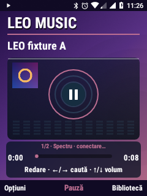
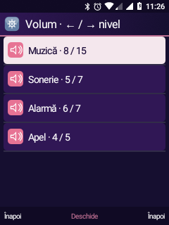
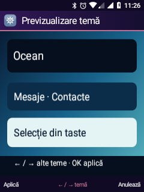
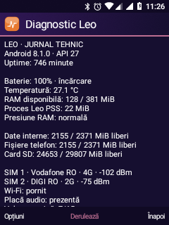
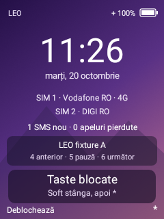

# Leo: șase îmbunătățiri pentru utilizarea zilnică

Implementate și instalate pe Nokia 6300 TA-1286, 20 octombrie 2026. Nu au fost schimbate boot/recovery, driverele audio sau driverul grafic.

## 1. Fluiditate și măsurători

Home păstrează imaginea de fundal în memorie până când fișierul se schimbă. Listele comune refolosesc fundalurile de selecție ale rândurilor; schimbarea volumului actualizează rândurile existente, cu păstrarea paginii și selecției. Playerul refolosește fontul și gradientul fundalului. Vizualizatorul rămâne limitat la 8 Hz și este eliberat în fundal.

Timpii locali sunt păstrați numai numeric, într-un buffer de 120 probe pentru taste și unul pentru pregătirea cadrului Home. Nu se înregistrează codurile tastelor sau textul introdus. Diagnostic arată aceste valori în microsecunde; ele măsoară lucrul din firul UI, nu GPU-ul și nici întârzierea fizică tastă–ecran.

Comparație pe aceeași grilă, 60 evenimente alternând sus/jos, cu verificarea selecției după fiecare eveniment:

| Probă | Versiunea anterioară `0efd75b` | UI nou |
| --- | ---: | ---: |
| Tastarea injectată → repaus, mediană | 34 ms | 34 ms |
| Tastarea injectată → repaus, p95 | 38 ms | 40 ms |
| Durată cadru, mediană, 60 cadre | 8 ms | 8 ms |
| Durată cadru, p95 | 9 ms | 11 ms |
| Deschidere Calculator | 373 ms | 345 ms |
| Deschidere Configurări rapide | 502 ms | 417 ms |
| Deschidere Personalizare | 245 ms | 290 ms |

O singură comparație nu demonstrează un câștig general de viteză; deschiderea paginilor variază. Schimbările reduc reconstrucțiile și alocările, fără promisiunea eliminării tuturor întârzierilor. Prima variantă a probei ajungea în Contacte din cauza tastei Înapoi de pe Home; acele valori au fost excluse. Proba corectată verifică explicit grila, poziția selecției și cadrele ferestrei Home.

## 2. Stil comun

Antetele, pictogramele, listele, câmpurile și dialogurile folosesc paleta comună Leo. Acțiunea centrală a barei softkey este accentuată cromatic. Dialogurile trunchiază textele lungi și afișează poziția în listă. Music și Calculator păstrează desenul retro dedicat; panoul de progres și indicațiile temelor au fundaluri cu contrast mai bun. Stilul nu schimbă aplicațiile Android externe.

## 3. Muzică

- Coperta încorporată este extrasă în fundal, cu imagine decodată de maximum aproximativ 192 px și coadă de lucru limitată. Dacă fișierul nu conține o copertă citibilă, rămâne cadranul retro.
- Selectarea unei piese din bibliotecă trimite lista către serviciu. Trecerea automată la următoarea piesă continuă și cu playerul în fundal.
- Opțiuni → Coada de redare: redare, mutare sus/jos, eliminare. Eliminarea piesei curente trece la piesa rămasă în poziția respectivă; eliminarea ultimei oprește serviciul.
- Aleatoriu: piesele nu se repetă înainte de epuizarea listei. Repetare: oprită, întreaga listă sau piesa curentă. Comanda manuală „următoarea” poate ieși din repetarea unei singure piese.
- MediaSession publică titlul, coperta, starea și comenzile pentru Android. Notificarea deschide direct playerul curent și permite pauză/redare sau oprire.
- Pe blocarea tastelor, când există redare: **4** anterior, **5** pauză/redare, **6** următor. Deblocarea rămâne soft stânga, apoi `*`. Cardul muzical ocupă locul previzualizării notificărilor cât timp serviciul este activ.

Coada este în memorie, pe durata serviciului; nu este o bibliotecă de playlisturi salvată după oprirea procesului. Coperta a fost verificată cu un MP3 propriu de test; nu toate formatele sau metadatele sunt validate. Redarea WMA păstrează mecanismul existent de decodare.

## 4. Notificări

SMS-urile Leo oferă „Marchează ca citit”, printr-un receiver privat. Acțiunea recunoaște numai mesajele conversației până la momentul notificării; un mesaj ulterior rămâne necitit. URI-uri distincte separă acțiunile conversațiilor, inclusiv când codurile hash ar coincide. Deschiderea continuă să ducă direct la conversație.

Lista notificărilor păstrează selecția după actualizare. În detalii, OK deschide notificarea. Apelurile pierdute ale Dialerului Oreo, identificate prin canalul `phone_missed_call`, sunt trimise către istoricul Leo. Home și meniul afișează insigne pe Telefon/Mesaje pentru numărul local necitit. Deschiderea unei conversații sau istoricului păstrează regulile existente de recunoaștere a elementelor citite/văzute.

Marcarea SMS a fost verificată cu date locale, fără trimitere. Nu s-au provocat apeluri reale pentru verificarea noii rute a notificărilor de apel pierdut.

## 5. Personalizare

- Personalizare reunește ordinea aplicațiilor, scurtăturile Home, textul, previzualizările, temele, profilurile și apelarea rapidă.
- Alegerea unei teme deschide întâi o previzualizare. Stânga/dreapta schimbă mostra; OK/Aplică salvează; Înapoi anulează fără a modifica preferința.
- Profilurile comune din Setări și Configurări rapide: Normal, Silențios, Exterior, Noapte și Profilul meu. „Salvează nivelurile curente” reține volumele Muzică/Sonerie/Alarmă, modul soneriei și filtrul Nu deranjați.
- Exterior folosește soneria la maximum. Noapte oprește muzica și soneria, păstrează nivelul alarmei și selectează explicit filtrul „doar alarme”. Alarma trebuie să aibă deja un nivel audibil; profilul nu îi ridică automat volumul.
- Profilurile se schimbă numai la alegerea utilizatorului; nu există programare automată. Vibrația fizică rămâne nevalidată și nu este folosită ca promisiune de alertare.

## 6. Diagnostic Leo

Disponibil în meniul aplicațiilor, ID stabil **24**, sau Setări → Telefon → Diagnostic Leo. Catalogul are acum **25 aplicații**; ordinea și scurtăturile existente sunt păstrate.

Pagina afișează bateria, temperatura raportată, RAM, PSS al procesului Leo, spațiul intern/partajat/SD, operatorul și semnalul ambelor SIM-uri, starea Wi-Fi, prezența plăcii audio, volumul și timpii locali UI. Sus/jos derulează; Opțiuni → Actualizează recitește starea. Evenimentele rețelei sunt comasate înainte de recitirea datelor.

Opțiuni → Exportă jurnalul tehnic salvează `leo-diagnostic.txt`, accesibil din Fișiere Leo → Documente Leo. Fișierul anterior cu acest nume este înlocuit atomic. Raportul este construit din câmpuri limitate: nu citește logcat, IMEI/IMSI/ICCID, numere, mesaje, conturi, SSID, IP sau poziția geografică. Exportul este local și nu se trimite automat nicăieri.

## Capturi de pe telefon

Fișierele muzicale și coperta din capturi sunt probe originale silențioase, fără biblioteca personală.

| Muzică și copertă | Volum | Previzualizare temă |
| --- | --- | --- |
|  |  |  |

| Diagnostic | Muzică la blocare |
| --- | --- |
|  |  |

## Verificări și reproducere

- `MusicQueueTest` JVM: listă goală, capăt, repetare, epuizare shuffle, mutare și eliminare cu păstrarea piesei curente.
- `DailyTests` pe telefon: 25 ID-uri și pictograme; schimbare reală volum fără reconstruirea paginii; selecție; previzualizare/ciclare/anulare temă; acțiune PendingIntent SMS și limita temporală; Diagnostic, derulare și export; copertă MP3, trecere automată, repetare și comenzi la blocare.
- `ProfileTests` pe telefon: salvare/restaurare niveluri, Noapte cu alarmă permisă în DND, Exterior. Proba restaurează volumele, soneria, DND și preferințele originale.
- `JourneyTests` verifică grila și selecția, injectează 60 taste și măsoară cadrul prin FrameMetrics; deschide numai pagini locale.

```powershell
wsl -d kaios -- bash /mnt/d/ROMS/nokia-6300-ta1286-dump/android81/test-music-queue.sh
wsl -d kaios -- bash /mnt/d/ROMS/nokia-6300-ta1286-dump/android81/build-visual-shell.sh
wsl -d kaios -- bash /mnt/d/ROMS/nokia-6300-ta1286-dump/android81/build-six-feature-tests.sh
wsl -d kaios -- python3 /mnt/d/ROMS/nokia-6300-ta1286-dump/android81/generate-daily-fixtures.py --cover-mp3
```

Ultima comandă folosește FFmpeg pentru MP3-ul de probă și scrie numai în `output`. Instalarea APK-ului de teste și copierea probelor sunt separate: DailyTests așteaptă `leo-queue-a.mp3` și `leo-queue-b.wav` în `/data/local/tmp` din mediul Android. Probele rulează prin `am instrument -w ro.leo.visual.tests/ro.leo.visual.DailyTests`, respectiv `ProfileTests` sau `JourneyTests`, folosind `framework-command.py`. Redarea din DailyTests este silențioasă și volumul este restaurat. Nu rulează apeluri, SMS trimise sau emailuri.

Testele sunt un APK separat; aplicația livrată nu include o intrare de comandă pentru teste. Datele de probă din baza SMS și raportul temporar sunt eliminate/restaurate după test. Capturile generate sunt artefacte locale de test. Instalarea curentă păstrează HOME Leo și Launcher3 dezactivat.

După instrumentare: dacă Android a suspendat serviciile de accesibilitate în timpul capturilor, rulează `python -X utf8 android81/activate-visual-home.py` pentru reconectarea serviciilor Leo autorizate. La finalul acestei instalări, HOME, accesul la notificări și serviciul meniului global/mouse Leo au fost reconectate și verificate.
