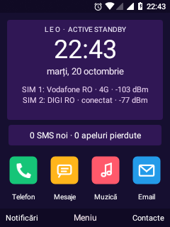
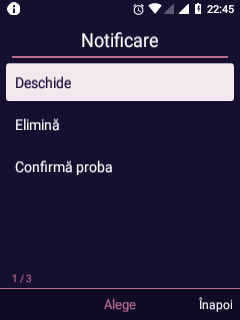
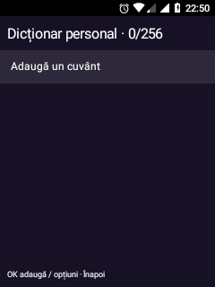
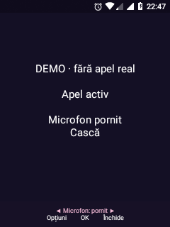
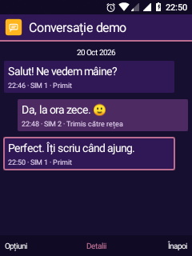
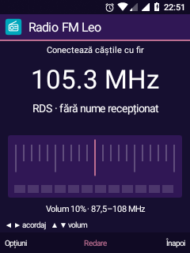

# Leo · șase rafinări pentru folosirea zilnică

20 octombrie 2026 · instalate pe Nokia 6300 4G TA-1286, fără reboot.

| Zonă | Implementare | Verificare / limită |
| --- | --- | --- |
| Stil flat consecvent | Bule SMS cu colțuri discrete și culori uniforme, cadran FM simplificat, contrast pentru taburile Telefon, bara de control a apelului și demo în stil flat | Capturi reale; demo de apel răspuns/încheiat din taste, fără apel Telecom. Logica de telefonie și rutele audio nu au fost schimbate. |
| Viteză | Listele periodice nu mai notifică adaptorul când rândurile sunt identice; formatatoarele ceasului sunt reutilizate; schimbarea puterii semnalului nu mai recitește serviciile de telefonie pe firul UI | Mai puține cadre la o pagină stabilă; accelerarea globală a navigării nu este demonstrată. Vezi măsurările de mai jos. |
| Home personalizabil | Ceas normal/compact, afișare SIM-uri, bara contoarelor și dBm; scurtăturile și ordinea aplicațiilor existente se păstrează | Cele patru comutatoare au fost schimbate și restaurate din taste, cu citirea valorilor salvate. |
| Notificări | Text scurt în listă, acțiuni pentru selecție direct din Opțiuni și eliminare colectivă cu confirmare, limitată la notificări eliminabile | Acțiune locală și eliminarea unei notificări demonstrative au trecut. Eliminarea colectivă nu a fost executată asupra notificărilor utilizatorului. |
| T9 | Vocabular românesc extins, sugestii memorate pe secvență, indicator de candidat, editor privat de cuvinte și ordonare după alegeri, opțională | Cuvânt adăugat în noua interfață și apoi prezis prin InputConnection; datele de probă eliminate. 433 + 17 verificări host și politica editorilor sensibili verificată pe telefon. |
| Stabilitate / consum | Un singur callback întârziat pentru repararea tastelor, anulat când pagina nu mai este vizibilă; Diagnostic include UDC/runtime USB; proba de baterie consemnează uptime și diferența față de elapsedRealtime | Fără ANR sau crash nou în probe. Măsurarea fizică pe baterie este amânată de utilizator. Întreruperea ADB rămâne deschisă. |

## Unde găsești opțiunile

- **Personalizare → Home · ceas și informații**: cele patru comutatoare și resetarea lor. Fundalul, temele, scurtăturile și reordonarea din versiunea anterioară sunt păstrate.
- **Notificări → Opțiuni → Acțiuni pentru selecție**: deschidere, eliminare sau acțiunile oferite de aplicația sursă. Acțiunile care trimit un răspuns păstrează confirmarea existentă.
- **Setări → Aspect → Tastatură și text → Dicționar personal**: adaugă/șterge cuvinte, maximum 256, fiecare de 2–32 de litere. La adăugare se folosește multi-tap; Soft stânga salvează. Pe lista de cuvinte, OK deschide opțiunea de ștergere.
- **Memorează alegerile T9** este o opțiune separată, oprită implicit. Reține cuvintele sugerate acceptate și frecvența lor, fără jurnalul textelor scrise. Cuvintele noi se adaugă explicit în editor.
- **Setări → Telefon → Baterie**: începe proba numai după scoaterea USB, încheie înainte de reconectare. Conectarea încărcătorului sau rebootul invalidează proba. Diferența dintre elapsedRealtime și uptime indică suspendarea sistemului; nu este timpul de ecran și nici consumul unui proces. Minutele sunt rotunjite în jos.

Dicționarul este stocat în datele private ale IME-ului, cu backup Android dezactivat, fără rețea sau sincronizare. Parolele, adresele email/URI, câmpurile numerice și editorii care interzic personalizarea/sugestiile nu participă la memorare.

## Măsurări și probe

### Redesenări în repaus

Aceeași pagină **Acum se redă**, fără pornirea redării, vizibilă timp de 10 secunde după stabilizarea inițială:

| APK | Cadre raportate de Android |
| --- | ---: |
| Versiunea anterioară | 20 |
| Versiunea nouă | 9 |

Comparația a instalat temporar APK-ul anterior și a restaurat automat versiunea nouă într-un bloc `finally`. Datele aplicației au fost păstrate. Sunt contori `gfxinfo` într-o probă scurtă; nu reprezintă o creștere măsurată a autonomiei. `measure-leo-idle-page.py` reproduce citirea fără să pornească muzica.

### Navigarea în grilă

| Probă | Cadre | p50 | p95 |
| --- | ---: | ---: | ---: |
| Inițială, un traseu | 14 | 8,64 ms | 9,69 ms |
| Prima versiune nouă, un traseu | 13 | 8,58 ms | 31,98 ms |
| Serie extinsă, trei trasee | 39 | 8,72 ms | 20,92 ms |

Mediana este apropiată, iar coada întârzierilor rămâne variabilă. Nu se declară o accelerare generală sau eliminarea delay-ului; traseele scurte nu sunt o comparație statistică suficientă. `measure-leo-navigation.py` citește timpii cadrelor Android, nu întârzierea fizică de la apăsare până la pixel. Telefonul era conectat prin USB.

### Alte rezultate

- Predicție host: **433 verificări**; dicționar personal: **17 verificări**, inclusiv diacritice, persistență, ordonare, date invalide și limita de 256 de cuvinte.
- Zece probe pe editor real: T9 normal/majuscule, ștergere, acceptare OK, candidat următor, fallback numeric, multi-tap și câmpuri protejate. Preferințele au fost restaurate.
- Instrumentarea `ImePolicyTests`: excluderea parolelor, adreselor, câmpurilor numerice și a editorilor cu opt-out a trecut pe telefon.
- O notificare din APK-ul de teste, cu text fix, a executat un acknowledgment local din taste și a fost eliminată din meniul selecției. Nu a trimis mesaje sau cereri de rețea; canalul și datele demonstrative au fost curățate.
- Sondare sănătate: 3 citiri, 2 s între citiri, 0 eșecuri ADB, același boot, aproximativ 95,97% CPU idle și audio runtime activ. Bateria raporta `Full`, cu USB conectat; nu este probă de autonomie.
- Diagnostic a confirmat serviciul tastelor conectat și USB `configured · runtime active`.
- `lastanr`: fără ANR de la boot. Bufferul crash a rămas la cele două erori DeskClock anterioare, documentate separat; niciun crash nou al shell-ului sau dialerului.

[Investigația ADB și telefonia SIM 1](STABILITY-PHONE-20261020.md) rămâne valabilă: nu s-a aplicat un reset USB automat și nu s-au modificat boot, recovery sau driverele în această etapă. Nu s-au inițiat apeluri, SMS, emailuri sau redare audio. Proba de autonomie rămâne de făcut ulterior, conform alegerii utilizatorului.

## Capturi reale

Home compact este o preferință demonstrată și apoi restaurată. Apelul și conversația din imagini sunt **demo locale**; radioul este oprit.

| Home compact | Acțiuni notificare locală | Dicționar personal |
| :---: | :---: | :---: |
|  |  |  |
| **Apel demo** | **Mesaje demo** | **FM flat, oprit** |
|  |  |  |

## Recompilare

`build-visual-shell.sh`, `build-keypad-ime.sh` și `build-call-keypad.sh` construiesc cele trei APK-uri. Modificările celor două clase InCallUI sunt sincronizate și în exportul AOSP cu SHA-256 actualizate. `run-keypad-word-tests.sh` rulează probele Java independente; `build-six-feature-tests.sh` include verificarea politicii IME și fixture-ul local de notificări.

APK-urile instalate păstrează identitatea și datele aplicațiilor. Copia privilegiată Leo din sistem este sincronizată; update-urile IME și Dialer rămân instalate prin PackageManager. Nu a fost necesară o repornire în această etapă, iar o probă după reboot rămâne separată.
