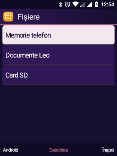
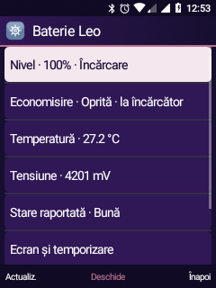
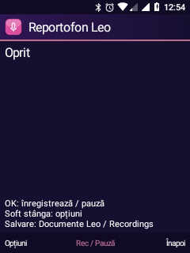

# Leo: fișiere, ciorne, contacte, reportofon și baterie

Probe pe TA-1286, 20 octombrie 2026. Aplicații native pentru taste; fără cameră.

| Funcție | Rezultat verificat | Limite |
| --- | --- | --- |
| Fișiere | Copiere intern → SD și mutare SD → intern, SHA-256 identic; conflictul păstrează sursa. Căutare fără diferențe de diacritice. | Fișiere obișnuite, fără copiere recursivă de foldere; maximum 100 marcaje, 2 GiB/fișier. |
| Mesaje | Ciorne independente în SQLite, redeschidere și normalizare număr; confirmarea unui mesaj vechi păstrează ciorna editată ulterior. | Lista arată ultimele 200 ciorne. „Trimis către rețea” nu înseamnă livrat destinatarului. Fără SMS real trimis în aceste probe. |
| Contacte | VCF 2.1 QP / 3 UTF-8 / 4, import/export prin provider și filtrare după favoritul sintetic; căutare T9. | Importul adaugă copii; fără deduplicare. Nu am exportat agenda personală în probe. |
| Reportofon | Înregistrare internă reală AAC mono, 16 kHz, 8,448 s; decodare completă și semnal audio prezent. SD: înregistrare 7,936 s finalizată și pornirea redării prin Muzică Leo. | Claritatea vocii și microfonul căștilor nu sunt confirmate. Utilizatorul nu a surprins redarea probei SD. |
| Baterie | PowerManager a activat economisirea cu încărcarea simulată ca deconectată; proba a restaurat starea reală. Instrument local de măsurare prin două eșantioane. | Consumul real în repaus și autonomia nu sunt măsurate; USB era conectat. |
| FM | `/dev/radio0` răspunde la QUERYCAP: `radio-iris`, `QTI FM Radio Transceiver`. | Recepție reală în căști confirmată ulterior pe 101,3 MHz; Radio FM Leo adăugat. Vezi [investigația FM](FM-INVESTIGATION.md). |

## Utilizare din taste

**Fișiere:** pe un fișier, Opțiuni → Marchează. Din meniul folderului: Selecție → Copiază/Mută selecția. Alege stocarea și folderul destinație, apoi Opțiuni → Lipește aici. Destinațiile existente nu se suprascriu. Pentru mutare, sursa se șterge numai după copiere și verificare. Dacă ștergerea sursei eșuează, copia este păstrată și eroarea este afișată. Operațiile simultane din alte aplicații asupra aceluiași fișier nu sunt suportate.

Căutarea verifică cel mult 5.000 intrări și afișează cel mult 200 rezultate. Fișierele temporare și legăturile simbolice sunt excluse.

**Mesaje:** Opțiuni → Ciorne salvate. Fiecare ciornă se editează sau se șterge separat. Ciorna veche din versiunea anterioară se migrează o singură dată. Redirecționarea creează o ciornă separată. Confirmarea de trimitere curăță numai ciorna cu același identificator, număr și text.

**Contacte:** Opțiuni → Administrează favoritele; OK comută steaua. Import / export VCF oferă export pentru favorite sau întreaga agendă; din detaliile contactului se poate exporta doar acel contact. Exportul necesită confirmare și rămâne local.

**Reportofon:** OK începe / pune pauză, Opțiuni → Oprește și salvează. Stocare Leo alege locația înregistrărilor viitoare; fișierele existente din ambele locații rămân vizibile. Limita este 10 minute / 64 MiB. Nu există înregistrare automată în fundal la pornire.

**Baterie:** ultima intrare din Baterie Leo pornește/încheie proba. Scoate USB, începe proba, stinge ecranul minimum cinci minute și încheie proba înainte să reconectezi USB. Sunt afișate durata, diferența procentuală și, când driverul o oferă, diferența contorului de sarcină. Încărcarea sau repornirea invalidează proba. Nu folosim wakelock sau polling pentru această măsurare; două eșantioane nu înlocuiesc un test complet de autonomie.

## Compilare și probe

```sh
bash android81/build-visual-shell.sh
bash android81/build-keypad-ime.sh
bash android81/build-six-feature-tests.sh
bash android81/test-file-transfers.sh
```

După instalarea APK-urilor de aplicație și probe, prin mediul framework:

```text
am instrument -w ro.leo.visual.tests/ro.leo.visual.StorageDraftTests
am instrument -w ro.leo.visual.tests/ro.leo.visual.FeatureTests
```

`RecorderTests` activează microfonul pentru opt secunde, salvează pe SD și redă înregistrarea. Se rulează numai după anunțarea utilizatorului. Înregistrările nu se adaugă în Git.

`python android81/verify-battery-saver.py` folosește deconectarea simulată a serviciului Battery și îl resetează în `finally`; verifică mecanismul software, fără a măsura consumul fizic. Probele păstrează setările și șterg numai propriile date sintetice.

| Stocare | Baterie | Reportofon |
| --- | --- | --- |
|  |  |  |
