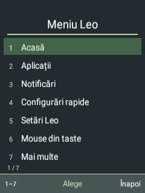
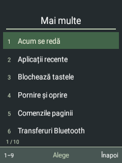

# Leo as the phone interface

The intended product is one coherent, keypad-first phone interface over the existing Android base. Android continues to provide drivers, telephony, IMS and app compatibility. Leo supplies the everyday interface and common controls. This does not install a Linux desktop environment or replace Android with Sxmo.

## Usability rules

- Everyday actions should be easy to find and require few steps.
- Every page should show the selected item and the actions of its softkeys.
- OK selects; Back returns to the preceding page. Text editing retains its documented delete action.
- Advanced Android tools remain available without crowding the everyday menu.
- Destructive operations keep their existing confirmations. Data is not discarded just to simplify a screen.

These are product goals; the entire interface has not yet been brought to this standard.

## First step: a simpler global menu

The dedicated physical Menu key opens seven primary choices, all visible on the small display:

1. Home
2. Apps
3. Notifications
4. Quick settings
5. Leo settings
6. Keypad mouse / Stop mouse
7. More

Digits select their numbered action on release; holding or repeating a release does not activate it again. Up/down and OK remain available. Ordinary option dialogs retain their previous numeric-key behaviour.

More retains Now playing, recent apps, keypad lock, power options, page help, Bluetooth transfers, workspaces, Leo Studio, Android keypad controls and closing the current app. Back from More returns to the primary menu; Back from the primary menu closes it. Existing power, close-window and lock protections remain in their action handlers.

The Apps action opens Leo's app menu directly from Home or another application. If the Home editor is active, its existing save/discard dialog is shown instead of discarding the draft.




## Verification

Thirty-six local on-device checks passed: action coverage, immutable menu definitions, pointer state labels, restored contact dependencies, numbered activation/repeat/cancellation handling, unchanged ordinary dialogs, Back, circular selection and the Home entry handlers. No calls, messages, playback or destructive operations were triggered.

The actual Menu scan code 212 was also injected through the installed keypad mapping. The menu was inspected on Home and over native Android Settings. The 7 → Back → 2 sequence opened More, returned to the primary menu and opened Leo Apps; the Apps action was also checked from native Settings. These live checks supplement the direct handler tests: asynchronous Home launch behaviour under instrumentation was not counted as an end-to-end launch pass.

Instrumentation restarts the target app and can temporarily disconnect its accessibility service. After the checks, the Leo global service was confirmed responding to physical Menu events. It retains its existing key-filter/gesture capabilities and does not gain window-content retrieval.

## Packaging correction

A follow-up audit found that the first Windows-built Sxmo APK omitted the 59 external dependency classes used by the original Leo build, including the vCard classes. The current installed APK restores all 59. The incremental fallback now explicitly merges the DEX definitions instead of assuming that passing a DEX dependency to dx includes it in the output.

`audit-visual-apk.py` checks class coverage across all DEX files, rejects duplicate classes and detects missing or extra external dependency classes against a complete baseline. The repaired candidate passed this audit (1519 total classes, 59 preserved dependency classes); vCard composer and parser classes also loaded in the device test. The corrected installed APK and the system base have matching hashes, and the system partition is read-only.

```powershell
python android81/audit-visual-apk.py COMPLETE_BASELINE.apk CANDIDATE.apk
```

## Next integration work

1. Make the status bar, headings, selection and softkey bar consistent across Leo and adapted Android pages.
2. Simplify common task flows in Phone, Messages, Contacts, Clock and Settings; preserve context when returning.
3. Audit remaining pickers, permission screens and third-party fallbacks. The global pointer remains available where native keypad support is incomplete.

Existing recovery/release ZIPs have not been rebuilt for this UI iteration.
