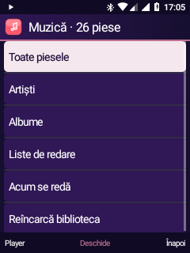

# Centrul media Leo · 20 octombrie 2026

## Funcții

| Direcție | Implementare | Verificare |
| --- | --- | --- |
| Bibliotecă muzicală | Până la 500 piese, grupare pe artiști/albume, WMA generic inclus; liste locale salvate din coada playerului, ștergere cu confirmare fără ștergerea pieselor | 26 fișiere indexate pe telefon; testele cozii au trecut. Artiști/albume și salvarea listei confirmate manual |
| Acum se redă | Home → tasta 0, meniul Home sau meniul global; sursă Muzică/FM, timp, volum, acces la player, anterior/următor și oprire | Accesul din Home prin tasta 0 confirmat manual. Eticheta ieșirii descrie dispozitivele disponibile, nu o măsurare a fluxului fiecărui player |
| Reportofon | Nivel real din `MediaRecorder.getMaxAmplitude`, actualizat de cinci ori pe secundă numai pe pagina vizibilă; pauză/salvare, redenumire fără suprascriere, acces la selecția intern/SD | Indicatorul reacționează la voce și redenumirea funcționează, confirmate manual. Înregistrarea nu pornește la simpla deschidere a paginii |
| Bluetooth audio | AOSP A2DP PCM HAL, rută în politica legacy; conectare/deconectare audio separată de HID în Bluetooth Leo; MediaSession/AVRCP existent pentru muzică | Boxă conectată A2DP, negociere stereo AAC, AudioTrack raportat pe device type 8 și 384000 cadre în opt secunde; bipurile confirmate auditiv la repetarea cu volum mai clar. HFP, microfonul Bluetooth și comenzile fizice ale boxei nu au fost validate |
| Profiluri sonore | Normal, Silențios, Exterior, Noapte și profil personal existent, integrate în setări rapide; revenirea din Noapte resetează DND și reface nivelurile anterioare Muzică/FM când au rămas la zero | Revenirea sunetului după Noapte → Normal confirmată manual. Alarma își păstrează volumul; vibratorul fizic rămâne nefuncțional |
| Stabilitate | Reparare limitată a propriului serviciu de taste deja configurat, la revenirea în Leo dacă nu este conectat; comandă manuală în Diagnostic; timp maxim de întârziere al buclei UI, măsurat numai cât Leo este vizibil | Serviciu legat la noul proces după instalare; tastele continuă să răspundă în probele manuale. Nu demonstrează eliminarea tuturor blocajelor sau un câștig de performanță |

Playerul reutilizează coperta, vizualizatorul, coada editabilă, shuffle și repeat existente; ultimele două opțiuni sunt acum persistente. Listele sunt păstrate în preferințele private ale Leo, maximum 30 liste a câte 500 intrări. Fișierele media rămân la locul lor; o intrare devenită indisponibilă produce o eroare de redare, nu o descărcare automată.

## A2DP: cauza și corecția

Bluetooth avea serviciul A2DP, dar imaginea nu conținea `audio.a2dp.default.so`, iar politica audio enumera numai modulul primar. Asocierea nu era suficientă pentru redare. Am compilat modulul AOSP din `system/bt/audio_a2dp_hw`, am adăugat ieșirea A2DP la politica Leo și am inclus modulul în pachetele produsului Go.

Instalatorul verifică telefonul și absența apelurilor/înregistrării, păstrează copia inițială și hash-urile în `output/bt-audio-before`, apoi înlocuiește atomic doar modulul și politica. Repornește audioserver și remontează sistemul read-only. Nu reîncarcă driverul DSP, Bluetooth, kernel, boot sau recovery. `--restore` permite revenirea la copia inițială, inclusiv eliminarea modulului dacă lipsea inițial.

```text
# în mediul WSL kaios pregătit de proiect
bash android81/build-bluetooth-audio.sh
bash android81/build-visual-shell.sh

# pe PC, cu ADB și telefonul în Android
python -X utf8 android81/install-bluetooth-audio.py
# Instalează apoi output/leo-visual.apk conform ghidului shell-ului
python -X utf8 android81/install-visual-system-settings.py
```

În proba auditivă s-a modificat temporar volumul Muzică de la 5/15 la 10/15, apoi s-a restaurat 5/15. Boxa are și volum propriu. Sunetul pe boxă este confirmat; nu au fost inițiate apeluri/SMS și nu a fost pornit automat microfonul. Nu s-au folosit suite de instrumentare asupra interfeței în această etapă.

## Recuperarea tastelor

`LeoApplication` verifică după reluarea unei pagini dacă serviciul propriu de accesibilitate este conectat. Reface legătura numai dacă serviciul era deja configurat de utilizator, păstrează celelalte servicii și limitează încercările la una pe minut. Nu este un watchdog care repornește framework-ul și nu poate repara o buclă UI blocată definitiv. Diagnostic → Opțiuni oferă reconectarea explicită.

## Captură


