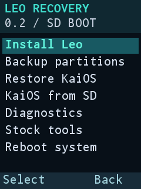
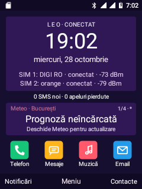
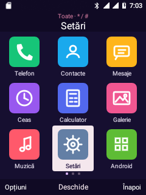
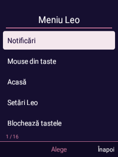

# Leo Recovery · 0.2 · SD boot

Standalone recovery for the Nokia 6300 4G TA-1286 **240 × 320** display and
physical keys. Native RGB565, no Android framework, touchscreen or Java app.
Leo Night colors: dark background and turquoise selection.

**Hardware validation, 28 October 2026:** installed recovery boots directly,
draws the menu, handles physical keys and exposes root ADB. Kernel/adbd from the
root base are retained; the early selector restores original recovery init in
RAM before executing it. SD boot/system/recovery backup passed readback checks.
**Native clean installation passed:** system, blank userdata and boot written
in that order and completely SHA-256 verified. Previous userdata is backed up
and verified on SD/PC. Menu-driven KaiOS restoration remains untested.



The initial 32-bit minui renderer crashed: this device uses 16-bit RGB565 and a
512-byte pitch. The dedicated renderer bounds framebuffer writes and draws
without a GPU. Corrected image write/readback and direct boot passed. Evidence
in `leo-recovery/hardware-validation.json` is tied to exact image hashes;
a different build does not inherit validation. The screenshot above records an
earlier validated menu build; capture provenance is kept in the evidence files.

## Implemented menu

| Action | Behavior |
| --- | --- |
| Install Leo | Verify/install the approved clean SD package |
| Backup partitions | Copy boot/system/recovery to SD with SHA-256 checks |
| Restore KaiOS | Write original boot/system from the approved restore ZIP |
| KaiOS from SD | Verify images or request one KaiOS boot; experimental |
| Diagnostics | Mount SD, inspect information and save logs to the card |
| Stock tools | Open original recovery retained in ramdisk, with text shown |
| Reboot system / Power off | Keypad confirmation, sync and requested action |

KaiOS SD tests reached its menu, then a normal reboot returned to Leo. Internal
boot/system hashes matched the pre-test backups. Root ADB confirmed UID 0,
`b2g=running`, `sys.boot_completed=1`, system/data/cache on loop0/1/2 and all four
protected internal OS blocks read-only. Global SELinux stayed enforcing; only
KaiOS diagnostic adbd/shell domains were permissive.

**USB limit:** ADB disconnected after boot; physically reconnecting USB restored
access without restarting KaiOS. ADB stability is unresolved. Exact build and
screenshot provenance are recorded in `leo-recovery/*validation.json`.

Up/down select and wrap between first/last item. OK, green or left softkey
accept; Back/right softkey/red return. Actions trigger on key release; held-key
repeat cannot confirm installation. Every write confirmation defaults to
**Cancel**.

This prototype accepts **only the exact two ZIPs verified during its build**.
Archive size/SHA-256 and image hashes are compiled into the executable. Changed
archives, other versions and arbitrary OTAs are rejected. Another ROM build
requires a regenerated catalog and rebuilt recovery. Sideload, update-binary
execution and automatic updates are unimplemented. OTA/BCB/cache commands are
not automatically executed at startup.

## SD packages and files

Keep the card's contents. Place this layout on FAT32 or ext4:

```text
LeoRecovery/
  packages/
    leo-fresh-0.14.0-dev-20261027-232615.zip
    kaios-original-restore-695d.zip
  stock-backups/
    boot-kaios.img
    system-kaios.img
    recovery-device.img
```

Local sources are `output/recovery-bundles/final/` and `output/recovery-entry-kit/`.
The recovery manifest pins accepted hashes. The real `mmcblk1p1` (`179:65`) must
be mounted read/write at `/sdcard`; an internal folder with that name is not
sufficient.

After mounting through Diagnostics, verified ADB staging uses:

```powershell
python android81/stage-leo-recovery-sd.py --copy --confirm-target 695d
```

This copies approved ZIPs, extracts the required stock originals, checks hashes
and refuses conflicting existing files. It neither installs a ROM nor writes
internal partitions.

Installation needs at least **3.3 GiB additional free SD space** after the ZIPs
and stock backups are copied. Temporary files remain for diagnosis, including
on failure. Boot/system/recovery backup needs about 940 MiB separately and
**excludes personal data and radio**.

## Installation guards

- Exact serial `695d`, root recovery and no `system_server`.
- Partition geometry and major/minor checked against sysfs and block nodes.
- System, and userdata for clean installation, unmounted in both the process
  and PID 1 namespaces; no forced unmount by recovery.
- Battery at least 30%, or USB power present.
- All three stock originals present with exact SHA-256.
- Every image extracted and checked on SD before the first partition write.
- **System → blank userdata → boot**, verifying after each write. Stock return
  writes system then boot only.
- Recovery, modem, NV, persist and GPT are not native install targets.
- No automatic reboot. A failure after writing starts requires retaining recovery
  for diagnosis/restore; this is not an atomic multi-partition transaction.

After stock boot/system restoration, **data reset is a separate Stock tools
step** before normal KaiOS startup. The kit does not restore personal contacts,
accounts or messages.

## Built image and recovery entry

Private local files:

```text
output/leo-recovery/leo-recovery-0.2.img
output/leo-recovery/leo-recovery-0.2-private.zip
output/leo-recovery/manifest.json
```

SHA-256 of the **33,554,432-byte** image:

```text
28f9eb399e9479e135328e795ca7dd6b3a5e6feb530bc3a795cd78dab157b612
```

PC-only verification:

```powershell
python android81/install-root-recovery.py android81/output/leo-recovery/leo-recovery-0.2.img --leo
```

`--leo --preflight --serial 695d --adb D:/ROMS/platform-tools/adb.exe` checks the
phone without partition writes. This mode requires the known internal Leo port
with `/leo-framework-internal`. Default mode remains rooted-stock-KaiOS recovery
bootstrap. From known root recovery, use `--from-recovery` instead of `--leo`;
it checks the base marker, PID 1 and absence of Android.

Explicit installation from internal Leo:

```powershell
python android81/install-root-recovery.py android81/output/leo-recovery/leo-recovery-0.2.img --leo --install --serial 695d --confirm-target 695d --adb D:/ROMS/platform-tools/adb.exe
```

This saves/verifies existing recovery on PC, then writes **p33 only** with full
readback. It does not format data, change boot/system or reboot automatically.
Request recovery boot separately with `adb -s 695d reboot recovery`. If early
Leo adbd's namespace refuses that request, use the framework wrapper:

```powershell
python android81/framework-command.py --timeout 15 /system/bin/setprop sys.powerctl reboot,recovery
```

Original recovery is not automatically restored after a patch.

## Rebuild and verification

```powershell
python android81/build-leo-recovery.py
python -m unittest discover -s android81/tests -p 'test_*.py'
wsl -d kaios -- bash -c 'g++ -std=c++14 -Wall -Wextra -Werror /mnt/d/ROMS/nokia-6300-ta1286-dump/android81/leo-recovery/policy-test.cpp -o /tmp/leo-recovery-policy-test && /tmp/leo-recovery-policy-test'
```

Requires the local WSL/AOSP 8.1 environment and previous private kits. The builder
compiles a static binary, retains the kernel/unrelated ramdisk entries, updates
the boot header and rereads CPIO. Ramdisk expansion may use only zero padding or
the byte-identified 8110 residue; other trailing data is rejected. The recovery
kernel stays identical to original KaiOS. The AOSP 12×22 font is distributed with
its OFL notice. This image is not a universal ROM.

Host checks cover targets, mounts, boot-last order, sizes above 2 GiB, keys,
CPIO and image-tail protection. They do not replace display/input/card tests.

Explicit native audit commands are `--backup-sd` (write/readback-verify SD
boot/system/recovery backup) and `--verify-fresh` (check the approved ZIP and
extract/hash every image under `LeoRecovery/verify-*`, without partition writes).
Neither runs automatically. Both passed on the phone, including the
2,566,897,152-byte userdata image. ZIP64 local headers use extraction metadata
compiled from the exact approved ZIP; whole-archive and per-image SHA-256 remain
mandatory. Arbitrary ZIPs are not accepted. Subsequent native menu installation
with data wipe also passed per-partition readback verification.

The stock recovery policy initially denied PID 1 mount inspection/block-alias
creation. The builder pins that policy hash and adds only recovery domain 239
(read with libsepol) to its permissive bitmap. Vendor rules are preserved and
global SELinux remains enforcing. This fix does not modify Android policy or
the embedded KaiOS root. [KaiOS SD design](KAIOS-SD.md).

## First boot after clean installation

Confirmed on 28 October: `sys.boot_completed=1`, default Leo Home/dialer/IME,
automatic audio/UI markers, root authorization for the app's new UID and audio
card present. Home and app grid were captured; D-pad/OK navigation through ADB
worked.

Both SIMs voice-registered. Data needs a selected SIM: after wipe,
`multi_sim_data_call=-1`, preferred modes `0/0`, observed GSM/EDGE. LTE/IMS were
not revalidated, no calls/SMS initiated and no listening tests repeated.
ADB needed a ten-second physical USB disconnect/reconnect after boot.




<a id="corecție-post-instalare-identificată-în-probă"></a>

## Post-install fix found during testing

The approved ZIP's bootstrap did not enable Leo accessibility after a wipe, and
Launcher3/old Leo Shell reappeared from system. The phone and
`leo-first-setup.sh` were corrected through `access-v2`: global menu/pointer,
WRITE_SETTINGS, notifications/DND and preservation of other accessibility
services. Legacy launchers are disabled only after selecting Leo Home. Global
menu over Android Settings and idempotent rerun passed.

**The hash-pinned ZIP has not been silently replaced.** Reinstalling that older
ZIP requires applying the fix. A future ROM will include it, require a new
recovery catalog and need its own flash validation.

With internal Leo and root ADB, preserve the old script on PC, then apply:

```powershell
& D:/ROMS/platform-tools/adb.exe -s 695d push android81/leo-first-setup.sh /tmp/leo-first-setup-v2.sh
python android81/framework-command.py --timeout 20 /system/bin/sh -c 'set -e; mount -o remount,rw /system; trap "mount -o remount,ro /system" EXIT; cp /tmp/leo-first-setup-v2.sh /system/etc/leo-first-setup.sh.new; chown 0:0 /system/etc/leo-first-setup.sh.new; chmod 644 /system/etc/leo-first-setup.sh.new; restorecon /system/etc/leo-first-setup.sh.new; mv /system/etc/leo-first-setup.sh.new /system/etc/leo-first-setup.sh; restorecon /system/etc/leo-first-setup.sh; mount -o remount,ro /system; trap - EXIT; sh /system/etc/leo-first-setup.sh'
```

At the user's request, old Leo Shell was later physically removed from
`/system/app/LeoShell` and uninstalled for user 0 after PC backup/hash verification.
Launcher3 stays disabled in system. The clean builder now removes only the exact
known legacy APK; unknown hashes stop it. That does not replace the published ZIP.


