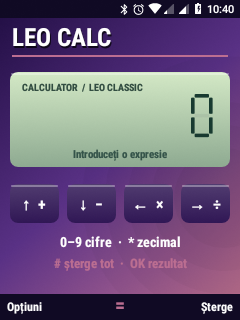
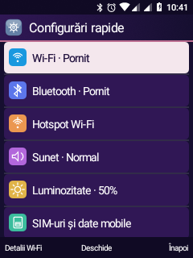

# Leo retro UI, terminal și ecran principal

## Interfață instalată

- Muzică: titlu desenat, cadran, progres și 12 benzi FFT din sesiunea MediaPlayer. Captura este limitată la 8 Hz, eliberată în fundal; indisponibilitatea efectului este afișată explicit. Fără animație care simulează sunetul și fără captură din microfon.
- Calculator: afișaj LCD, cifre cu șapte segmente și aspect inspirat de telefoanele clasice; motorul de calcul existent este păstrat.
- Nouă teme și patru fundaluri originale desenate în Canvas. Fundalul se aplică numai la alegerea utilizatorului; imaginea proprie din Galerie rămâne disponibilă.
- Meniu aplicații: 24 intrări, inclusiv Terminal; Opțiuni → Reordonează aplicațiile folosește ordinea salvată existentă.
- Configurări rapide: pictograme colorate și Volum. Sus/jos alege Muzică, Sonerie, Alarmă sau Apel; stânga/dreapta schimbă nivelul real, OK deschide alegerea nivelului.

| Calculator | Configurări rapide |
| --- | --- |
|  |  |

## Terminal din taste

OK execută comanda; sus/jos parcurge istoricul ținut exclusiv în memorie. Opțiuni oferă simboluri shell, comenzi rapide și derularea rezultatului. Textul folosește tastatura fizică Leo. Ieșirea este limitată la 32 KiB. Sesiunea folosește pipe-uri, fără PTY: programele interactive precum `vi` nu sunt suportate.

Sesiunea normală rulează ca aplicația. `su`, `su -c 'id'` sau Opțiuni → Sesiune root folosesc helperul separat instalat la cererea proprietarului; `id` trebuie să raporteze `uid=0`. `exit` încheie shell-ul root. Nu este un manager general de permisiuni root pentru alte aplicații.

Recompilare și instalare opțională a helperului, din workspace:

```powershell
wsl -d kaios -- bash /mnt/d/ROMS/nokia-6300-ta1286-dump/android81/build-terminal-root.sh
python -X utf8 android81/install-terminal-root.py
```

Brokerul root folosește un socket Unix local și verifică UID-ul clientului prin SO_PEERCRED. UID-ul Leo este citit la instalare și salvat într-un fișier root 0600. Alt UID de aplicație este refuzat; executabilele sunt 0755, fără setuid. Binarul `su` original nu este modificat. Închiderea clientului oprește grupul procesului root asociat. Imaginea actuală folosește SELinux permissive; funcționarea în enforcing nu este validată. Reinstalarea după schimbarea UID-ului Leo necesită actualizarea configurației helperului. Serviciul init este instalat pentru pornirile ulterioare, dar această integrare root nu a fost încă verificată prin repornire completă.

## Pornire direct în Leo

`select-leo-home.py` verifică telefonul și existența Leo, selectează Leo drept HOME, îl deschide și dezactivează Launcher3 doar pentru utilizatorul 0. Starea PackageManager persistă după repornire; APK-ul launcherului original este păstrat. Lista Aplicații Android exclude pachetele care oferă un HOME. Configurația existentă `leo-first-setup.sh` selectează deja Leo la pornire.

```powershell
python -X utf8 android81/select-leo-home.py
```

Revenire opțională la disponibilitatea launcherului Android:

```powershell
python -X utf8 android81/framework-command.py /system/bin/sh /system/bin/pm enable --user 0 com.android.launcher3
```

Reactivarea nu schimbă automat HOME: Leo rămâne implicit până este aleasă altă aplicație principală.

## Validare

- APK compilat și instalat; copia de sistem sincronizată. HOME rezolvat explicit la `ro.leo.visual/.MainActivity`, Launcher3 raportat `disabled-user`; captura finală arată Leo Home. Nu s-a repornit telefonul pentru această verificare.
- Utilizatorul a confirmat manual mișcarea spectrului, comanda `pwd` din taste și controlul volumului.
- Testul JVM TerminalSession a trecut pentru comenzi, director persistent, UTF-8, stderr și EOF.
- Helper testat cu identitatea UID a aplicației Leo: rezultat root; alt UID refuzat; codul de ieșire 7 păstrat. Confirmarea directă din interfața telefonului rămâne manuală.
- Instrumentarea RetroTests a fost compilată, dar nu executată: utilizatorul a ales verificarea manuală după instalare. Nu sunt revendicate probe automate de redare sau navigare pe telefon.

Sursele grafice, testele și scripturile de compilare sunt în repository; imaginile runtime, configurația UID și datele personale rămân în directorul local ignorat `output`.
