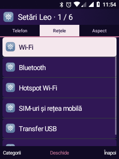
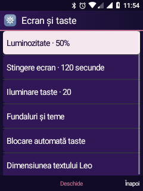
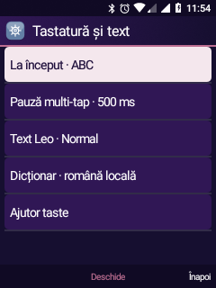
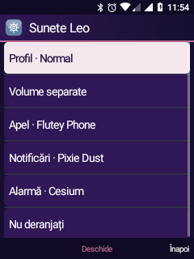
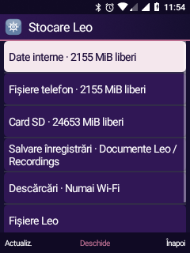
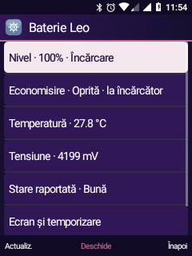
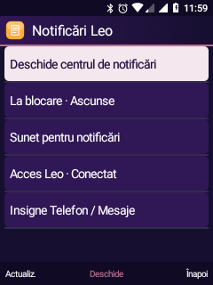

# Setări Leo inspirate de KaiOS

Implementare proprie pentru Android 8.1, instalată pe Nokia 6300 TA-1286 la 20 octombrie 2026.

## Referința inspectată

Arhiva locală `analysis/system/b2g/webapps/settings.gaiamobile.org/application.zip`: `elements/sound.html`, `display.html`, `battery.html`, `application_storage.html`, `media_storage_location.html` și `input_languages_selection.html`. Panourile originale separă volumele și tonurile, luminozitatea și temporizarea, bateria/economisirea, spațiul și locația media.

Leo preia organizarea și navigarea din taste. Nu include aceste fișiere în APK și nu execută servicii Gecko/KaiOS în Android. API-urile și funcțiile fără echivalent verificat nu sunt prezentate ca funcționale.

## Categorii și navigare

| Categorie | Pagini |
| --- | --- |
| Rețele | Wi-Fi, Bluetooth, hotspot, SIM/rețea mobilă, USB și trafic |
| Aspect | Ecran/taste, fundaluri/teme, personalizare, tastatură/text |
| Sunet | Tonuri, volume separate, profiluri și notificări |
| Siguranță | Blocare taste, aplicații/permisiuni, localizare |
| Stocare | Spațiu telefon/card, fișiere și descărcări |
| Telefon | Baterie, dată/oră, diagnostic, informații, Android și configurare |

Stânga/dreapta schimbă categoria, cu revenire circulară. Bara arată categoria curentă și vecinele, ca să rămână lizibilă la 240 px. Soft stânga → Categorii permite alegerea directă. Poziția în fiecare listă este păstrată la schimbarea filei; categoria se păstrează la redeschidere, iar pozițiile sunt salvate la recrearea activității.

## Funcții noi

### Sunet și notificări

Selector nativ din taste pentru tonul general de apel, notificări și alarmă, folosind biblioteca `RingtoneManager` a sistemului. Alegerea nu pornește automat redarea: OK deschide Aplică / Ascultă proba / Oprește. Proba explicită durează maximum opt secunde și se oprește la plecarea din pagină.

„Silențios” este disponibil pentru apel/notificări. La alarme sunt oferite tonurile efective; o alarmă fără ton configurat păstrează comportamentul existent de rezervă. Tonurile nu sunt separate pe SIM. Canalele unei aplicații care folosesc un sunet propriu nu sunt suprascrise de această pagină.

Volumele se deschid direct, iar profilurile folosesc implementarea comună Leo. „Nu deranjați” oferă Oprit, Prioritare, Alarme și Fără întreruperi; ultima opțiune include alarmele în filtrare.

Pagina Notificări reunește centrul Leo, previzualizările la blocare, sunetul și starea conexiunii listenerului. Afișarea textului la blocare păstrează confirmarea explicită. Nu sunt acordate automat permisiuni pentru alte aplicații.

### Ecran și taste

Luminozitate manuală 5/25/50/75/100%, stingere la 30 secunde, 1/2/5/10/30 minute; acces direct la fundaluri, blocare și text. Valorile sunt salvate în setările Android, nu doar în preferințele paginii.

Iluminarea tastelor: Oprită, Slabă (8), Normală (20), Puternică (40). Sunt niveluri configurate; daemonul existent limitează valoarea la maximul raportat de LED. El citește `persist.leo.keylight.level`; fereastra de iluminare rămâne opt secunde. Setarea folosește helperul root restricționat la UID-ul Leo și se aplică la următoarea apăsare. Fără helper sau LED, controlul anunță indisponibilitatea. Nu au fost modificate daemonul, kernelul sau imaginea de recovery.

### Tastatură și text

La începutul unui editor: ultimul mod folosit, abc, ABC, 123, T9 română sau T9 ROMÂNĂ. Pauza multi-tap: 500, 850 sau 1200 ms. Leo salvează cheile Secure `leo_keypad_default_mode` și `leo_keypad_multitap_ms`; APK-ul separat `ro.leo.keypad` le citește la începutul editării. Parolele rămân fără predicție, iar editoarele numerice continuă să primească cifre.

Modificările se aplică la următorul editor. `#` continuă să schimbe modul în editorul curent; „ultimul mod folosit” păstrează comportamentul anterior. Sunt disponibile dimensiunea textului Leo și ajutorul pentru taste. Nu sunt pretinse traduceri complete ale shell-ului sau dicționare suplimentare.

### Stocare și înregistrări

Spațiu total/liber/ocupat și procent pentru date interne, fișierele telefonului și cardul montat. Aceste pagini nu formatează, nu mută și nu șterg fișiere personale.

Pentru înregistrările **noi**, alegere între Documente Leo și dosarul propriu al aplicației pe cardul SD. Se verifică scrierea cu un mic fișier temporar, apoi proba este eliminată. Înregistrările interne existente și cele de pe card rămân vizibile împreună în Reportofon. Schimbarea locației este refuzată cât timp recorderul funcționează. Dacă SD-ul ales nu mai este montat, pornirea anunță locația indisponibilă; nu salvează pe ascuns în alt loc.

Înregistrările SD folosesc dosarul aplicației din `Android/data/ro.leo.visual/files/Recordings`; dezinstalarea aplicației poate elimina acel dosar. Alegerea nu este o setare globală pentru toate aplicațiile Android. Din Stocare se poate schimba și regula Wi-Fi/date mobile pentru descărcările Leo viitoare.

### Baterie și trafic

Nivel, încărcare, temperatură, tensiune și sănătatea raportată de driver, fără estimări inventate de autonomie. Economisirea folosește starea `PowerManager` și cheia Android `low_power`; la încărcător, pornirea este refuzată cu explicație. Activarea efectivă fără încărcător și autonomia nu au fost validate în această etapă. Nu a fost adăugată activare automată la un prag.

Traficul afișează contoarele mobile și totale ale interfețelor (`TrafficStats`). Nu este consumul facturat de operator, un contor separat pentru fiecare SIM sau un ciclu lunar.

## Verificare

| Probă | Rezultat |
| --- | --- |
| Șase categorii, schimbare circulară și păstrarea selecției | Trecut pe telefon |
| Salvare reală luminozitate / temporizare, cu restaurarea valorilor | Trecut |
| Nivel taste prin helperul root al UID-ului Leo, cu restaurarea proprietății | Trecut software; iluminarea la apăsare rămâne de verificat manual pentru fiecare nivel |
| Biblioteci apel / notificări / alarmă și scriere/citire a tonului curent | Trecut; fără redare sau apel real în probă |
| Dosare interne și SD pentru înregistrări | Scrierea și eliminarea fișierului de probă au trecut; nu s-a pornit microfonul |
| Opțiunile IME în editor real, prin InputConnection | ABC, două litere separate la pauza de 500 ms, parolă fără predicție și cifre/`#`/`*` au trecut |
| Baterie / notificări / capturi | Paginile s-au deschis; listenerul a fost reconectat la final |

Probele restaurează luminozitatea, temporizarea, proprietatea LED și preferințele folosite. Nu inițiază apeluri, SMS, emailuri, înregistrare audio sau operații de formatare. O probă inițială de injectare directă în nodul Linux nu a produs text în editor; confirmarea IME este cea a probei separate, cu evenimente Android și editor real. Testul așteaptă conectarea IME înainte de injectare, pentru a evita o cursă la pornirea serviciului.

## Recompilare

```powershell
wsl -d kaios -- bash /mnt/d/ROMS/nokia-6300-ta1286-dump/android81/build-visual-shell.sh
wsl -d kaios -- bash /mnt/d/ROMS/nokia-6300-ta1286-dump/android81/build-keypad-ime.sh
wsl -d kaios -- bash /mnt/d/ROMS/nokia-6300-ta1286-dump/android81/build-six-feature-tests.sh
```

Instalează cu `pm install -r` APK-urile Visual, Keypad și cel separat de teste, folosind mediul `framework-command.py`. `SettingsTests` țintește `ro.leo.visual`; `ImeSettingsTests` țintește `ro.leo.keypad`. Ambele sunt declarate în APK-ul de teste `ro.leo.visual.tests`. `python -X utf8 android81/verify-settings-input.py` rulează proba IME cu setările de probă și le restaurează în `finally`. Clasele Keypad sunt exportate de compilare în `output/leo-keypad-classes.jar`, pentru compilarea testelor.

Visual are copia de sistem sincronizată. Keypad este instalat ca actualizare persistentă în userdata; nu necesită reboot. Reproducerea imaginii folosește ieșirile compilate ale ambelor aplicații, conform scripturilor existente de împachetare. Arhivele KaiOS originale rămân numai referințe locale.

## Capturi reale

| Categorii | Ecran / taste | Tastatură |
| --- | --- | --- |
|  |  |  |

| Sunet | Stocare | Baterie |
| --- | --- | --- |
|  |  |  |


