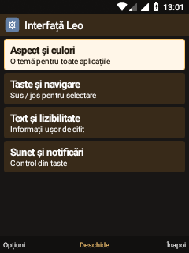
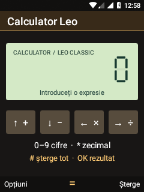
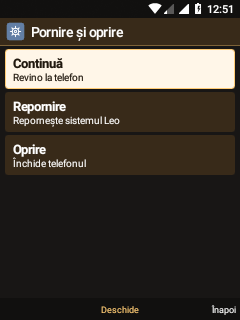
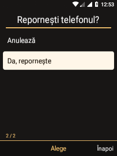

# Leo · aceeași interfață, rețeaua pornește mai devreme

24 octombrie 2026 · Nokia 6300 4G TA-1286 · Leo 0.5.0-dev

## Interfață

- Listele și formularele folosesc același antet de 36 dp, pictogramă, titlu
  mediu, margini și bară de taste compactă. Subtitlurile rămân mai mici, iar
  titlurile rândurilor cu două linii sunt evidențiate. Actualizarea etichetelor
  nu reconstruiește conținutul sau suprafețele camerei. Culoarea textului urmărește
  selecția reală, inclusiv după reciclarea rândurilor la navigare circulară.
- Ceas, Meteo, Calculator, Muzică și Media curentă folosesc același desen al
  antetului, cu paleta aleasă de utilizator. Conținutul fiecărei aplicații rămâne
  propriu; această etapă nu înlocuiește toate desenele interne cu o singură pagină.
- Home distinge pregătirea modemului, pornirea SIM-urilor și căutarea
  operatorului. Starea „conectat” provine din înregistrarea reală în rețea,
  nu din simpla pornire a RIL. Modul avion are prioritate. Etapele sunt recitite
  la două secunde numai în primele trei minute, cât Home este vizibil și
  cel puțin un slot nu este înregistrat; apoi rămân ascultătorii telefoniei.
- În Telefon, alegerea SIM-ului inițiază direct apelul, fără al doilea dialog.
  Numărul este validat înainte; Înapoi anulează alegerea SIM-ului. Nu s-au
  efectuat apeluri reale pentru verificarea acestei simplificări.

## Oprire din taste

Apăsarea lungă a tastei de pornire înlocuiește dialogul Android de oprire cu
pagina Leo. Este accesibilă și din **Meniu fizic → Pornire și oprire**.
Săgețile selectează, OK alege, Înapoi anulează. „Continuă” este selectat inițial;
oprirea/repornirea au o confirmare separată, inițial pe „Anulează”. Comanda
efectivă folosește `leo-su` și mecanismul init `sys.powerctl`, fără oprire forțată
a kernelului. Deschiderea paginii nu oprește serviciile.

Pagina este internă, nu adaugă o pictogramă în grila aplicațiilor. Serviciul de
accesibilitate Leo trebuie să fie activ pentru înlocuirea dialogului sistemului.

## Pornirea rețelei

Înainte, `leo_radio_setup` era declanșat numai de `sys.boot_completed=1`.
Acum începe la `ro.persistent_properties.ready=true`, după etapa sincronă de
preîncărcare audio din `post-fs-data`. Sunt păstrate verificările dispozitivului,
firmware-ul read-only, rmt_storage/per_mgr, inițializarea DSP înainte de RIL și
așteptarea socketului netmgr. Nu se schimbă SIM-ul de date sau modul rețelei.

Declanșatorul vechi rămâne ca rezervă. Un director atomic în `/dev`, recreat la
fiecare boot, împiedică rularea dublă a setupului. Eșecul este raportat explicit;
protecția limitată din [RADIO-RECOVERY.md](RADIO-RECOVERY.md) rămâne separată.

Scriptul înregistrează uptime și starea în `sys.leo.radio.start_state` și
`sys.leo.radio.time.*`, plus linii `LEO_RADIO_BOOT` în jurnalul local.

| Etapă în proba reală | Secunde de la boot |
| --- | ---: |
| Pregătire | 26,23 |
| Servicii de stocare/periferice | 30,17 |
| DSP solicitat; pregătire transport/date | 35,10 |
| Ambele servicii RIL solicitate | 48,24 |
| Ambele SIM-uri observate înregistrate | cel târziu la citirea de la 68,14 |

Pornirea anterioară începea pregătirea la aproximativ 42 s. Câștigul observat
este de aproximativ **16 s până la începutul setupului**. Nu există o măsurare
comparabilă anterioară a primei înregistrări: nu revendicăm un câștig de 16 s
până la semnal sau Internet. Operatorul și semnalul influențează timpul final.

După reboot: SIM 1 Vodafone LTE, voce/date în serviciu; SIM 2 Orange GSM, voce
în serviciu. Datele au rămas pe SIM 1. Setarea Android pentru ambele sloturi era
LTE/GSM/WCDMA automat; folosirea LTE pe SIM 2 și LTE simultan nu sunt probate.
Audio Qualcomm a revenit `active`, cu proprietatea profilului Leo păstrată.
Observatorul de recuperare a raportat `HEALTHY`, fără restart suplimentar.

## Instalare și verificări

```powershell
# Actualizare text init + setup + protecție existentă, cu backup și hash-uri:
python -X utf8 android81/install-radio-recovery.py --startup --install
```

APK-ul se construiește cu `build-visual-shell.sh`; testele cu
`build-six-feature-tests.sh`. `UiFoundationTests` a trecut cele 30 de verificări:
stări de pornire, geometrie, identitatea barei la actualizări repetate, navigare
circulară și anularea meniului de oprire. Apăsarea lungă a tastei Power a fost
verificată separat pe telefon; repornirea reală a fost executată din meniul Leo.
Oprirea completă nu a fost executată, pentru a păstra sesiunea de lucru.

Backups ale fișierelor radio sunt locale, în directorul ignorat
`output/radio-recovery-backups/`. Pentru revenire se restaurează cele două
fișiere de startup din aceeași copie și se repornește telefonul. Nu se
formatează date și nu se scriu boot/recovery sau calibrarea modemului.

## Capturi reale








