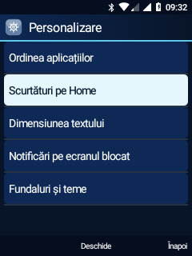
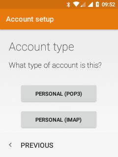

# Leo: personalizare, telefon, notificări și email

Stare la 20 octombrie 2026. Shell nativ Android; aplicațiile KaiOS originale
nu sunt executate și interfața nu depinde de WebView.

| Grup | Implementare | Limită |
| --- | --- | --- |
| Personalizare | Setări → Aspect → Personalizare: ordinea aplicațiilor, patru scurtături Home, text normal/mărit, previzualizări la blocare, acces la teme | Textul mărit acoperă listele/formularele comune și Home, nu toate ecranele Android sau desenele specializate. |
| Telefon | Potriviri locale T9 după nume și număr; statistici pe SIM | Cache de maximum 1.000 de numere, cinci potriviri; statistici din ultimele 5.000 de apeluri locale, fără valoare de facturare. |
| Notificări | Acțiunile aplicației, editor RemoteInput cu confirmare, previzualizări opționale la blocare | Acțiunile depind de notificarea sursă; răspunsurile reale nu sunt validate. |
| Email | Meniu din taste în configurarea/compunerea AOSP, sus/jos între câmpuri, cerere de sincronizare IMAP și marcare ca citit | Cont IMAP real și descărcarea inițială confirmate; afișarea corpului în Leo, sincronizarea manuală, ciornele și SMTP rămân nevalidate. |
| Cameră | Enumerare HAL izolată și diagnostic al inițializării senzorului | Încă nefuncțională; [audit](CAMERA-PORT-AUDIT.md). |
| Stabilitate | Măsurare CPU/memorie/baterie/USB fără schimbări de alimentare | Un minut pe USB nu validează autonomia sau stabilitatea pe termen lung. |

## Utilizare

În Personalizare → Ordinea aplicațiilor, OK deschide comenzile de mutare.
Identificatorii aplicațiilor sunt separați de pozițiile din grilă. Scurtăturile
Home se aleg separat. Preferințele sunt locale; resetarea ordinii cere confirmare.

În Telefon, tastează minimum două cifre. Potrivirile se actualizează după o
pauză de 120 ms și normalizează diacriticele. Jos selectează rezultatul, OK
deschide lista, apoi OK încarcă numărul. Încărcarea nu apelează automat: alegerea
SIM-ului și confirmarea apelului rămân separate. Conturile istorice care nu pot
fi mapate la un SIM activ sunt etichetate explicit, fără afișarea ICCID-ului.

Previzualizările sunt **ascunse implicit**. Se pot activa numai titlurile sau
titlul și textul, cu confirmare pentru text. Sus/jos schimbă notificarea fără
deblocare. Notificările SECRET sunt excluse; dacă Android este blocat efectiv,
conținutul privat respectă publicVersion. Blocarea Leo protejează contra
apăsărilor accidentale, fără PIN. Deblocare: Meniu/soft stânga, apoi `*`.

În detaliul notificării, Opțiuni arată acțiunile aplicației sursă. Răspunsul
necesită text și confirmare; simpla deschidere a editorului nu trimite nimic.
Conținutul notificărilor nu este salvat în fișiere. Comanda Reîncearcă poate
reîmprospăta componenta Leo după o legătură moartă Oreo; nu acordă acces nou și
nu schimbă ceilalți ascultători. Relegarea poate dura câteva secunde.

În Email Android, Meniu oferă Continuă / Configurare manuală; validarea rămâne
în AOSP. În editor, Meniu oferă Trimite / Salvează ciorna / Renunță, cu confirmare
suplimentară la trimitere. Parolele se introduc direct în Email Android; Leo nu
interoghează HostAuth sau parolele. Sincronizarea manuală vizează numai contul
IMAP selectat de tip com.android.email. Deschiderea configurării nu demonstrează
compatibilitatea autentificării cu furnizorul ales.

## Măsurarea la repaus

Șapte eșantioane la interval de 10 secunde: fără eșec ADB, aceeași pornire,
audio activ, USB mtp,adb și baterie Full. Aproximativ **98,46% idle + iowait**.
Primul eșantion: MemAvailable aproximativ 144 MiB și zRAM liberă aproximativ
137 MiB din 256 MiB. Procesorul nu era saturat continuu în această fereastră.
Aceste valori nu măsoară latența tastă–ecran, suspendarea fără cablu, consumul
în standby sau transferurile MTP mari.

Unealtă: `audit-device-health.py --samples 7 --interval 10`. Rapoartele brute,
identificatorii SIM, jurnalul apelurilor și datele conturilor rămân locale,
ignorate de Git. Probele acestei etape nu inițiază apeluri, SMS sau emailuri.

## Verificări pe telefon

APK-ul Leo a fost compilat, instalat și sincronizat în baza de sistem fără
ștergerea datelor sau rescrierea boot/recovery. Email AOSP a fost recompilat și
instalat ca actualizare cu aceeași semnătură.

Instrumentarea separată UpgradeTests a trecut: ordinea invalidă este reparată
fără pierderea aplicațiilor; Calculator se deschide din prima poziție reordonată;
scurtătura Home aleasă deschide Calendar; preferința pentru text mărit este
citită; un contact sintetic este găsit prin T9 și selectat din taste fără apel;
o notificare locală ajunge în ascultător; modurile ascuns/titlu/text funcționează;
navigarea previzualizărilor păstrează blocarea; Meniu apoi * deblochează.
Preferințele inițiale sunt restaurate, contactul și notificarea de test eliminate.

Proba a necesitat așteptarea focusului și a relegării serviciului, nu doar
a terminării onCreate. La deblocare, un key-up poate ajunge după schimbarea
aplicației; testul acceptă refuzul de injectare numai dacă deblocarea s-a produs
deja. Nu se acordă INJECT_EVENTS aplicației de producție.

Din taste s-a completat adresa fictivă leo.fixture@example.invalid, inclusiv @
prin multi-tap pe tasta 1. Meniu → Configurare manuală a ajuns la alegerea
Personal IMAP și apoi la câmpul de parolă. Nu s-a introdus o parolă și nu s-a
creat contul fictiv. Configurarea a fost relansată fără adresa de probă.
Acest rezultat nu validează conectarea la un server sau trimiterea unui email.

Snapshotul de recompilare include acum zece proiecte AOSP modificate și trei
fișiere Java suplimentare; apply.py --check-only le recunoaște în checkout.

| Personalizare | Configurare email din taste |
| --- | --- |
|  |  |

## Configurare reală IMAP confirmată

Utilizatorul a introdus datele direct pe telefon și a confirmat finalizarea.
Interogările ulterioare, limitate la identificatori tehnici și număr de intrări,
au găsit un cont, șapte foldere și zece mesaje locale. Înainte de configurare nu
exista un cont. Acest rezultat confirmă salvarea contului și descărcarea inițială
prin IMAP. Nu s-au citit adrese, parole, subiecte sau corpuri de mesaje în probă.
Email Leo a fost deschis pe telefon pentru verificarea vizuală de către utilizator.
Nu s-a trimis un email; SMTP, ciornele, sincronizarea manuală și marcarea ca citit
necesită încă probe separate.
