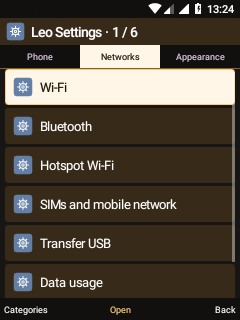
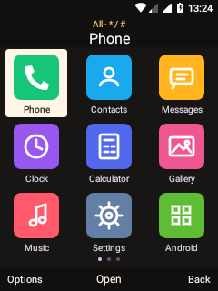

# Leo speaks Romanian and English

24 October 2026 · Leo Visual / Leo Keypad 0.5.0-dev

## Selecting a language

Open **Settings → Appearance → Personalization → Language / Limbă** and select
**English** or **Română** with the D-pad and OK. The first page of the setup
guide opens the same selector. The phone returns to Home to rebuild visible
pages; a system reboot is not required. Changing language during a call is
blocked. App order, theme, saved records and input mode are retained.

The language applies to Leo Home, native apps, settings, dialogs, notifications,
boot-status labels, keypad hints and personal-dictionary screens. Existing user
content is not translated: contacts, messages, notes, typed text, file names and
previously saved templates retain their original content. Existing notification
text may remain until the notification is refreshed by its owning service.

This is **interface localization**, not a new English T9 dictionary. The current
Romanian predictive dictionary and multi-tap character sets are unchanged.
Android Settings, Android Email and third-party apps use their own language
support; the Android system locale is not changed by the Leo selector.

## Implementation

- `localization/en.json` is the reviewed source-label → English catalog, with
  over 2,300 entries. Romanian labels remain readable at their call sites.
- `L.t("Înapoi")` translates an authored label. Dynamic personal content must
  never be passed through it. Context-specific translations use the overload
  `L.t("Răspunde", "message")`: Reply for messages, Answer for calls.
- `L.array(new String[]{...})` retains an original copy of static label arrays
  and updates their contents when language changes. This includes the nested
  settings categories; switching back restores the original Romanian labels.
  Stable application IDs, preference keys and storage formats are independent
  of translated labels.
- `Language` reads `Settings.Secure.leo_ui_language` so the shell, its separate
  camera/browser processes and the separately installed keypad share the same
  selection. The shell also keeps a local fallback preference. Locale/date
  formatting and Android resources are configured within these app processes.
- There is no online translation service or network dependency. Romanian
  returns immediately; English uses an exact in-memory lookup. Missing entries
  fall back to their source text.
- `generate.py` builds `EnglishCatalog.java`. Both APK build scripts and the
  host-test scripts run it automatically. The generated file is ignored by Git.
  The one-time migration tool is retained for audit; routine additions should
  add a reviewed catalog entry and an explicit call to `L.t`.

## Build

```sh
bash android81/build-visual-shell.sh
bash android81/build-keypad-ime.sh
bash android81/build-six-feature-tests.sh
```

Use the documented WSL/AOSP environment. The existing installers retain package
identities and data. No radio, audio, kernel, boot or recovery changes are part
of this update.

## Verification

- 20 on-device localization checks: Romanian/English round-trip, already-loaded
  catalog arrays and nested settings, persistent shared language, English date
  locale, call/network status labels without a real call, English header and
  softkeys, unchanged user-authored Romanian text, app order, theme and input
  mode. The test restores its previous language preference.
- 30 UI foundation checks passed in both Romanian and English after localization.
  The fixture synchronizes language initialization on the main thread and holds
  a bounded display wake lock while measuring views. It releases the wake lock
  on exit; it does not change the screen timeout or any saved display setting.
- Host checks passed: 137 unit-conversion, 484 prediction-dictionary, 275 keypad,
  17 browser, 28 pocket-suite, 36 organizer and 10 project-algorithm assertions.
- Manual language activation and captures are documented with the installed
  APKs. No real call, SMS, email, recording or media playback was started.

## Real screenshots




