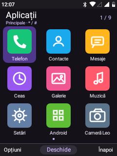
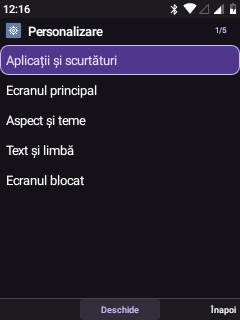
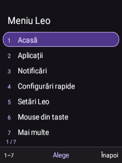

# Leo Material

Leo Material modernizes the compact keypad interface using Material-inspired colour roles, surfaces and selected states. It is implemented in the existing native Android views and Canvas renderers; it does not introduce the Material Components or Compose libraries, change Android's version or replace the framework.

## Visual changes

- Dark neutral surfaces with a lavender accent and a coordinated purple selection container.
- Compact app bars: the launcher shows Apps, the current category and the selection count instead of repeating the selected app's name above its icon label.
- Rounded selected grid cells, list rows and global-menu entries, with an explicit focus outline for physical-key navigation.
- Shared header/footer surfaces and input colours across the Leo components that use the common palette and chrome.
- An original static Orchid wallpaper that matches the palette. It is generated once when selected; it is not an animated background.

The nine-app first page, app categories, short context menus, five personalization groups and seven global actions remain unchanged. Custom Home transforms and app order are preserved. Leo Classic and the preceding themes remain selectable; the standard visual checkpoint can restore the previous palette and wallpaper.

Custom app canvases continue to use their own layouts; common palette changes do not mean every control has been rebuilt as an official Material widget. Native Android system panels retain their existing keypad adaptations.

## Validation on 6 November 2026

Seventeen on-device checks passed for theme registration, Material role selection, selected/body text colour contrast, focus-outline contrast, grid preference, wallpaper decoding, drawable selected/unselected/header colours, exact restoration of the preceding fixture palette/wallpaper, retained menu sizes, unchanged Home transforms/app order, a real Leo page and external dependency loading.

The tested colour pairs meet the checks' 4.5:1 text and 3:1 focus-outline thresholds. These are checks of those specific colour pairs, not a certification of every screen. Test fixtures used isolated preferences and files. The actual palette was then activated with the existing theme checkpoint; no calls, SMS, media playback or network changes were performed.

The launcher, personalization page and global menu were inspected from real device captures. The dedicated physical Menu event opened the global menu, and its accessibility service was connected after instrumentation.

The APK signature and class coverage audit passed: 1526 classes, including all 59 original external dependencies, with no duplicates. The installed app and system base match; the system partition was returned to read-only. Recovery/release ZIPs were not rebuilt.

## Design references

- [Material colour roles](https://m3.material.io/styles/color/roles)
- [Material interaction states](https://m3.material.io/foundations/interaction/states/overview)
