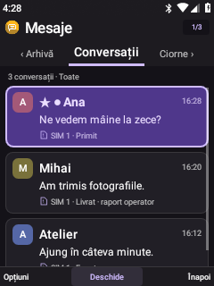
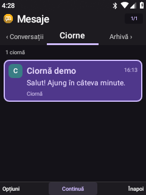
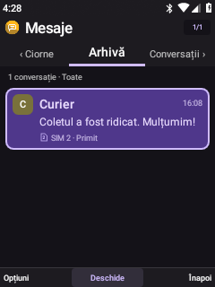
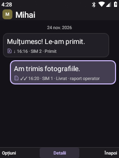
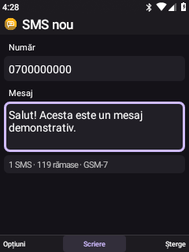
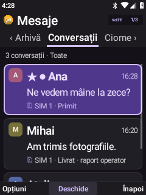

# Messages · native keypad UI refresh · 24 November 2026

The shell's SMS app now has **Conversations / Drafts / Archive** tabs, matching
the owner's selected organization. This is a native-view update to catalog ID 2,
`ro.leo.visual.MessagesActivity`, on the Nokia 6300 4G TA-1286 / Android API 27.

## On the handset

These 240 × 320 captures use the app's non-transmitting preview mode. Names,
numbers, messages, archive entries and drafts are synthetic; no real inbox or
carrier delivery is demonstrated by the screenshots.

| Conversations | Drafts | Archive |
| --- | --- | --- |
|  |  |  |

| Conversation | SMS editor | Large text |
| --- | --- | --- |
|  |  |  |

## What changed

- Large tab labels and a visible active state use the shared `KeypadTabs` rules.
  Left/right switches between the three pages, including while a page loads.
  Up from the first row reaches the tab strip; Down returns to the list.
- Recycled conversation cards separate avatar, contact/sender, time, preview,
  SIM and delivery state. Existing pinned and unread markers remain visible.
- Drafts have their own page. OK continues editing the selected draft directly;
  deletion remains an explicit menu action followed by confirmation.
- Conversation bubbles have more consistent spacing, a clear selected outline,
  date separators and theme-aware SIM/status metadata. OK opens message details;
  key 5 still replies and is described in application Help.
- The composer uses the shared themed fields, a message hint and a styled
  encoding/segment budget. Live palette or font changes preserve entered text.
- Each tab has a proper empty state. English translations cover the new labels.

## Data and navigation boundaries

The SMS provider/archive merge, message IDs, default-SMS role, send confirmation,
SIM selection, multipart/delivery handling and draft database schema are retained.
This update does not add MMS or change the carrier send path. The existing
Incoming / Sent / Pending / Failed filters remain under Options. Filtered
senders also remain accessible through the existing organization menu.

Archive and sender filtering still use `ConversationPrefs`. Existing per-page
viewport keys retain their format, so returning from a conversation or message
detail restores the selected thread. Tab changes do not intercept left/right
inside the editor or search fields. Preview pages skip draft persistence,
notification-option writes and real-thread read markers.

`MessageUi.java` contains the presentation-only row/empty-state helpers; the
activity retains the SMS workflows. Views are reused by a `ListView` adapter.
Draft loading moves to the activity's existing worker; root-identity checks
discard results from pages that have since been replaced. There are no new
services, permissions, network requests, animations, bitmaps or background timers.

## Verification

- Full build: 296 production Java sources; APK signer and manifest retained.
  The DEX audit retains all 431 external dependency classes with no duplicates.
- 107 host checks pass.
- 160 Messages UI device checks pass, including all 18 palettes × three text
  sizes, tab/Back focus, draft editing, help, existing filters, empty states and
  preservation of unsaved editor text.
- The test's SMS preferences and existing private draft database bytes remain
  unchanged. Original appearance/accessibility settings are restored and compared
  independently after instrumentation. No SMS was transmitted.
- Physical Home/Menu/Settings routes and the real launcher → Messages → tabs
  route: all pass on the physical keypad; no real thread or send flow was opened.
- Running **data APK** SHA-256: `03a7f0230f012627e671f0e5d55b4b5c68d650eca6ae3b55dc0fce3d6d9b02a7`.

The bundled system APK and firmware archives were not regenerated. A known-good
copy of the previously running data APK was retained before installation.

Build the local, synthetic UI checks without installing or sending anything:

```powershell
python android81/build-pocket-apps-windows.py
python android81/build-pocket-tests-windows.py --messages-ui
```

The suite opens `preview=true` with the private `preview_overview` fixture flag,
exercises tabs, filters, selection return, draft/editor behavior, send guarding,
empty states and live theme/text changes. Keep real carrier tests separate.
