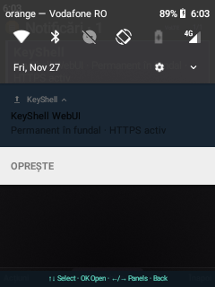
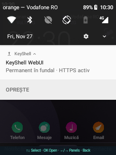

# Android notification contrast · 27 November 2026

The native Android shade had dark standard notification text on a dark blue
card. The earlier SystemUI chrome patch changed the card background to #192633,
while apps still used Oreo's light notification template when choosing text colors.
The KeyShell notification list was a separate page and was readable.

The existing SystemUI resource overlay now restores the ordinary card background
to #FAFAFA. The source patch uses the same light value for future SystemUI builds.
Quick Settings and the surrounding native shade retain their existing dark style.
This targets the notification surface rather than overriding arbitrary app text.

| Before · native shade | After · real WebUI notification |
| :---: | :---: |
|  |  |

The screenshot contains only KeyShell's own foreground notification. The separate
fixture also showed a synthetic silent test notification and no private messages.
Already inflated notification rows can retain their old color after an overlay
update. SystemUI was refreshed and the WebUI foreground notification was recreated.

The signed update to `ro.leo.systemdark.systemui` is installed as a data APK over
the existing vendor overlay and remains enabled. The vendor base and `/system`
APKs were not replaced. No ROM flash or device reboot was used. Known-good overlay
and shell APK copies remain in ignored local build output.

Overlay SHA-256:
`4ac2c0bf9e9e9373e88fb2b62c3aa952a15f6deba4817499c4a425192146ab21`.

Fresh validation on TA-1286/API 27: nine native Android keypad integration checks
passed, including a runtime check that the ordinary notification card resource is
light. The silent fixture opened only its own PendingIntent, navigated the native
shade/quick panels and closed with Back. It removed only its own notification.
The final WebUI notification was inspected visually. Custom app-drawn notification
layouts and carrier push notifications were not surveyed.

The Windows overlay builder remains `build-system-dark.py`, using the exact
handset framework-res.apk; only the SystemUI overlay was installed. The test
source is `framework-keypad/tests/NativeSystemUiTests.java`.
