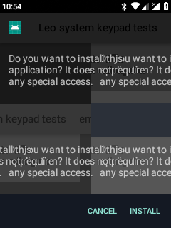
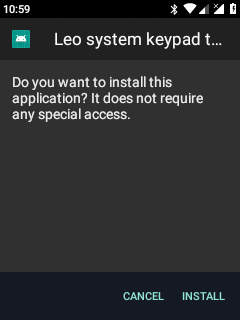
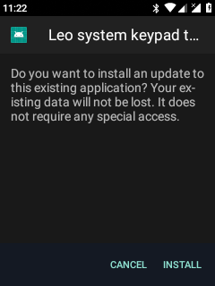
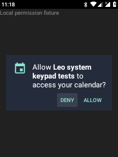

# Android installer rendering · 21 November 2026

The Nokia's original PackageInstaller repeated and overlapped confirmation text,
including stale copies of the application name. A manifest-only trial switching
the application to software Canvas removed those artifacts. A second scoped
change makes the six phone installation headers use `textAppearanceLarge`
instead of the action bar's `titleTextStyle`, so the app name follows the theme's
normal foreground color and remains readable on this port's dark background.

## Scope and audit

This is a signed **data update of `com.android.packageinstaller`**, version
8.1.0/code 27, over the existing system copy. KeyShell stays at its previous
`4058e901…` APK. No system partition, framework, modem or recovery was replaced.
Application IDs, permissions, exported components and installation decisions
remain unchanged. The owned test APK was installed temporarily and removed
after verification.

- Original system APK SHA-256:
  `ed7ac30309a18911dc87be0c7ffcc702a632e8128834491e452b11fad00ad98d`.
- Installed candidate SHA-256:
  `98e90badfb62d69494f97611622f2daae9a8e6df29a8a943e29af9ce803ddf68`.
- Original development signer SHA-256, retained by the update:
  `c8a2e9bccf597c2fb6dc66bee293fc13f2fc47ec77bc6b2b0d52c11f51192ab8`.
- All 438 retained payload entries, including every DEX file and `resources.arsc`,
  are byte-identical. Only the manifest and six header layouts differ.
- Independent SDK `aapt` dumps verify the complete semantic delta: one false
  `hardwareAccelerated` application attribute and one text-appearance reference
  in each expected layout. Package identity, version and signer are verified
  again after signing.

Android's [hardware-acceleration documentation](https://developer.android.com/develop/ui/views/graphics/hardware-accel)
describes the application-level switch. The phone comparison establishes that
avoiding HWUI fixes this installer; it does not identify a particular GPU driver
or change the rendering mode of other packages.

## Rebuilding

`build-framework-keypad.sh` applies `patch-packageinstaller-rendering.py` before
the ordinary AOSP app build. This updates the source manifest and the six title
styles, preserving other declarations. A full AOSP/ROM rebuild was not performed
in this verification; the existing WSL checkout could not be attached.

The Windows fallback changes compiled XML in a verified APK backup and retains
the existing code and resource table. It requires the original matching AOSP
development key. No downloads, installation or device access occur in the build:

```powershell
python android81/build-packageinstaller-rendering-windows.py `
  --baseline android81/output/installer-rendering/PackageInstaller-before.apk `
  --expected-sha256 ed7ac30309a18911dc87be0c7ffcc702a632e8128834491e452b11fad00ad98d `
  --output android81/output/installer-rendering/PackageInstaller-fixed.apk
```

Use a new output filename when repeating the build. The AXML helper preserves
unrelated attribute values and string references, handles UTF-8/UTF-16 pools,
and rejects unsupported styled pools or an activity that re-enables acceleration.
Resource-name strings remain before unmapped names such as `package`/`coreApp`;
namespace, comment, attribute and string-value indices are remapped together.
The SDK dump audit guards against unintended manifest changes.

## Validation

The host suite passes 89 tests, including eleven new checks for binary/source
manifest preservation, UTF-8/UTF-16, string remapping, malformed inputs, title
targeting and idempotence. Real installation and same-version update of the
owned keypad test APK succeeded. The right softkey canceled the first request
and returned to KeyShell without installing it. Android still owns every
confirmation and runtime-permission decision.

All seven native permission/volume checks and all five physical shell keypad
routes passed. The permission probe selected **Deny** and verified the real
denial callback. The fixtures defer their permission request past initial
activity creation, keep a bounded screen wake lock during the test, and inspect
native input focus or the target's outline region rather than mistaking the
mint calendar icon for a selection border.

The final file-manager route exercised APK preview → Android update prompt,
dedicated Back cancellation with the installed APK unchanged, and successful
same-version replacement with its SHA-256 matching the selected fixture. The
original Home, accessibility service, notification listener and IME remained
configured. The temporary KeyShell installation-source grant was restored to
its original default mode. Owned test APKs, files and phone-side uploads were
removed. The screen was left off; the separate USB battery trial remains armed.

Screenshots show only the owned test application.

| Original confirmation | Corrected confirmation |
| --- | --- |
|  |  |

| Update confirmation | Native runtime permission |
| --- | --- |
|  |  |
