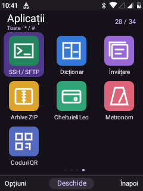
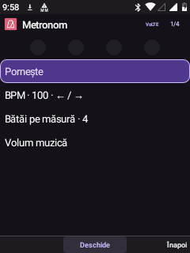
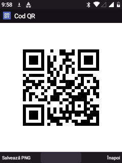

# Ten Pocket apps for Leo

These are first usable native keypad applications, not preinstalled third-party Android UIs. Stable app IDs **38–47** extend the existing catalog without changing previous IDs, saved app order or the nine-app primary page. They share Leo's Material palette, focus states, native status bar, list bookmarks and softkey conventions.

## Finding them

Choose **Full** interface mode if needed. In the app menu, `*` / `#` change categories:

| App | Category | Available now |
| --- | --- | --- |
| Leo News | Communication | RSS/Atom subscriptions, explicit refresh, bounded offline cache, plain-text article view, saved articles and original-page opening in Leo Browser |
| Leo Podcasts | Media | Audio enclosures from RSS/Atom, online playback, downloads, an episode journal, file access and verified SD promotion |
| Internet radio | Media | User-added direct MP3/AAC stream URLs, saved station list, shared media controls and an on-demand ICY current-track sample |
| SSH / SFTP | Communication | Password login, explicit SHA-256 host-key approval, changed-key refusal, a PTY shell with line entry/Ctrl+C, directory browsing and confirmed upload/download |
| Dictionary | Tools | Both RO→EN and EN→RO search, accent folding, 48 original starter pairs, manual additions, UTF-8 CSV/TSV replacement import and CSV export |
| Study | Tools | Question/answer cards, due counts, four review grades, simple scheduled repetition, stable-ID updates/deletion, CSV/TSV append import and export |
| ZIP archives | Tools | Archive listing, entry information, extraction into a new folder, single-file ZIP creation and direct opening of ordinary ZIP files from Leo Files |
| Leo expenses | Tools | Positive amounts stored as exact integer cents, separate currencies, monthly/category totals, history, confirmed deletion and CSV export |
| Metronome | Tools | 30–240 BPM, 1–8 beats/bar, first-beat accent, keypad tempo changes and user-started foreground playback through AudioTrack |
| QR codes | Tools | Text/link, Wi-Fi and vCard payloads; black-and-white screen display and explicitly confirmed PNG export |

The **All** category also contains all ten. No camera, GPS, NFC or touchscreen is required.







The QR capture contains only the example URL above. It does not contain account or Wi-Fi credentials. The metronome was stopped during the capture.

## Downloads and storage

News refresh and podcast/radio playback happen only after a user action. No subscriptions or public stations are silently added. Add the provider's RSS/Atom URL or the station's direct audio URL; a website landing page is not a stream.

Android DownloadManager was verified for internal app-external storage but **failed direct secondary-SD downloads on this port**. Podcasts therefore download to the app's primary external Podcasts folder first. If SD exports were selected, a short foreground finalizer copies to the chosen SD folder through the existing SHA-256-verifying file-transfer helper. The temporary source is removed only after the verified target and ready journal entry are committed.

If the card is unavailable/full, the primary copy remains and the episode journal offers **Retry saving to SD**. A retry does not redownload the episode. A completed SD move removes the stale DownloadManager record; the episode remains accessible in Podcasts → Downloaded episodes. Primary-storage downloads retain their DownloadManager entry. Reopening Podcasts reconciles completed or interrupted finalization jobs without starting new downloads.

Storage settings select the export location. Dictionary, cards, expenses, ZIP and QR exports use `LeoTools/<app>` under that location. Podcasts use the primary app-external Podcasts folder or `LeoTools/Podcasts` on the selected SD export volume. Existing files are not intentionally overwritten; generated output names are unique. The new app-private JSON files live under `files/pocket/`. They are **not included in the existing general Leo configuration backup**. Use the provided CSV exports for dictionary/cards/expenses; downloaded media and exported files remain separate files.

The existing player supplies long-track resume bookmarks when duration is known and at least ten minutes, per source URI. Moving between online and downloaded URIs does not merge their progress automatically. Remote cover extraction is skipped to avoid a second potentially unbounded read of a live stream.

## Deliberate bounds and current limits

- Feeds: 40 subscriptions, at most 100 items per cached feed, 2 MiB responses, bounded redirects/timeouts, HTTP/HTTPS only and DTD refusal. Saved articles: 100. Feed authentication, OPML and automatic refresh scheduling are not implemented.
- Radio: direct MP3/AAC URLs. ICY metadata is sampled on request, with at most 256 KiB before the metadata block. M3U/PLS parsing and continuous title updates are future work. Public providers' TLS chains, redirects and codecs still need to be compatible with Android 8.1.
- SSH: ECDSA/RSA-SHA-2 host keys, supported ECDH/group14-SHA256 exchanges and password authentication. Passwords are not saved; profiles contain host/user/port, and trusted public host keys are stored separately. Private-key UI, agent support and full VT/curses terminal emulation are not provided. Output is bounded to 32 KiB; directory listings to 1,000 entries; each SFTP file to 100 MiB.
- Dictionary/cards: strict UTF-8 two-column CSV/TSV, 2 MiB import limit, 4,096 characters per field, 20,000 dictionary pairs / 5,000 cards. The bundled dictionary is a **48-pair starter**, not a complete language corpus. Reviews use simple 10-minute/1-day/multiplied-day intervals capped at 365 days, not the Anki scheduling algorithm.
- ZIP: at most 2,000 entries, 32 MiB per file and 100 MiB total expansion. Absolute/traversal paths, duplicate output and overwrites are refused. Extraction verifies CRC and size; creation currently accepts one regular file.
- Expenses: at most 5,000 entries, three-letter currency labels and at most two fractional digits. Currencies are not converted. Text CSV exports quote fields and prefix formula-like values for safer spreadsheet opening.
- QR: 600 UTF-8 bytes maximum, QR versions through 15, with explicit overflow errors. Wi-Fi is WPA/open; no QR camera scanner is added. PNG exports include the entered data and require confirmation.
- Metronome: one precomputed PCM bar loops in AudioTrack; the UI timer only draws beat indicators. A foreground notification provides Stop, audio-focus loss stops playback, and it never starts at boot. Timing is sample-quantized, not a claim of calibrated musical hardware.

## Device validation · 6 November 2026

**72 on-device checks passed**, using synthetic local data and a loopback-only HTTP/SSH/SFTP server reached through temporary ADB reverse ports:

- Catalog IDs/categories and all ten new vector icons; opening the nine Activity classes plus separate podcast mode with common content/softkeys.
- Atomic Unicode storage, URL/input bounds, RSS/Atom parsing, relative/enclosure URLs, DTD refusal, bounded HTTP redirect fetch and real ICY metadata extraction.
- Independent QR decoding with **ZXing**, including Unicode; Wi-Fi escaping; metronome PCM duration/click/silence checks and invalid-tempo refusal.
- CSV/TSV imports, accent folding, starter vocabulary, isolated card persistence, interval bounds, and preserving newly added cards when grading/deleting an older one.
- Exact money/date validation, separate currency totals and formula-safe CSV text.
- Actual ZIP creation/extraction/CRC round trip, overwrite refusal and traversal rejection.
- HTTP audio preparation without starting playback; a real DownloadManager download to primary storage; a real SD podcast copy with verified completion.
- Unknown SSH key rejection, SHA-256 fingerprint, approved RSA/SHA-2 login, interactive PTY command output, SFTP listing/download/upload, no password in trust data and changed-key refusal.

An earlier direct-SD DownloadManager test failed with status 16/reason 1000 and led to the staged finalizer above. A screenshot fixture also blocked when trying to recreate the already-running single-task Home; it was removed from the final suite, and the launcher capture was collected separately through actual keypad navigation. Failed attempts are not counted as passed checks.

No user accounts, remote commands on a personal server, real news feeds, paid downloads, calls, SMS or audible media/metronome playback were used. The metronome was checked at PCM level; listening to it and scanning the physical display remain manual checks. This validation does not establish compatibility with every Internet provider or SSH server. Temporary test files, download records and reverse-port mappings are cleaned up; test host keys/passwords are synthetic and never populate the user's SSH trust store.

The candidate APK signature and DEX audit preserve all 59 original external classes. Added SSH/QR dependency packages are explicitly allowlisted; duplicate definitions remain an error. The installed app and system base are hash-verified, with system returned to read-only. The existing Leo accessibility grant was restored after package replacement; global-menu key handling, the keypad IME and notification-listener binding were checked again. Recovery, kernel and published ROM ZIPs were not rebuilt.

## Sources, licenses and rebuilding

Application sources are in `visual-shell/`, with the shared `PocketActivity`, atomic store and bounded feed/CSV/ZIP/SSH/QR helpers. Tests are in `visual-shell/tests/PocketApplicationsTests.java`; the loopback server is `app-tests/pocket_fixture_server.py` and never executes received shell commands.

Pinned third-party code and notices are under [third-party/pocket](third-party/pocket/README.md): [maintained JSch](https://github.com/mwiede/jsch) and [Project Nayuki's QR generator](https://www.nayuki.io/page/qr-code-generator-library). Their hashes are checked by `prepare-pocket-dependencies.py`; notices are also packaged in APK assets. Multi-release Java-only variants and MethodParameters debug metadata are excluded for the pinned Android compiler; cryptography and host-key checks are retained. ZXing is test-only.

The normal [rebuild guide](REBUILD.md) still applies. `build-visual-shell.sh` now compiles the extra source/dependency with **D8, min API 27**. Set `LEO_D8_JAR` to Android build-tools **28.0.3/lib/d8.jar** if that tool is absent from the AOSP checkout. This updated clean Linux recipe was not executed in this session.

`build-pocket-apps-windows.py` is the tested **incremental Windows** path: it requires the existing verified APK/class checkpoint and local JDK/SDK tools under `output/windows-build-tools`. It compiles the enumerated changed classes, rebuilds the manifest/resources, desugars the Java 8 SSH dependency, explicitly preserves baseline external classes and signs a candidate under `output/pocket-apps-build`; it never installs. Changes outside its enumerated set need the full source build or an updated enumeration.

For local tests, start the fixture server on the PC, reverse only TCP 18774 and 2267 to the Nokia, build with `build-pocket-tests-windows.py`, install its test APK and run `ro.leo.visual.pocketapptests/ro.leo.visual.PocketApplicationsTests` in Android's framework namespace. Paramiko is a host-only test dependency; the builder downloads/hash-checks ZXing for tests. Neither is a phone service.

Audit a candidate against the preceding APK with:

```text
python android81/audit-visual-apk.py BASELINE.apk CANDIDATE.apk --allow-prefix com/jcraft/jsch --allow-prefix io/nayuki/qrcodegen
```

Without those explicit allowances, the auditor continues to reject new external packages. A clean-host full-ROM rebuild and recovery installation are separate workflows.
