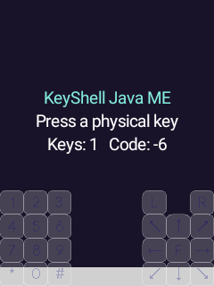
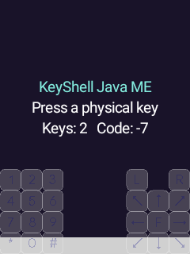

# Faster keypad wake and physical Java softkeys — 23 November 2026

This follow-up changes the native keypad observer and the interactive KeyShell
APK on the existing Android 8.1 port. It does not replace the kernel, boot image,
modem firmware or bundled firmware downloads.

## Physical keys in J2ME Loader

The Nokia layout assigns Android MENU to scan 139 and BACK to scan 158. J2ME
Loader 1.8.2 expects SOFT_LEFT/SOFT_RIGHT for the two in-game softkeys. Remapping
BACK in an emulator profile would also change the separate Back-arrow button,
which shares the Android key code but has scan 14.

KeyShell now translates only those two physical scans while the external
MIDlet player is active. The emulator library and configuration screens retain
their Android navigation. Native popup menus and the KeyShell overlay preserve
the underlying player context. Screen-off disables translation without losing
that context for wake. Synthetic input, D-pad and numeric keys pass through.

| Physical button | Android/MIDlet result |
| --- | --- |
| Left softkey, scan 139 | SOFT_LEFT → MIDP `-6` |
| Right softkey, scan 158 | SOFT_RIGHT → MIDP `-7` |
| Dedicated Back arrow, scan 14 | Original Android BACK; emulator options |
| Dedicated Menu, scan 212 | Existing global KeyShell menu |
| D-pad left/right, scans 105/106 | Existing MIDP `-3` / `-4` |

The app uses the existing UID-checked local root broker and native Binder
client on a bounded worker. It serializes Android's own KeyEvent parcel and
reads the installed input transaction identifier, rather than guessing it.
The worker expires after two seconds without keys. No new permission, polling,
network listener, background Java helper or wake lock is added. This integration
requires the port's existing root broker and enabled KeyShell accessibility
service; it is not a claim that an ordinary launcher APK can inject keys on
arbitrary Android firmware.

J2ME Loader remains the original, separately signed 1.8.2 APK. Its games,
profiles and private data are preserved. The owned KeyShell Key Demo MIDlet
provided the visible results below; compatibility of unrelated games is not
established by this fixture.

| Left softkey | Right softkey |
| --- | --- |
|  |  |

Upstream behavior was checked against the pinned [J2ME Loader 1.8.2 key mapper](https://github.com/nikita36078/J2ME-Loader/blob/1.8.2/app/src/main/java/javax/microedition/lcdui/keyboard/KeyMapper.java)
and [MIDlet activity](https://github.com/nikita36078/J2ME-Loader/blob/1.8.2/app/src/main/java/javax/microedition/shell/MicroActivity.java).

## Faster screen wake

`leo-keylight` now uses the small native Binder client to request Oreo's
`IPowerManager.wakeUp(long, String, String)` instead of starting the Java Input
program for each wake. The target handset's read-only framework probe verified
transaction 9 and the exact signature. The [pinned Oreo power interface](https://github.com/aosp-mirror/platform_frameworks_base/blob/android-8.1.0_r81/core/java/android/os/IPowerManager.aidl)
provides the matching contract. Other Android versions retain the old input
path. The explicit rollback property also retains it on this ROM:

```sh
setprop persist.leo.keylight.wake legacy
```

Set it to `native` to select the faster path again. The existing built-in input
whitelist, Power policy, keypad lock, boot-complete check and two-second request
limit remain. Once the LCD is off, the observer ends its eight-second lighting
window and blocks in `poll` immediately, avoiding the remaining timed polls.
It never grabs input, holds a wake lock or forces a suspend state.

| Screen-wake probe | Four measurements | Median |
| --- | --- | --- |
| Previous Java Input path | 1665, 1637, 1640, 1470 ms | 1638.5 ms |
| Native path | 352, 340, 331, 339 ms | 339.5 ms |

The same native test injected an OK down/up through the verified matrix keypad
and measured monotonic time until LCD-backlight brightness became positive.
USB remained connected, Home was used, and sampling resolution was about 2 ms.
This measures a screen-wake indicator, not the first fully rendered frame or
wake from verified battery-only deep suspend. A post-install repeat was 343 ms.

The native service was tested from a temporary path, then installed with a
known-good backup and an independent 90-second rollback guard. The service
was restarted and the guard acknowledged after a successful wake check;
Android was not rebooted. `/system` was returned read-only.

## Opera background work and the battery trial

Before the change, a WorkManager job from Opera Mini held the only partial
wake lock. Ten-minute timeouts were followed by new jobs for more than two
hours, including while the screen was off. The approved `RUN_IN_BACKGROUND`
restriction is now `ignore`, but Oreo does not use that app-op to block all
modern JobScheduler work: a specific timeout just caused another job.
Disabling the WorkManager component did not remain effective either.

For this trial, Opera was therefore stopped after checking its foreground
activity could still open. It remains installed with its data intact, and can
be opened normally. Reopening it may restart its jobs; this is not a permanent
per-app job scheduler or an automatic task killer. Background downloads will
not continue during the stopped trial. Revert the app-op, if desired, with:

```sh
cmd appops set com.opera.mini.native RUN_IN_BACKGROUND default
```

Before preparing the unplug trial, PowerManager reported no held partial wake
locks and zero wake-lock/display suspend blockers with the screen off. These
are USB-connected observations, not a completed autonomy result.

The command line still contains `lpm_levels.sleep_disabled=1`, but this kernel
exposes `lpm_levels_legacy`, whose live `sleep_disabled` parameter was `N`.
Its CPU C2 idle counter also advanced. The older command-line spelling alone
therefore does not prove that all sleep is disabled; CPU idle counters do not
prove full-system suspend either. No kernel sleep parameter, CPU governor,
radio policy or forced suspend command was changed.

The existing Battery page records unplug/reconnect broadcasts, boot identity,
elapsed realtime and uptime without polling, alarms or wake locks. A real
screen-off session without USB for at least 15 minutes is still required.
Elapsed time minus uptime measures system suspension, not screen-off time or
which process consumed battery. A short session cannot establish daily battery
life, and percentage-only results can be below the gauge's resolution.

## Build and installation boundaries

- KeyShell: 292 production Java sources compiled; 2,254 DEX classes, with all
  431 baseline external dependency classes retained and no duplicates.
- Existing APK signing identity and manifest retained; the running app is a
  `/data/app` update, while the bundled `/system/priv-app/LeoVisual` base stays
  at its older version.
- Native source builds via `build-keylight.sh` or the existing device module.
  This handset test also cross-compiled ARMv7 against pinned Oreo NDK startup
  objects and the handset's bionic libraries. No host glibc dependency was used.
- Read-only contract probe source: `app-tests/PowerContractProbe.java`. Its
  `main` prints the power/input Binder identifiers, signatures and KeyEvent
  parcel layout; it does not call any power or input transaction.
- Firmware/recovery archives were not regenerated. Future ROM assembly must
  include both the updated native service and the current shell APK.

## Final verification on Nokia 695d

- All 96 host checks pass; the source/manifest inventory still has 48 native
  catalog routes and 110 activities. The APK audit retains the external classes.
- All five existing keypad smoke routes pass on the final installed APK:
  Home/apps, softkey notifications, dedicated global Menu, Settings entry and
  left/right Settings tabs with the original tab preserved.
- The owned MIDlet visibly received `-6` and `-7`, retained the distinct emulator
  and global menus, and still received the correct softkey after dismissing
  either menu and after screen-off/wake. D-pad left/right retained `-3`/`-4`.
- Six EV_KEY wake probes through the verified built-in devices (digit, D-pad,
  left softkey, Back, star and pound) each restored Awake with Home resumed.
- Home, accessibility service, notification listener and IME exactly match
  their pre-install values. The installed J2ME APK digest matches the unchanged
  official APK kept locally.
- The battery trial was armed from the Battery UI. Before unplug it remained
  armed/inactive, USB powered, screen Asleep, with zero held partial wake locks
  and zero reported wake-lock/display suspend blockers. No completed unplugged
  result is claimed here.

| Artifact | Verified SHA-256 |
| --- | --- |
| Running KeyShell **data update** | `ed029610cadbd1f42ecba3965f5c1c4ac8e785bffaf1740db9300356d272eebf` |
| Updated native `/system/bin/leo-keylight` | `3cdefd74bd0781ea4b6fb1acc6ab73e9c8f2387607d266a40b7cc755d953b8b9` |
| Unchanged bundled system KeyShell | `abcb93b6ee1305ededb7e52105a2d5dc232f8c795e67420834e49564cb89f0e6` |
| Unchanged J2ME Loader 1.8.2 | `2bf30066e4c9a664af3d27fbda69b64255e5940904698ac5de4bcb82c6e0e871` |

Battery-only results remain pending until a real unplug/reconnect session
completes. The previous invalid/interrupted record was preserved while arming;
actual unplug will create the new session through the normal battery broadcast.
