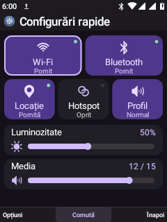

# KeyShell · quick controls · 27 November 2026

The native quick panel now has five live icon tiles: Wi-Fi, Bluetooth, location,
hotspot and sound profile. Brightness and media volume have separate sliders.
Gaia Settings font icons reuse the existing licensed asset; colors follow the
shell theme, including high contrast. On the ldpi Nokia, labels retain a readable
minimum pixel size. Large text scrolls to the selected control.

## Keypad use

From Home press Up, or choose Quick settings in the dedicated global Menu.
Arrows move between tiles. OK toggles a connection or opens the shared profile
picker. On a slider, Left/Right changes brightness by 5% or music volume by one
step; OK opens a level picker with the current value selected. Brightness uses
manual mode, with a 5% floor. Media changes STREAM_MUSIC only.

The left softkey opens Options: Wi-Fi/Bluetooth/location/hotspot details, SIMs,
all four separate audio streams and contextual help. Back returns to the prior
control. Existing catalog ID 20 and the `volumes` intent extra remain compatible.
Hotspot reuses the existing Oreo tethering path, requires WPA2 configuration and
asks before disabling Wi-Fi. State comes from Android services, not an optimistic
local toggle. Radios report off/on/busy/unavailable. Location remembers its last
nonzero mode locally; enabling it does not claim a GPS fix.

Updates use visible-page broadcasts and settings observers, coalesced for 40 ms;
there is no idle polling or continuously animated background. Observers are
removed on pause. Radio changes refresh values without replacing the panel.

## Fresh validation

Nokia 6300 4G TA-1286, serial 695d, Android 8.1/API 27:

- 90 instrumentation checks passed: real UI navigation, profile cancellation,
  both sliders, independent ring/alarm/call volumes, external-change refresh,
  legacy all-stream route, 18 palettes × 3 text sizes, accessibility ranges,
  large-text visibility and high contrast.
- Brightness and music volume were changed and restored in teardown. Radio
  toggles, location, profile application, calls and SMS were not exercised.
- Actual hardware scans verified Home Up, D-pad, OK/profile cancel, left-soft
  Options, right-soft Back and media steps. The five standard keypad smoke
  checks passed; its final automatic Home return timed out and Home was restored
  separately with the longer framework command.
- 107 host checks passed. Signed APK audit preserved all 431 baseline external
  dependency classes; catalog/manifest inventory remains 50 IDs and 139 components.
- Home, accessibility, notification listener and keypad IME were rechecked.
  Persistent WebUI was resumed after instrumentation.

Quick-controls verification APK SHA-256:
`b1ada3a9c1ab13ad37233d9bcfa4f161007c62df44fd49027486ae817701caed`.
The final combined shell APK is recorded in [Home keys / USSD](HOME-KEYS-USSD.md).
The bundled `/system` shell APK was not promoted or replaced.

[Media focus](screenshots/quick-settings-2026-11-27/media-slider.png) ·
[Large text, scrolled to media](screenshots/quick-settings-2026-11-27/large-text.png) ·
[Ocean theme](screenshots/quick-settings-2026-11-27/ocean-theme.png) ·
[High contrast](screenshots/quick-settings-2026-11-27/high-contrast.png).

Captures show real device values using controlled theme/text preferences, which
were restored afterward. No Wi-Fi SSID, credentials or private notifications
appear in these images. Source: `QuickSettingsActivity`, `QuickSettingsPanel`,
`QuickSettingsControls`, `HotspotControl`; regression runner:
`python android81/build-pocket-tests-windows.py --quick-settings`.
