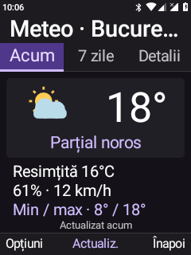
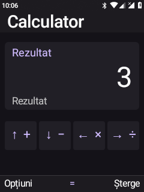
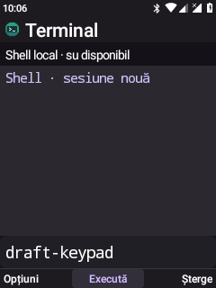
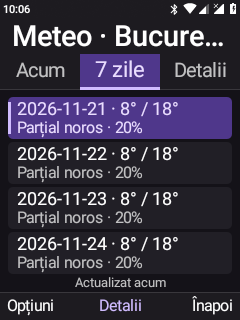
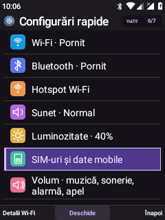
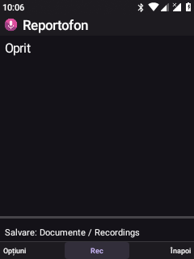

# Shell UI and operation · 21 November 2026

This batch implements the six agreed shell refinements on the Nokia 6300 4G
TA-1286, API 27. App IDs, package names, preference formats and shortcuts are
retained. It is an app update over the existing experimental system image.

## Presentation and keypad behavior

- Weather and Calculator share `CanvasChrome` for their scale-aware heading,
  softkeys and tab presentation. The forecast renderer is separate from its
  network/persistence controller. Home and Weather reuse `WeatherArt` instead
  of maintaining different weather symbols.
- `UiTypography` remembers logical text sizes with weak references. Returning
  after a font change resizes managed native controls without replacing their
  views, drafts or carets. Manual sizes in Terminal, the dialer, search and the
  text browser's zoom are registered too. Separate app processes reload the
  accessibility preferences on resume.
- Selection has a common accent border and stripe. Native fields, checkboxes
  and tabs share focused/disabled styling. Colorful app icons are retained.
- Weather and Calculator use `KeyRelease`: canceled and repeated discrete
  presses cannot activate an action. Held Calculator deletion is retained.
- Quick Settings updates only changed visible rows through `replaceRows`;
  row identities, the adapter, selection and scroll offset remain intact.
  Wi-Fi and Bluetooth distinguish enabling, disabling and unavailable states.
  Updates uses the same mechanism and separate bookmarks for its two lists.

## Work and memory

The idle and paused recorder no longer schedule its old 200 ms UI timer.
Recording state broadcasts refresh it immediately; active metering uses the
existing `ScreenTicker` only while visible and interactive. Recording itself
remains in its service. Home's clock and the UI latency sampler use the same
display-aware scheduling. Terminal keeps collecting bounded output but stops
rendering it while paused, then displays it on return.

`UiMemory` forwards Android memory pressure to weakly registered UI clients.
Styled rows and artwork caches are evicted, and obsolete artwork decodes cannot
refill the caches after a trim. Bound images are not recycled. A hidden gallery
releases its decoded photo and thumbnails, then reloads the selected image on
resume while keeping viewer mode, zoom, rotation and pan. The foreground image
remains visible under pressure. Playback and recording services are not killed.

## App installation and return

The real phone trial exposed a lost callback after KeyShell replaced its own
APK. `UpdateRecovery` reconciles the durable journal at startup and after
`MY_PACKAGE_REPLACED`, comparing the installed APK with the selected payload.
A journal written before session creation restarts the existing update service.
On replacement, KeyShell reopens only when it is already the selected Home;
it does not change the default launcher. Legacy journals are supported, including
startup completing before the replacement receiver runs.

Android still confirms each package installation. Previous APKs remain available
for rollback; application data is not rolled back. An older restored binary
without the new reconciler can require **Verify interrupted session** in Updates.

## Validation and measurements

The final APK passed 564 on-device assertions: 242 shell optimization checks,
14 isolated update-recovery checks, 72 theme checks, 48 native dialog/form
checks and 188 daily-use checks. The host suite passed all 78 checks. Full-source
Windows compilation covers 289 Java files. The DEX audit retains all 431 baseline
external classes among 2,245 candidate classes, with no duplicates or new
external dependency classes.

All five physical keypad smoke routes passed, including the dedicated global
Menu → Settings shortcut and returning through the Settings tabs. The smoke
preflight now checks the existing accessibility grant, and window detection
distinguishes an activity (type 1), its dialog (type 2) and the accessibility
overlay (type 2032), even when they share a title. Five host parser tests cover
these actual window records. A real Wi-Fi off/on cycle retained the page and
restored the original enabled state. The temporary installation-source grant
was returned to its original default mode. Appearance, accessibility, browser
and weather preference files have identical before/after SHA-256 values.

The real installation trial used Settings → Phone → Updates, the native file
picker, both Android installation confirmations, and the Previous APKs action.
Rollback restored the original `c9a98229…` APK exactly. The final installation
from that older build automatically completed its journal and returned to
KeyShell through its private Home alias. These APKs share version code 14;
this proves same-code replacement/rollback, not a numeric downgrade or a ROM
recovery flash. Android PackageInstaller's existing text/rendering artifacts
were visible during confirmation, but D-pad selection and installation worked.
Those installer artifacts were subsequently fixed in the
[PackageInstaller rendering update](PACKAGEINSTALLER-RENDERING.md), with a new
native permission/installation check and before/after screenshots.

Signed and installed data APK SHA-256:
`4058e901559b260cc6299efedcdebd54564a9832826ad3c22a0bf5a11ad32e20`.
The original known-good APK is retained locally, and the phone keeps its previous
APK pair. No system image, kernel, modem or recovery was flashed.
The unchanged bundled system APK remains
`abcb93b6ee1305ededb7e52105a2d5dc232f8c795e67420834e49564cb89f0e6`.

### Resource snapshots

Three samples, ten seconds apart, with USB attached and the keypad accessibility
service and notification listener active. PSS sums the listed shell and IME
processes; it is not whole-system memory. CPU is percent of one core.

| State | Combined PSS | Combined CPU |
| --- | ---: | ---: |
| Home | 24,168 KiB · 23.60 MiB | 0.353% |
| Idle recorder | 23,752 KiB · 23.20 MiB | 0.300% |
| Recorder, display asleep | 24,264 KiB · 23.70 MiB | 0.000% |

The recorder's own app CPU was 0.050% in the idle sample; the rest was the
unchanged IME process. Short windows include diagnostic overhead and 100 Hz
clock quantization. They do not establish a CPU or autonomy saving. Timer
removal, cache eviction and retained view state are verified separately by the
device tests.

Raw `final-ready-*.json` files are kept in ignored `output/shell-six/`.
Earlier restart-only diagnostic samples are excluded from the table because
Android force-stop revokes the accessibility grant. The original grant was
restored before the final normal-service measurements and physical key test.

At the final on-device check, the physical battery trial was still armed and
had not started: no real USB disconnect was observed. It will measure the new APK once disconnected, with
the screen off, and save on reconnection. No battery-life estimate is claimed.

Screenshots use owned fixtures; the forecast and Terminal draft are
demonstrations, not personal/live readings.

| Weather · largest text | Calculator · largest text | Terminal · largest text |
| --- | --- | --- |
|  |  |  |

| Seven-day forecast | Quick Settings | Idle recorder |
| --- | --- | --- |
|  |  |  |
