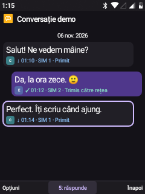
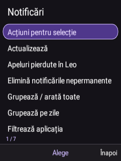

# Six refinements for everyday keypad use

The compact Leo Material interface now shares more behaviour across its screens. These changes keep the existing native Android 8.1 base, keypad controls and user Home layout.

## What changed

| Area | Current behaviour | Scope |
| --- | --- | --- |
| Status and chrome | Shared native bar colours with readable light icons. List headers can show VoLTE beside the position counter when IMS reports registration. | Signal, Wi-Fi, Bluetooth and battery still come from Android SystemUI. The new VoLTE badge is in Leo list headers, not a new global SystemUI icon. Registration is checked on resume/navigation, at most every five seconds. |
| Returning to a list | Selection and vertical offset return after opening a detail page. Contacts and SMS use contact/thread identities. | Up to 24 bookmarks per activity, held in RAM. This is not durable navigation history; process death clears it. Other lists use their row labels as identities. |
| Communications | Distinct coloured SIM chips in Phone, Material conversation bubbles, shorter contact and message action menus. | Five primary actions in each contact/conversation menu; advanced actions remain under More. Calling, sending and SIM selection rules are unchanged. |
| Notifications | OK opens the selected notification directly; soft-left opens its actions; `*` opens details, `5` requests removal, `#` opens additional controls. | Removal requires confirmation. Permanent notices cannot be removed. Remote replies and external notification actions retain confirmations. Existing grouping preferences are respected. |
| Home | Automatic mode shows at most one relevant card: unread communication counts, current media, dismissible notifications, a near alarm, or fresh weather. | Alarm horizon: 24 hours. Weather freshness: six hours. No useful item means no card. Existing manual cards remain available. |
| Feedback and text | Shared loading/retry states, contextual empty lists, bounded secondary previews and Unicode-safe truncation. | Applied through common Leo list components and the updated communications/notification pages; custom app canvases retain their own layouts. |

## Controls and preferences

Personalization → Home screen offers the Home editor, **automatic/manual card mode**, and the existing manual card order/visibility controls. Automatic mode is the default when the preference is absent; custom object positions and app order are preserved. The mode is included in Leo's configuration backup.

Contact detail: Call, SMS, Numbers, Favorite, More. Conversation options: Reply, Details, Forward, Search, More. The advanced menus retain editing, export, photo/group/history tools and message management functions.

Notification list previews are bounded to 250 code points per field; full details allow up to 4096. Home reads counts rather than notification bodies. Notification contents and list bookmarks are not persisted by these additions.

The conversation above uses Leo's preview mode. Its names, messages and times are synthetic; no SMS was sent for the capture.

## Validation · 6 November 2026

- **32 on-device checks passed** for native bar policy, real IMS registration consistency, bounded/movable bookmarks, restored ListView selection and offset, precedence of explicit navigation, Unicode boundaries, Home priority and backup support, retry/loading states, retained advanced communication actions, SIM icons and rendered number direction.
- **9 separate live-notification checks passed** from an independent test app: posting its own silent fixture, opening Leo, direct OK destination, full detail beyond the list-preview limit, additional options, removal confirmation and confirmed removal. Only the fixture notification was opened or dismissed; cleanup removed its own channel.
- Earlier test attempts exposed an asynchronous notification-posting race, selection on a parent accessibility node, and a listener disconnected by instrumentation targeting Leo. The final notification run used a separate process after reconnecting the existing listener. These were fixture/lifecycle issues; the successful counts above refer to the final runs.
- APK signing and class-coverage checks preserve all 59 baseline external dependency classes without duplicate definitions. The runtime APK and system base are hash-verified after synchronization, with the system partition returned to read-only.

The checks do not initiate calls, send SMS/email, play media, change the data SIM or alter network preferences. They are targeted UI validation, not a new certification of telephony, battery life or every application screen. Accessibility, the keypad IME and notification-listener bindings are checked after instrumentation.

## Sources and rebuilding

Common helpers: `SystemChrome.java`, `UiListMemory.java`, `UiText.java`, `HomeContext.java`, and `SimIcon.java` in `visual-shell/`. Tests: `visual-shell/tests/SixRefinementTests.java` and `framework-keypad/tests/LeoNotificationsIntegrationTests.java`.

Use the normal [source build procedure](REBUILD.md) for the app. The standalone native test bundle is built with `build-framework-keypad-tests-windows.py`; run `ro.leo.systemtests/.LeoNotificationsIntegrationTests` separately from tests targeting Leo, since those restart its managed services. Reconnect the already-authorized Leo notification listener before the live test if necessary.

Recovery images and published ROM ZIPs were not rebuilt by this UI update.

